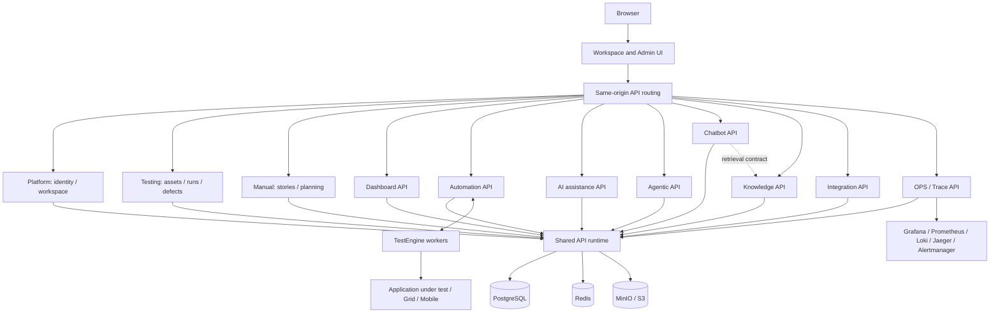
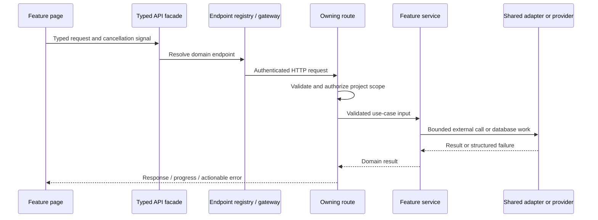
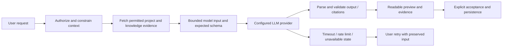
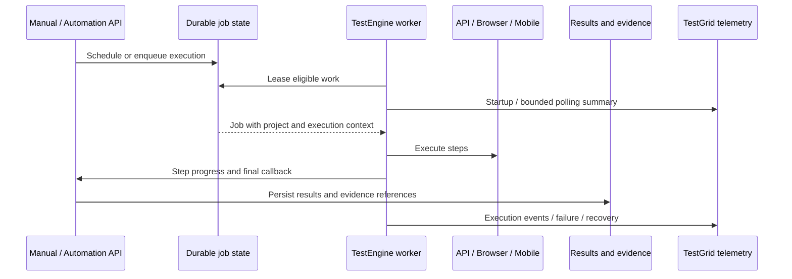

# Contributing to HelloTest

The [capability architecture decision](docs/architecture/capability-packaging.md) explains customer-selectable packaging and the remaining isolation work. This guide describes the code that exists today, where to make a change, and how to verify it. Start with the ownership table before adding files. Feature implementations belong beside their service; reusable UI and the application runtime have explicit shared homes.

## 1. Architecture and current limits

See [capability packaging](docs/architecture/capability-packaging.md) for the implemented release model and remaining limits. The [earlier structure review](docs/architecture/current-structure-review.md) records historical findings, not current counts.

HelloTest has three planes:

1. **Product:** a React workspace and administration portal, backed by Fastify API profiles.
2. **Execution:** TestEngine API, browser, and Android workers, with Selenium/mobile support.
3. **Operations:** metrics, logs, tracing, dashboards, and alerting, exposed through OPS telemetry.

The product has **eleven full-stack npm workspace packages** with selectable API profiles and independently loaded UI releases. Compatible capability UI/API updates can ship without rebuilding the shell. Packages still share runtime adapters, database schemas, authentication and some implementation contracts; this is not complete data or dependency isolation. Existing single-process deployment remains supported.



The `all` API profile supports the existing single-API deployment. Named profiles select routes and background tasks. The frontend endpoint registry supports either topology. Nginx resolves profile upstreams at request time, so a missing optional API need not prevent the UI server from starting. A page that depends on that API must still show an accurate unavailable state. Shared database outages and cross-domain dependencies are not isolated by a route profile.

Authoritative architecture files:

- [Dashboard package and export contract](services/dashboard/package.json) (the same conventions apply to every capability)
- [Generated product capability metadata](services/capabilities.json)
- [Deployment and ownership catalog](services/catalog.json)
- [API route manifest aggregator](services/platform/backend/src/routes/manifest.js)
- [API profile selection](services/platform/backend/src/runtime/serviceProfile.js)
- [Frontend endpoint registry](services/platform/frontend/src/services/index.ts)
- [Frontend endpoint resolution](services/platform/frontend/src/platform/lib/serviceEndpoints.ts)
- [OpenAPI contract](openapi.yaml)
- [Architecture validation](scripts/checks/validate-service-architecture.mjs)

## 2. Repository map

```text
QAIra/
├── CONTRIBUTING.md, README.md      Contribution guide and quick start
├── package.json, package-lock.json Workspace commands and capability links
├── services/
│   ├── catalog.json                Deployment inventory and source ownership
│   ├── capabilities.json           Generated product dependencies and feature owners
│   ├── platform/                   Shared foundation and Platform capability
│   │   ├── package.json            Public npm exports and capability metadata
│   │   ├── frontend/
│   │   │   ├── src/                Workspace shell, routing, auth and shared UI
│   │   │   │   ├── platform/       Navigation, access hooks, remote UI host and loader
│   │   │   │   ├── shared/         Reusable controls, dialogs and pure helpers
│   │   │   │   ├── lib/            Shared HTTP transport and API compatibility facade
│   │   │   │   └── auth/, context/ Shared session and localization providers
│   │   │   ├── pages/, admin/      Platform workspace screens and Administration
│   │   │   ├── test/              Shared UI contracts, browser checks and fixtures
│   │   │   ├── package.json        Shell dependencies and Vite commands
│   │   │   └── Dockerfile, vite*   Workspace/admin builds and web server configuration
│   │   ├── backend/
│   │   │   ├── src/                Process kernel: auth, database, HTTP and workers
│   │   │   ├── routes/, services/  Platform handlers, use cases and instance setup
│   │   │   ├── public/             Project/application access contracts
│   │   │   ├── instance-setup-data/ Versioned JSON sample records and manifest
│   │   │   │   └── schema-setup/   Bootstrap SQL, excluded from sample installation
│   │   │   ├── test/, eval/        Shared API contracts and offline evaluations
│   │   │   └── Dockerfile, package.json API image and runtime dependencies
│   │   └── test/                   Platform capability tests
│   └── <capability>/               testing, manual, dashboard, automation, ai,
│       │                           agentic, chatbot, knowledge, integration, trace
│       ├── package.json            npm exports, dependencies and release commands
│       ├── frontend/               entry.ts, pages, components, hooks and API client
│       ├── backend/                server.cjs, manifest, routes, use cases and workers
│       ├── test/                   backend/, frontend/ and browser/ owner tests
│       └── dist/ui/                Generated release manifest/assets (ignored)
├── testengine/                     Execution-plane runtime and deployment
│   └── backend/                    src/, test/, scripts/ and worker dependencies
├── local-run/                      Local stack, engine gateway and mobile worker
├── ops/                            Monitoring configuration and provisioning
├── scripts/                        Build, deployment, data and validation commands
├── docs/                           Architecture, product, operations and research
├── docker-compose*.yml             Supported deployment entry points
├── hellotest.sh                     Primary stack lifecycle command
└── openapi.yaml, redocly.yaml       Public API documentation and tooling
```

There are no root `frontend/` or `backend/` source trees or compatibility symlinks. Shared runtime and shell code belong to Platform; feature code and tests belong to their capability. The nested Platform frontend/backend manifests pin their browser and server dependencies separately; the outer Platform manifest is the capability package contract. This keeps browser-only dependencies out of API runtime installs.

Do not group files merely by extension. A Grafana provisioning YAML belongs under `ops`; a Kubernetes worker manifest belongs with TestEngine. Root Compose files and executable entry points remain at stable operator-facing paths. Product and research documents belong under `docs`, while package `README.md` files remain close to their packages.

## 3. Find the owner of a feature

| Area | Frontend implementation | Backend implementation | Responsibilities |
| --- | --- | --- | --- |
| Testing foundation | [testing](services/testing/frontend) | [testing](services/testing/backend) | Cases, suites, shared steps, runs, results, defects, schedules, environments and test data |
| Manual | [manual](services/manual/frontend) | [manual](services/manual/backend) | Stories, product planning and work-item relationships |
| Dashboard | [dashboard](services/dashboard/frontend) | [dashboard](services/dashboard/backend) | Analytics, Release Readiness and Custom Dashboard in one release |
| Automation | [automation](services/automation/frontend) | [automation](services/automation/backend) | Automation authoring, recorder controls, TestEngine dispatch/callbacks and local agent integration |
| AI features | [ai](services/ai/frontend) | [ai](services/ai/backend) | Story/case/defect assistance, assurance, impact review and context |
| Chatbot | [chatbot](services/chatbot/frontend) | [chatbot](services/chatbot/backend) | Ask AI, intent/retrieval, answer rendering, citations and progress |
| Knowledge Repo | [knowledge](services/knowledge/frontend) | [knowledge](services/knowledge/backend) | Knowledge sources, ingestion, authorization, retrieval, grounding and vector storage |
| Agentic | [agentic](services/agentic/frontend) | [agentic](services/agentic/backend) | Agent directory, workflows, repository inspection and Python/runtime assets |
| Integration | [integration](services/integration/frontend) | [integration](services/integration/backend) | Provider configuration/default-model selection, prompt templates, Jira/Rovo UI and project sync |
| OPS / trace | [trace](services/trace/frontend) | [trace](services/trace/backend) | Telemetry, health, metrics/log proxies and embedded Grafana/Jaeger/Alertmanager consoles |
| Workspace platform | [platform](services/platform/frontend) | [platform](services/platform/backend) | Auth, people, projects, settings, notifications, access policy and instance setup |
| Composition and adapters | [shell](services/platform/frontend/src/platform) | [API runtime](services/platform/backend/src) | Process lifecycle, routing, shared HTTP, persistence and SDK adapters |
| Reusable UI | [shared](services/platform/frontend/src/shared) | — | Tables, dialogs, controls, formatting, pagination and parameter primitives |
| TestGrid / execution | OPS and Automation UI | [TestEngine](testengine/backend/src) | Leasing jobs, API/web/mobile execution, results, evidence and worker telemetry |

Administration lives in `services/platform/frontend/admin/`, beside the Platform backend administration and setup use cases. `services/platform/frontend/admin.html`, Vite configuration and the runtime web server remain composition entry points; the public `/admin` URL is unchanged.

**Trace a request through its owner.** Start with `services/<owner>/frontend/api.client.ts`, its endpoint matcher (`services/<owner>/frontend/index.ts`), its route manifest and route handler, then the use case. The old `services/platform/frontend/src/lib/api.ts` API shape remains a small compatibility facade. Durable task declarations live in the owner's `backend/workers.js`; the runtime scheduler supplies overlap protection, error reporting and shutdown. Knowledge owns ingestion/search/retrieval; Chatbot owns conversations/planning/synthesis. Integration owns reusable prompt templates. Some authoring handlers still invoke AI use cases directly, and some services still query common tables; these remain explicit migration boundaries.

### Frontend conventions

```text
services/<owner>/frontend/
  index.ts          Endpoint-matching definition (not an eager UI export barrel)
  api.client.ts     Named HTTP client; public entry point for declared consumers
  pages/            Route-level composition and workspace screens
  components/       Feature UI, with its CSS beside it
  hooks/            React lifecycle and query orchestration for this feature
  lib/              Pure transformations and feature contracts
```

Create a layer only when it contains code. Knowledge has a nested feature folder because source-management screens are distinct from conversational UI. Prefer direct imports of the implementation you need; avoid a barrel that eagerly loads every page or creates import cycles.

Keep a shared component generic. It must not import a specific feature's components or policy. A component that knows about AI criteria belongs to AI; a component that formats a metric label can be shared. Platform composition may connect feature UI to authentication, navigation and workspace settings.

Prefer the owning `api.client.ts` for focused frontend work. The shared API facade remains for existing cross-feature composition screens; it eagerly composes all clients, so importing it from a small helper creates unnecessary dependencies. The root `types.ts` remains an existing integration boundary. Do not move a contract into a private feature folder if many services still consume it. Avoid adding unrelated feature logic to these large shared files; future extraction should preserve their public contract and have an explicit migration plan.

### Backend conventions

```text
services/<owner>/backend/
  service.manifest.js       Declares each route file exactly once
  routes/example.routes.js Validates transport, authorizes, maps responses
  services/example.service.js
                           Coordinates a business use case
```

The process kernel under `services/platform/backend/src` owns database access, authentication, shared storage/email/probe adapters, runtime policy and sample-data installation. Domain implementations import these shared capabilities. Existing cross-feature calls remain visible as explicit imports; do not silently duplicate an implementation to avoid a dependency.

The Docker image preserves `services/platform/backend/src` and `services/<owner>/backend`, matching the checkout. It installs shared API dependencies at `/app/services/platform/backend/node_modules`, workspace links at `/app/node_modules`, and starts from `/app/services/platform/backend`. The selected UI artifacts are served from `/app/capability-ui/<owner>`; the image still retains capability backend implementations needed by existing imports. Both app images build from repository-root context. If you change source placement, verify this layout in the built image, not only on your host.

## 4. Request, AI and execution flows





An LLM response is untrusted input. Preserve evidence IDs, validate output before displaying or saving it, reject fabricated citations, and distinguish unavailable AI refinement from deterministic scores. Keep provider credentials server-side. Bound retrieval size, deadlines, retries and response size. Do not turn a timeout into a fabricated successful answer.



Execution telemetry and container logs serve different purposes. Project events stay project-scoped. Shared worker polling summaries are administrator-only. Distributed traces are part of OPS telemetry; the legacy `/traces` URL redirects there. Clear-project-events operations must never clear other projects or worker history.

## 5. Prerequisites and first setup

Use Node.js **22 LTS** for contribution work. The runtime package minimum is Node 20, but frontend tests import TypeScript directly using Node's native support; Node 22.18+ avoids needing a separate test transpilation loader. Use a compatible npm version and Docker with Compose v2. Browser tests need Chrome or a Playwright browser matching the test configuration. Python is needed for applicable agent and packaging work, not for ordinary UI editing.

```bash
# Run from the repository root.
npm run setup
npm run audit:source-layout
npm run audit:modules
npm run validate:architecture
```

`setup` runs `npm ci` for API, frontend and TestEngine, using their package locks. The mobile worker currently uses `npm install --ignore-scripts`; it has a separate lifecycle. The root is an npm workspace for `services/*` with a committed lockfile. Shared runtime packages retain their own locks. `setup:capabilities` installs workspace links. Use `--workspace @hellotest/<owner>` for capability commands and `--prefix` for a shared runtime or TestEngine.

Keep credentials in ignored local environment files. Never add `.env`, `.hellotest/*.env`, database dumps, provider keys or generated browser evidence to a PR. Use documented example files and the stack launcher; do not copy another person's local environment into source control.

### Run the local stack

```bash
./hellotest.sh up --build --stack local
```

Default local endpoints:

| Surface | URL |
| --- | --- |
| Workspace | `http://localhost:8080` |
| Administration | `http://localhost:8081` or API `/admin` |
| API | `http://localhost:3000` |
| Frontend Vite development server | `http://localhost:5173` |

Check the launcher and your local environment for port overrides. A successful container start is not proof of provider connectivity, authenticated access, job completion or LLM quality. Verify the relevant feature flow.

### Work on the frontend

```bash
npm --prefix services/platform/frontend run dev
# In a separate terminal when changing the administration application:
npm --prefix services/platform/frontend run dev:admin
```

The Vite proxy forwards `/api` to `http://localhost:3000` by default. `VITE_DEV_API_PROXY_TARGET` can target another development API. Runtime endpoint maps belong in the existing service-endpoint configuration; do not put a provider or container hostname in a page.

### Work on an API profile

```bash
# Uses the profile Compose stack and its declared dependencies.
npm run services:up -- --capabilities manual,chatbot --build
```

For a host process, configure its database and required local environment first, then run `npm --prefix services/platform/backend start`. `HELLOTEST_SERVICE_PROFILE=chatbot` selects Chatbot; `all` selects the complete API. Unknown profile names fail startup. Routes and recurring jobs must respect the selected profile.

### Work on TestEngine

```bash
npm --prefix testengine/backend run dev
npm --prefix testengine/backend test
```

Configure the engine's API URL, shared secret, artifact location and worker class using its documented environment. For the complete execution plane, use [TestEngine's setup guide](testengine/README.md). Do not start a second worker against a shared queue unintentionally. Never recreate an active worker without considering its drain behavior and active jobs.

## 6. How to implement a change

### A feature or UI change

1. Find its frontend owner in the table above and its existing route/page entry.
2. Keep page composition, feature components, hooks and pure helpers separate.
3. Reuse shared controls and established CSS variables. Include loading, empty, error and unavailable states.
4. Scope query keys and requests to the active project/application where applicable. Preserve cancellation and avoid fetching feature data before that feature opens.
5. Update the typed API contract and backend owner when behavior changes across the boundary.
6. Test observable behavior, including permission denial or upstream failure when relevant.

### A new or changed API route

1. Put the handler under `services/<owner>/backend/routes`.
2. Declare a new route file once in that profile's `service.manifest.js`.
3. Use existing schema validation, authentication and project authorization patterns. Never trust a client-supplied project ID as proof of access.
4. Put the use case in the owner's `services` directory. Keep routes thin.
5. Add or update permission registration and the OpenAPI contract.
6. Update frontend endpoint matching only if route ownership changes.
7. Run source ownership, API tests, architecture and deployment checks.

Do not move a transport route to the AI profile simply because it calls an LLM. Persisted story state belongs to Manual; shared test assets and schedules belong to Testing. Route ownership changes require coordinated gateway, permission, worker and client changes.

### Shared code and SOLID

- **Single responsibility:** separate transport validation, use-case orchestration, provider I/O and presentation. Split a large function when it represents distinct responsibilities, not just to reduce its line count.
- **Open/closed:** extend registries and adapters for new providers or runners rather than growing unrelated switches across pages and services.
- **Substitution:** keep provider/runner result shapes, cancellation and failure behavior compatible with the contract they implement.
- **Interface segregation:** pass the capabilities a use case needs; avoid a universal client interface or UI component with unrelated responsibilities.
- **Dependency inversion:** keep provider calls and storage details behind the existing adapter boundaries. Prefer explicit collaborators for new code that needs isolation in tests.

These are review rules, not a claim that every legacy module is already decomposed. Large feature screens, shared transport types, direct inter-service imports and the common schema remain known coupling points. Improve them with focused, behavior-preserving changes and evidence.

### Schema, setup data and migrations

Treat SQL schema and bootstrap changes as deployment changes. Keep rolling-version compatibility in mind: an independently restarted profile may encounter a schema written by another version.

Versioned sample data lives under `services/platform/backend/instance-setup-data`, with dependencies and SHA-256 checksums in its manifest. If you edit a record file, update its manifest checksum. Keep referenced IDs, memberships, project scope, planning relationships and evidence traceability coherent.

The feature reference JSON, portable docs export, stored artifact, and knowledge chunks represent the same authored content. Update them together when source paths or content change. If text changes length, regenerate knowledge offsets and relevant hashes rather than copying old offsets.

```bash
node scripts/data/export-product-blueprint.cjs
node --test services/platform/test/backend/hellotestBlueprint.test.js
node --test services/platform/test/backend/instanceSetupRepository.test.js
```

The exporter copies the canonical reference documents into `docs/product`; it does not recalculate all persisted setup records or their checksums.

## 7. Verification matrix

Run checks appropriate to the change first, then the repository gates before proposing a broad refactor.

| Check | Command | What it establishes |
| --- | --- | --- |
| API tests | `npm run test:backend` | Unit, authorization and contract behavior; some tests intentionally skip without external prerequisites |
| Frontend tests | `npm run test:frontend` | Pure behavior and source/UI contracts |
| TestEngine tests | `npm run test:testengine` | TypeScript build, execution behavior, telemetry and lifecycle contracts |
| Capability UI builds | `npm run build:capabilities` | Each owner's manifest and separately loaded UI assets |
| Frontend builds | `npm run build:frontend` | Workspace and admin TypeScript/Vite compilation |
| Engine build | `npm run build:testengine` | Worker compilation |
| Whole-repo layout | `npm run audit:source-layout` | Duplicate review, Markdown links, ownership, generated-file policy |
| Module graph | `npm run audit:modules` | Import resolution, shared-feature boundaries and production orphan/CSS enforcement |
| Clone review | `npm run audit:clones` | Advisory repeated-function report |
| Analysis tests | `npm run test:architecture` | Source import and graph traversal regression tests |
| Preview types | `npm --prefix services/platform/frontend run check:previews` | Type-check offline UI fixtures without adding them to production builds |
| Architecture | `npm run validate:architecture` | Catalog, profile and deployment-source consistency |
| Deployment contracts | `sh scripts/checks/validate-deployment-contracts.sh` | Compose and deployment configuration contracts |
| Gateway | `npm run test:service-gateway` | Isolated proxy forwarding, streaming and unavailable-upstream behavior |
| Live monitoring | `npm run ops:verify` | Connectivity and data flow in an already running OPS stack |

```bash
npm test
npm run build
```

`npm test` runs the package suites and architecture/layout gates. These are not substitutes for an authenticated end-to-end flow, a real LLM response, or a live execution against your application.

### Focused tests

```bash
node --test services/platform/backend/test/opsTelemetrySnapshot.test.js
node --test services/platform/frontend/test/aiRequestContext.test.mjs
npm --prefix testengine/backend run build
node --test testengine/backend/test/opsTelemetry.test.mjs
```

Check the actual file name before selecting a test. Single-owner tests live under `services/<owner>/test/backend` or `test/frontend`, with browser checks under `test/browser`. Shared and multi-owner tests remain under `services/platform/backend/test` and `services/platform/frontend/test`; common helpers stay there too. Root test runners discover the central tests plus each owner's direct unit-test directory. Browser and external-database checks remain opt-in. Use `npm test --workspace @hellotest/<owner>` for focused owner tests and central contracts that name that owner.

### Browser and integration tests

Browser tests are opt-in and use the repository's Playwright installation from TestEngine. Read [browser test instructions](services/platform/frontend/test/browser/README.md), start the expected Vite server, and select the relevant tests. Common fixture tests accept `VITE_TEST_URL` and `CHROME_EXECUTABLE`; inspect the test before assuming a default. Fixtures must remove temporary files and close browsers even when an assertion fails.

PostgreSQL integration tests have explicit environment and data-isolation requirements. Read their source/setup instructions and use a disposable test database. Never point destructive test setup at a shared development or production database.

### After moving files

1. Rewrite static and dynamic imports, CSS imports, lazy routes, source-inspection tests, scripts and documentation links.
2. Check source paths in setup/reference records and update affected checksums and offsets.
3. Verify the Docker image retains the same relative runtime layout.
4. Run module resolution, ownership audits, builds and affected behavioral tests.
5. Inspect generated bundles and ignored files; do not commit `dist`, `node_modules` or test artifacts.

The test source lookup helpers require an unambiguous module identity. They are not production aliases. Do not add compatibility copies of implementations merely to make a test's old path continue to work.

## 8. Orphans, naming and repository hygiene

A file with no static importer is a **candidate**, not automatically dead code. Entrypoints can be selected by HTML, route manifests, runtime loading, packaging scripts, tests or external callers. The module audit reports dynamic sites and candidates so a reviewer can examine those contracts.

Before deleting a candidate:

- Search its filename and exported symbols across source, scripts, configuration, tests and documentation.
- Check route/profile registration, HTML entries, asset URLs and packaging inputs.
- Decide whether it is production code, a reusable test fixture, an offline tool or obsolete code.
- Remove obsolete code together with its unused assets. Relocate useful previews to test fixtures.
- Record material removal decisions in the layout audit report and rerun checks.

Avoid generic feature filenames such as `helpers.ts`, `data.js` or `common.ts`. Use responsibility names, for example `executionParameterContext.ts` or `knowledgeGrounding.service.js`. Conventional composition roots such as `index.ts`, `server.js` and `service.manifest.js` are intentional exceptions.

Never commit dependencies, build output, databases, run evidence, screenshots from ad hoc testing, logs, PIDs, or local secret files. Curated research screenshots belong under `docs/research` with a referencing document. `.gitignore` prevents future additions; the architecture checks also detect already tracked generated files.

### Refactor and orphan checks

Use `npm run audit:clones` to identify repeated function bodies for review, alongside the whole-file and module audits. Consolidate shared behavior inside the capability that owns its contract; inject external storage/network collaborators instead of introducing cross-capability imports into pure policies. Callback text alone is not enough evidence of interchangeable behavior.

Keep preview-only components under `services/platform/frontend/test/fixtures/previews` and run `npm --prefix services/platform/frontend run check:previews` when changing them. Production files referenced only by tests are orphan candidates, not implicit supported features. `npm run audit:modules` fails for those files and for disconnected CSS. Source-analysis regression tests run through `npm run test:architecture` and the root test command.

## 9. Resource use, failures and security

Keep reads bounded and page large collections. Avoid holding entire execution histories, attachment bodies or knowledge corpora in memory. Prefer existing streaming and bounded-response helpers. Use explicit timeouts and cancellation, and avoid stacking client retries on top of several server/provider retry layers.

Do not make optional LLM, knowledge, monitoring or execution providers a prerequisite for unrelated application startup. Preserve readiness versus liveness semantics. A dependency failure must be visible in its feature and logs, while unrelated reachable features continue working where their dependencies permit.

Do not expose provider credentials or shared infrastructure data in browser payloads. Preserve tenant/project authorization before retrieval, exports, attachments, callbacks and AI context assembly. Logs and citations need redaction and scope checks. Keep read-only embedded consoles behind the existing authenticated gateway.

## 10. Documentation and pull requests

Update the nearest implementation documentation when a public contract, deployment command, ownership boundary or setup behavior changes. Detailed product/architecture/operations documents belong in `docs`; update this guide when contributor entry points change.

A reviewable PR should explain:

1. The concrete problem and resulting behavior.
2. Which service owns the change and whether another service's contract changes.
3. Relevant validation, including exact failing/remaining checks where applicable.
4. Migration, compatibility and deployment requirements.
5. Any limitations that tests or local infrastructure could not verify.

Keep behavior changes separate from mechanical moves when practical. Do not include generated files, unrelated formatting, local credentials or one-off migration scripts. Do not claim complete service isolation on the strength of a folder move. Review the resulting dependency direction and failure behavior.

Useful deeper references: [backend architecture](docs/architecture/backend.md), [service deployment guide](services/README.md), [execution architecture](testengine/ARCHITECTURE.md), [OPS runbook](docs/ops-operations.md), [debugging guide](docs/DEBUGGING.md), and [source-layout audit](docs/source-layout-audit.md).

## 11. Select customer capabilities and debug boundaries

```sh
# Inspect the exact process selection without starting anything.
npm run services:up -- --capabilities automation --print
# Run the customer selection and required foundations.
npm run services:up -- --capabilities automation --build
npm run services:up -- --capabilities knowledge --build
npm run services:up -- --capabilities manual,ai,chatbot --build
```

`services/capabilities.json` defines the dependency closure. Platform is always included. Automation includes Testing and Integration; Knowledge includes Platform and Integration, without Chatbot. Agentic currently includes Automation and Knowledge because its shipped tools use them. AI currently includes Manual and Knowledge. These are tested current requirements, not claims that every integration is optional.

`HELLOTEST_ENABLED_CAPABILITIES` is the deployment ceiling; `HELLOTEST_SERVICE_PROFILE` selects which owner's routes/workers one process registers. The default selection and profile are `all`, preserving the existing deployment. Unknown names fail before startup. The deployment ceiling also masks the server's feature snapshot and permission checks: an administrator cannot enable an absent capability through a saved workspace flag. Ask HelloTest has a separate `hellotest.ai.chatbot` flag from Knowledge. All profile processes must receive the same selection.

The command adds only the selected APIs, frontend, required infrastructure, and TestEngine/Tika where applicable. It does not stop existing containers from an older selection or delete their data. Use a separate Compose project per customer and plan removal of previously deployed services explicitly. The single-API topology remains the lower-overhead option when independent process scaling is unnecessary. Per-profile development defaults cap memory at 512 MiB, CPU at 1, main DB connections at 4, observability connections at 2, and JSON logs at three 10 MiB files; these are ceilings, not measured workload sizing guarantees.

For a missing response:

1. Locate the endpoint in `services/<owner>/frontend/api.client.ts` and confirm its runtime `SERVICE_URLS` entry.
2. Check the capability selection, returned feature flags, project grants and API-key scope.
3. Check the owner's `/health/ready`, gateway response and request/trace ID.
4. Follow the route handler to the use case; for queued work, inspect that owner's `backend/workers.js` and durable job status.
5. Reproduce with the existing unit/route test harness. Use `services/platform/frontend/test/serviceEndpoints.test.mjs` to catch client/backend ownership drift and `services/platform/test/backend/capabilityComposition.test.js` for deployment availability.

Do not solve a missing capability by silently routing its requests to Manual. `/api` falls back to Platform in the separate-profile gateway; configured feature calls use `/services/<owner>`. The default single-API gateway still sends `/api` to the complete API.

See the [deployment and script inventory](docs/architecture/deployment-script-review.md) for each shell/YAML owner, retained deployment variants, and schema-to-instance-setup startup behavior.

## Enforced dependency boundaries

Run `npm run check:boundaries` when changing imports or extracting a workflow. It is included in `npm test`. Cross-owner imports must use `@hellotest/<owner>/<export>`, declare that package in `dependencies` and target an explicit `exports` entry. Private relative imports and backend-to-frontend imports fail. There is no per-file exception registry. The separate module and backend architecture checks cover reachability, shared UI direction and backend module/layer cycles. These checks do not enforce table ownership or file-size limits.

See [implementation boundaries](docs/architecture/implementation-boundaries.md) for the repository contract, suite-context extraction, startup ownership, UI extraction and contribution examples.


### Service contracts and migration startup

Project/application reads from another capability use Platform's `backend/public/projectAccess.js` and `applicationAccess.js`. Every profile calls the existing local implementation, preserving project membership checks and catalog redaction. This foundation is already shared by authentication and the current database model; no extra service token or Platform HTTP hop is needed. Keep cross-feature mutation workflows with their owning capability.

`npm run services:up` resolves the capability selection and runs the one-shot `schema-migrate` job before verification-only API profiles start. Direct deployments run `npm --prefix services/platform/backend run migrate` once, then use `HELLOTEST_SCHEMA_MODE=verify`. A missing schema receipt fails readiness with a migration instruction. Single-process startup retains its compatible default migration behavior.

Capability names, product prerequisites and feature ownership are maintained in `services/<owner>/package.json#hellotest`; run `npm run generate:capabilities` to refresh `services/capabilities.json`, which profile validation and route loading consume. Keep the deployment/source metadata in `services/catalog.json` consistent; tests check that alignment. See [implementation boundaries](docs/architecture/implementation-boundaries.md#foundation-ownership) for the request diagram, schema lifecycle, bridge removal and shared-dependency limits.


### Keep refactoring simple

Use the existing capability folders, HTTP clients, shared utilities and deployment modes. Extract a pure policy when it is truly shared; keep business orchestration with its owner. New wrappers, registries, packages, queues or network calls need a concrete requirement and an observable benefit. Existing product relationships are valid dependencies; deleting their imports by duplicating logic is not decoupling. See [the simplification decision](docs/architecture/implementation-boundaries.md#dependency-inversion-within-workflows) for the current examples and limits.


## 12. Develop and release one capability

```sh
npm run setup
npm run dev --workspace @hellotest/dashboard
# Separate terminal; supply your local database/session environment:
npm run dev:api --workspace @hellotest/dashboard
npm test --workspace @hellotest/dashboard
npm run build --workspace @hellotest/dashboard
```

`dev` uses the shared Vite shell so layout, session, routing and shared providers match the application. The package backend entry selects only its API profile. Required foundation processes/data still need to be available; the service selector can start the dependency closure.

The three Dashboard views belong to one `@hellotest/dashboard` package and one `OverviewPage` release entry. Testing owns defects as well as shared cases and runs. Cross-feature AI buttons stay in their original host pages, but mount their owning capability's dialog through `capabilityView` after access checks. Chatbot supplies the global overlay through its own release entry. Shell orchestration that combines several owners, such as TestOps, remains in the shell.

```mermaid
sequenceDiagram
  participant User
  participant Shell
  participant Capability as Capability UI/API
  User->>Shell: Select enabled, permitted action
  Shell->>Shell: Keep host state; show loading
  Shell->>Capability: GET manifest (same-origin gateway)
  Capability-->>Shell: Owner, protocol, version, hashed assets
  Shell->>Shell: Validate and load with shared providers
  Shell->>Capability: Authenticated project-scoped request
  Capability-->>User: Screen or panel result
  Note over Shell,Capability: Load failure shows retry within the affected feature
```

For independent deployment, build from the repo root:

```sh
docker build -f services/platform/backend/Dockerfile --build-arg HELLOTEST_CAPABILITY=dashboard -t hellotest-dashboard:local .
```

The separate-profile Compose file configures `HELLOTEST_CAPABILITY_UI_URLS` automatically. The shell loads the selected release through `/services/dashboard/capability-ui/dashboard/manifest.json`; data requests use the existing service URL map. Without a UI mapping, combined/dev mode retains local lazy loading. UI release failures do not fall back silently to another version.

Protocol 1 shares React, router, query cache, authentication, localization, HTTP transport, dialog focus and loading-overlay state with the shell. Preserve exported view names/props and API compatibility when releasing a capability. New menus or host extension points require a shell update. Retain old hashed assets during rolling releases so open clients can finish their existing release; automatic retention/version routing is not yet implemented. Coordinate schema changes with the shared migration job.

Packages remain private monorepo workspaces. They are not yet standalone installable tarballs: runtime adapters and some exported implementation dependencies remain shared. Source ownership, separate UI assets and selected processes make releases possible; they do not remove those dependencies.

### Flags, permissions and menu behavior

An action appears only when its capability is deployed, its feature dependencies are enabled and the user has the necessary project/workspace permission. Empty navigation groups disappear. Restricted and disabled destinations are omitted from navigation search. A temporarily unavailable service keeps its permitted entry and shows a retryable error when opened.

Use `useCapabilityAccess`/`hasCapability` for feature-aware grants, and do not replace them with role-name comparisons. Keep denied or disabled routes protected even when opened directly. The backend must still validate feature availability, session/API-key scope and project permissions for every protected operation. Enabling a feature never grants permission. Dashboard editing requires manage permission separately from viewing. Permission-denied actions are not rendered; loading, selection and record-state constraints still disable permitted actions. A split menu evaluates each option independently and promotes an allowed option when its usual primary action is denied. Read-only fields remain visible when the user can view their record.

The release browser check is `services/dashboard/test/browser/capabilityRelease.test.mjs`. Build Dashboard first, start Vite, then run it with `VITE_TEST_URL` and `CHROME_EXECUTABLE`. It loads built assets, exercises all three views, retries a failed manifest, retains host draft state and checks feature disable/re-enable behavior.
