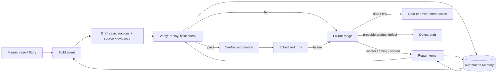

# Automation AI agents: capability, design and implementation review

Review date: 28 November 2026. Reviewer stance: product architect. Scope:

1. **Automation Build Agent** in test automation (the Case Build tab).
2. **AI Automation Repair** in test automation (the case Runs tab, feature `F18`).
3. **Automation Build Agent** as a workflow node (`artifactTask: automation-engineer`).

**Method and limits.** Static review of the checkout at `main`. Nothing was run
against a browser, TestEngine or model provider. Claims marked **(verified)**
were read in the cited file; **(inferred)** follows from the code but was not
exercised. `docs/architecture/automation-workflow.md` had uncommitted edits
(about 69 added lines) when reviewed, so this review reads the working-tree
version. Earlier reviews
([automation product review](automation-product-architecture-review-2026-11-16.md),
[AI and agentic review](automation-ai-agentic-review-2026-11-16.md),
[agent research](../research/automation-engineer-agent.md)) are the baseline;
their closed findings are not repeated.

---

## 1. Verdict

The three agents are **safe and well-engineered, but they are three separate
products that do not form a loop**, and the repair agent is gated so tightly
that it will rarely be used.

| Agent | Verdict in one line |
|---|---|
| Build (Case Build) | Strong generator with real browser grounding, closed program contract, progressive saves and a scorecard. Weak on page types it deliberately rejects (tabs, dialogs), on reuse across cases, and on default verification. |
| Repair | Very rigorous proof model (pinned evidence, three runner checks), but it can only rebind one locator or one API URL, cannot see the page where the failure happened, and demands a negative fixture the user must design. Likely adoption near zero outside demos. |
| Workflow node | Correct and durable, but it outputs an unverified whole-case proposal, defaults to a read-only browser, runs cases serially, and has no verify or repair stage after it. |

The intended outcome is *"automation that builds itself, stays green, and heals
when the app changes."* Today the product delivers the first third (build),
withholds the middle (verification is opt-in and single-pass), and delivers a
narrow version of the last (repair), with no connection between them.

### Scorecard

| Dimension | Build (case) | Repair | Workflow node |
|---|---|---|---|
| Safety and governance | Strong | Strong | Strong |
| Capability breadth | Medium | Narrow | Medium |
| Verification by default | Weak | Heavy, manual | Weak |
| Failure handling | Medium | Narrow | Medium |
| Reuse and learning | None | None | None |
| Throughput and scale | Medium | Single case | Serial |
| Ease of use | Good | Poor | Medium |
| Measurement | Scorecard exists | None | None |
| Code health | Mixed | Dense, hard to change | Monolithic |

---

## 2. How each agent works today

### 2.1 Build Agent (Case Build)

Source: `aiAutomationBuilder.service.js`, `lib/upstream/automationUpstreamEngineer.js`,
`lib/build/*`, `lib/verification/*`, [architecture](automation-workflow.md#automation-build-agent-implementation).

1. A durable job gathers authorized context: saved steps and expected results,
   linked manual cases and Stories, repository objects, bounded Knowledge
   evidence, environment, scoped data, user guidance.
2. For Web, the configured LLM drives the pinned Playwright MCP over the
   authenticated TestEngine transport, one section at a time, observing the real
   page. The host compiles the *confirmed* browser operations into Playwright
   source; the model does not rewrite them.
3. Source is validated against a closed program contract, mapped to readable
   instructions, and saved progressively. A second LLM stage produces display
   text only.
4. Optional isolated verification replays the saved source once in fresh
   Chromium, with at most one diagnosis and one bounded locator repair
   (`runVerificationPipeline`, modes `generate_only` and `verify_repair`).
5. A scorecard (`automationBuildScorecard.service.js`) reports build success,
   first-run pass, repair rate and median duration over 30 days.

### 2.2 AI Automation Repair

Source: `automationRepair.service.js`, `automationRepairRules.js`,
`automationRepairContext.js`, `routes/automationRepair.routes.js`,
`AutomationRepairReview.tsx`, `agenticAssistant.service.js` (profile `F18`).

1. User opens the collapsed **Automation Repair** panel on a case's Runs tab.
2. `prepare()` pins the latest failed Run, its frozen fixture and the case
   source; it finds the **first failed section** and builds a projection of at
   most 24,000 bytes.
3. The assistant asks the model for one of three typed patches:
   `replace_locator`, `replace_instructions` (same operations, rebound
   locators) or `replace_api_url`.
4. The proposal is saved. To apply it the user must run **three** pinned
   validation Runs: reproduce the original failure, pass the repaired case with
   up to five neighbors, and pass a **known-negative** fixture that still trips a
   chosen protected assertion. Only then does `apply` write the step.

### 2.3 Workflow node

Source: `workflows/artifactTasks.js` (987 lines), `automationNodeInputs.js`,
`manualAutomationTask.js`, `acceptDraft.js`, `failureResolutions.js`.

1. Two source modes: Sprint (Story, then generated cases, then assurance, then
   automation) or a single saved manual case.
2. For each assessed case the node resolves data, calls `generateCase` →
   `previewAutomationDraft`, and returns an **unsaved whole-case proposal**.
3. Browser mode is `perform_steps`, `read_only` (default for new nodes) or
   `offline`. Output is always `verification_status: unverified`.
4. A separate acceptance step saves the case. A durable operation journal makes
   retries safe after lost checkpoints.

---

## 3. Gaps: Build Agent in test automation

Priority: **P0** undermines the core promise; **P1** limits value; **P2** maturity.
Effort: S under 1 week, M 1 to 3 weeks, L over 3.

### 3.1 Feature gaps

**B-F1. Verification is opt-in and single-pass (P0, S to M).** The pipeline
default is `mode = 'generate_only'` (verified,
`automationVerificationPipeline.js:10`); verification is an explicit user choice,
and it runs one Chromium pass on one data row. The architecture doc lists
"repeatable fixture reset, multi-browser verification and automated negative
checks" as not implemented. A build that was never replayed is a draft, but the
UI presents it as "built." *Target:* make `verify_repair` the default when a
Test Engine and environment exist; add a flake check (default 3 passes, mark
"unstable" if any differ); show "Verified / Unverified / Unstable" as a
first-class state in the case list.

**B-F2. Common web behaviours are rejected by design (P0, M to L).** Operations
without a portable saved-source contract, including **tab mutations and native
dialog handling**, are rejected before dispatch (verified in the architecture
doc, "Native browser tools and source authority"). Popups, new-tab flows, JS
alerts/confirms, file upload, file download and drag-and-drop are routine in real
applications. The agent either stalls or produces a partial case. *Target:*
extend the closed contract one capability at a time (dialog accept/dismiss with
expected text, new-page handoff, `setInputFiles` from a project fixture,
download wait with name assertion), each with a decoder, an emitter, a verifier
and a repair rule.

**B-F3. No reuse across cases (P1, M).** Every case starts its own browser
session and rediscovers the same login page, navigation and shared widgets.
Repository hints are "evidence" only; the native browser must re-establish the
target (verified). Cost and time scale linearly with case count, and two
cases can pick different locators for the same control. *Target:* an
"Automation Memory" (section 7.1): per-application page models and locator
confidence learned from successful builds and runs, offered to the agent as
candidates it must still validate, never as authority.

**B-F4. No session reuse (P1, M, inferred).** No evidence of stored
authentication state being reused across sections or cases during build. Each
case re-logs in. *Target:* a build-scoped authenticated storage state per
environment and role, created once, held in the protected runtime, and recorded
as a precondition rather than copied into every case.

**B-F5. Native mobile has no live inspection (P1, L).** The docs state browser
MCP cannot inspect native controls, so Android and iOS builds generate "from
supplied selectors and recordings." There is no Appium-session agent equivalent
of the Web path. *Target:* an Appium inspector adapter (page source plus
screenshot) feeding the same section loop, behind the same private-binding and
operation-receipt rules.

**B-F6. Assertion quality is validated, not discovered (P1, M).** Validation
rejects constant checks and swallowed failures, which is good, but the agent
does not propose *additional* assertions that the observed page supports (state
change, persisted record, URL, count). Coverage of expected results is checked
(`automationExpectedResultCoverage`), but only against what the manual case
already states. *Target:* a bounded "assertion suggestions" pass that proposes
extra checks as optional, labelled, never auto-saved.

**B-F7. Test data is not generated in the case path (P2, S).** Manual Build
"analyzes its selected case and reports unresolved input without synthesizing
it," while the workflow path has a Test Data Generator. Users of Case Build must
leave the tab to fix data gaps. *Target:* offer "generate proposed data" inside
the unresolved-input dialog, reusing `testDataGenerator`.

**B-F8. No cost or time estimate before a batch (P2, S).** Batch builds queue
many cases with no pre-flight estimate of model calls, browser minutes or
expected duration; the scorecard reports medians after the fact. *Target:* show
an estimate from the scorecard and per-section budgets, with a spend ceiling.

### 3.2 Design gaps

**B-D1. Two generator generations coexist (P1, M).** The living generator is the
upstream-MCP host, but the retired-actor survivors remain for Recorder and
Repair: `automationBrowserLoop.js` (1,197 lines), `automationBrowserAgent.js`,
`programGeneration.js` (978), `recordedProgram.js` (694) and
`automationRecordedProgram.js`. The docs call them separate, yet they share
compilers and contracts with the generator. Any contract change must be made in
several places. *Target:* one operation model and one compiler used by Build,
Recorder and Repair, with the browser loop retired once Repair no longer needs
it (see R-D1).

**B-D2. Verification repair is a second, smaller repair system (P1, M).**
`applyLocatorRepair` (36 lines) rebinds interactive locators during a build's
verification, with its own proposal shape
(`operation_index`, `step_id`, `locator`), separate from the assistant's repair
patches. Two implementations of "fix a locator" will diverge. *Target:* one
`RepairKernel` (section 6.2) used by both.

**B-D3. Progressive save vs. all-or-nothing differs by entry point (P2, M).**
Case Build saves each validated section; the workflow node returns one unsaved
whole-case proposal. Users and tests must reason about two persistence
semantics for the same agent. See W-D1.

### 3.3 Implementation gaps

**B-I1. Oversized units (P1, M).** Verified line counts:
`StepAutomationEditor.tsx` 3,033, `testEngineDispatch.service.js` 1,606,
`automationBrowserLoop.js` 1,197, `repositoryStorage.js` 1,172,
`aiAutomationBuilder.service.js` 916. The repo already tracks splits in
`large-file-split-plans.json`; these should be added with owners and dates.

**B-I2. Evaluation is fixture-based (P0, M).** The docs say "live provider
credentials, private targets, remote recorder deployment and physical devices
require validation in the configured environment." The scorecard measures
production outcomes, but there is no standing benchmark of real applications
that tells you whether a model, prompt or contract change improved or broke
build quality before release. *Target:* a golden application suite (section 8).

---

## 4. Gaps: AI Automation Repair

### 4.1 Feature gaps

**R-F1. It cannot see the page where the test failed (P0, M).** The repair
context carries the error text, per-step status, redacted step notes and the
*names* of artifacts (verified, `automationRepair.service.js` `failureEvidence`).
The live browser it opens only navigates to the start URL and takes one snapshot,
and `allowBrowserActions` is forced false for repair (verified,
`agenticAssistant.service.js:933-935`). For a failure on the fourth screen of a
flow, the model is asked to choose a "new_locator" from a page it never saw. The
Playwright test-agent model the docs cite ("healer inspects a failing run") works
because it replays to the failure point. *Target:* capture a failure-time
accessibility snapshot, candidate locators and a masked screenshot in the worker
at the moment of failure (cheap, once), store it as a run artifact and give it to
repair. Add an optional replay-to-failure inspector for older runs.

**R-F2. Scope is one locator or one API URL (P0, L).** Typed patches are
`replace_locator`, `replace_instructions` (operations must match in order and
count, only locators may change) and `replace_api_url`
(verified, `automationRepairProgramContract.js`). Real failure causes also
include timing and synchronisation, changed data or environment, added or removed
steps, redirected flows, changed text, and genuine product defects. The agent has
no way to say "this is a product bug" or "this is a stale fixture." *Target:* add
a failure **triage** stage that classifies cause (locator drift, timing,
data, environment, flow change, probable product defect, unknown) with evidence,
and route each class: repair, suggest data fix, retry, open defect, or request
human edit. Add repair kinds in order of safety: wait/synchronisation on the
failed action, parameter rebinding, and "flow change" proposals that insert or
remove steps as *authored-change proposals* needing normal review, never
presented as automatic repairs.

**R-F3. Shared sections and the Object Repository are unsupported (P0, M).**
A failure whose first failed section belongs to a Shared Section Group is
rejected with "Review that shared definition before repairing" (verified,
`prepare()` and `instructionPatch`). Shared groups are exactly where login and
navigation live, so one UI change breaks many cases at once and repair refuses the
root cause. *Target:* support a **shared-definition repair** that proposes the
change on the group, shows every dependent case, and verifies a chosen sample of
dependents before applying.

**R-F4. No cluster or batch repair (P0, M).** One case, one failed section, one
proposal, three validation Runs. A release that renames one control fails dozens
of cases and the user repeats the whole ceremony per case. *Target:* group
failures by `(locator or endpoint, error signature, build)` and propose the
fix once for the cluster; verify on a representative subset; apply to all
members after review.

**R-F5. Manual, buried entry point (P1, S).** The only entry is a collapsed
`<details>` panel on one case's Runs tab. There is no action on a failed Run row,
a suite-run summary, a notification, a workflow node or an MCP tool
(`featureOperations.js` registers only `GET /ai/automation-repairs/:id`).
*Target:* "Suggest repair" on failed results, a suite-run "repairable failures"
view, and an MCP/workflow entry that creates a proposal.

**R-F6. The verification ritual is too heavy to adopt (P0, S to M).** To apply
any proposal the user must choose up to five neighbours, a key/value data set that
"exercises a known-invalid outcome", a protected assertion and a 30 to 2000
character fixture-isolation contract (verified, `plan()`), then run three Runs.
The negative control exists to detect a weakened assertion, but the same code
already rejects any patch that changes an argument other than the locator
(`nativeProgramPatch` requires every non-locator argument and every assertion to
be equivalent). For locator-only rebinds the negative control adds cost and a
prerequisite most projects will never meet (a dedicated negative data set).
*Target:* **risk-tiered verification** (section 6.3).

**R-F7. No revert and no history (P1, S).** `apply` returns `previous_code` but
there is no revert endpoint (only four routes exist, verified) and no per-case
repair history. A wrong repair that passed three runs cannot be undone from the
product. *Target:* a stored before/after, a one-click revert that is itself
version-checked, and a "Repairs" tab showing proposals, outcomes and who applied
them.

**R-F8. No learning from outcomes (P1, S).** Repair has no scorecard equivalent
to Build's. Acceptance rate, verified-and-applied rate, and post-apply
regression rate are unknown. *Target:* record every proposal outcome and feed the
scorecard and the Automation Memory.

**R-F9. Local runner users are excluded (P1, M).** `start()` requires an active
Test Engine integration and `execution_mode: 'remote'`; there is no local paired
agent path (verified). *Target:* run validation through the paired local runner
where the build path already supports it.

### 4.2 Design gaps

**R-D1. Repair is embedded in the generic assistant (P1, M).** Feature profile
`F18` branches inside `agenticAssistant.service.js` (about a dozen places:
`featureProfile?.featureId === "F18"`, repair context, revision rounds, save),
and `specialistModelBoundary.js` special-cases `automation_repair`. The domain
logic lives in automation, the orchestration in agentic, and the schema in AI
(`automationRepairSchema.js`). A change to repair needs edits in four services.
*Target:* make Repair a self-contained agent module with a narrow interface
(`prepare → propose → verify → apply`) that the assistant calls.

**R-D2. Failure evidence is a fingerprint of text, not a structured model
(P1, M).** `failureFingerprint` hashes the run, case, steps, error and logs. It
detects change but does not give the model typed facts (which locator, what the
DOM held, which candidates exist). *Target:* a typed `FailureReport` produced by
the runner and consumed by triage, repair, defect creation and the dashboard.

**R-D3. Proof model is correct but monolithic (P2, M).** The "original → patched →
negative" protocol is encoded directly in `plan()` and `start()`. Tiering
(R-F6) needs the protocol expressed as policy data (which checks, in what
order, with which pass rule), not as three hard-coded phases.

**R-D4. Eligibility is all-or-nothing (P1, M).** Every executable step must be
`web` or `api` with code, the case must be automated, at most 200 steps, prior
steps must all have passed, and no shared group may be involved
(verified, `prepare()`); otherwise the user sees "needs evidence." There is no
partial help ("here is why not, and the next action").

### 4.3 Implementation gaps

**R-I1. Maintainability (P1, M).** `automationRepair.service.js` is 222 lines but
about 43 KB, with dense one-line functions of 300+ characters and no comments
explaining invariants. `automationRepairRules.js` is similar. These carry the
product's most safety-critical logic and are hard to review or extend safely.
*Target:* reformat, name intermediate values, add invariant comments, and
separate rule modules (freshness, specification equality, oracle, receipts).

**R-I2. Permission surface (P1, S).** The panel requires `automation.code.view`,
`automation.view`, `testcase.view`, `run.view`, `result.view`, `data.view`, plus
`run.create`, `run.execute`, `step.manage` and `testcase.update` to finish. In
practice only admins hold all of them. *Target:* define a `automation.repair`
role bundle and show which permission is missing.

**R-I3. UI is a dense 46-line component (P2, S).** `AutomationRepairReview.tsx`
holds the whole flow in very long lines; no loading skeleton per phase, no
deep link to each validation Run's evidence, no diff view beyond two `<pre>`
blocks. *Target:* split into proposal, validation and history components with a
real diff.

---

## 5. Gaps: Automation Build Agent as a workflow node

### 5.1 Feature gaps

**W-F1. Lower fidelity by default (P0, S).** New nodes default to browser mode
`read_only` (verified in the architecture doc), so the agent inspects the entry
page but does not perform the flow. Selectors for later screens are then
reasoned, not observed. Output is always `unverified`. A workflow that claims to
automate a Sprint therefore produces drafts of lower quality than the Case Build
tab. *Target:* default to `perform_steps` against a non-production environment,
with the policy surfaced in the node, and require an explicit environment so
side effects are intentional.

**W-F2. No verify and no repair stage (P0, M).** The node ends at a proposal. The
failure guidance file (`failureResolutions.js`) is human-readable text; there is
no `automation-verify` or `automation-repair` node and no loop "build → run →
diagnose → repair → re-run" with a budget. The Playwright test-agent trio
(planner, generator, healer) the research cites is implemented as three
disconnected parts. *Target:* two new native tasks and a documented loop
(section 6.4).

**W-F3. Serial execution (P1, M).** Cases are built in a `for` loop, one browser
session at a time (verified, `artifactTasks.js`). A 40-case Sprint is slow, and
the checkpoint resets per case on failure. *Target:* bounded parallelism
(configurable, default 2 to 3) against TestEngine browser capacity, with
per-environment rate limits and fair scheduling across workflow runs.

**W-F4. Failure is per case, not per section (P1, M).** A case that fails midway
loses its partial result in the proposal path; the progressive-save behaviour of
Case Build is not available. (Checkpoints are kept per case and a failed case is
recorded as `automation_failures`.) *Target:* retain validated sections as a
partial draft on failure so a human or a retry continues from the last good
section.

**W-F5. Rigid upstream chain (P1, S).** Automation is skipped unless Story
assurance and Test Case assurance both passed and the case fingerprint is
unchanged (verified). That is a sound guard, but there is no "build anyway with
warnings" policy for teams that accept lower assurance, and the manual-case mode
re-implements data preparation in `manualAutomationTask.js` with its own
acceptance path (`saved_automation_case_id` only for manual mode).

**W-F6. No post-run bulk action (P2, S).** After a Sprint run the user accepts
cases one at a time; there is no "accept all verified", "run all accepted" or
"summarise what needs input" step with a link into the repair queue.

### 5.2 Design gaps

**W-D1. Two persistence semantics (P1, M).** The node publishes an unsaved
proposal and a separate `acceptDraft` saves; Case Build saves progressively. Two
paths mean two failure modes, two sets of tests, and different idempotency
(`workflow_draft_acceptances` receipts vs. build transactions). *Target:*
single "draft case" entity that both paths write to, with acceptance as a state
change.

**W-D2. Results travel inside node output (P1, M).** A 2 MB cap on node output
and a 4 MB cap on progress are enforced with hard failures
("Sprint draft output exceeded 2 MB. Reduce cases per Story or split the
Sprint") and `MAX_STORIES = 100`. Large Sprints must be split by hand.
*Target:* store generated source and evidence as artifacts and carry only
references and summaries in the workflow context.

**W-D3. Uncertain outcomes need tools (P2, M).** When a browser action's outcome
is unknown, replay is blocked and the user must "inspect the application and
reconcile." That is correct, but there is no reconciliation UI that shows the
operation journal, the last observed page and a "mark as completed / not
performed" action.

### 5.3 Implementation gaps

**W-I1. One file, five tasks (P1, M).** `artifactTasks.js` (987 lines) holds
story assurance, generation, assurance, test data and automation in one `execute`
with an `if/else` chain and three long, duplicated lists of keys to invalidate per
task (verified). Adding a task or output field means editing several lists and
risks stale downstream data. *Target:* a task-strategy interface (`validate`,
`invalidates`, `run`, `project`) with one module per task.

**W-I2. Duplicated source modes (P2, S).** `artifactTasks.js` and
`manualAutomationTask.js` each prepare inputs, evaluate gaps and shape results;
shared behaviour is passed in as a long argument list of function references.
*Target:* extract the common "prepare case inputs" step.

**W-I3. No node-level metrics (P1, S).** The scorecard counts Case Build
`automation_build` activities; workflow-node builds are only visible in activity
metadata. *Target:* emit the same outcome record from both paths.

---

## 6. Improved solution design

### 6.1 Principle: one automation loop, three entry points



Case Build, the workflow nodes and MCP are entry points to the same loop, with
the same states (`draft → unverified → verified | unstable | needs_input`), the
same budgets and the same outcome record.

### 6.2 The Repair Kernel

A single module (new `services/automation/backend/repair/`) that both the
build-time verification repair and the assistant repair call.

| Stage | Responsibility | Inputs | Output |
|---|---|---|---|
| Collect | Gather the typed `FailureReport` | Failed Result, frozen fixture, run artifacts | `FailureReport` |
| Triage | Classify cause with evidence and confidence | `FailureReport`, case, recent changes | `Triage` (class, evidence, route) |
| Propose | Ask the model for a typed patch within the class | Triage, failure-time snapshot | `Patch` (kind, scope, before, after, rationale) |
| Check | Static contract check (existing `nativeProgramPatch` rules) | Patch, source | pass or reject with reason |
| Verify | Run the policy's checks | Patch, policy tier | `Verification` |
| Apply / Revert | Version-checked write with stored inverse | Patch, verification | Receipt |

`FailureReport` (new, produced by the runner at failure time):

```json
{
  "schema": "failure-report/1",
  "result_id": "...", "step_id": "...", "operation_index": 3,
  "error": { "class": "locator_not_found", "message": "(redacted)" },
  "page": { "url": "(origin and path only)", "title": "...",
            "snapshot_ref": "artifact://...", "screenshot_ref": "artifact://..." },
  "candidates": [{ "locator": "getByRole('button',{name:'Place order'})", "validated": true, "unique": true }],
  "network": { "failed_requests": 0, "status_codes": [200] },
  "environment": { "build": "...", "viewport": "..." }
}
```

Capturing this at the moment of failure is the single highest-leverage change:
it makes triage possible, makes repair see the right page, and costs one
snapshot per failure.

### 6.3 Risk-tiered verification

Keep the current proof as the strictest tier; do not force it on safe changes.

| Tier | Patch type | Required evidence | User effort |
|---|---|---|---|
| 0 Locator rebind | Same operations, same arguments except locator; candidate validated unique in the failure-time snapshot | One replay of the full case passes; original failure already evidenced by the recorded Run (no re-run) | Review diff, one click |
| 1 Synchronisation or parameter | Adds a bounded wait on the failed action, or rebinds a parameter reference | Tier 0 plus a second replay (flake check) | Review diff, one click |
| 2 Shared definition | Edits a Shared Section Group | Tier 0 on a sampled subset of dependents (default 5) plus list of all dependents | Review dependents, confirm |
| 3 Assertion or flow change | Anything that changes an assertion, adds or removes steps, or touches data | Existing three-phase proof with negative control | Explicit authored change, full ceremony |

The proof stays strict where assertions can weaken, and the product stops
demanding a negative fixture for rebinds that cannot weaken anything.

### 6.4 Workflow integration

Add two native tasks and a template:

- `automation-verify`: takes the Build output, runs the isolated verification
  (with flake check) and returns `verified | unstable | failed` with a
  `FailureReport` per failed case.
- `automation-repair`: takes failed cases, runs triage and propose, and returns
  proposals; auto-applies Tier 0 only if the workflow author enabled
  `autoApplyTier0` and the target is a draft case, never an accepted one.
- Template **Sprint Automator v2**: Story assurance → Case generation →
  Assurance → Build → Verify → Repair (max 2 rounds) → Re-verify → Review.

Budgets are explicit: maximum repair rounds, maximum browser minutes, maximum
model calls, all visible in the node and recorded in the outcome.

### 6.5 Automation Memory

A per-application store, written by Build, Verify and Repair, read by all three.

| Record | Content | Use |
|---|---|---|
| Page model | URL pattern, key landmarks, validated stable locators with last-seen build | Build proposes candidates; Repair prefers known-good alternatives |
| Locator health | Success and failure counts per locator per build | Rank candidates; surface fragile locators |
| Repair outcome | Class, patch kind, applied, regressed | Prioritise repairs likely to hold; tune triage |
| Flow preconditions | Authenticated state, seed data | Reuse sessions; avoid repeating login |

Rules: memory is **evidence, never authority** (consistent with repository hints
today): every candidate is re-validated against the live page; entries expire by
build; contents obey the same redaction and permission rules as other
automation evidence.

### 6.6 Build agent improvements

1. **Verification default:** `verify_repair` when an engine and environment
   exist; flake check; state shown in lists and exports.
2. **Contract growth:** dialogs, new pages, uploads, downloads, drag-and-drop,
   one at a time (B-F2).
3. **Session reuse:** a build-scoped authenticated state (B-F4).
4. **Assertion suggestions:** optional, labelled (B-F6).
5. **Inspect-then-plan for mobile:** Appium inspector adapter (B-F5).
6. **Estimates and ceilings:** pre-flight cost and time from the scorecard
   (B-F8).

---

## 7. Roadmap

### Phase 1: close the loop on evidence (about 4 to 6 weeks)

| Item | Gaps | Acceptance |
|---|---|---|
| Failure-time snapshot capture in the runner and `FailureReport` | R-F1, R-D2 | Every failed web step stores a masked snapshot and validated candidates; repair reads it |
| Triage stage with route output | R-F2 | Classifies a labelled sample of 100 failures with a measured agreement against reviewer labels |
| Tiered verification (Tier 0 and 1) | R-F6, R-D3 | A locator rebind applies after one replay; Tier 3 unchanged |
| Revert and repair history | R-F7 | Applied repair can be reverted; history lists outcomes |
| Verification default and flake check in Case Build | B-F1 | New builds show Verified / Unstable / Unverified |
| Node defaults and metrics parity | W-F1, W-I3 | New workflow builds record the same outcome fields as Case Build |

### Phase 2: widen what can be fixed and built (about 8 to 12 weeks)

| Item | Gaps | Acceptance |
|---|---|---|
| Shared-definition repair (Tier 2) | R-F3 | A broken shared login is repaired once and verified on a dependent sample |
| Cluster repair and suite-run entry | R-F4, R-F5 | Failures with one root cause surface as one proposal |
| `automation-verify` and `automation-repair` tasks; Sprint Automator v2 | W-F2 | End-to-end template completes on the golden suite |
| Dialogs, new pages, upload and download in the closed contract | B-F2 | Each has decoder, emitter, verifier and tests on real browser fixtures |
| Task-strategy refactor of `artifactTasks.js` | W-I1 | Adding a task changes one module |
| Repair Kernel extraction; assistant calls kernel | R-D1, B-D2 | One implementation of locator repair |

### Phase 3: scale and learn (quarter-scale)

| Item | Gaps | Acceptance |
|---|---|---|
| Automation Memory | B-F3, R-F8 | Measurable drop in model calls and browser minutes per case |
| Bounded parallel builds | W-F3 | Throughput target set from load tests |
| Artifact-based results; remove 2 MB and 4 MB ceilings | W-D2 | A 300-case Sprint completes without manual splitting |
| Session reuse, assertion suggestions, estimates | B-F4, B-F6, B-F8 | Opt-in, labelled |
| Mobile inspector | B-F5 | Android and iOS builds use observed controls |
| Local-runner validation for repair | R-F9 | Repair validates through the paired runner |
| Retire legacy browser loop | B-D1 | No production caller of `automationBrowserLoop` |

---

## 8. Measurement and release gates

Today only Case Build has a scorecard, and no gate prevents a model, prompt or
contract change from reducing quality. Add a **golden application suite**: three
to five maintained test applications (a simple CRUD app, an app with
iframes and dialogs, a deliberately drifting app for repair, an API service, and
a mobile sample) with labelled scenarios, run in CI nightly against each
configured model.

| Metric | Source | Why |
|---|---|---|
| Build success rate | Scorecard, golden suite | Core promise |
| First-run pass rate | Scorecard | Whether generated source works |
| Flake rate (3-pass) | Verification | Trust in "verified" |
| Repair proposal rate and accuracy by triage class | Repair outcomes, labelled drift scenarios | Whether repair helps |
| Tier 0 apply-to-regression rate | Post-apply runs | Safety of lighter verification |
| Time and model calls per verified case | Outcome records | Cost |
| Triage agreement with reviewers | Labelled sample | Whether routing is trustworthy |
| Share of failures routed to repair vs. defect vs. data | Triage | Product insight |

Release gates: no regression beyond a stated tolerance on the golden suite;
Tier 0 regression rate under a stated threshold on the drift app; zero uncited
use of Memory without live validation.

---

## 9. Risks and decisions needed

1. **Healing can hide real defects.** The triage class "probable product
   defect" must be conservative, and a Tier 0 repair must never be applied when
   the page evidence shows the control is present but the assertion's expected
   value differs. Decision: default `autoApplyTier0` off; enable per project.
2. **Failure-time snapshots can contain sensitive data.** Apply the existing
   masking and artifact retention policy; store references, not bodies, in
   events; follow the rule already stated for traces that JSON redaction does not
   cover binary artifacts.
3. **Parallel builds multiply side effects** on shared environments. Gate on
   environment type and require fixtures; keep serial as the default for
   environments not marked safe.
4. **Memory can ossify bad locators.** Expire by build, decay on failure and
   always re-validate.
5. **Decision for product:** should a verified Tier 0 repair apply to an
   *accepted* case automatically (maintenance mode) or only to drafts? Recommend
   drafts and explicit opt-in per project for accepted cases.
6. **Not verified in this review:** live build success rates, model-specific
   behaviour, TestEngine capacity limits, and whether the Case Build UI
   already defaults to verification (the pipeline default is `generate_only`;
   the UI default was not inspected).

## 10. Evidence index

| Claim | Where to look |
|---|---|
| Repair patch kinds and locator-only contract | `lib/verification/automationRepairProgramContract.js` (`nativeProgramPatch`), `automationRepairContext.js` (`MODEL_CONTRACT`) |
| Three-phase validation and required inputs | `automationRepair.service.js` `plan()`, `start()`, `AutomationRepairReview.tsx` |
| Shared group and prerequisite rejections | `automationRepair.service.js` `prepare()` |
| Repair browser is read-only and start-URL only | `agenticAssistant.service.js:933-945` |
| Only four repair routes; no revert | `routes/automationRepair.routes.js` |
| Repair requires remote Test Engine | `automationRepair.service.js` `start()` |
| Verification default and one bounded repair | `lib/verification/automationVerificationPipeline.js` |
| Locator-only build repair | `lib/verification/automationVerificationLocatorRepair.js` |
| Scorecard fields | `services/automationBuildScorecard.service.js` |
| Workflow node browser modes, proposal-only output | `docs/architecture/automation-workflow.md`, `artifactTasks.js`, `acceptDraft.js` |
| Serial loop, output and progress ceilings | `artifactTasks.js` (loop, 2 MB and 4 MB checks, `MAX_STORIES`) |
| Rejected browser operations (tabs, dialogs) | `docs/architecture/automation-workflow.md`, "Native browser tools and source authority" |
| Known limits of verification | `docs/architecture/automation-workflow.md`, "Current boundaries" |
| No repair node in the workflow palette | `agentic/shared/workflowNativeTasks.json`, `workflowTemplates.ts` |
