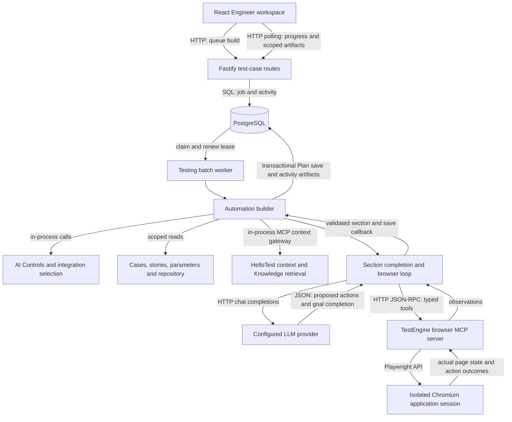

# Automation authoring and execution

An automation case is an ordered behavior plan with an implementation for each step. Manual cases and stories remain the coverage sources. Agent generation, recording and keyword/code authoring all update that plan; suites and runs execute its saved version.

## Runtime contract

| Test type | Conventional implementation | Automation agent | Evidence |
| --- | --- | --- | --- |
| Web | Playwright JavaScript, browser keywords, local/remote recording | Uses a Playwright-backed MCP browser to observe the application, select tools and generate code | Awaited operation outcomes and source lines, assertion failures, screenshots, trace and video according to policy |
| API | Structured HTTP requests, authentication, assertions and response captures | Builds the request contract from manual behavior, stories and supplied API context | Request/response details, duration, assertions and captured values |
| Android | Appium / UiAutomator2 keywords and driver code; device recording | Generates native code from supplied selectors and recordings | Step outcomes and configured failure screenshots |
| iOS | Appium / XCUITest keywords and driver code; device recording | Generates native code from supplied selectors and recordings | Step outcomes and configured failure screenshots |

Playwright is the primary Web runtime; the existing Selenium provider remains selectable. A shared envelope and parameter context coordinate mixed API/Web/native plans. Native apps need Appium drivers and a connected device, simulator, emulator or device-cloud connection. Configure `MOBILE_ENGINE_URL`, matching `MOBILE_ENGINE_SHARED_SECRET` values and a reachable Appium endpoint; XCUITest requires a macOS Appium host. Browser MCP cannot inspect native app controls. This follows the platform distinction in the [Appium driver documentation](https://appium.io/docs/en/2.3/ecosystem/drivers/).

The MCP endpoint is a HelloTest implementation at `/api/v1/automation/mcp`, protected by the TestEngine shared secret. It uses Playwright and exposes a bounded browser tool set. It is not Microsoft's packaged server. The LLM owns the decision loop; MCP returns observations. This separation follows the [Playwright MCP model](https://github.com/microsoft/playwright-mcp).

## Workspace

1. **Details:** case identity, manual coverage, stories, modules, suites and data-set links.
2. **Plan:** preconditions and ordered steps, expected outcomes, runtime, keywords or source, local groups and shared groups.
3. **Test Data:** case, suite and run parameters; selected data rows become execution iterations.
4. **Before / After:** setup and teardown saved with the case and frozen into direct, suite and scheduled runs. Reruns reuse the frozen links, source and data. Each source keeps its own parameter and dataset policy.
5. **Build tools:** “Build with automation agent” and recording. Optional instructions augment the saved behavior; the user need not repeat the manual case.
6. **Objects:** fields owned by or directly referenced from this case. The application-wide repository remains available separately for reuse and inspection.
7. **Runs:** attempts, outcomes, code-operation details, hook results and permission-controlled evidence.

Execution setup stays collapsed until needed. Platform-specific controls avoid offering browser recording for API-only or native-only plans. Mobile navigation keeps the selected tab visible. Repository inspection supports attribute composition, parent scope and explicit match index; changing a locator invalidates its earlier validation.

## Build handoff

The backend assembles saved actions and expected results, source manual cases, accessible linked and related stories (including acceptance criteria and specifications), repository objects, groups, knowledge, selected execution configuration/environment, scoped data and user guidance. Both feature availability and permissions govern optional evidence. Context is bounded; it is not an unlimited export of project content.

For Web, the build opens an isolated browser session and provides tool schemas and observations to the configured LLM. Navigation stays within the configured application origin and follows existing private-network policy. **Perform steps in browser** enables interaction; **Generate source only** keeps it disabled. Single and batch builds carry the same option.

The agent develops and saves one section at a time. Final completion requires every section and linked manual step to have a valid implementation/mapping. Runtime changes, duplicate/missing mappings and malformed executable contracts reject completion. Existing code and successfully saved sections survive later failures. Concurrent case changes cause a conflict instead of being overwritten. A generated implementation is ready to review; execution is a separate action that verifies it.

## Automation Engineer implementation

This describes the repository implementation, reviewed on 2026-10-17. The
Engineer is a Node.js orchestrator around a configured LLM, permission-aware
project context and a Playwright browser. In interactive actor mode the model
proposes typed actions; HelloTest records their actual outcomes and compiles their
Playwright source before saving. Explicit source-generation mode retains the
model-authored program path. The model does not connect directly to the browser
or database.

### Design: specification to executable artifact

Automation Engineer uses one orchestrator with bounded model decisions and
deterministic services. Planning, browser control, review and compilation are
separate responsibilities; they do not each require a separate model or browser.

```mermaid
flowchart LR
  Spec[Authorized manual specification or prompt] --> Plan[Ordered Plan and pinned obligations]
  Plan --> Context[Current requirements and bounded context lookup]
  Context --> Actor[Model selects typed MCP operations]
  Actor --> Ledger[Host records real browser outcomes]
  Ledger --> Review[Review requested outcomes against evidence]
  Review --> Compile[Deterministic Playwright compiler]
  Compile --> Save[Save Plan and version-bound manifest]
  Save --> Export[Shared runnable Playwright exporter]
  Export --> Run[Separate isolated TestEngine or Playwright run]
```

The model selects observed targets and interprets manual intent. Host code owns
authorization, fixed data, budgets, operation receipts, source rendering and
persistence. A completion flag cannot authorize a tool, create an execution
receipt or change an expected result. A model review is an assessment of meaning;
only a real run establishes its execution result.

The backend build download and UI full-source export use the same emitter in
`services/automation/shared/playwrightArtifact.mjs`. Its output is a Playwright
Test `.spec.ts` with fixtures, imports, native assertions, parameter bindings,
repository resolution and executable API sections. Private values are supplied
through the existing `QAIRA_DATA_JSON` runtime interface. Unsupported source or
missing dependencies remain explicit. Backend downloads must not label bare
section fragments as executable specifications.

Section previews carry a host-created generation manifest. Hashes bind the exact
source/API request and section/manual specification to the compiler/source origin
and actual review status. Preview reads compare this manifest with the current
scoped Plan: changed code, expectations or manual sources make the old assessment
historical while retaining its evidence. Missing legacy provenance stays unknown.
Neither a current manifest nor an accepted review is an execution pass, and a
manifest cannot recreate operation authority after a browser session is lost.

### Components and communication

There are two MCP paths with different jobs:

| Path | Caller and transport | Responsibility |
| --- | --- | --- |
| Application context | `retrieveAgentContext` calls `@hellotest/mcp/backend/gateway.retrievePacket` in process. The gateway invokes `hellotest_context_build` under a verified user/project principal. | Retrieve permission-filtered project evidence and indexed Knowledge context. |
| Browser interaction | `connectAutomationBrowser` uses Node `fetch` to POST JSON-RPC to the selected TestEngine's `/api/v1/automation/mcp`. | Observe and interact with the actual application through Playwright. |

The browser connection negotiates MCP `2025-03-26`: `initialize`,
`notifications/initialized`, `tools/list`, then `tools/call`. Requests carry the
TestEngine shared-secret header and returned `mcp-session-id`; an affinity cookie
keeps a gateway session on its owning worker. DELETE closes the session. Browser
MCP is HelloTest code in TestEngine backed directly by Playwright. The separate
application MCP server uses the official MCP server SDK. `browser-use` was a
design reference; it is not an installed Engineer runtime dependency.

### Packages and libraries

The manifests are the dependency authority; the following are the libraries on
this flow rather than every dependency installed by the product.

| Package/library | Where it participates |
| --- | --- |
| `react`, `react-dom`, `@tanstack/react-query` | Engineer workspace, mutations, activity polling and protected preview queries. `@tabler/icons-react` supplies its icons. |
| `fastify` | API route handling and the separate TestEngine browser MCP HTTP endpoint. The API and TestEngine have their own manifests and versions. |
| Node built-ins: `fetch`, `AbortSignal`, `crypto` | Provider HTTP, browser MCP transport, deadlines/cancellation, observation IDs and request identity. The builder sends HTTP chat completions through the shared HTTP layer. |
| `playwright`, including `playwright/test` | Chromium sessions, native page/locator operations, accessibility snapshots and assertions in TestEngine. |
| `acorn` | Parse/validate JavaScript and locator syntax, compile confirmed operations into native source, and lower supported model-authored programs into typed tools without executing them. |
| `pg` / PostgreSQL | Saved cases/steps, linked manual coverage, durable job leases, activity events, artifacts and trace metadata through the platform database adapters. |
| `ajv` | Published AI output-schema validation and bounded validation of discovered MCP tool arguments before dispatch. Tool validation supports conditional schemas without coercing values, inserting defaults or removing arguments. |
| `@modelcontextprotocol/server`, `zod` | The application's MCP server and tool contracts used by the context backplane. Browser MCP has its own restricted implementation. |

Internal workspace packages divide ownership:

| Workspace | Engineer responsibility |
| --- | --- |
| `@hellotest/automation` | Builder, section completion, browser agent, source validation, data projection, activity artifacts and Engineer UI. |
| `@hellotest/testing` | Test-case build routes, durable batch worker, steps, linked manual parameters, data sets, configurations and environments. |
| `@hellotest/integration` | Authorized LLM and TestEngine selection, endpoints and credentials. |
| `@hellotest/platform` | AI Controls/configuration, managed instructions, HTTP resilience, trace context, permissions, database and transaction services. |
| `@hellotest/mcp`, `@hellotest/knowledge` | Scoped context packets and Knowledge retrieval. |
| `@hellotest/agentic` | Agent Studio entry/profile and shared agent experience; the automation builder owns the actual browser-generation loop. |

See the [automation manifest](../../services/automation/package.json),
[frontend manifest](../../services/platform/frontend/package.json),
[API manifest](../../services/platform/backend/package.json) and
[TestEngine manifest](../../testengine/backend/package.json) for declared versions.

### From Build button to a running agent

1. `AutomationPage` sends `buildAutomationBatch` through the testing API client to
   `POST /test-cases/automation/build-batch`. The request includes explicit case
   IDs, selected model/integration, Start URL, brief, browser interaction option,
   execution-context IDs and `agent_context` selections.
2. The test-case route checks authentication, project/application scope, feature
   availability and build/data permissions. The testing batch service stores a
   durable SQL job and its workspace activity, then returns their IDs. This Build
   button uses the testing batch queue; the separate automation generator-job
   API is another entry point, not a second mandatory hop.
3. The testing worker claims the job and maintains its lease. It invokes
   `aiAutomationBuilder.buildAutomationBatch`, then `buildCaseCore` for a case.
   Ownership/cancellation checks continue during model calls and saves. Redis is
   not the queue authority for this path.
4. `automationCasePreparation` obtains a separate `AT_` case when starting from a
   manual `TC_` case and retains the link. A Web build validates and freezes the
   reviewed Start URL. Context, data and current source baselines are prepared
   before the first section is generated.
5. The UI polls activity/job endpoints. The workspace follows actual section,
   browser-action, check and save events; this is incremental progress polling,
   rather than a model-token stream or a continuous browser video feed.

### How the agent receives context

`buildCaseCore` combines several inputs into a bounded request:

| Input | How it reaches the model |
| --- | --- |
| Current task | Automation case title, description, preconditions, priority, labels, saved sections and the user's Agent brief. |
| Linked manual specification | Authorized linked manual cases and their complete ordered actions/expected results are retained as background. Only the active section is requested as the next implementation. Group identities are retained. |
| Story intent | Authorized linked stories contribute bounded descriptions, acceptance criteria, Gherkin/specification and references. Related stories contribute minimal identity/title/status metadata. Stories must be selected and additional context enabled. |
| Objects | Canonical repository fields/locators scoped to the application and reviewed Web target origin, plus authorized captured interactions/network context when supplied. A candidate locator still needs actual browser validation. |
| Execution context | Selected configuration, environment and data set, subject to resource permissions. |
| Smart Context and evidence scope | The selected scopes, exact evidence selectors, query, source IDs and source kinds constrain `retrievePacket`. Evidence identity/version/location/freshness and retrieval limitations are preserved. A bounded reviewed note is separate, untrusted user input, anchored to matching authorized evidence. |
| Current browser | Fresh URL/title, accessibility snapshot, observed controls/locator candidates, the active section's action/check receipts, current failure and a bounded previous draft. These are refreshed between turns. |

The context gateway reuses application permissions and Knowledge retrieval; a
source selection cannot grant access. Retrieval uses the AI Controls context
token/item limits and a bounded deadline. Optional retrieval failure leaves an
explicit gap and the pinned case/direct context; required-context policy stops
the build. The builder marks the request as already grounded, preventing the
generic LLM wrapper from recursively retrieving the same context again.

Data is resolved once per build by `automationBrowserParameters` using effective
manual defaults, explicit automation overrides and selected data layers. An
explicit empty override remains an override. Random generators materialize once;
the same values serve manual-step labels, model context and browser input/checks.
Public values replace parameter tokens in the prompt. Private values remain
references and are resolved by the host wrapper immediately before an authorized
MCP call. Before queueing, the parameter dialog offers inherited values and
build overrides. Authored unset inputs may deliberately continue as empty strings
for one case, without inventing values or changing the expected result.
Historical UI previews use the frozen build snapshot rather than today's defaults.
An opaque parameter-plan receipt binds the reviewed specification and source
resources. Source drift is rechecked before browser work and locked at save.
Reviewed edits and synthesized empty defaults save with the first accepted
section. Configured secret values remain host-bound; an intentional empty secret
can be exported as an empty value without revealing a credential.

At the active interactive section, original current-section and pinned manual
references are rejoined before projection and checked against the host's actual
bindings in every namespace. Legacy `@name` uses an existing run binding, otherwise
an inherited case binding; explicit `@r.name` never borrows `t.name`. The chosen
scope is frozen before adding empty defaults and recorded canonically in source.
Unknown model-created references still fail before dispatch. Earlier saved
sections and frozen runs retain their data. Interactive browser
generation currently has no implicit mailbox/capture producer: future producer
support needs explicit input/output provenance rather than guessing from prose.

AI Controls supplies the Engineer role/task/guardrails, published instruction
blocks, context policy, model parameters and final output schema. Integration
selection resolves an authorized provider/model. `requestChatCompletion` sends a
JSON-object chat-completions request through `fetchLlmWithRetry`;
`aiFeatureRuntime.apply` expands instruction markers and applies the current
managed profile before provider dispatch. Model calls are correlated with the
case, activity, section, attempt and configuration trace. Intermediate tool
responses and the final assembled outcome have distinct validation stages.

### Browser interaction and source generation

The core loop is **observe → propose → validate → act → observe/check → save**.

1. **Open the reviewed entry.** `connectAutomationBrowser` discovers the restricted
   browser tools. The server creates an isolated Chromium session on first use.
   Navigation waits for document load, usable visible content, loading indicators
   and bounded interface stability. Background polling does not require permanent
   network idleness.
2. **Observe.** `browser_snapshot` combines Playwright `ariaSnapshot` with bounded
   DOM metadata: labels, roles, text, attributes and candidate locators.
   `automationSnapshotLocators` obtains accessible names from Playwright and
   validates candidates against the captured node. Only unique matching
   candidates survive, with a CSS alternative when available. Hidden required
   markers in DOM label text cannot become invented role names. Capture-time
   validation is bounded and does not guarantee the page will remain unchanged.
   The model
   receives this structured text. Optional compressed viewport screenshots are
   retained as protected UI evidence; their bytes are excluded from model text.
3. **Ask the actor.** The host sends task/context, discovered tool schemas, active
   section, prior receipts and current page state. The preferred reply contains
   `stage:"act"`, the current `step_id`, typed `tool_calls` and
   `section_complete:false`. When the real goal/checks are finished the actor
   requests `section_complete:true`. That flag requests verification; it cannot
   establish success. Malformed accompanying model source cannot block valid
   actor tools, because recorded source comes from the host's confirmed ledger.
4. **Validate and dispatch.** Tool names/arguments must match discovery and policy.
   Mutation tools include click, fill, press, select, hover, check and uncheck;
   read tools include snapshots, locator validation and typed assertions. The
   host resolves authorized parameter references and calls MCP. The server
   enforces origin/network policy, unique locators, interaction mode, deadlines
   and Playwright actionability. It does not accept arbitrary model JavaScript
   as a browser tool. Private model inputs retain usable scoped references such
   as `@t.password`; the wrapper resolves their configured values. Display-only
   redaction placeholders are rejected before dispatch with retryable reference
   feedback, unless the placeholder is itself explicitly configured test data.
5. **Replan from actual state.** Failed input/checks stop the rest of a dependent
   batch. Transition-capable actions trigger fresh control inspection before
   another mutation. Changed controls on the same URL pause stale requests;
   ordinary fills and confirmed unchanged controls can remain batched. A high-level
   action such as “Navigate to signup” can require clicking Sign up before fields
   become available; all those prerequisites belong to that section's source.
   A redundant navigation to the already-ready current URL is skipped; an
   intentional reload requires an explicit navigation intent. Failed navigation
   invalidates earlier page snapshots and requires a fresh satisfied check.
   Failed assertions and zero/ambiguous locator validations refresh evidence.
   Repeating the same unsuccessful check on unchanged evidence is bounded and
   does not consume further MCP calls. Locator summaries retain match counts
   and uniqueness. A typed browser-budget failure preserves the actual last
   check rather than being classified as a provider failure. One completion-only
   turn may save an already-verified ledger; it cannot perform more browser work.
   An unknown mutation outcome stops automatic action replay.
6. **Compile executable source.** `automationBrowserRecording` privately retains
   the original dispatched arguments and real success/check receipts. Public
   redacted observations and copied/model-authored JSON cannot replace that
   WeakMap provenance. `automationRecordedProgram` renders confirmed operations
   in order, with explicit locator matching defaults, scoped secret references
   and faithful native/polling assertions. The model does not need to write the
   same actions a second time as code. For read-only generation or unsupported
   recorded behavior, the existing model-source contract remains available:
   `automationGeneratedProgram` validates/normalizes it, and
   `automationProgramTools` can lower a supported complete linear program into
   typed tools. No model JavaScript is evaluated by MCP.
7. **Prove and reconcile.** Interactive completion requires actual action receipts,
   a satisfied expected-result check after the last action and an executable
   check in the source. For supported linear source, `exactLinearCoverage` also
   compares targets, values and order and preserves observed prerequisite
   navigation. Actor retries also use host-stamped reconciliation, avoiding a
   repeated signup/submission after a failed check. A genuinely repeated action
   uses an explicit cumulative `occurrence` ordinal; correcting a check reuses
   its prior ordinal. Exact source reconciliation remains limited to its
   supported linear subset; actor source itself is compiled from the protected
   confirmed-operation ledger.
   Interactive builder sections also pass `automationSemanticReview` before
   preview/save. It reviews the exact active section and every linked active
   manual obligation against protected confirmed operations, their observed
   targets, current page evidence and retained failed predicates. Strict verdict
   validation requires exact obligation IDs and real action/assertion indexes;
   assertions follow the actions they support. An unrelated satisfied check does
   not establish business coverage. This is a model assessment of meaning, not
   an independent execution result or a deterministic natural-language proof.
   `automationExpectedResultCoverage` additionally rejects a known insufficient
   proof: native content/value checks cannot establish an explicitly authored
   field-validation/no-error condition. Original section/manual identities are
   rejoined into host-only `source_obligations`; projected public values, quoted
   literals and parameter names cannot add validation requirements. A narrow
   English classifier adds typed coverage facts without disclosing raw source.
   An exclusively insufficient ledger is rejected before another reviewer call;
   the same guard also checks model mappings before accepting mixed ledgers.
   Rejection preserves completed input, uses the existing bounded correction
   path and caches unchanged evidence. It never supplies a selector, assertion
   or pass result. Other languages/phrasing and the relevance of independent
   checks remain subject to semantic review.
   For immediate field entry, the discovered `field_valid` assertion adds a
   read-only executable predicate alongside the exact `value` check. It checks
   one visible participating native value-entry control's constraints/custom
   validity, `aria-invalid`, and visible error content explicitly associated
   through `aria-errormessage` or `aria-describedby` with an alert role. Associated
   identities must resolve uniquely in the same DOM root; malformed or oversized
   relationships stop verification. This follows the [ARIA error association
   contract](https://www.w3.org/TR/wai-aria/#aria-errormessage). It dispatches no
   validation events and proves no later submission, business acceptance,
   entire-form validity, or absence of unassociated application errors. MCP and
   exported Playwright use the same closed predicate, with AST parity checks.
   After rejection, `receipts_ready` retains recorded work while
   `completion_available` remains false and expected-result coverage is marked
   `coverage_rejected`. Public diagnostics retain allowlisted issue codes and
   pinned requirement identities, then join authorized requirement text in the
   UI; private model rationale and expanded test data stay excluded.
   The host permits at most two distinct reviews, caches unchanged candidates
   and shares the actor's combined model/deadline budget. Invalid/unavailable
   review stops saving; corrected checks reuse confirmed actions.
   `automationReviewEvidence` separates rendered targets and their bounded
   before/after changes from URL/title context. SPA views can change without
   changing address-bar/document metadata; explicit metadata requirements still
   apply. Sampled targets cannot establish page-wide absence, and a transition
   does not establish a business outcome. The host-selected review phase uses
   its managed system instruction instead of the broader code-generation frame.
   Rejected reviews return bounded,
   privacy-projected specific rationale only to the actor as untrusted assessment
   data. Repeating the same successful predicate with unchanged action/failure/page
   history reuses the rejection and stops without spending another review.
   Acceptance caching remains exact; neither cache changes the operation ledger.
8. **Save, then advance.** `completeAutomationBuild` validates the current result
   and manual coverage before any section write. Accepted source is detached
   from later model responses. New manual coverage cannot retroactively claim
   unrelated earlier work, and exact manual mappings that contradict Plan order
   fail before browser work. Its save callback calls transactional `applyBuild` to
   update Plan before the next section starts. Final validation checks all
   sections, mappings and the published outcome schema. Saved sections remain
   available if a later section is blocked. Coverage-only and final metadata
   corrections use retained instructions without reopening the browser; final
   schema correction has a separate bounded allowance.

If there are no sections, `automationFlowPlanning` first uses the brief, context
and read-only browser evidence to propose ordered manual actions/expected results.
It saves that draft plan against the original baselines, then uses the same
section loop. **Generate source only** uses generation/validation/save without
claiming that browser actions were performed. Repair shares the core machinery
but starts from an existing plan and failure/run context.

### Saving, presentation and actual execution

`applyBuild` locks/rechecks the case, steps, linked manual specification,
parameters and reviewed URL. Concurrent edits produce a conflict. It updates
`test_steps.automation_code` or the structured API request through the normal step
service, retaining section/manual mappings. Shared-group instance updates do not
publish the shared definition. Partial builds stay incomplete; final completion
marks automation ready for review, not passed.

The UI derives readable Instructions/Gherkin from saved source and repository
names; Source shows executable section programs. Full source uses the export
builder to assemble a standalone Playwright test with imports, wrapper, locators
and resolved public data/secret environment references. Activity previews,
browser evidence, per-step Build Error history and model request/response tabs
are linked to scoped artifacts and trace records.

Run local/remote is a separate TestEngine execution. Its Web runtime compiles
accepted/authored section JavaScript into an async function, injects runtime
bindings such as `page`, `web`, `expect`, `params` and `capture`, and records
operation/assertion outcomes and configured artifacts. This intentional code
execution is separate from typed MCP discovery/generation; it is not an operating
system sandbox. A real run receipt establishes pass/fail and linked manual
coverage. Development observations alone do not.

### Current context boundaries

The interactive Engineer progressively presents the discovered browser tools
needed by its current page and section goal. Selected tools retain their full
schemas. Deferred names remain visible; a `tool_catalog_request` reveals their
contracts on the next bounded model turn. A batch containing a deferred tool
pauses before its first browser action. Revealed tools remain available for the
section, and the last actionable turn receives the complete catalog. A
completion-only turn receives no tools. The original discovery catalog still
controls authorization and argument validation. Activity records catalog sizes
and selected/available counts; these character counts are separate from actual
provider token usage. See the [research decision](../research/automation-engineer-agent.md)
and [capability projection](../../services/automation/backend/lib/automationBrowserCapabilities.js).

`automationActorContext` keeps complete current-section and active linked manual
requirements once in `required_obligations`. Identity references join the current
section and execution contract after exact host-side validation; a mismatch uses
the full contract. A goal above 48,000 UTF-8 bytes fails before actor requests,
without truncating clauses. It sends an ordered identity/excerpt index for other
manual steps, scoped parameter references, and selected-resource metadata.
Recorder payloads, case documents, projected values and full resource data remain
in an immutable authorized host snapshot. The actor can request exact records
through `actor_context_request`: at most three requests, eight manual steps or
two documents per request, bounded capture ranges, and a bounded response size.
The host pauses every accompanying browser action, validates source identities
and includes the result on the next existing model turn. Context requests share
the actor budget; they do not introduce another model or enlarge source access.
Oversized/unknown selections are explicit and disclose no partial records.

Target binding prefers an explicit test-ID contract only when that exact
supported selector was already observed and uniquely validated for the target.
Accessible names remain model evidence and safe locator alternatives remain
available. A dynamic name can therefore change between development and replay
without freezing the previous value into a selector when a stable test ID exists.
There is no synthesized selector or runtime fallback to a different target.

Interactive actors also receive a host-derived navigation policy. Exact entry,
current/confirmed, current authored and validated current link URLs can ground
navigation; a destination name cannot authorize an inferred route. A denied
request does not reach MCP, consume a browser call or replace the current page.
Current URL parameter bindings are selected from original pinned source before
projection, so inserted literal `@tokens` cannot create another grant. Existing
origin/browser policy still applies. Native button types are retained as
observed evidence to distinguish navigation and submit/reset controls.

Native text-entry controls also disclose their assertion subject as input value.
A nonempty `text`/`text_contains` check on an exactly validated native input or
textarea receives a host correction before MCP, with the discovered value-mode
contract when available. No predicate/data is silently rewritten, no fill is
replayed, and no browser call or snapshot refresh is consumed. Explicit native
DOM/default-text checks and other control types retain their own meaning. A
corrected value assertion must still cover all other expected-result clauses.

Discovered `valid`/`invalid` assertions provide a separate read-only native
constraint check. They require a unique input, textarea or select that is a
constraint-validation candidate (`willValidate`), then poll `validity.valid`.
Controls barred from validation, including disabled controls and applicable
readonly inputs, cannot pass vacuously. The fixed
property reader never calls `checkValidity`/`reportValidity`, dispatches an
invalid event or submits a form. Receipts identify the selected-control native
scope; this does not prove server acceptance or absence of application errors.
The compiler emits the same fixed reader in a Playwright polling assertion, and
the program deriver accepts only that exact reader AST. This follows the
[HTML constraint-validation contract](https://html.spec.whatwg.org/multipage/form-control-infrastructure.html#dom-cva-validity)
and [Playwright locator evaluation](https://playwright.dev/docs/api/class-locator#locator-evaluate).

The browser actor uses a host-only phase flag to select its managed goal/action
instructions at system level. Task/browser data cannot select the phase. The
broader code-generation frame and final-case schema are omitted for actor/review
requests; their native phase response contracts remain enforced.

Failed checks retain a privacy-projected version of the attempted expectation in
the model's private current-step context, while public receipts keep input values
redacted. Current visible alerts are foregrounded as evidence to compare with the
manual goal, including intentional negative outcomes. A grounded `section_issue`
stops an unmet prerequisite or expected-result mismatch for review without saving
source. Rewriting expected text on the same target cannot reopen exhausted
unchanged-state checks; a repeated rejected probe stops further model/browser
retries. The selected step's **Browser activity** tab holds action/check outcomes,
interaction mode and page title beside **Build Error**.

Privacy projection preserves locator integrity: a selector whose bytes would be
changed by redaction is not advertised as executable. Safe observed alternatives
remain available. A redacted native option value is an excerpt, not an exact value
that the actor can select. Outcome-review and metadata calls retain their own
trace scopes and use phase-specific managed instructions across all supported
builder profiles. Published final-case schemas apply to the assembled outcome,
while intermediate phases retain their own strict host contracts.

- The direct story loader does not read attachment binaries or comments.
  Available indexed/source evidence can contribute them through context retrieval;
  the build does not automatically export every linked story asset.
- Reviewed Smart Context is supplemental user text, not independently verified
  source content. It is omitted when sources are disabled/deselected, evidence
  retrieval fails or no matching authorized evidence is returned. It cannot
  satisfy required-evidence policy or override pinned case facts.
- Evidence metadata is allowlisted and bounded. Retrieval ranking is identified
  as ranking, rather than being presented as factual confidence. Truncation and
  missing evidence remain explicit limitations.
- Optional screenshots are permission-protected images. Text-value redaction
  does not imply that visible data inside an image has been masked.
- Browser operations, model turns, context size and completion time are bounded.
  Actual source/model/provider errors and missing data remain explicit failures
  or dependencies; the agent cannot guarantee completion for every application.

### Source map

All paths below are relative to the repository root.

| Area | Main source |
| --- | --- |
| Build submission / UI | [AutomationPage](../../services/automation/frontend/pages/AutomationPage.tsx), [Engineer workspace](../../services/automation/frontend/components/AutomationEngineerWorkspace.tsx), [testing client](../../services/testing/frontend/api.client.ts) |
| API / durable worker | [test-case routes](../../services/testing/backend/routes/testCases.routes.js), [batch service](../../services/testing/backend/services/batchProcess.service.js), [testing workers](../../services/testing/backend/workers.js) |
| Orchestration / Plan writes | [aiAutomationBuilder.service](../../services/automation/backend/services/aiAutomationBuilder.service.js), [automationBuildCompletion](../../services/automation/backend/lib/automationBuildCompletion.js), [automationFlowPlanning](../../services/automation/backend/lib/automationFlowPlanning.js) |
| Context / data | [automationAgentContext](../../services/automation/backend/lib/automationAgentContext.js), [automationBuildContext](../../services/automation/backend/lib/automationBuildContext.js), [automationBrowserParameters](../../services/automation/backend/lib/automationBrowserParameters.js), [MCP gateway](../../services/mcp/backend/gateway.js) |
| AI Controls / provider HTTP | [aiFeatureRuntime](../../services/platform/backend/src/utils/aiFeatureRuntime.js), [llmHttpClient](../../services/platform/backend/src/utils/llmHttpClient.js), [feature catalog](../../services/platform/shared/aiFeatureCatalog.json) |
| Browser conversation | [automationBrowserAgent](../../services/automation/backend/lib/automationBrowserAgent.js), [automationBrowserContext](../../services/automation/backend/lib/automationBrowserContext.js) |
| Navigation grounding | [automationNavigationGrounding](../../services/automation/backend/lib/automationNavigationGrounding.js), [goal provenance](../../services/automation/backend/lib/automationGoalObligations.js) |
| Assertion subjects | [automationBrowserAssertionSubject](../../services/automation/backend/lib/automationBrowserAssertionSubject.js), [compact targets](../../services/automation/backend/lib/automationBrowserModelTargets.js) |
| Outcome review | [automationSemanticReview](../../services/automation/backend/lib/automationSemanticReview.js), [automationReviewEvidence](../../services/automation/backend/lib/automationReviewEvidence.js), [native-content coverage boundary](../../services/automation/backend/lib/automationExpectedResultCoverage.js) |
| Source and evidence validation | [automationGeneratedProgram](../../services/automation/backend/lib/automationGeneratedProgram.js), [automationProgramTools](../../services/automation/backend/lib/automationProgramTools.js), [automationInteractiveEvidence](../../services/automation/backend/lib/automationInteractiveEvidence.js), [automationActionReconciliation](../../services/automation/backend/lib/automationActionReconciliation.js) |
| Confirmed-operation source | [automationBrowserRecording](../../services/automation/backend/lib/automationBrowserRecording.js), [automationRecordedProgram](../../services/automation/backend/lib/automationRecordedProgram.js), [batch-state checks](../../services/automation/backend/lib/automationBrowserBatchState.js), [input preflight](../../services/automation/backend/lib/automationBuildInputPreflight.js) |
| Actual browser server | [automationMcp](../../testengine/backend/src/lib/automationMcp.ts), [portable native-validity reader](../../services/automation/backend/lib/automationNativeValidity.js), [repositoryLocator](../../testengine/backend/src/lib/repositoryLocator.ts), [inspectionSecurity](../../testengine/backend/src/lib/inspectionSecurity.ts) |
| Activity / source presentation | [automationAgentActivity.service](../../services/automation/backend/services/automationAgentActivity.service.js), [automationProgress](../../services/automation/frontend/lib/automationActivityMonitoring.ts) |
| Saved-source execution | [webEngine](../../testengine/backend/src/lib/webEngine.ts), [TestEngine guide](../../testengine/README.md) |

## Reuse, execution and results

Local groups organize one plan. Shared-group instances retain their source identity and scoped parameters; generating code for an instance does not publish a shared-library edit. Cases can belong to suites while retaining their own data and run history.

Run creation freezes hook sources and their parameters. Before/after hooks run around each case. Teardown runs after setup or case failure, and hook failure policies control continuation. Reruns retain the frozen hooks. Failed-only reruns consider the latest attempt for each data row. Secrets in frozen hook data are redacted from public reads and restored only in the internal execution path.

The Playwright provider uses native Playwright page/locator behavior and retrying assertions. Execution instruments awaited operations and reports their original source line, status, duration and attempt; loops can emit multiple events on the same line. It does not invent pass results for comments, declarations or unexecuted branches. Trace/video retention follows policy for engine-owned Playwright contexts; attached CDP contexts do not get equivalent recording. Actual artifact references are attached after collection. Inline traces are capped at 8 MiB; larger traces need accessible artifact storage. [Playwright tracing](https://playwright.dev/docs/api/class-tracing) records browser operations; step outcomes and assertion results are also kept in the application run contract.

Recordings keep actions in chronological order. Typing can coalesce only within an uninterrupted edit; a later click or navigation is a boundary. The UI displays all retained actions in playback order, with a count when a backend retention limit is reached.

## Current boundaries

- Agent generation uses the configured LLM; runtime retries execute saved code again. There is no runtime LLM repair or automatic locator publication. Unbuilt `web.aiStep` and native AI instructions fail explicitly.
- Web code is an executable step body. A simple Playwright `test(...)` wrapper can be unwrapped; arbitrary multi-test suites, imported fixtures and test-runner hooks belong outside that body. Use plan groups and execution hooks.
- API steps execute their structured request. Saved JavaScript references are not API runtime overrides; edit the request JSON or request form to change execution.
- Hooks support before/after each test. Coordinated once-per-suite/run hooks and independent hook data-set iteration are not implemented.
- Native video and native per-line traces are not implemented. Native screenshots require the configured failure-capture policy.
- Isolated test fixtures verify authoring and engine behavior. Live provider credentials, private targets, remote recorder deployment and physical devices require validation in the configured environment.

See [automation setup and focused checks](../../services/automation/README.md) and the [TestEngine runtime guide](../../testengine/README.md).

## Reviewed section grouping

Automation's selection action opens **Group Selected Sections**. Adjacent sections are reviewed in a modal before saving. A section's More menu provides grouping, ungrouping and conversion between local and Shared Section Groups. Grouping locks the case's section order and creates a shared source and its case references in one transaction. Cross-application reuse and incomplete selection of an existing shared group are rejected. Ungrouping or making a local copy retains the shared library source and historical run snapshots.

**Shared Section Groups** appears between Automation and Object Repository. It reuses the native shared-step library at `/shared-steps?view=automation`, including grid/list views, search, filters, creation, data and usage. The instruction editor uses the existing automation editor. Wording-only AI improvement preserves platform, code and API payload; Save Group persists the reviewed draft.

The automation library presents named sections with the same instruction preview,
source sections, behavior projection and instruction composer used by automation
cases. Sections support insertion, movement, copy/cut/paste, execution options,
implementation clearing and removal. Section dialogs update the local draft;
**Save Shared Section Group** publishes it to linked cases. Source and Gherkin
use that same draft, with structured API requests taking precedence for API
sections. Manual Shared Step Groups retain their Structured/Gherkin fragment editor.

Group Params detect references in section names, expected results, instructions
and API requests. Explicit empty defaults remain empty. A linked data row overrides
group defaults; private values stay hidden while deliberate replacement is allowed.
Removing a data policy cannot expose a previously hidden fallback: clear the
affected fallback before unlinking or changing that policy. Canonical section IDs
remain stable through reorder and synchronization; frozen execution snapshots stay
independent of subsequent library edits.

## Refactoring boundaries and operational checks

The builder composes domain adapters; it does not define separate authorization,
retry or persistence rules for each browser driver. Keep the executable contracts
behind the following focused modules:

| Responsibility | Implementation | Required boundary |
| --- | --- | --- |
| Saved-build orchestration | `automationSavedBuildVerification.service.js` | Inject source/data readers, execution, diagnosis and commit; freeze expected state until a matching verified commit. |
| Program decoding and worker receipts | `automationVerificationSections.js`, `automationVerificationReceipt.js` | Exact closed source and complete matching receipts; preserve the pipeline's public facade. |
| Locator-only repair | `automationVerificationLocatorRepair.js` | Actions may change observed targets; assertions and data remain protected. |
| Transient recovery | `automationRecoveryPolicy.ts` | Prove a section read-only before replay; cap attempts, delay and remaining run time. |
| Public progress and receipts | `automationProgressDiagnostics.js`, `automationActivityReceipts.js` | Host correlation/time, typed bounded facts, immutable outcomes and no browser argument payloads. |
| Execution diagnostic privacy | `executionOutputRedaction.ts`, `automationExecutionDiagnostics.js` | Mask public output using frozen private inputs and observed captures; retain authenticated runtime values for subsequent steps. |
| Optional export/import work | `useAutomationExportPreview.ts`, `automationOptionalModule.ts` | Load on demand, share module requests, support retry, ignore stale case/application completions. |

Freshness and access are checked after awaited progress writes and transport
preparation, immediately before verification dispatch. Cancellation and lost
ownership propagate through the same boundary. An unavailable optional progress
sink is classified and logged without converting a verified browser run into a
failure. Source-check counts and durations are numeric diagnostics, not model
usage estimates.

Normal execution never replays a whole section containing a mutation, navigation,
capture, custom callback or unsupported source. Proven read-only assertion timeout
retries keep the first failed source lines, return bounded recovery metadata and
label a recovered outcome as flaky. Permanent selector errors are terminal. This
preserves the distinction between first-pass success and
[success after retry](https://playwright.dev/docs/test-retries).
The engine test command limits concurrent test files to two so real browser and
CLI fixtures do not compete with every available CPU worker during startup.

Initial case loading does not generate the portable script or fetch thousands of
full run records for a badge. Export and ZIP import are optional chunks. Runs
history uses its summary projection only when needed; an unloaded count is unknown.
Activity polling still refetches its first event page: incremental pagination needs
a merged per-activity cache with reset, completion and race contracts before it can
replace the current evidence behavior.

Public execution notes, captures, failures and structured logs are redacted at the
worker boundary and again at host ingestion, including signed older-worker
callbacks. Private-value tracking is local to the execution and retains previous
values after a binding changes. Frozen inputs and authenticated queue capture
transport retain the actual values needed by later steps.

Raw screenshots, video and trace archives follow capture/retention policy and
run-scoped `attachment.view` plus `result.view` access. These binary artifacts can
contain sensitive page data; JSON redaction does not sanitize them. Browser traces
include page and network evidence; see the
[Playwright trace viewer](https://playwright.dev/docs/trace-viewer).

## Persistent outcome evidence

Native MCP snapshots expose up to eight visible paragraph targets as
`page_content`, after controls and semantic result nodes within the existing
120-target and 64 KiB limits. Content regions take precedence over decorative
paragraphs. These targets use the same unique, observed-DOM locator validation
as interactive controls; visible text and truncation remain explicit. Private
parameter values do not become public text locators or generated literals.

The actor compares every authored outcome with current evidence. A persistent
confirmation can establish a descriptive result after its toast disappears;
an explicitly required notification, exact text or recipient remains required.
A code-sent confirmation does not prove mailbox delivery. Reading a verification
email requires an available inbox integration or explicit test prerequisite.

After a host-observed final text assertion fails and its target disappears from
a fresh bounded snapshot, the host can permit one read-only outcome reassessment
within the existing model budget. This does not establish success or absence,
authorize another submission, or bypass independent semantic review. Current
validation errors and repeated unsupported outcomes still stop the section.

The Build tools workspace gives the output most of its width. Instructions,
Source, Build Error and Browser activity keep full labels and wrap on narrow
screens. Instructions expand with their content. Build Plan collapses Agent
brief & settings for single-case, batch and create-and-build flows; cancelled
or rejected preflight/queue requests reopen the brief for correction.
