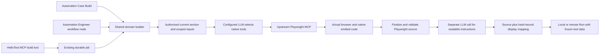

# Automation authoring and execution

An automation case is an ordered behavior plan with an implementation for each step. Manual cases and stories remain the coverage sources. Agent generation, recording and keyword/code authoring all update that plan; suites and runs execute its saved version.

## Runtime contract

| Test type | Conventional implementation | Automation agent | Evidence |
| --- | --- | --- | --- |
| Web | Playwright JavaScript, browser keywords, local/remote recording | Uses a Playwright-backed MCP browser to observe the application, select tools and generate code | Awaited operation outcomes and source lines, assertion failures, screenshots, trace and video according to policy |
| API | Structured HTTP requests, authentication, assertions and response captures | Builds the request contract from manual behavior, stories and supplied API context | Request/response details, duration, assertions and captured values |
| Android | Appium / UiAutomator2 keywords and driver code; device recording | Generates native code from supplied selectors and recordings | Step outcomes and configured failure screenshots |
| iOS | Appium / XCUITest keywords and driver code; device recording | Generates native code from supplied selectors and recordings | Step outcomes and configured failure screenshots |

Playwright is the primary Web runtime; the existing Selenium provider remains selectable. A shared envelope and parameter context coordinate mixed API/Web/native plans. Native apps need Appium drivers and a connected device, simulator, emulator or device-cloud connection. Configure `MOBILE_ENGINE_URL`, matching `MOBILE_ENGINE_SHARED_SECRET` values and a reachable Appium endpoint; XCUITest requires a macOS Appium host. Browser MCP cannot inspect native app controls. This follows the platform distinction in the [Appium driver documentation](https://appium.io/docs/en/2.3/ecosystem/drivers/).

The MCP endpoint is a HelloTest implementation at `/api/v1/automation/mcp`, protected by the TestEngine shared secret. It uses Playwright and exposes a bounded browser tool set. It is not Microsoft's packaged server. The LLM owns the decision loop; MCP returns observations. This separation follows the [Playwright MCP model](https://github.com/microsoft/playwright-mcp).

## Workspace

1. **Details:** case identity, manual coverage, stories, modules, suites and data-set links.
2. **Plan:** preconditions and ordered steps, expected outcomes, runtime, keywords or source, local groups and shared groups.
3. **Test Data:** case, suite and run parameters; selected data rows become execution iterations.
4. **Before / After:** setup and teardown saved with the case and frozen into direct, suite and scheduled runs. Reruns reuse the frozen links, source and data. Each source keeps its own parameter and dataset policy.
5. **Build tools:** “Build with automation agent” and recording. Optional instructions augment the saved behavior; the user need not repeat the manual case.
6. **Objects:** fields owned by or directly referenced from this case. The application-wide repository remains available separately for reuse and inspection.
7. **Runs:** attempts, outcomes, code-operation details, hook results and permission-controlled evidence.

Execution setup stays collapsed until needed. Platform-specific controls avoid offering browser recording for API-only or native-only plans. Mobile navigation keeps the selected tab visible. Repository inspection supports attribute composition, parent scope and explicit match index; changing a locator invalidates its earlier validation.

## Build handoff

The backend assembles saved actions and expected results, source manual cases, accessible linked and related stories (including acceptance criteria and specifications), repository objects, groups, knowledge, selected execution configuration/environment, scoped data and user guidance. Both feature availability and permissions govern optional evidence. Context is bounded; it is not an unlimited export of project content.

For Web, the build opens an isolated browser session and provides tool schemas and observations to the configured LLM. Navigation stays within the configured application origin and follows existing private-network policy. **Perform steps in browser** enables interaction; **Generate source only** keeps it disabled. Single and batch builds carry the same option.

The agent develops and saves one section at a time. Final completion requires every section and linked manual step to have a valid implementation/mapping. Runtime changes, duplicate/missing mappings and malformed executable contracts reject completion. Existing code and successfully saved sections survive later failures. Concurrent case changes cause a conflict instead of being overwritten. A generated implementation is ready to review; execution is a separate action that verifies it.

## Automation Engineer implementation

Reviewed on 2026-11-09. Browser generation uses the actual pinned
[Microsoft Playwright MCP](https://github.com/microsoft/playwright-mcp) package.
HelloTest supplies the configured model, authorized specification, scoped data,
interaction policy and durable saves. It does not replace upstream browser tools
with its own action language or DOM planner.

### Entry points and shared generator

The Case Build path persists validated sections progressively and can display
the page from its actual owned upstream browser session. The workflow node calls
`previewAutomationDraft`, reusing the same upstream browser/source/mapping host,
then publishes the final unsaved whole-case script proposal for normal
acceptance. Workflow generation requests no page preview; browser visibility
does not determine whether authored actions are permitted.

The saved workflow `automationBrowserMode` selects `perform_steps`, `read_only`
or `offline`. Newly created Engineer nodes explicitly default to `perform_steps`:
the background generator performs the authored flow through native MCP tools.
`read_only` inspects the entry page without typing or submitting. `offline` opens
no browser. Existing definitions without a mode retain their earlier authority:
`inspectBrowser:false` means offline; otherwise they remain read-only. Hydration,
guidance reset and export retain the selected mode rather than silently granting
interactive actions. All modes return generated source as unverified until a
separate execution passes. Offline source receives the same separate
display-mapping stage. API-only and native-mobile generation use their own
contracts without a browser connection.

### Upstream testing pattern

The implementation follows the separation documented by
[Playwright Test Agents](https://playwright.dev/docs/test-agents): a plan records
the intended behavior, a generator visits the application and builds source
from performed actions, and test execution establishes whether the saved program
passes. The official
[generator instructions](https://raw.githubusercontent.com/microsoft/playwright/main/packages/playwright/src/agents/playwright-test-generator.agent.md)
use scenario setup, live steps and verifications, then the performed log when
writing a test. HelloTest supplies its existing case/Run fixtures and scoped
data boundary rather than accepting arbitrary repository fixture execution.

An intent-only Case Build now observes the entry page with native navigation and
snapshot calls before asking the LLM to propose manual sections. Planning reuses
the owned browser and receives bounded, redacted entry evidence; later screens
remain unknown until generation visits them. Planning does not submit forms.
Saved manual sections preserve their authored actions and expected results.

The HelloTest MCP domain tool prepares the existing build job. It has no browser
orchestration of its own. HelloTest context MCP remains responsible for authorized
project/Knowledge retrieval, separately from upstream browser MCP.

### Input, permissions and data

The domain builder resolves project/application membership and feature
permissions, selected environment/configuration/dataset, linked manual cases,
related Story evidence and scoped parameters. Repository hints require Automation
view access and the selected Automation context scope. Access is checked again
before model/tool dispatch and saves; model arguments cannot change the actor or
project or grant a new capability.

The model receives the complete current action and expected result, the ordered
case actions, and the linked manual steps owned by the current section. Context
includes case intent/preconditions, selected resource metadata, authorized Story
acceptance criteria, repository hints and bounded retrieved evidence. Raw dataset
rows, resource-variable collections and unrelated manual steps are omitted from
this additional context. The parameter resolver supplies the actual selected row
through its separate scoped binding channel. Repository hints remain evidence;
the native browser must establish the actual target.

Private input values remain in the authorized host/runtime. Model inputs use
exact scoped references and availability metadata. Dispatch resolves an admitted
binding only for the current section. Generated source uses native
`params["r.key"]` expressions with the versioned binding marker; data is not
rescanned as executable code. Raw generator templates remain available for fresh
Runs while one materialized value stays fixed throughout the current attempt.

Completed-section summaries retain identity/runtime/status instead of resending
all preceding programs on every actor turn. Source generation receives only the
two most recent sections for continuity. Full evidence and saved source remain
available in protected artifacts and are not changed by prompt packing.

### Native browser tools and source authority

`automationUpstreamMcpClient` negotiates the existing authenticated TestEngine or
paired-browser transport and discovers the upstream tool catalog. The TestEngine
`automationPlaywrightMcp` adapter instantiates the pinned upstream package. Tool
names, JSON Schemas, argument shapes and results retain their native contracts;
HelloTest filters capability availability according to its interaction policy.

The configured LLM selects those discovered tools. Upstream performs browser
operations and emits their Playwright code. Source finalization preserves those
actual mutation calls exactly once and in order, binds data, and checks runnable
assertions and the allowed program boundary. It does not infer substitute
locators or regenerate already completed browser actions to repair JavaScript.
A lost transport or uncertain mutation outcome remains explicit; it cannot
trigger an automatic replay of the whole section.

Native batches stop at actions that can change the page or its controls,
including clicks, navigation, selection and submitting text. The model receives
the returned observation before choosing another target. Undispatched requests
from the earlier batch are discarded; completed actions are retained. Known
field fills and independent reads can still use native batching. The original
tool schemas are unchanged. Operations without a portable saved-source contract,
including tab mutations and native dialog handling, are rejected before dispatch
with explicit feedback; tab listing remains available for inspection.

Malformed source JSON receives bounded corrections in the source stage using
the retained native evidence. These corrections cannot call the browser or
repeat actions. This keeps provider formatting failures separate from uncertain
browser outcomes and actual product failures.

Case Build page images are optional UI evidence captured from that same native
session after a tool response. Inputs, editable regions and configured private
text are masked, and a masking/capture failure yields no image. Query/fragment
data is omitted from preview URLs. The image travels as separate transport
metadata to the Build workspace; it is not a model input or an invented native
MCP tool result. Workflow generation does not request these images.

AI Build validation checks expected-result assertions and rejects known unsupported runner
features or ambiguous generated record checks with source-only feedback. Native
Playwright behavior is the reference for locator compatibility; equivalent iframe
selector spellings do not always produce equivalent composite locators. The
current engine and upstream runtime have real-browser regression coverage.

### Source to readable instructions

`automationUpstreamSectionSource` owns source finalization and calls the shared
`mapGeneratedSectionInstructions` stage. The latter makes a separate configured
LLM call through `automationInstructionMapping` after the source is final.

A display instruction must cover an exact parsed source operation in order and
retain its operation identity and source hash. The mapping cannot replace code,
change a selector, modify an assertion or introduce executable instructions.
Invalid display JSON receives bounded correction; an explicit parser fallback
keeps valid source available if display mapping remains invalid. Instructions,
Source and portable exports all reference the same authoritative source.

Source-only recovery can reuse protected native evidence when its case,
section/manual specification, old public samples and access still match. It
returns an unverified, unsaved proposal and opens the ordinary Source editor.
A later real Run verifies the saved result. Historical Build failures are not
rewritten into successes by a source edit.

### Persistence and execution

Saves recheck case/manual/data versions under the existing domain transaction.
A late provider failure retains previously saved sections. The case is complete
only when every required section is structurally executable; generated or
inspected source remains unverified until execution passes.

An interactive workflow Web case uses the existing durable operation journal
before entering the shared preview host. Its stable identity includes the real
workflow node plus the loop, Story and case position. The privacy-projected
whole-case response is stored before the outer workflow checkpoint. A retry can
therefore reuse a completed script after a lost checkpoint without repeating
submissions. An uncertain browser/model/persistence outcome blocks replay. A
nested model's `effect_dispatched:false` does not release the whole-case
reservation after possible earlier browser actions. Only Automation Engineer
artifact receipts can request the bounded 2 MiB allowance; ordinary operation
receipts retain 128 KiB. Read-only/offline previews do not reserve interactive
browser effects.

Local/remote individual-case and suite Run admission requires executable saved
instructions in every active section, rather than an inline assertion per
section. Navigation and input sections can run before an assertion in a later
section, and user-linked action-only plans can execute. Missing instructions,
invalid syntax and unsupported runtimes still block dispatch. The Run executes
only the saved actions and checks: prose expectations do not create assertions.
AI Build keeps its separate stricter assertion-quality validation.

Local/remote individual-case and suite Runs execute frozen copies of that source
with frozen scoped data. The shared Playwright artifact emitter supplies the
portable wrapper. API steps execute their structured request contract and mobile
steps retain their mobile runtime. The local paired agent must advertise support
for the saved program format before receiving it.

Worker acknowledgements follow durable commit. Optional hierarchy telemetry is
coalesced outside the queue transaction and does not hold the lease row lock or
block heartbeat renewal. Expired/uncertain attempts retain their evidence and
require an explicit retry; telemetry availability cannot authorize a replay.

### Retired and shared code

The unreachable legacy web actor branch below the upstream Build return and its
duplicate inspected-preview connection have been removed. Build-only actor
context/obligation/binding and used-object staging modules with no production
callers have been retired, along with their dedicated tests. Mixed tests retain
coverage of the living shared components using direct fixtures.

Recorder, saved-source compatibility, locator repair, verification and the
explicit Repair agent still have production callers. Their shared compiler and
runtime helpers remain separate from the Automation Engineer generator. They
are not alternate browser-generation implementations for Case Build or the
workflow node.

### Source map

| Responsibility | Implementation |
| --- | --- |
| Case and workflow entry points | [aiAutomationBuilder.service](../../services/automation/backend/services/aiAutomationBuilder.service.js), [artifactTasks](../../services/agentic/backend/workflows/artifactTasks.js) |
| HelloTest MCP domain wrapper | [domainTools](../../services/mcp/backend/domainTools.js) |
| Browser/model host | [automationUpstreamEngineer](../../services/automation/backend/lib/automationUpstreamEngineer.js) |
| Native MCP transport/runtime | [automationUpstreamMcpClient](../../services/automation/backend/lib/automationUpstreamMcpClient.js), [automationPlaywrightMcp](../../testengine/backend/src/lib/automationPlaywrightMcp.ts) |
| Input and private bindings | [automationBuildContext](../../services/automation/backend/lib/automationBuildContext.js), [automationBrowserParameters](../../services/automation/backend/lib/automationBrowserParameters.js), [private binding scope](../../services/automation/backend/lib/automationUpstreamPrivateBindings.js) |
| Source and LLM display mapping | [section source](../../services/automation/backend/lib/automationUpstreamSectionSource.js), [instruction mapping](../../services/automation/backend/lib/automationInstructionMapping.js) |
| Readiness and portable output | [automationReadiness](../../services/automation/backend/services/automationReadiness.service.js), [playwrightArtifact](../../services/automation/shared/playwrightArtifact.mjs) |
| Actual execution | [webEngine](../../testengine/backend/src/lib/webEngine.ts), [queue dispatch](../../services/automation/backend/services/testEngineDispatch.service.js) |

## Reuse, execution and results

Local groups organize one plan. Shared-group instances retain their source identity and scoped parameters; generating code for an instance does not publish a shared-library edit. Cases can belong to suites while retaining their own data and run history.

Run creation freezes hook sources and their parameters. Before/after hooks run around each case. Teardown runs after setup or case failure, and hook failure policies control continuation. Reruns retain the frozen hooks. Failed-only reruns consider the latest attempt for each data row. Secrets in frozen hook data are redacted from public reads and restored only in the internal execution path.

The Playwright provider uses native Playwright page/locator behavior and retrying assertions. Execution instruments awaited operations and reports their original source line, status, duration and attempt; loops can emit multiple events on the same line. It does not invent pass results for comments, declarations or unexecuted branches. Trace/video retention follows policy for engine-owned Playwright contexts; attached CDP contexts do not get equivalent recording. Actual artifact references are attached after collection. Inline traces are capped at 8 MiB; larger traces need accessible artifact storage. [Playwright tracing](https://playwright.dev/docs/api/class-tracing) records browser operations; step outcomes and assertion results are also kept in the application run contract.

Recordings keep actions in chronological order. Typing can coalesce only within an uninterrupted edit; a later click or navigation is a boundary. The UI displays all retained actions in playback order, with a count when a backend retention limit is reached.

## Current boundaries

- Agent generation uses the configured LLM; runtime retries execute saved code again. There is no runtime LLM repair or automatic locator publication. Unbuilt `web.aiStep` and native AI instructions fail explicitly.
- Web code is an executable step body. A simple Playwright `test(...)` wrapper can be unwrapped; arbitrary multi-test suites, imported fixtures and test-runner hooks belong outside that body. Use plan groups and execution hooks.
- API steps execute their structured request. Saved JavaScript references are not API runtime overrides; edit the request JSON or request form to change execution.
- Hooks support before/after each test. Coordinated once-per-suite/run hooks and independent hook data-set iteration are not implemented.
- Native video and native per-line traces are not implemented. Native screenshots require the configured failure-capture policy.
- Isolated test fixtures verify authoring and engine behavior. Live provider credentials, private targets, remote recorder deployment and physical devices require validation in the configured environment.

See [automation setup and focused checks](../../services/automation/README.md) and the [TestEngine runtime guide](../../testengine/README.md).

## Reviewed section grouping

Automation's selection action opens **Group Selected Sections**. Adjacent sections are reviewed in a modal before saving. A section's More menu provides grouping, ungrouping and conversion between local and Shared Section Groups. Grouping locks the case's section order and creates a shared source and its case references in one transaction. Cross-application reuse and incomplete selection of an existing shared group are rejected. Ungrouping or making a local copy retains the shared library source and historical run snapshots.

**Shared Section Groups** appears between Automation and Object Repository. It reuses the native shared-step library at `/shared-steps?view=automation`, including grid/list views, search, filters, creation, data and usage. The instruction editor uses the existing automation editor. Wording-only AI improvement preserves platform, code and API payload; Save Group persists the reviewed draft.

The automation library presents named sections with the same instruction preview,
source sections, behavior projection and instruction composer used by automation
cases. Sections support insertion, movement, copy/cut/paste, execution options,
implementation clearing and removal. Section dialogs update the local draft;
**Save Shared Section Group** publishes it to linked cases. Source and Gherkin
use that same draft, with structured API requests taking precedence for API
sections. Manual Shared Step Groups retain their Structured/Gherkin fragment editor.

Group Params detect references in section names, expected results, instructions
and API requests. Explicit empty defaults remain empty. A linked data row overrides
group defaults; private values stay hidden while deliberate replacement is allowed.
Removing a data policy cannot expose a previously hidden fallback: clear the
affected fallback before unlinking or changing that policy. Canonical section IDs
remain stable through reorder and synchronization; frozen execution snapshots stay
independent of subsequent library edits.

## Refactoring boundaries and operational checks

The builder composes domain adapters; it does not define separate authorization,
retry or persistence rules for each browser driver. Keep the executable contracts
behind the following focused modules:

| Responsibility | Implementation | Required boundary |
| --- | --- | --- |
| Saved-build orchestration | `automationSavedBuildVerification.service.js` | Inject source/data readers, execution, diagnosis and commit; freeze expected state until a matching verified commit. |
| Program decoding and worker receipts | `automationVerificationSections.js`, `automationVerificationReceipt.js` | Exact closed source and complete matching receipts; preserve the pipeline's public facade. |
| Locator-only repair | `automationVerificationLocatorRepair.js` | Actions may change observed targets; assertions and data remain protected. |
| Transient recovery | `automationRecoveryPolicy.ts` | Prove a section read-only before replay; cap attempts, delay and remaining run time. |
| Public progress and receipts | `automationProgressDiagnostics.js`, `automationActivityReceipts.js` | Host correlation/time, typed bounded facts, immutable outcomes and no browser argument payloads. |
| Execution diagnostic privacy | `executionOutputRedaction.ts`, `automationExecutionDiagnostics.js` | Mask public output using frozen private inputs and observed captures; retain authenticated runtime values for subsequent steps. |
| Optional export/import work | `useAutomationExportPreview.ts`, `automationOptionalModule.ts` | Load on demand, share module requests, support retry, ignore stale case/application completions. |

Freshness and access are checked after awaited progress writes and transport
preparation, immediately before verification dispatch. Cancellation and lost
ownership propagate through the same boundary. An unavailable optional progress
sink is classified and logged without converting a verified browser run into a
failure. Source-check counts and durations are numeric diagnostics, not model
usage estimates.

Normal execution never replays a whole section containing a mutation, navigation,
capture, custom callback or unsupported source. Proven read-only assertion timeout
retries keep the first failed source lines, return bounded recovery metadata and
label a recovered outcome as flaky. Permanent selector errors are terminal. This
preserves the distinction between first-pass success and
[success after retry](https://playwright.dev/docs/test-retries).
The engine test command limits concurrent test files to two so real browser and
CLI fixtures do not compete with every available CPU worker during startup.

Initial case loading does not generate the portable script or fetch thousands of
full run records for a badge. Export and ZIP import are optional chunks. Runs
history uses its summary projection only when needed; an unloaded count is unknown.
Activity polling still refetches its first event page: incremental pagination needs
a merged per-activity cache with reset, completion and race contracts before it can
replace the current evidence behavior.

Public execution notes, captures, failures and structured logs are redacted at the
worker boundary and again at host ingestion, including signed older-worker
callbacks. Private-value tracking is local to the execution and retains previous
values after a binding changes. Frozen inputs and authenticated queue capture
transport retain the actual values needed by later steps.

Raw screenshots, video and trace archives follow capture/retention policy and
run-scoped `attachment.view` plus `result.view` access. These binary artifacts can
contain sensitive page data; JSON redaction does not sanitize them. Browser traces
include page and network evidence; see the
[Playwright trace viewer](https://playwright.dev/docs/trace-viewer).

## Persistent outcome evidence

Native MCP snapshots expose up to eight visible paragraph targets as
`page_content`, after controls and semantic result nodes within the existing
120-target and 64 KiB limits. Content regions take precedence over decorative
paragraphs. These targets use the same unique, observed-DOM locator validation
as interactive controls; visible text and truncation remain explicit. Private
parameter values do not become public text locators or generated literals.

The actor compares every authored outcome with current evidence. A persistent
confirmation can establish a descriptive result after its toast disappears;
an explicitly required notification, exact text or recipient remains required.
A code-sent confirmation does not prove mailbox delivery. Reading a verification
email requires an available inbox integration or explicit test prerequisite.

After a host-observed final text assertion fails and its target disappears from
a fresh bounded snapshot, the host can permit one read-only outcome reassessment
within the existing model budget. This does not establish success or absence,
authorize another submission, or bypass independent semantic review. Current
validation errors and repeated unsupported outcomes still stop the section.

The Build tools workspace gives the output most of its width. Instructions,
Source, Build Error and Browser activity keep full labels and wrap on narrow
screens. Instructions expand with their content. Build Plan collapses Agent
brief & settings for single-case, batch and create-and-build flows; cancelled
or rejected preflight/queue requests reopen the brief for correction.

## Recorder and explicit Repair execution contracts

The following recorded-operation contracts belong to the retained Recorder and
explicit Repair components. Case Build and the workflow Engineer use the
upstream generator described above.

The Repair browser loop selects at most two locally reviewed strategy cards, bounded to
1,800 JSON characters, for the current goal and evidence. Agent Studio
Repair uses these hints; completion-only turns load none. Cards do not
install upstream skills, select credentials, change tool schemas or authorize
actions. Prompt diagnostics record selected IDs and character counts; provider
usage remains the source for actual token accounting. The source comparison and
license review are in [the agent research](../research/automation-engineer-agent.md).

The Repair browser server retains session-local handles for observed subjects. Before
an interaction, the runner rechecks the same node, page, control identity and
enclosing row/list-item context. A changed subject returns a typed, retry-safe
`not_attempted` result; the host can refresh evidence within its existing budget,
without replaying the operation. Read-only assertions remain the independent
outcome proof. A stable page ID distinguishes otherwise identical page snapshots.

Identity reads exclude entered values and selection state. They are bounded:
2,048 characters for control text or an identity attribute, 4,096 for row text,
256 select choices and 16,384 total choice characters. Incomplete identity cannot
grant an interaction. Native labels and ARIA name references are also rechecked,
with at most 16 of each and an 8,192-character combined label allowance.
Reads use the remaining inspection timeout and handle
cleanup is bounded. The check immediately precedes dispatch and pins its native
node; it does not lock application JavaScript against a later same-node change.

Where a semantic row has an observed unique application key, grounded CSS retains
that record scope in generated code instead of preferring a globally unique
button ID. Every candidate must still resolve to the captured node. Private or
unvalidated scoped candidates are excluded. Applications without a suitable key,
or with keys reused for virtual slots, still need authored record checks or a
reviewed application locator contract for reliable playback intent.

Within one model response, an unchanged complete control inventory can retain
queued targets across a host snapshot refresh. This requires the same page ID,
URL, stable target ID, role, name and complete record context. Rebound work uses
the fresh validated preferred locator and unchanged arguments. Changed dropdown
choices, ambiguous IDs, clipped evidence, copied snapshots and prior-turn refs
cannot use this path. Native select actions and explicit parameter value checks
retain their original case/suite/run references.

Agent Studio repair produces a typed proposal focused on the first failed
case-owned section. It pins the exact failed result, frozen inputs, source and
execution policies, checks freshness again before saving/planning, and rolls back
cancelled writes. Reviewed validation reproduces the original failure, executes
the complete repaired case and selected neighbors, then confirms a known-negative
fixture still fails its protected assertion. Setup, teardown, every successor and
frozen shared-section bindings remain part of the verification contract. Ordered
runner receipts and executed assertion-line evidence are required; an
infrastructure error is not a successful negative control. Older validation
fingerprints that omitted frozen policy require a new proposal.

The builder's bounded locator-repair pipeline is a separate entry point. It uses
the same closed native operation contracts, preserves actions, data and assertion
checkpoints, and commits only after isolated verification. Neither entry point
can treat a proposed patch or a live browser inspection as a verified repair.
