# Capability packages and independent UI releases

Status: eleven full-stack npm workspace packages, selected API profiles, runtime-loaded UI releases and capability-aware permissions are implemented. Shared runtime, database schemas and implementation dependencies remain explicit constraints.

## Decision and source ownership

Keep one monorepo. Each capability has one home, `services/<owner>`, containing its frontend, backend, public exports, tests and npm release metadata. Engineers use the same checkout and shared development shell; they do not maintain duplicate frontend and backend feature directories.

```text
services/<owner>/
  package.json             @hellotest/<owner>, exports, dependencies, feature ownership
  frontend/
    entry.ts               Public lazy screen/panel exports
    api.client.ts          Owning HTTP client
    pages/, components/    Capability UI and workflows
    lib/, hooks/           Capability policies and state
  backend/
    server.cjs             Starts this API profile in the shared runtime
    service.manifest.js    Owning routes
    routes/, services/     HTTP handlers and use cases
    domain/, repositories/ Pure rules and persistence adapters where extracted
    workers.js             Recurring workers, where applicable
  test/
    backend/, frontend/    Capability unit and contract tests
    browser/               Capability browser checks
  dist/ui/                 Generated immutable assets and manifest; Git-ignored
services/platform/frontend/                  Workspace/admin shell, providers and shared UI/transport
services/platform/backend/               Shared process lifecycle, auth, database/provider adapters
services/platform/backend/instance-setup-data/schema-setup/  Bootstrap schema, separate from sample data
```

The root `frontend/` and `backend/` trees have been consolidated into Platform. Shared shell code, API lifecycle code, their dependency manifests, Dockerfiles and development entry points now live beside their owner. Existing browser routes and API paths are unchanged. The schema lives in `services/platform/backend/instance-setup-data/schema-setup` and remains separate from optional sample installation.

Testing owns common cases, suites, shared steps, runs, results, defects, environments and test data. Manual owns product planning, stories, sprints and releases. Dashboard owns **Analytics, Release Readiness and Custom Dashboard** in one package. Integration owns provider configuration, prompt templates and default-model selection. AI owns assistance dialogs and generation. Chatbot owns its overlay and conversations; Knowledge owns ingestion and retrieval.

`package.json#hellotest` declares product foundations and feature ownership. `npm run generate:capabilities` derives `services/capabilities.json`; do not hand-edit generated metadata. `catalog.json` inventories processes and deployment details. Ordinary npm `dependencies` and `exports` declare code dependencies. Product prerequisites and implementation imports serve different purposes: an optional API need not be running merely because a compatibility module is compiled into a consumer.

There is no per-file `boundaries.json` exception inventory. `npm run check:boundaries` checks actual imports against npm dependencies and exports. Existing exported implementation modules are compatibility surfaces, not proof that every package is autonomous.

## UI composition and releases

```mermaid
flowchart LR
  Browser --> Shell[Stable shell: session, navigation, theme]
  Shell --> Policy[Deployment availability + flags + permissions]
  Policy --> Action[Existing menu, button or route]
  Action --> Loader[Lazy capability loader / retry]
  Loader --> Manifest[Same-origin capability manifest]
  Manifest --> UI[Versioned UI assets]
  UI --> API[Owning API profile]
  API --> Runtime[Shared auth / runtime]
  Runtime --> DB[(Shared PostgreSQL)]
```



The shell installs UI host protocol 1 with shared React, router, query, session, localization, HTTP, dialog focus and loading-overlay instances. Capability builds reuse these providers instead of bundling a second session or React runtime. `services/<owner>/frontend/entry.ts` exposes named lazy views. Manifest validation checks the owner, protocol and same-origin asset directory before loading scripts or styles. A configured remote release never silently falls back to an older local implementation after failure.

`HELLOTEST_CAPABILITY_UI_URLS` maps owners to manifest paths, for example:

```sh
HELLOTEST_CAPABILITY_UI_URLS='{"dashboard":"/services/dashboard/capability-ui/dashboard/manifest.json"}'
```

The separate-profile Compose stack configures these paths automatically. The owning backend image serves its built UI artifacts through the existing gateway. Without a mapping, the combined deployment and Vite development shell use local lazy imports. `HELLOTEST_SERVICE_URLS` separately controls data API routing.

An owner can release its existing screens and backend without rebuilding the shell. New top-level navigation, a changed host protocol or a new extension point still requires a compatible shell release. UI assets use content hashes; the manifest is not cached. Operators must retain previous hashed assets during rolling upgrades so already-open browsers can finish loading their release. Automatic multi-version artifact retention is not implemented. API/schema changes must remain compatible with open clients and other running profiles.

Loading, timeouts and retry stay inside the affected panel/page. Host drafts remain mounted when an optional panel cannot load. This isolates interface loading/render failures; it cannot make a workflow succeed when its required API or the shared database is unavailable. Existing global CSS is retained for visual compatibility; it is not a sandbox against arbitrary capability CSS.

## Availability and permissions

A visible action requires the deployed capability, enabled feature dependencies and the user's permission in the current project. Menu groups with no accessible destinations are omitted; disabled or restricted destinations are removed from navigation search. AI actions use the same access checks, and Chatbot mounts only when Knowledge/Chatbot are enabled and the user has access.

Feature flags do not grant permissions. UI hiding does not authorize an API call: backend feature policy, authentication and project permission checks remain authoritative. Dashboard's three views share the capability's view permission; custom dashboard editing separately requires manage access. Legacy feature keys, including `hellotest.manual.bugs`, remain compatible even where the owner is now Testing.

Deployment selection masks feature availability. A transient service outage produces an unavailable state with retry instead of rewriting permissions or hiding unrelated menus. Requesting a disabled page directly still encounters route/page and API access checks.

## Customer selection and prerequisites

| Selection | Required foundations | Additional process |
| --- | --- | --- |
| Manual / product planning | Platform, Testing | — |
| Automation | Platform, Testing, Integration | TestEngine |
| Agentic | Automation foundations, Knowledge | TestEngine, Tika |
| AI assistance | Manual foundations, Knowledge, Integration | Tika |
| Ask Chatbot | Knowledge, Platform, Integration | Tika |
| Knowledge Repo | Platform, Integration | Tika |
| Dashboard | Platform, Testing | — |
| OPS telemetry | Platform | Optional monitoring stack |

```sh
npm run setup
npm run services:up -- --capabilities automation --print
npm run services:up -- --capabilities automation --build
npm run build --workspace @hellotest/dashboard
npm test --workspace @hellotest/dashboard
# Uses your configured database and environment:
npm start --workspace @hellotest/dashboard
# Build a selected UI + API image from the repository root:
docker build -f services/platform/backend/Dockerfile --build-arg HELLOTEST_CAPABILITY=dashboard -t hellotest-dashboard:local .
```

The selector expands foundations and starts selected APIs plus required infrastructure. It does not remove older containers or customer data. APIs register only their own enabled routes and workers. A one-shot migration job runs before the separate profiles; APIs verify committed schema receipts. Platform alone owns administrator foundation initialization and optional instance setup admission.

The source packages are private workspaces, not published standalone registry artifacts. Their build/start commands intentionally use this repository's shell and runtime. Selected images currently retain all capability backend source needed by existing implementation imports. Independent package tarballs, per-owner database credentials/migrations and elimination of cross-owner SQL are further work, not properties established by npm naming.

## Reliability and verification

The gateway resolves optional upstreams at request time. Separate-profile defaults cap each API at 512 MiB memory, one CPU, four main DB connections, two observability connections and bounded Docker logs. These are configurable ceilings, not measured production sizing. The combined API remains available for installations prioritizing lower process overhead.

```sh
npm test
npm run build
npm run build:capabilities
sh scripts/checks/validate-deployment-contracts.sh
npm run test:service-gateway
node services/platform/backend/instance-setup-data/verify.cjs
```

Single-capability tests live with their owner. Shared runtime and multi-capability contracts remain in the runtime test harnesses. The root test runners discover both. Browser checks are opt-in; the Dashboard release check builds/loads real capability assets and covers all three views, failure/retry, retained host state and flag changes.

These checks do not establish every production workflow, a live LLM response, database failure isolation or zero-downtime schema compatibility. See [CONTRIBUTING](../../CONTRIBUTING.md) for the full source map and workflow, and [implementation contracts](implementation-boundaries.md) for dependency rules.
