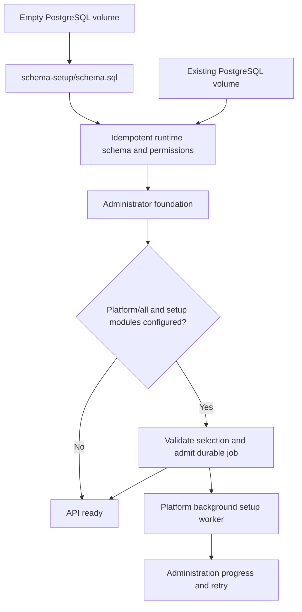

# Deployment, setup and script review

Reviewed against the working tree on 2026-09-24. Scope: maintained repository shell and YAML files, including hidden files discovered by the source inventory; installed dependencies, generated builds, local secrets and runtime artifacts are excluded. There are no byte-identical shell or YAML files in that inventory. Similar names alone are not evidence that a file is redundant.

## Decisions implemented

- Administration implementation belongs to Platform: `services/platform/frontend/admin/`. The web composition root retains `services/platform/frontend/admin.html`, the Vite configuration, Docker packaging and public `/admin` routing. Platform owns both administration UI and backend use cases; this does not introduce another deployable service.
- Removed the legacy SQL demo seed and all Compose mounts of it. Schema, runtime upgrades, roles/permissions and bootstrap administrator initialization remain required. Sample content comes only from the versioned instance dataset.
- Added optional `HELLOTEST_INSTANCE_SETUP_MODULES=all` or comma-separated manifest module keys. Platform/all queues the existing durable installer after schema and administrator initialization. The default is blank: customer instances remain empty. Completed receipts covering the same manifest/selection are reused; failed receipts retain their retry state. Installation happens in the background and uses Administration progress/retry. Existing customer records are not deleted or overwritten.
- Removed the unauthenticated `create-demo-records.sh` walkthrough. It duplicated sample setup without the installer’s validation, authenticated actor, transaction checkpoints or retry behavior.
- Consolidated six local Compose wrappers through `local-run/lib/compose.sh`, retaining the custom Compose-file override, existing `.env`, arguments, start-only environment loading and autoscaler behavior. Renamed `fix-recorder-integration.sh` to `configure-integrations.sh`: it configures several integrations and restarts the API, rather than merely repairing a recorder.
- Corrected `reset-data.sh` wording: `down -v` removes every selected stack volume, including cache, object storage and vector data. This destructive command was not executed during review.
- Reused the TestEngine worker anchor for the development Web worker's build, restart, volume and healthcheck settings. The complete rendered Compose configuration was identical before and after this consolidation.

## Startup sequence



Automatic admission shares the same PostgreSQL advisory lock as UI admission. Concurrent replicas cannot create competing active jobs. A matching completed or failed receipt prevents restart loops; an active job is reused. If an unrelated setup is already active, it takes precedence; review its selection in Administration and start any additional modules explicitly. A changed manifest permits a new installation. Missing administrator or invalid configuration is logged without taking down the API. The installer rechecks administrator access at execution time.

```sh
# Source-build local stack; sample content is explicitly enabled.
HELLOTEST_INSTANCE_SETUP_MODULES=all ./hellotest.sh up --stack local --build

# Schema/runtime foundation only; choose content later in Administration.
./hellotest.sh up --stack local --build
```

Unset the variable (including in supplied config/env files) to disable automatic admission. It does not remove previously installed content. Deployment onto an existing volume does not rerun PostgreSQL init scripts. Do not reset volumes to migrate away from the old SQL seed.

`local-run/db/03-local-integrations.sql` remains intentional: it connects the local TestEngine/mobile topology and supplies inactive credential-free LLM examples. It is environment wiring, not the product sample dataset. Its updates preserve existing credentials. `local-run/bin/configure-integrations.sh` reapplies that wiring explicitly.

## Shell inventory

Paths are relative to the repository root. Sourced helpers are not operator entry points.

| File(s) | Intent and decision |
| --- | --- |
| `hellotest.sh` | Canonical stack lifecycle, config, build and deployment; retained. Writes optional setup selection into the generated env file, including values supplied through `--config`. |
| `start-testengine-ops.sh` | Engine/recorder execution-plane startup, integration resolution and telemetry; retained. Different scope from product-stack deployment. |
| `services/platform/backend/start.sh`, `services/platform/frontend/start.sh` | Thin development Compose entry points; retained. Use `scripts/lib/docker.sh`. |
| `services/platform/frontend/docker-entrypoint.sh` | Container-time browser endpoint configuration; retained. Not a deployment wrapper. |
| `scripts/lib/docker.sh` | Docker availability and Compose invocation adapter; retained as shared implementation. |
| `scripts/deploy/aws/aws-runtime.sh` | Shared EC2/runtime helpers; retained. |
| `scripts/deploy/aws/deploy-app.sh` | App host deployment and readiness; retained. |
| `scripts/deploy/aws/deploy-testengine.sh` | Independent worker host deployment; retained. |
| `scripts/deploy/aws/status.sh`, `scripts/deploy/aws/logs.sh` | Remote inspection; retained. Their SSH scope differs from local status/logs. |
| `scripts/deploy/provider-stack.sh` | Provider/network-isolated Compose and Kubernetes generator; retained as a distinct topology, with limitations below. |
| `scripts/checks/validate-deployment-contracts.sh` | Static deployment rendering/contracts; retained. Does not deploy services. |
| `scripts/checks/test-hellotest-startup.sh` | Stubbed operator sequencing and failure tests; retained. |
| `local-run/lib/compose.sh` | Shared local `.env`, working-directory and Compose selection/invocation helper. |
| `local-run/bin/start.sh` | Local startup plus optional worker autoscaler; retained. |
| `local-run/bin/stop.sh` | Stop autoscaler and local stack; retained. |
| `local-run/bin/status.sh`, `local-run/bin/logs.sh` | Local Compose inspection; retained. |
| `local-run/bin/reset-data.sh` | Explicit destructive local reset; retained with accurate scope description. |
| `local-run/bin/health.sh` | HTTP checks of application, engine and optional recorder; retained. |
| `local-run/bin/autoscale-testengine.sh` | Manage local worker autoscale process; retained. |
| `local-run/bin/start-host-recorder.sh` | Native visible-browser recorder; retained, separate from container workers. |
| `local-run/bin/configure-integrations.sh` | Apply local environment wiring and restart API; retained under the clearer name. |

JavaScript command ownership remains in [scripts/README.md](../../scripts/README.md): capability selection, OPS lifecycle/verification, graph/architecture checks and data export serve different contracts. TestEngine binary and inspection-agent packaging scripts remain with TestEngine. They are not alternative implementations of stack startup.

## YAML inventory

| File | Intent and decision |
| --- | --- |
| `docker-compose.full.yml` | Combined source-build app/engine environment; retained. |
| `docker-compose.platform.yml` | Published app-plane deployment, production secrets/private infrastructure binds; retained. |
| `docker-compose.microservices.yml` | Capability API profiles, gateway and shared infrastructure; retained. |
| `docker-compose.ops.yml` | Optional observability stack; retained independently of app lifecycle. |
| `services/platform/backend/docker-compose.yml` | API development with its infrastructure; retained. |
| `services/platform/frontend/docker-compose.yml` | Frontend-only development deployment; retained. |
| `local-run/docker-compose.yml` | Integrated local source builds, worker classes and mobile engine; retained. |
| `local-run/docker-compose.images.yml` | Published-image local topology; retained. It also differs in Redis persistence, API worker replicas and tracing settings, so it is not a drop-in image-only override. |
| `testengine/docker-compose.yml` | Development execution plane, local builds/defaults; retained with shared worker block. |
| `testengine/docker-compose.deploy.yml` | Published execution plane, required secrets, production defaults and explicit recorder/CORS policy; retained. |
| `testengine/k8s/testengine-workers.yaml` | Kubernetes workers/autoscaling and cluster resource declarations; retained. Not a Compose duplicate. |
| `ops/prometheus/prometheus.yml` | Scrape targets and rule loading; retained. |
| `ops/prometheus/alerts.yml` | Prometheus alert expressions; retained separately from scraping. |
| `ops/alertmanager/alertmanager.yml` | Alert routing/grouping/receivers; retained. Does not evaluate Prometheus expressions. |
| `ops/otel-collector/config.yaml` | Telemetry receivers/processors/exporters; retained. |
| `ops/jaeger/config.yaml` | Trace storage/query/ingestion configuration; retained. |
| `ops/loki/loki-config.yml` | Log storage/index/retention configuration; retained. |
| `ops/grafana/provisioning/datasources/datasources.yml` | Dashboard data sources and trace/log links; retained. |
| `ops/grafana/provisioning/dashboards/dashboards.yml` | Dashboard file provisioning; retained. Actual dashboard definitions are JSON. |
| `openapi.yaml` | HTTP contract; retained at the public contract entry point. |
| `redocly.yaml` | OpenAPI lint policy; retained alongside its contract. |

Component-owned configuration remains beside its owner. A single folder of unrelated YAML would obscure ownership without reducing duplication. Merging source-build and published-image manifests requires first deciding which differing behavior is intentional and proving rendered parity; deleting one based on similar service names would change deployments.

## Remaining architectural limits

This review does not certify every topology as production-ready. The provider-generated Kubernetes example still needs schema initialization, persistent database lifecycle and secret/connection hardening before customer deployment. Rendering its YAML is not an installation test. The different local source/image defaults remain deployment drift to resolve with a deliberate compatibility decision.

Platform ownership improves discoverability; it does not eliminate the existing shared-database and cross-capability imports documented in [the structure review](refactor-review.md). Keep future changes focused on explicit contracts and tested failure boundaries rather than moving files solely to reduce directory counts.

## Verification

Use the [current verification runbook](../development/verification.md). Historical test counts and rollout receipts have been removed. Disposable PostgreSQL checks verify installation and retries; browser fixtures verify progress recovery without writing to a customer database.

## Separate-profile migration job

`docker-compose.microservices.yml` now runs `schema-migrate` once before API startup. API profiles use `HELLOTEST_SCHEMA_MODE=verify` and require committed main/observability schema receipts; they no longer run global DDL on every startup. Single-API deployment variants keep the compatible default migration mode. `npm --prefix services/platform/backend run migrate` is the explicit migration command for orchestrators outside Compose.

The capability selector resolves the existing definition and invokes Compose. `npm run microservices:up` and `npm run microservices:down` use that same selector. The internal Platform read bridge and token provisioning have been removed; profiles use the shared Platform implementation. `--print` is read-only and does not contact Docker. The [implementation boundaries](implementation-boundaries.md) describe failure behavior, compatibility versions and shared-schema limitations.
