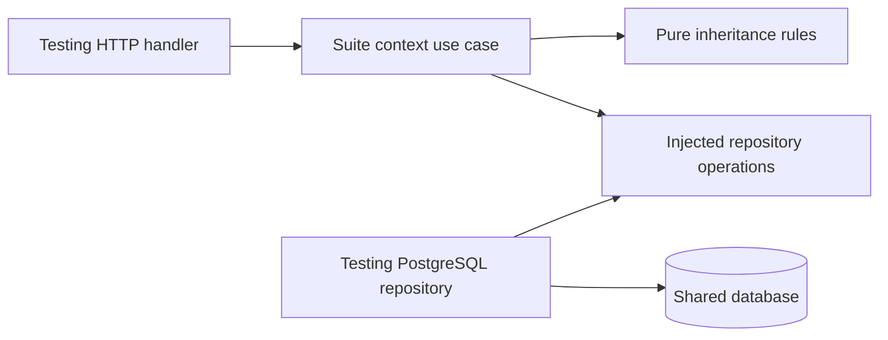

# Capability implementation contracts

The repository uses full-stack npm workspace packages with shared runtime and database foundations. See [capability packaging](capability-packaging.md) for UI release loading and customer deployment selection.

## Imports and contracts

Cross-capability source imports use `@hellotest/<owner>/<export>`. The consumer declares the owning npm package in `dependencies`; the owner explicitly lists the entry in `exports`. Private relative imports across capability folders fail `npm run check:boundaries`. Backend imports of frontend source also fail. There is no per-file exception registry.

The checker enforces declared source contracts, not service independence. Some exports intentionally preserve existing implementation-level contracts. Prefer a narrow named public operation for new integrations; do not expose an entire service just to bypass review. Product prerequisites in `package.json#hellotest.requires` are distinct from compiled code dependencies. Regenerate runtime metadata with `npm run generate:capabilities` after changing product composition.

The module audit checks reachability, unresolved imports and shared UI dependency direction. Backend architecture tests cover all capability backends and the runtime, checking module-level cycles and route/plugin dependency direction. An acyclic module graph can still have capability-level cycles. These checks do not enforce database ownership or maximum file length.

## Dependency inversion within workflows



Testing's `domain/suiteContext.js` contains pure inheritance rules. `services/testing/backend/services/suiteExecutionContext.service.js` accepts repository operations for descendant, ancestor and dataset reads. Its PostgreSQL adapter preserves cycle termination and application scoping. This is a persistence seam; it does not establish a separate Testing database.

Keep validation and transport mapping in routes, business decisions in their capability, and persistence behind small repository operations when extracting a workflow. Do not create forwarding layers without an actual contract or move business logic into shared runtime merely to reduce dependency counts. Existing large orchestration screens and cross-owner SQL still need incremental extraction with behavioral tests.

## Foundation ownership

Testing owns cases, suites, runs, results, defects, schedules and test configuration. Product planning belongs to Manual. Dashboard owns all three dashboard views. Integration owns LLM provider configuration/selection and prompt templates. AI owns assistance workflows. Knowledge owns authorized retrieval; Chatbot owns conversation planning and synthesis.

Platform's `backend/public/projectAccess.js` exposes scoped project reads and catalog redaction; `applicationAccess.js` exposes application lookup. Every profile uses the existing local implementation, preserving membership checks without an extra Platform HTTP dependency. Public routes retain authentication and permissions. Database failures are reported rather than converted into empty records.

Shared HTTP helpers remain in `services/platform/frontend/src/lib`; pure common execution evidence rules remain in `services/platform/backend/src/domain`; model-text normalization and redaction remain in `services/platform/backend/src/security/aiTextPolicy.js`. These modules must not acquire capability use cases.

## Optional UI integrations

The host owns button placement and its draft state. A capability supplies the panel through its `frontend/entry.ts` and the shared `capabilityView` loader. Gate the action on both feature availability and project permission before mounting. Preserve the component props as a release contract. Failures and retries belong to that panel, leaving the host usable.

Protocol 1 shares React, router, query, session, localization, transport, dialog focus and loading-overlay instances. New shell extension points require a shell release. Existing shell composition such as TestOps combines multiple owners and is not wholly a Trace screen. Do not relocate that orchestration into an arbitrary owner merely to empty a shared folder.

## Migration and deployment lifecycle

```sh
npm --prefix services/platform/backend run migrate
HELLOTEST_SCHEMA_MODE=verify npm start --workspace @hellotest/testing
npm run services:up -- --capabilities automation --build
```

The migration job bootstraps an empty database, applies existing idempotent changes under advisory locks and records compatibility receipts. Separate API profiles verify those receipts without running DDL. Platform/all alone performs administrator initialization and optional sample setup. Shared schema migrations are still centrally coordinated; per-owner table grants and migrations are not yet implemented.

Use additive schema/API changes before updating individual profiles, retain compatibility with open UI clients, and retain older hashed UI assets during rolling deployment. Shared database failure remains a shared dependency failure. Optional API unavailability must not prevent unrelated profiles or the shell from starting.

## Contribution checks

1. Place UI, backend and focused tests in the owning package.
2. Use the owner's client and exported contracts; preserve access checks and cancellation.
3. Run its workspace tests and relevant browser checks.
4. Run root tests, builds, package UI builds and source/deployment audits for source or release changes.
5. Describe remaining shared dependencies honestly; package names and separate processes alone do not establish isolation.
