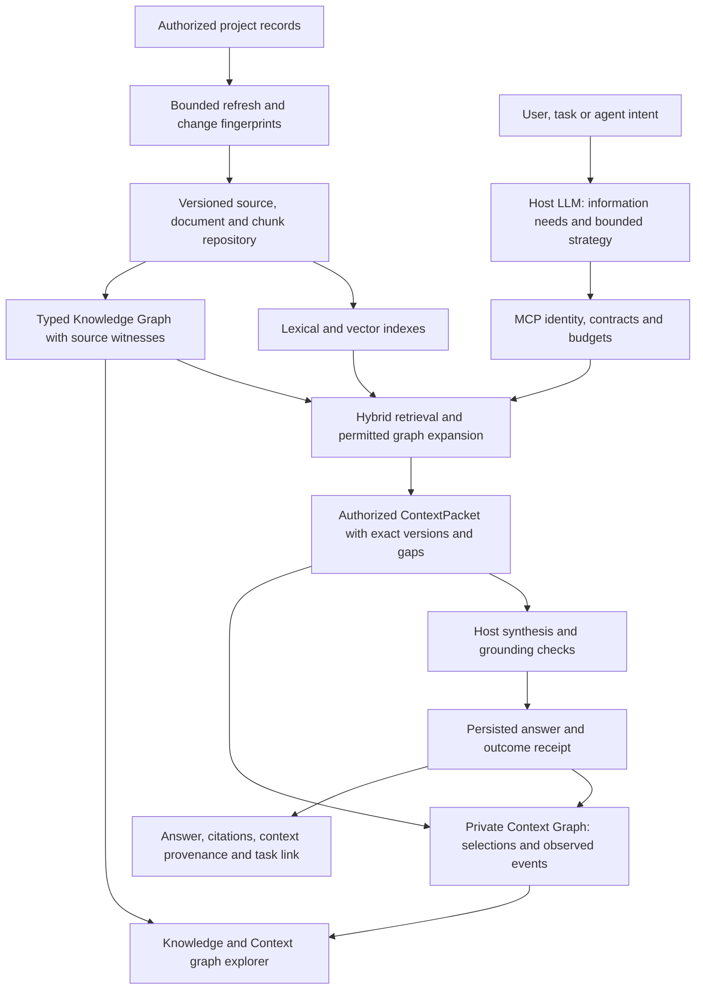
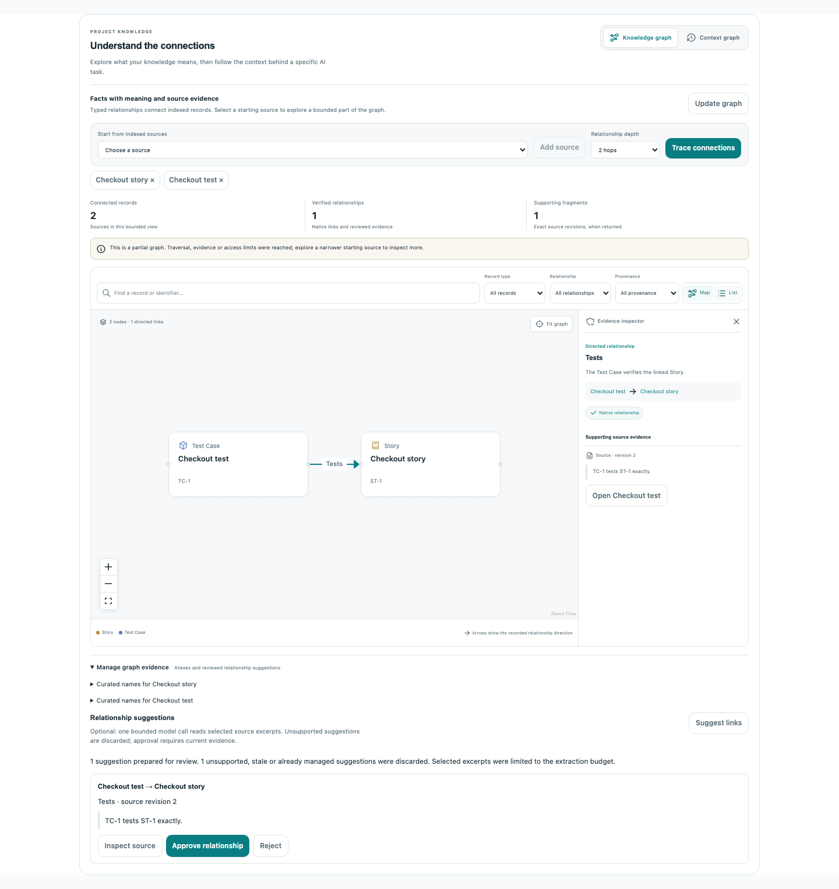
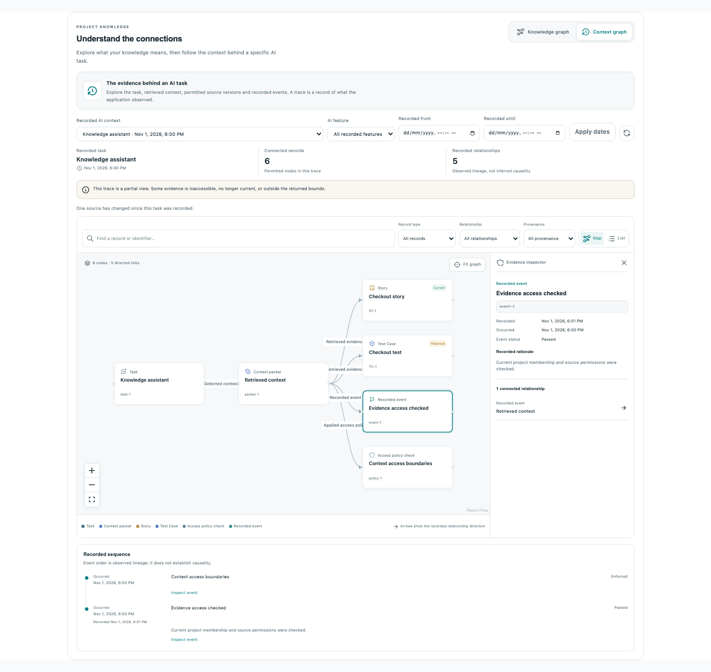
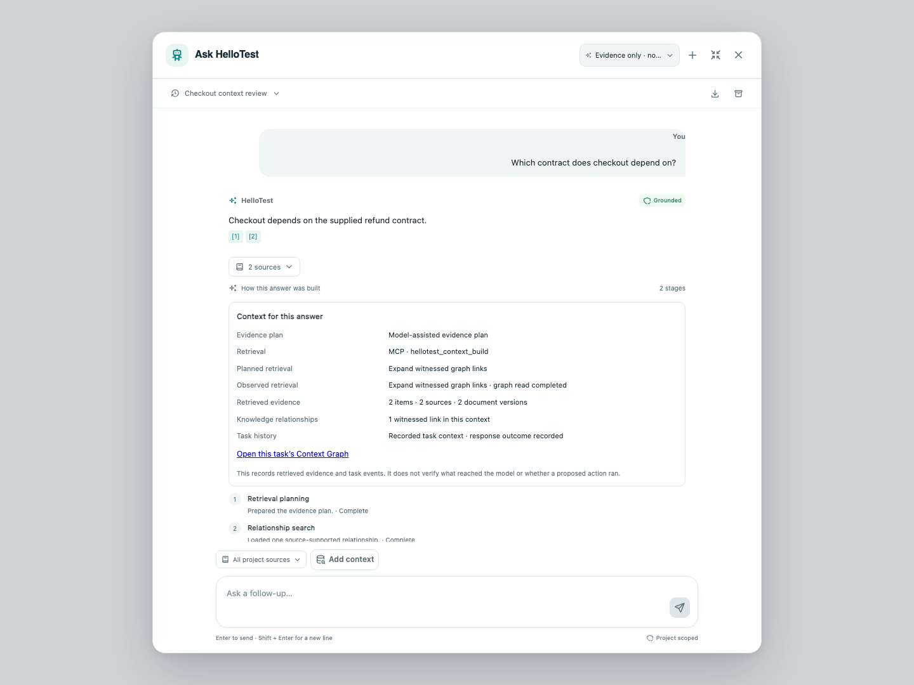

# Knowledge, graphs, MCP and chatbot architecture review

Review date: 2 November 2026. Scope: the current QAIra checkout, its local
runtime and focused verification databases. This is a code-backed assessment;
passing fixtures do not establish accuracy for every project question or
production operating condition.

## Assessment

The foundation is substantial: canonical sources, immutable document/chunk
versions, atomic index promotion, live authorization, witnessed relationships,
typed MCP tools, bounded retrieval and a private task-context ledger are already
implemented. The system is not yet a complete semantic knowledge platform or
an autonomous context-planning platform. Several integration defects prevented
those foundations from producing consistent, inspectable results.

| Area | Existing capability | Maturity boundary |
| --- | --- | --- |
| Knowledge Repository | Explicit project-record ingestion, scheduled refresh, immutable versions, lexical/vector indexes, source/document/fragment ACLs | Periodic scans rather than a domain-wide change outbox; limited native record families and extraction adapters |
| Knowledge Graph | Canonical source nodes, exact aliases, directed native/source/reviewed links, witnessed traversal and bounded path search | Source-level graph; no general concept/entity extraction or complete execution-membership graph |
| Context Graph | Owner-private retained packet selections, exact evidence versions, observed policy/outcome events and separate event/recording clocks | Retrieval provenance, not a verified record of every final provider input or business decision; retention policy remains incomplete |
| MCP | Typed tools, verified project/principal, current permission checks, bounded transport, graph and context endpoints | Tool availability does not establish model-selected execution or external OAuth onboarding |
| Chatbot | Model intent plan, authorized retrieval, grounded synthesis, citation validation and retained sessions | Requires shared budgets, durable outcome receipts and visible plan/tool/graph provenance to be inspectable end to end |

## Architecture decision

Keep orchestration in the host. The host LLM identifies information needs and
selects a bounded retrieval strategy. MCP exposes focused, typed capabilities
and executes the approved plan within the verified identity, source selectors,
deadlines and budgets. An MCP handler should not recursively ask another model
to invent tools, expand authority or search without bounds. This matches the
[official MCP host/server responsibilities](https://modelcontextprotocol.io/specification/2026-07-28/architecture).

Keep PostgreSQL as the transactional source of identities, witnesses and task
events. A separate graph database is not required for the current bounded
traversals. Add one only after measuring a query/operational requirement that
the existing store cannot satisfy.

The Knowledge Graph describes supported relationships in the corpus. The
Context Graph describes what a particular task retrieved and what the
application observed afterward. A retrieved passage is not proof that the model
used it, and an observed sequence is not proof of causality or approval. This
separation follows the entities, activities and agents in
[W3C PROV-DM](https://www.w3.org/TR/prov-dm/).

## Concrete defects addressed

| Priority | Finding and effect | Implementation boundary |
| --- | --- | --- |
| P0 | Story ingestion omitted acceptance criteria stored in `additional_fields`; an acceptance-only edit could leave authoritative behavior absent from search and refresh fingerprints | Project only the named acceptance-criteria field into the native serializer and fingerprint; arbitrary additional fields remain excluded |
| P0 | Repository overview counts/quality aggregates bypassed source, revision and fragment ACLs, even though retrieval enforced them | Apply the shared ACL predicates to counts; exclude whole-document quality metrics when any contributing fragment is denied |
| P1 | Suspended or revoked owners could remain eligible for refresh scans or already-queued ingestion work | Recheck active identity, current Knowledge management access and feature availability before scans and before retained ingestion payload reads |
| P1 | Native relationship serialization could split a typed comma list between chunks, and reference extraction silently stopped below the serializer's bound | Serialize each typed association independently, align bounds and expose omitted-reference metadata |
| P1 | Native snapshot fingerprints did not consistently reach immutable document metadata, so a refresh could repeatedly enqueue unchanged records or reuse a stale metadata revision | Retain the trusted native fingerprint in the immutable revision and require it to match before reusing a ready revision |
| P1 | Remote MCP context calls lost host task/session attribution across the HTTP boundary | Carry an allowlisted correlation projection in the server-signed delegated credential; never accept it from model tool arguments or protocol metadata |
| P1 | The chatbot reconciled retrieval usage by adding the already-spent planner call back into its allowance | Charge planner, retrieval and synthesis against the original combined call cap and reserve the final synthesis slot |
| P1 | The model plan could suggest queries/source families but could not explicitly request graph retrieval when search passages appeared sufficient | Add `hybrid_evidence` and `graph_expand`; one witnessed graph read can follow authorized seed retrieval, while exact selectors, history and remaining budgets retain their veto |
| P1 | An initial search could consume every candidate/tool slot before a requested graph expansion | Reserve bounded graph capacity before optional search enrichment without increasing the caller's total allowance |
| P1 | A zero model-spend budget could stop free retrieval before lexical search or witnessed graph reads | Preserve free retrieval while rejecting positive-cost model/embedding reservations |
| P1 | Context outcome receipts were returned in memory after message insertion, then lost on history/replay | Persist the actual receipt against the newly inserted assistant message; a losing concurrent turn cannot attach another packet |
| P1 | Chatbot evidence cards hid actual MCP delivery and graph/context lineage; frontend relationship presentation was weaker than the native witness contract | Display observed transport, planner, evidence/version and graph facts; require exact supplied relationship witnesses before presentation |
| P1 | A chatbot could not open an exact retained Context Graph outside the first history page | Add the exact trace link and independently authorized exploration; access failure never switches to a different task |
| P2 | Graph fit zoom was clamped above what a narrow viewport could display | Permit fitting the loaded graph at narrow widths; retain zoom controls, the relationship list and the evidence inspector |
| P2 | Restored chatbot messages could display insufficient context solely because transient presentation metadata was absent | Derive the saved-answer badge from the retained validated AnswerContract and claim state, preserving partial/insufficient states |

Source entrypoints:

- [Repository ingestion and overview](../../services/knowledge/backend/services/knowledgeRag.service.js),
  [refresh lifecycle](../../services/knowledge/backend/services/knowledgeRefresh.service.js),
  [graph projection](../../services/knowledge/backend/services/knowledgeGraphProjection.service.js).
- [MCP gateway](../../services/mcp/backend/gateway.js),
  [delegated transport](../../services/mcp/backend/remote.js),
  [credential authentication](../../services/mcp/backend/auth.js),
  [context attribution](../../services/mcp/backend/contextAttribution.js).
- [Intent planning](../../services/knowledge/backend/services/knowledgeIntentPlanning.service.js),
  [context execution](../../services/knowledge/backend/services/knowledgeContextEngine.service.js),
  [chatbot lifecycle](../../services/chatbot/backend/services/knowledgeAssistant.service.js).
- [Context explorer](../../services/knowledge/frontend/components/ContextGraphPanel.tsx),
  [graph canvas](../../services/knowledge/frontend/components/KnowledgeGraphCanvas.tsx),
  [chatbot provenance](../../services/chatbot/frontend/components/KnowledgeContextProvenance.tsx).

## Automatic construction and freshness

Use the existing project refresh lifecycle for database-native Stories, Test
Cases, Runs and Defects. It reads through the current owner's permissions,
compares content and immutable snapshot fingerprints, queues bounded ingestion
jobs, and promotes a revision only when its required indexes are usable. Graph
projection follows usable publication. Context traces are constructed from
actual retrieval and observed outcomes; they must not be fabricated by scanning
old prose and calling it recorded decision history.

Automatic refresh is project-configured. It should not silently ingest every
tenant's database, infer access from an administrator's former status, or turn
on unrestricted model extraction. File/URL/source adapters keep their existing
extraction and destination policies. A URL pointer alone does not establish that
its contents were fetched.

Freshness has two distinct meanings: whether the indexed source is current and
whether a retained task selected that exact older version. Current retrieval
must invalidate deleted/archived/revoked source participation immediately;
historical task inspection can describe an old selection only while current
access still permits that version. Source timestamps are not historical graph
reconstruction.

## Remaining architecture gaps

1. **Exact entity targeting and coverage.** Resolve exact UUID/display IDs through
   permission-checked native/graph resolvers before broad search. Keep ambiguous
   names unresolved. The live two-record chatbot question retrieved nine items,
   including other related readiness material; successful graph execution does
   not establish optimal retrieval precision. Track evidence against each
   information need, surface unresolved needs and measure ranking noise.
2. **Change-driven ingestion.** Replace repeated full-table scans with a durable
   domain outbox and transactional change receipts. Cover Story, case-step,
   parameter-name, linkage, result and permission changes. Keep periodic
   reconciliation for missed events; retain idempotent fingerprint/version
   checks and cleanup on native deletion. Measure lag, throughput, retries and
   indexing cost before setting project-wide automatic defaults.
3. **Semantic entity layer.** Current nodes identify canonical sources, not all
   business entities, rules, APIs, services or decisions within those sources.
   A future entity layer needs project-scoped canonical keys, ambiguity handling,
   exact passage witnesses, review state, validity intervals and deletion rules.
   Extraction candidates must remain separate from active facts. Rich GraphRAG
   methods operate on completed indexes and introduce different cost/accuracy
   tradeoffs; they are not installed by adding an orchestration framework.
   See [Microsoft GraphRAG query methods](https://microsoft.github.io/graphrag/query/overview/).
4. **Execution membership.** `EXECUTED_IN` is an ontology relationship without a
   complete automatic native witness adapter. A Run view permission alone does
   not authorize exposing every linked case/result. Add an exact native
   membership projection with joint Run/case/result authorization before
   advertising complete Story-to-case-to-execution impact paths.
5. **Full model-input receipts.** The ledger currently marks returned retrieval
   evidence with `model_input_verified:false`. Record a separate delivery event
   after the final context packing/redaction step, with exact selected evidence
   versions and rendered digests. Even that receipt establishes delivery rather
   than factual correctness or model attention.
6. **Broader model-directed tools.** A bounded graph-expansion strategy is a
   useful step, but does not implement arbitrary tool discovery, graph path
   planning, multi-agent delegation or automatic reuse of private decision
   memory. Add each read strategy with a typed plan and actual outcome receipt.
   Prior decisions never grant permission for a new action.
7. **Retention and operations.** Add configurable trace TTL, per-owner/project
   quotas, purge/audit semantics, ingestion lag and graph-coverage monitoring,
   alerting and load tests. Current bounded reads do not bound stored history.
8. **Accuracy gates.** Maintain reviewed project questions covering exact lookup,
   missing evidence, contradictory versions, relationship/path questions and
   permission changes. Gate releases on measured retrieval recall, citation
   precision, unsupported-claim rate, coverage and latency. Mock-model success
   and visually connected nodes do not establish answer correctness.

## Verification and visual evidence

The final AI-feature regression gate passed **2,530 tests**, with eleven optional
tests skipped and zero failures. The complete MCP package passed **119/119**.
Frontend helper tests passed **45/45**, and the shared frontend type check passed.
The Knowledge/Context browser flow passed both tests, including exact-task
navigation, revocation and fitting all loaded nodes at 320 pixels. The full
chatbot component also passed desktop/mobile saved-history checks. Counts
overlap with focused agent checks and must not be added together.

Real PostgreSQL/Fastify/SDK MCP verification passed signed attribution,
zero-model-spend lexical/graph retrieval, a current human-verified `DEPENDS_ON`
witness, budget accounting, source-selector blocking and credential revocation.
Knowledge's separate disposable PostgreSQL/Qdrant gate passed **6/6** and covers
native revision lifecycle, index consistency and overview
source/document/fragment revocation.
These persistence checks are separate from controlled browser/model fixtures.

### Actual local construction

The isolated project **Knowledge architecture sample 5f6e77f8**
(`81e86f82-a080-4b50-93b9-cf352e40428e`) retains a synthetic native Story,
Test Case and Defect. The actual refresh and ingestion workers constructed
three ready sources and a Knowledge Graph containing three nodes and three
witnessed relationships: `TESTS` and two `HAS_DEFECT` links. An unchanged scan
added no documents. An acceptance-criteria-only edit queued exactly one record,
promoted Story version 2 and expired version 1. A current-owner queued replay
also reused the immutable revision without adding a document.

MCP retrieval persisted three exact references in private Context Graph trace
`49d65fa1-47b1-4a86-84f6-ce9376bd7045` (four nodes, three edges). This source
process explicitly blocked external provider requests and exercised the recorded
lexical/local-hash fallback. It does not establish semantic embedding quality.
Only the new sample project was configured for refresh, and its automatic
refresh was disabled after verification. Original project settings and native
records were unchanged.

The authorized graph JSON and sanitized checks are retained locally in
`.hellotest/reports/knowledge-architecture-local-2026-11-02.json`.

### Actual model-directed chatbot retrieval

Using the existing local project's configured OpenAI `gpt-4o`, private session
`e0eb6706-0e6a-4021-9d04-5f2cc5ad0643` made two model calls. The intent model
selected `graph_expand`; MCP executed one witnessed graph read and retained one
native `TESTS` relationship. Planner/model work and the three retrieval calls
totaled five calls under the original limit of ten. Both existing native source
rows remained unchanged. Exact versions were indexed through native ingestion.

The answer, Context Graph selection and outcome receipt were persisted. History
and same-turn replay retained those receipts, with zero additional model calls.
The four answer claims are citation-bound **interpretations**, not independent
entailment verification. The packet contained nine authorized items; the task
graph retained the two indexed versions and explicitly reported unavailable or
unindexed/live snapshot omissions. It remains partial and keeps
`model_input_verified:false`.

The sanitized report also preserves the earlier unsuccessful candidate-budget
attempt so the subsequent fix is reviewable:
`.hellotest/reports/chatbot-architecture-local-2026-11-02.json`.

### Local runtime refresh

The API and frontend images were rebuilt and recreated after verification.
All 23 changed backend/shared files match the running API. Its Knowledge and
chatbot capability bundles contain the new retrieval-plan inspector and context
presentation. Direct API readiness, proxied API readiness, main frontend and
admin frontend return HTTP 200. No domain schema migration was needed; graph
projection version 2 uses the existing bounded backfill lifecycle. The temporary
browser-test preview server was stopped.

The current browser flow was captured and inspected on desktop and narrow
viewports:

1. Select indexed sources, trace their relationships and inspect the exact
   passage/revision supporting a directed `TESTS` link. Native links and reviewed
   suggestions stay distinct. Keyboard selection and the relationship list are
   exercised by the browser test.
2. Switch to a private Context Graph and inspect the task, packet, source state,
   policy observation and event clocks. An exact linked trace opens even when
   absent from loaded history; revoking its access removes the graph instead of
   silently selecting another task.
3. Restore a saved chatbot answer and inspect the planned versus observed
   retrieval, exact MCP tool, permitted evidence/version counts, witnessed links
   and task-history link. The retained AnswerContract controls its grounding
   badge. Retrieval provenance does not claim verified final model input.

Narrow captures: [Context Graph](../development/screenshots/architecture-knowledge-context/context-graph-mobile.png),
[chatbot](../development/screenshots/architecture-knowledge-context/chatbot-context-mobile.png).
The full graph fits the loaded viewport; zoom/list controls remain necessary
for reading dense graphs. These screenshots and interaction checks cover the
captured fixtures, not a full accessibility certification or large-corpus
performance evaluation.
