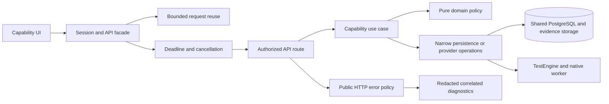

# Reliability and development refactor

Reviewed against the working tree on 28 September 2026. This is a folder-level architecture assessment and a record of implemented changes, not a claim that every source file has been rewritten or security audited. Existing automation work in the checkout was preserved.

## Architectural decision

Retain the capability packages, shared runtime and current deployment contracts. Extract responsibilities where there is a concrete correctness, ownership or testing benefit. Each extraction keeps its caller-facing operation while separating policy, orchestration and side effects. Do not introduce an interface for every function or move files solely to shorten a directory listing.

## Implemented seams and behavior

| Boundary | Implementation | Verified behavior |
| --- | --- | --- |
| Browser request reuse | [ClientRequestCache](../../services/platform/frontend/src/lib/clientRequestCache.ts) behind [httpClient](../../services/platform/frontend/src/lib/httpClient.ts) | GET reuse remains bounded to 120 entries and 1.5 seconds. Writes invalidate both cached and pending reuse. Generation checks prevent older reads from restoring stale data. Headers, endpoint and request options distinguish representations. Session/permission isolation remains enforced. |
| Browser transport | [clientRequestTransport](../../services/platform/frontend/src/lib/clientRequestTransport.ts) | JSON, uploads and downloads share cancellation/deadline handling through response consumption. Download cancellation reaches fetch; body timeout and malformed JSON have useful messages. Timeout errors do not echo query values. |
| Public API failures | [httpErrorPolicy](../../services/platform/backend/src/utils/httpErrorPolicy.js), [error handler](../../services/platform/backend/src/plugins/errorHandler.js) | Pure classification is separate from Fastify logging/replies. Unexpected SQLSTATE errors stay private 500 responses. Known validation/conflict/retry contracts remain intact. Missing retry hints remain absent and explicit hints are bounded. |
| Diagnostic logging | [diagnosticErrorSerializer](../../services/platform/backend/src/utils/diagnosticErrorSerializer.js), [serviceErrors](../../services/platform/backend/src/utils/serviceErrors.js) | API `err`/`error` fields preserve sanitized type, message, stack and bounded causes. Arbitrary provider configuration, SQL parameters and response properties are omitted. Quoted credentials and signed URL values are redacted. |
| Native recording | [mobileRecorderPlan](../../services/automation/backend/domain/mobileRecorderPlan.js), [mobileRecorderPersistence](../../services/automation/backend/services/mobileRecorderPersistence.service.js) | Pure platform/action planning is separate from injected transactional persistence. Step edits and readiness commit together. Missing targets, invalid coordinates, unsupported actions and stale selections fail explicitly. Chronological selection uses set membership instead of repeated scans. |
| Worker service HTTP | [engineHttpClient](../../testengine/backend/src/lib/engineHttpClient.ts) | Queue, callback and native control callers share bounded JSON reads and deadlines. Typed failures replace message matching. Redirects cannot forward service credentials. Error messages omit raw provider bodies/URLs and retain request references. |
| Native driver ownership | [executionSessions](../../local-run/mobile-engine/src/executionSessions.js) | Capacity remains reserved through driver close. Old operations cannot close replacement sessions. Shutdown prevents new work; one-shot runs use the same capacity accounting. |
| Developer entry points | [doctor](../../scripts/dev/doctor.mjs), [debugger configurations](../../.vscode/launch.json), [contributor guide](../../CONTRIBUTING.md) | Read-only prerequisites/dependency diagnosis, loopback inspectors and documented startup, tests, tracing and recovery. No infrastructure reset is part of diagnosis. |

The shared HTTP client no longer contains unused private Jira transformation helpers. New code can use an explicit invalidation operation. The exported cache Map and its `clear()` contract remain available for already deployed protocol 1 capability releases; clearing it also invalidates pending reuse and older generations.

These changes apply SOLID through concrete contracts: one responsibility per extracted policy/adapter; stable caller operations; compatible result and cancellation semantics; small injected persistence operations; and domain decisions independent of PostgreSQL or Appium. Performance claims are limited to bounded memory/request reuse and the recorder selection algorithm. No production throughput or latency benchmark was performed.

## Folder assessment

| Folder | Ownership and assessment |
| --- | --- |
| `services/platform` | Shared API composition, auth, storage and workspace shell. Error policy/diagnostics and browser transport were refactored here so all capability clients/profiles benefit. Keep product use cases in their owners. |
| `services/testing` | Cases, groups, data, suites, runs and results. Preserve frozen execution contracts and existing hook work. Large case/run pages still need separate authoring, planning and result state modules with browser regression coverage. |
| `services/manual` | Stories and planning. Existing ownership/import contracts remain. `RequirementsPage.tsx` still combines substantial editing, linking and assistance state; extract each workflow with its own query/draft tests when changing it. |
| `services/automation` | Automation build, recording and dispatch. Native planning/persistence now have explicit seams. The main builder still coordinates browser, model and repository work; future extraction should isolate one lifecycle at a time. |
| `services/agentic` | Agent and inspection workflows. Preserve authorized source/tool contracts and deployed inspection bundle compatibility. Generated/model-supplied output must pass validation before persistence. |
| `services/ai` | Assistance workflows and jobs. Retain durable ownership, bounded provider calls and context authorization. Shared error/log handling now applies without moving these use cases into Platform. |
| `services/knowledge` | Ingestion, retrieval and grounding. Preserve streaming, source-level access and evidence provenance. Do not convert dependency failures to empty retrieval results. |
| `services/chatbot` | Conversation and streaming answer contracts. Cache invalidation now uses the shared operation; stream progress and session isolation remain capability-owned. |
| `services/integration` | Provider selection/configuration and synchronization. Keep secrets server-side and provider behavior behind existing contracts; no additional universal provider registry was introduced. |
| `services/dashboard` | Analytics and readiness projections. Shared request reliability applies to its client. Keep large report queries bounded and preserve denied-source redaction in future changes. |
| `services/trace` | Operational telemetry and monitoring gateways. Preserve best-effort telemetry and bounded cardinality. Request/trace IDs connect public failures to structured API logs; worker HTTP also retains request references. |
| `testengine` | Sole supported execution worker, provider orchestration, artifacts and queue adapters. Internal service transport was consolidated; target API execution policy remains separate. |
| `local-run` | Local stack wrappers, recorder launchers and native provider. Native session lifecycle was corrected; infrastructure wrappers retain their existing stable entry points. |
| `scripts` | Build, deployment, checks and operations entry points. Added read-only developer diagnosis. Existing architecture checks enforce source/import ownership; the requested root `CONTRIBUTE.md` pointer is explicitly allowed. |
| `ops` | Monitoring/routing configuration. No monitoring stack or credentials were changed. Runtime health checks and OPS verification remain separate from static source audits. |
| `docs`, root guides, `.vscode` | Corrected actual paths, ports, environment loading, setup and debugger instructions. `CONTRIBUTING.md` is canonical; `CONTRIBUTE.md` and the older debugging path point to it/the current runbook. |

Installed dependencies, build outputs, artifacts, private environment files and local tool state are not source-refactor targets. Source and package boundary checks assess all capability folders; that does not substitute for a line-by-line review of each implementation.

## Verification and remaining limits

Run `npm test`, `npm run build`, and `npm --prefix local-run/mobile-engine test` from the repository root. Focused behavioral tests cover stale reads across mutations and sessions, cancellation during body reads, safe error envelopes/logging, transactional native saves, bounded worker responses and concurrent driver shutdown. Architecture checks cover declared exports/dependencies, module resolution, ownership and source layout. The debugging runbook distinguishes these tests from live integration validation.

Validation receipt for this working tree:

| Check | Result |
| --- | --- |
| Backend workspace tests | 1,272 passed; two PostgreSQL integration tests skipped |
| Frontend workspace tests | 639 passed |
| TestEngine tests and TypeScript build | 76 passed; build passed |
| Native worker tests | 26 passed |
| Architecture/developer-tool tests | 14 passed |
| Workspace/admin UI and Chatbot capability builds | Passed; existing large-chunk warning remains |
| Source layout, module graph, package boundaries, service architecture | Passed |
| Actual `npm run --silent doctor -- --json` | `ok: true`; no required failures or optional-tool warnings |
| Documentation verification | 80 local links/anchors and 41 shell examples checked |

The final architecture tests were rerun after correcting Compose version parsing for a leading `v`. The test counts above count each suite once, excluding repeated focused regression runs.

No database migration, deployed-stack smoke run, real LLM call or physical-device test was performed for this refactor. Validating those paths requires the intended database, integrations, browsers/devices and credentials. The frontend build still reports large bundle chunks; this change does not establish a bundle-size improvement.

Remaining architectural work is explicit: large authoring screens and orchestration services, centrally coordinated shared schemas, implementation-level cross-capability contracts, and worker isolation for trusted automation. Saved automation runs in the worker process; these HTTP and logging safeguards do not create a sandbox for untrusted code. Split those responsibilities with behavior tests and deployment compatibility evidence, rather than declaring service independence from folder names alone.
