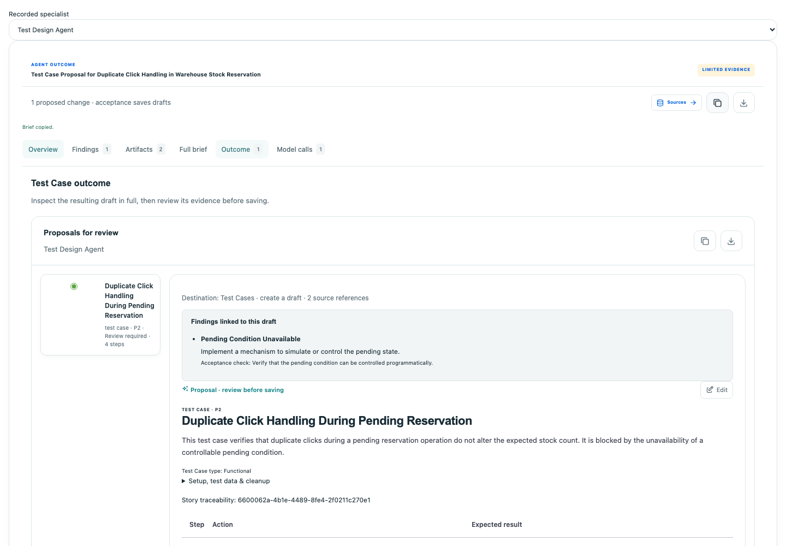

# Live agent intent and outcome verification

Date: 2 November 2026. Scope: all 31 built-in Studio agents, comprising 22
workspace specialists, four repository agents and five browser missions, plus
the one active local custom agent. Unrelated native AI features are outside this
agent catalog. Verification uses the locally configured OpenAI `gpt-4o` integration,
native application services and bounded synthetic inputs. Provider responses are
real; browser renderer fixtures are reported separately.

## What is being verified

Each agent receives input appropriate to its task. Authoring agents receive
Story/case intent and exact native identifiers; analytical agents receive
selected release, case, result and defect evidence; repository agents receive
actual source findings; browser agents receive observed local browser state
and their native scanner phase. Synthetic result histories are clearly labeled
and do not establish product test execution.

Validation separates these questions:

1. Did a real provider request occur, and was its result retained?
2. Did the native output schema, source references and artifact constraints pass?
3. Did the proposed result address the submitted intent with the required fields?
4. Were the sampled claims, sequences and response contracts supported by the
   supplied evidence? Citation matching alone cannot answer this question.
5. Does the UI render/export the actual result without turning suggestions into
   completed work or silently accepting a draft?

`validated` means the native contract checks passed. `needs_input`, `needs_review`
and an explicitly limited assessment remain valid task outcomes when evidence
is absent. They are not successful repairs, release approvals, executed generated
tests or independent proof of factual correctness. Pre-model retrieval failures
do not count as live model tests. Initial failed attempts remain in the reports.

## Input and output defects corrected

| Defect | Resulting behavior |
| --- | --- |
| Accepted task text was silently shortened at 8,000 characters; reviewed context was reduced to 3,000 | Complete tasks up to 16,000 characters and reviewed context up to 12,000 are preserved; overflow fails before dispatch |
| Successors/context reductions omitted original supplied inputs or abbreviated assigned findings/proposals | Sanitized original task/workflow/reviewed context and complete assigned content survive handoffs; fresh product evidence retains its own authorization |
| Several complete supplied sections could displace all current product evidence | Context reduction reserves current evidence while keeping exact brief sections complete or rejecting an oversized packet |
| Run Planner could receive no canonical Test Case candidates after general context packing | A bounded current, permission-checked candidate projection supplies exact IDs/revisions and explicit omissions |
| Artifact format repair exposed only generic native-reference errors | Corrections identify missing metadata, invalid native fields and mismatched finding/source references without weakening validation |
| Positive findings could conflict with a declared no-change authoring outcome | Correction guidance distinguishes clean conclusions, independent drafts and findings requiring a proposal |
| Accepted recommendation, assumption and evidence-gap tails were discarded | Declared item/text bounds survive normalization and persistence; combined excess remains explicitly represented in review limitations |
| Source batching lost API schemas, locators, component assertions and document content | Complete validated typed findings reach model review within explicit bounds; source secrets remain recursively redacted |
| Native evidence compaction dropped Gherkin authoring details | Retained cases preserve authoring mode, Gherkin excerpts and completeness flags; omitted records remain explicitly unknown |
| Automation authoring could see selected manual cases/linked Stories without valid native linkage targets | Permission-checked case revisions, manual-case links and linkage-only Story references are projected into the allowed targets |
| Native evidence permission checks happened after the model returned | Native code, data and Story permissions are also rechecked immediately before dispatch |
| Source review prose could describe stronger assertions than its editable drafts | Governed source instructions require documented input constraints and response assertions in native steps; missing source contracts stay unresolved |
| Browser mission decisions depended on prose alone and lacked native scanner-phase information | Typed decision/provider schemas and pending-check/navigation state guide the bounded observed action loop |
| Browser assessment could reference invented finding IDs or miss a newly checkpointed screenshot | Allowed identifiers/metrics/conclusions derive from retained evidence, and assessment uses the current checkpoint row |
| The post-brief section emphasized review history and suggestions | A stable Outcome tab presents complete drafts or the actual assessment/report first; follow-up considerations and handoff history are secondary |
| Full-brief exports omitted typed repair/quality outcomes | Exports retain repair patches/status, quality reports, native artifact fields and model-call receipts |
| Hidden Model calls panels fetched trace details before being selected | Trace inspection loads when its tab is opened |

## Outcome presentation

The output order is **Overview → Findings → Artifacts → Full brief → Outcome →
Model calls**. Outcome chooses its presentation from the actual result:

- Story, Test Case, Defect, Run and Automation Plan drafts use the native review
  controls with full fields, steps, Gherkin, parameters or selection IDs.
- Assessments display the complete narrative and supporting sections/tables/
  charts instead of a recommendation checklist.
- Typed repairs preserve their proposal and verification state.
- Missing authoring deliverables remain an incomplete outcome with named gaps.
- Acceptance requires current permissions, supported references and completion
  checks; viewing/copying an outcome does not save or execute it.
- Finding links describe proposed coverage. They do not certify that a missing
  policy, runtime observation or source contract has been supplied.

The renderer verification over recorded real outputs is opt-in and makes no
additional provider calls:

```sh
AGENT_LIVE_OUTCOME_DIR="$PWD/.hellotest/reports/agent-intents-live-2026-11-02-outcomes" \
AGENT_LIVE_CUSTOM_REPORT="$PWD/.hellotest/reports/custom-agent-intent-live-2026-11-02.json" \
VITE_TEST_URL=http://127.0.0.1:5197 \
node --test services/agentic/test/browser/agentLiveOutcomeReplay.test.mjs
```

## Evidence and results

The live specialist matrix and individual retained outcomes are under
`.hellotest/reports/agent-intents-live-2026-11-02.json` and its accompanying
`-outcomes` directory. Source/browser reports retain static extraction,
provider review and actual browser observations as distinct evidence.

A real long-brief Story Architect request, transaction
`0d00e150-e1fb-4029-b244-c845b0c1495d`, verified that the exact 10,240-character
task and 3,938-character reviewed context, including their final obligations,
reached `gpt-4o`. The complete accepted response and artifacts were persisted.

The 22-specialist matrix recorded **80 actual provider dispatches**, including
**78 HTTP 200 responses** across initial, repaired and repeated attempts. Every
specialist has at least one actual HTTP 200 receipt. Final native validation
accepted **16 complete** and **five explicit needs-input outcomes**; **Automation
Engineer was rejected** after bounded repair because finding links lacked the
required supporting citations. Its rejected candidate is diagnostic data, not a
usable draft. No provider-contract checks were weakened to obtain a pass.

Six accepted specialist outputs have specific semantic review findings. These
include pending-click steps ordered after terminal assertions, an invented
two-second policy, an absence claim inferred from partial coverage evidence, and
wording implying executed coverage. Updated instructions address these patterns;
the retained captures still require review. The dedicated Test Designer retest
corrected its click chronology and explicitly retained the missing pending-control
prerequisite. This is not a claim that every generated test is correct.

The independent semantic audit is
`.hellotest/reports/agent-intents-semantic-review-2026-11-02.json`. It retains
initial defects, exact excerpts, input/report hashes and the state of each
follow-up rather than replacing failed captures with later successes.

The browser renderer replay checked all **21 accepted built-in specialist recordings
plus the accepted custom outcome**, their native fields and complete exports. It
separately required a real provider
receipt and retained diagnostics for the rejected specialist. Six existing
browser scenarios also passed. Desktop/mobile screenshot examples below show
the production outcome component with retained real model output; delivery,
authentication and write endpoints are fixtures, and no proposal is accepted.



[Mobile draft](screenshots/agent-intent-outcomes/test-designer-mobile.png),
[Story outcome](screenshots/agent-intent-outcomes/story-architect-desktop.png),
[mobile release assessment](screenshots/agent-intent-outcomes/release-readiness-mobile.png).

Regression verification: 2,568 AI feature checks passed, 11 optional checks
skipped; 119 MCP checks passed; 49 source compiler checks and seven native browser
worker checks passed. Frontend type checks, service boundaries, MCP inventory,
documentation links and whitespace checks passed. Focused intent checks passed
140/140. These checks are separate from real provider behavior and semantic
review.

The final combined per-agent matrix and refreshed-runtime checks follow below.

<!-- FINAL_MATRIX -->

## Final matrix

All **32 active/built-in agents** received actual LLM responses: **31 built-ins and one active custom agent**. Native contracts accepted **31 outcomes**, including the five needs-input specialist outcomes; one was rejected. **Nine accepted outputs have detected semantic issues** and must be reviewed or corrected. All other outputs still require human review. No generated artifacts were accepted, published or executed.

| Agent intent | Native outcome | Sampled semantics |
| --- | --- | --- |
| Story Architect | accepted | Human review required |
| Quality Orchestrator | accepted | **Needs correction/review** |
| Test Design Agent | accepted | Human review required |
| Automation Engineer | rejected | No accepted output |
| Smart Run Planner | accepted | Human review required |
| Defect Reporter | accepted | Human review required |
| Failure Analyst | accepted | Human review required |
| Defect Triage Agent | accepted | Human review required |
| Object Repository Curator | accepted | Human review required |
| AI Story Completion | accepted | **Needs correction/review** |
| Quality Evaluator | needs input | **Needs correction/review** |
| AI Story Assurance | accepted | **Needs correction/review** |
| AI Grooming | needs input | Human review required |
| AI Test Case Improvement | accepted | Human review required |
| AI Release Readiness | needs input | Human review required |
| AI Impact Analysis | needs input | Human review required |
| AI Test Coverage Assurance | accepted | **Needs correction/review** |
| AI Flaky Test Intelligence | accepted | **Needs correction/review** |
| AI Risk Prediction | accepted | Human review required |
| AI Release Risk Simulation | accepted | Human review required |
| AI Automation Repair | needs input | Human review required |
| AI Quality Graph | accepted | Human review required |
| object_repository | accepted | Human review required |
| api_tests | accepted | **Needs correction/review** |
| repository_knowledge | accepted | Human review required |
| component_tests | accepted | **Needs correction/review** |
| browser-web | accepted | Human review required |
| browser-security | accepted | Human review required |
| browser-performance | accepted | Human review required |
| browser-accessibility | accepted | Human review required |
| browser-visual | accepted | Human review required |
| Quality Orchestrator custom | accepted | **Needs correction/review** |

The active custom Quality Orchestrator version1 received its saved name, objective, instructions and exact configured budgets through the native custom-agent route. Its definition and source records were unchanged. Its review still inferred missing coverage from partial evidence and is flagged accordingly.

API drafts retain gaps in field-type/media assertions and minimum-ID inputs, and claim an absent body contract was resolved. Component prose invents `product-title`, which is absent from the actual source. New instructions were confirmed in the actual API provider request; these final semantic failures are retained rather than treated as stale-worker failures.

Browser missions preserve observed findings and limits: security/accessibility findings are actual findings, not product passes; visual comparison stays needs-review because no approved baseline exists.

Combined machine-readable evidence: `.hellotest/reports/all-agent-intents-live-2026-11-02.json`. Custom version evidence: `.hellotest/reports/custom-agent-intent-live-2026-11-02.json`. Source/browser evidence: `.hellotest/reports/repository-browser-intents-live-2026-11-02.json`.

## Local runtime

Rebuilt and refreshed the API and frontend. All39 changed backend/shared JavaScript, JSON and Python files match the running API image; the updated Outcome UI is present in its compiled Agentic bundle. API readiness, frontend, frontend API proxy and admin portal returned HTTP200. See `.hellotest/reports/agent-outcomes-image-check-2026-11-02.json`.

The opt-in live verification CLI exits nonzero for detected native/semantic failures. A failing verification report remains useful evidence; successful schema validation is not substituted for a correct test oracle or supported claim.
