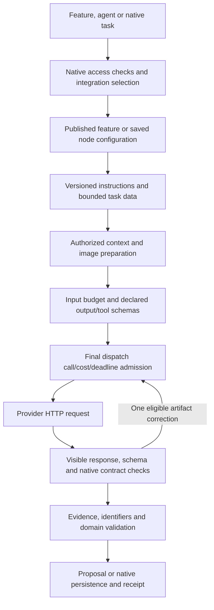

# LLM request construction and evaluation

This audit covers production application features, saved agents, native workflow tasks, Knowledge, embeddings and the connection probe. The canonical inventory has 76 profile identities: 40 active administrator controls, 33 active agent profiles and three retained non-invoking identities. Twenty-six application caller sources share the generation transport; adapters and explicit transport exceptions are separately classified. Reproduce the current identities and source paths with `node scripts/checks/ai-configuration-inventory.mjs`.

## Sending and receiving

`llmHttpClient` owns the shared HTTP boundary. `aiFeatureRuntime` resolves the configuration owner and expands the versioned instruction blocks. Application features use published Admin controls; agents and native tasks retain their saved node/definition scope. Provider credentials remain server-side and permission-checked. This work retains the configured OpenAI-compatible chat protocol; it does not silently migrate integrations or switch models.

Stable role, domain, task, prompt and guardrails precede varying native format guidance. Exact repeated instruction fragments are removed; differing instructions and required schemas are retained. The short immutable evidence-boundary protocol is versioned in `services/platform/shared/aiRequestPolicy.json`, separately from editable feature behavior. Trace capture records that revision and the effective configuration versions/hashes.

Dynamic documents and observations belong in USER task/context data. `aiPromptEnvelope.dataBlock` can wrap JSON in a fixed tag while escaping `<`, `>` and `&` inside its JSON strings. A supplied closing tag cannot escape the envelope, and JSON decoding retains the exact Unicode, code and markup. Tags improve the data boundary; they do not prove resistance to model prompt injection. Native permissions, tool dispatch, project/source access, validators and human action approval enforce authority outside the prompt.

Required supplied inputs stay complete. Optional retrieval projections may be bounded with explicit omissions; the system no longer silently cuts connected workflow JSON or required repair evidence. Exceeding a required-input budget stops before dispatch with guidance to split the task. Multimodal content remains attached and subject to its native access checks.

## Output contracts and corrections

Native code still owns field names, allowed identifiers, enum values, required evidence, parameter bindings and persistence. Declared `outputSchema` is locally validated; known official OpenAI model/endpoint combinations can receive a strict provider schema only when the original schema already fits the supported closed subset. Optional fields are not silently made mandatory. Other providers retain the schema instructions and local validation. Explicit unsupported-format rejection can downgrade the transport representation while preserving that contract.

Tool calls must use an advertised function and satisfy its actual parameters schema, including required fields, enums and additional-property rules. Valid JSON alone no longer counts as usable tool arguments. Native dispatch still rechecks permissions and business rules.

One eligible native artifact correction includes the previous visible candidate and its exact validation problems. Validation data stays at USER authority; it is not appended as a new SYSTEM instruction. Candidate/error data for caller-owned repairs is non-enumerable and bounded, so it is not copied into public error JSON. A repair that cannot retain the original task and candidate within the input budget stops without another paid request.

Transport compatibility, transient failures and semantic correction are distinct. Compatibility changes apply only after explicit pre-generation rejection. Authoring repairs, caller-owned review repairs and automation phase loops were cross-checked for ownership rather than stacked indiscriminately. Truncation/refusal is not an invitation to invent a complete artifact. Once a successful provider response has been received, a later correction-capacity or persistence failure cannot make the original paid generation replay-safe. Durable jobs retain the saved/partial state instead of rerunning it.

## Call accounting and intentional stages

Saved-agent/specialist call budgets and repository run budgets count actual dispatches, including corrections hidden inside the shared HTTP helper. Repository batches share one run ledger. Native bulk tasks retain their domain phase/item limits; no small generic cap is imposed across a whole Sprint. Empty repository findings produce an explicit skipped/limited-evidence result with zero model calls.

Knowledge normally uses an intent call and a synthesis call for different purposes. Explicit disabled retrieval skips both. Successful same-turn replay makes no new requests. Explicit grounding verification remains separate; it is not an automatic third answer call. Rejected provider-parameter capabilities are cached by integration/endpoint/model, without storing answers or credentials, to avoid repeatedly paying the latency of known-rejected requests.

Knowledge cost admission checks the final expanded payload before dispatch, rather than raw instruction-marker bytes. `calls_used` remains a conservative admission count; `provider_requests` records actual admitted generation POSTs. Missing usage does not reopen a spending ceiling. Query/document embeddings remain a separate traced transport and use endpoint/model/source-version-aware caching; an explicit query cost ceiling chooses keyword retrieval. The connection probe remains a small explicit provider capability check and uses the shared token-parameter classification rather than a second stale model-name rule.

Trace `capture.request_structure` records exact UTF-8 request/message/schema/tool bytes, image count, exact duplicate-message bytes and a trusted-prefix fingerprint. It contains no prompt copies or invented token estimates. Actual input/output/cached-token counts remain provider-reported usage, with cache counts treated as a subset. Byte reductions are not automatically token, latency, cost or semantic-quality improvements.

## Request evaluation set

`npm run test:ai-requests` runs deterministic caller/transport fixtures for closing-tag injection, exact data retention, stable instruction prefixes, schemas and tool arguments, complete repair evidence, actual dispatch/cost admission, input limits, disabled retrieval, replay prevention and persistence failures. The tests exercise application behavior with controlled providers. They do not establish live answer quality or prove an XML format superior to Markdown/JSON.

Measured representative fixtures:

| Fixture | Before | After | Retained check |
| --- | ---: | ---: | --- |
| Workflow request, UTF-8 bytes | 14,355 | 10,634 | All eight connected subjects, native schema and one successful model call |
| Initial chatbot intent USER data, UTF-8 bytes | 835 | 291 | Exact question/scope and user history references |

Before publishing a new prompt version or changing a provider/model, run the same held-out domain tasks against both candidates: functional and NFR objectives, structured/Gherkin cases, native parameters, conflicting/missing evidence, multilingual input, long inputs, tool errors and hostile documents. Score native validity, evidence/identifier precision, objective coverage and false completion claims; also compare actual calls, reported tokens, latency and cost. Keep human review for semantic correctness. Do not automatically choose the shortest prompt or let a model's self-score become product readiness.

The implementation follows the [official prompting guidance](https://developers.openai.com/api/docs/guides/prompt-engineering) on explicit instructions/data boundaries, the [structured-output guidance](https://developers.openai.com/api/docs/guides/structured-outputs) on provider schemas plus local handling, and the [evaluation guidance](https://developers.openai.com/api/docs/guides/evaluation-best-practices) on task-specific test sets. Stable prefixes and reducing redundant work follow [prompt caching](https://developers.openai.com/api/docs/guides/prompt-caching) and [latency optimization](https://developers.openai.com/api/docs/guides/latency-optimization); no production saving is inferred from a synthetic byte fixture.

## Detailed caller inventories

- [Application feature requests](ai-feature-request-audit.md)
- [Agents and native tasks](agentic-llm-request-audit.md)
- [Knowledge, chatbot and embeddings](knowledge-model-efficiency.md)
- [Configuration ownership and all profile identities](ai-configuration-audit.md)
- [MCP evidence delivery and access checks](mcp-context-accuracy.md)

No production prompts were published and no deployment was performed by these checks.

## Validation snapshot, 2026-10-31

- Request contract/effect regressions: 57 passed with `npm run test:ai-requests`.
- Full backend: 3,378 tests; 3,308 passed, 21 skipped, 49 failed. All 49 failing names also fail in the recorded isolated HEAD baseline; there are no new failing names. Two baseline failures now pass.
- Real disposable PostgreSQL/SDK integration passed, including feature and native-node model configuration, generated proposals, persistence/replay, current source/fragment access and context delivery.
- MCP regressions: 102 passed. Architecture regressions: 35 passed. Configuration inventory, native-contract/feature inventory, documentation links and package boundaries passed.
- The module graph still reports its two existing orphan-source findings; it reports no unresolved imports or shared-feature dependency violations.

Provider responses in the model fixtures are controlled. A live-provider comparison of semantic quality, latency or billing was not run.
