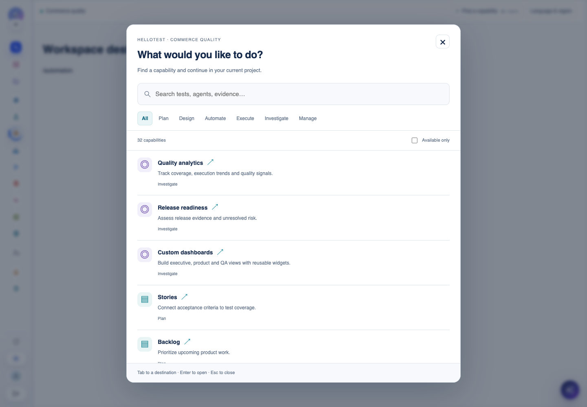
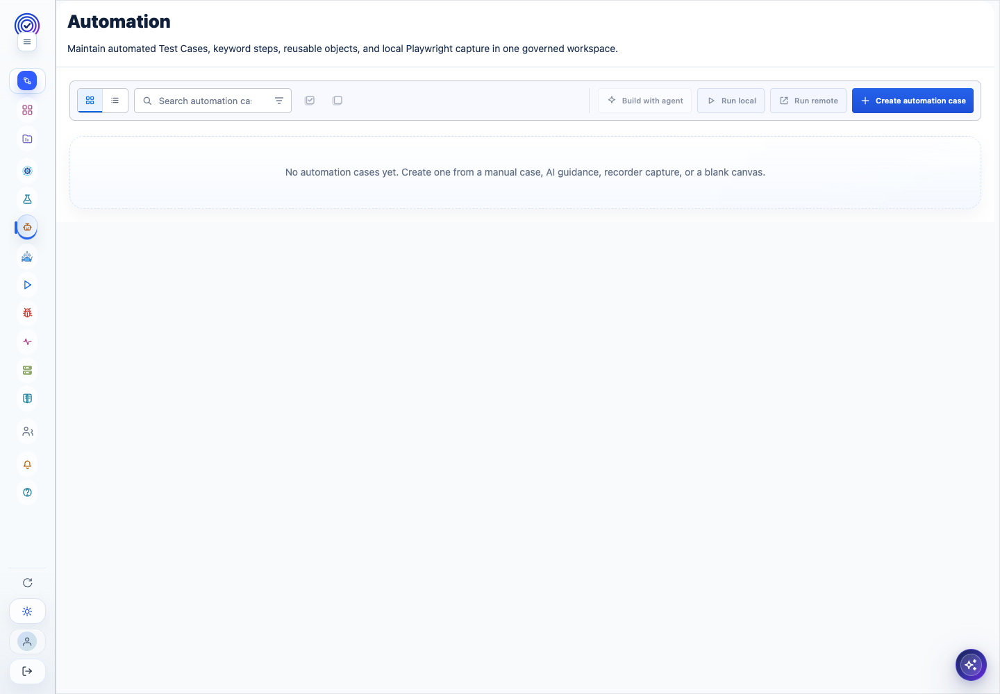
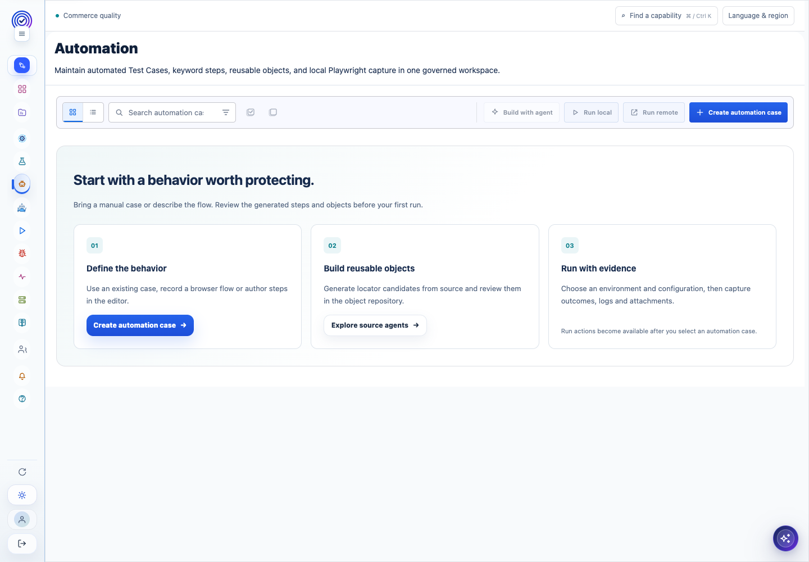
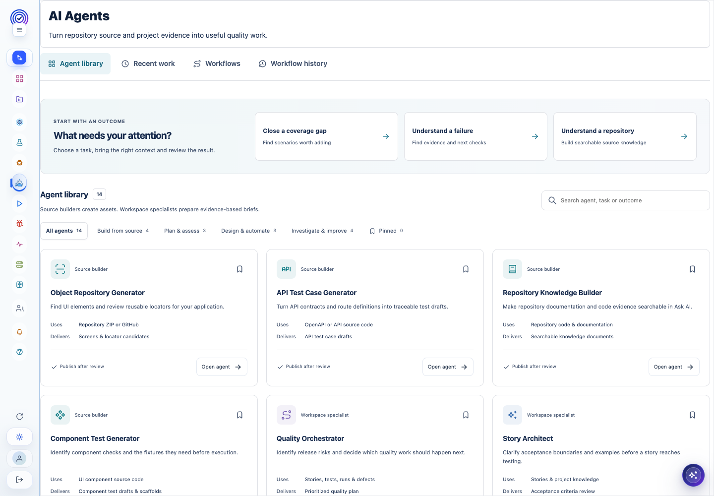
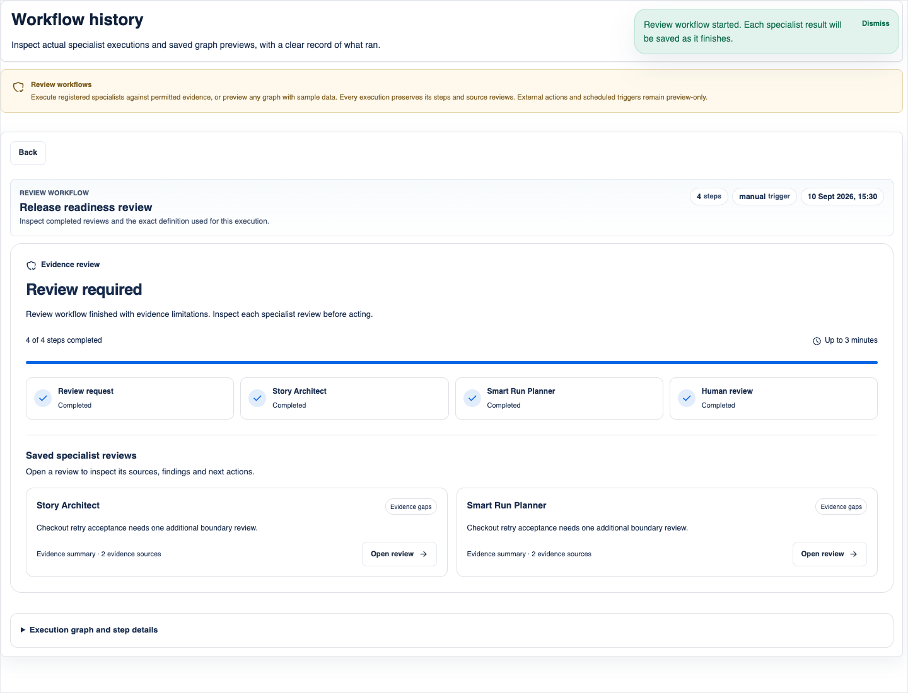
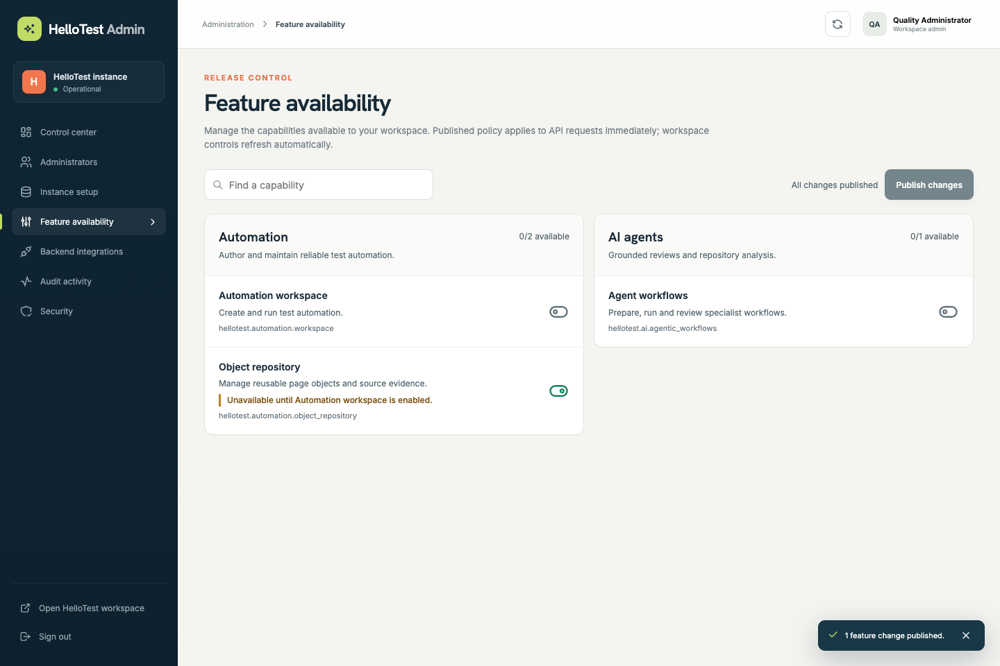
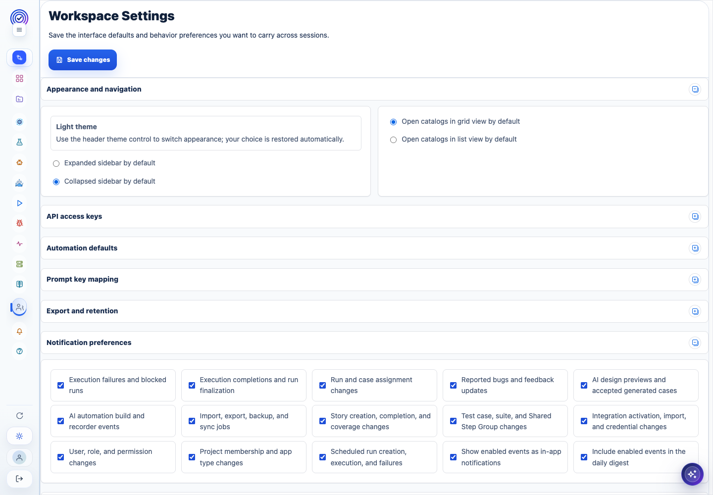
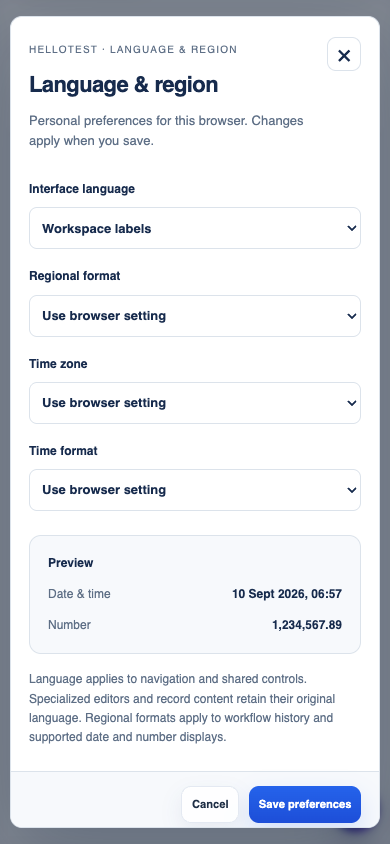
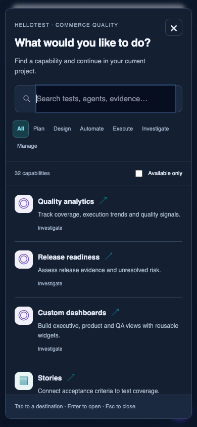

# HelloTest product maturity: research, decisions and implementation

**Reviewed 10 September 2026.** This report records a product and implementation review of the existing application and the changes made from that review. It is accompanied by the [capability inventory](product-capability-inventory.md), [access research](product-access-research.md) and [automation research](product-automation-research.md). Together these form the detailed research record; the scope and verification limits below apply to all conclusions.

## 1. Product position and decision

The strongest direction for this product is a connected quality workspace: a team can move from a product concern to a test, from a test to automation and execution, and from an observed failure to evidence, investigation and the next coverage improvement. Agents should accelerate those transitions, while preserving the person's ability to understand inputs, verify sources and review proposed changes.

The implementation already contains much of that domain model. Replacing mature editors wholesale would risk losing Gherkin parameters, reusable groups, execution snapshots, evidence handling and project boundaries. The higher-value intervention is to make the existing capabilities discoverable, make their shared access behavior reliable, and close the gap between a configurable agent canvas and an executor that performs real work.

This pass therefore implements four connected improvements:

1. A task-oriented navigator spanning 32 existing destinations, with permission, project and feature availability evaluated before navigation.
2. Actual execution of bounded specialist review workflows, with validation, recorded results, idempotent starts, cancellation and honest evidence limitations.
3. A corrected feature-policy and permission foundation, including atomic updates and direct API enforcement.
4. Personal language and regional preferences, a safe workspace language-pack publication flow, and responsive shared UI.

It also improves first-use automation guidance and separates failed loading from empty content. These are implemented product changes, rather than aspirational mockups. This is **not a claim that every historic page or every external integration has been independently certified or redesigned**.

## 2. Research method and evidence quality

### Product evidence

The review examined the route and section registries, application shell, authentication and authorization helpers, feature service, administration controls, localization provider and settings service, automation workspace, agent directory, repository-agent implementation, specialist service, workflow storage and graph validation, and relevant unit, API, database and browser tests. The supporting inventory links the implementation of additional product families.

The design target was the current application, with its real React components and CSS. The in-app browser was attempted and returned `Browser is not available: iab`; isolated Chrome/Playwright sessions were used instead. No normal Chrome profile or real user credentials were used.

The screenshots use representative API fixtures and the actual application components. This makes them evidence of layout, control behavior and empty states. It does **not** make them evidence of production data completeness or external provider quality. Early captures that redirected to sign-in, showed malformed fixture responses or an unloaded dashboard were excluded. They are not treated as product findings. The retained baseline screenshots below show successfully rendered surfaces.

The new shared-navigation browser fixture deliberately uses a simple destination component inside the actual shell. It tests the shell, dialogs and access recovery independently of large business editors. Separate captures exercise the actual Automation, Agents, Runs and Settings pages. Tests of agents and feature policy use their actual components and isolated responses. Database checks use fresh disposable databases, rather than the user's live database.

### External evidence

Primary sources were used to ground specific decisions:

- W3C describes keyboard focus, focus visibility, alternatives to dragging, target sizing and other accessibility requirements. This informed visible focus, accessible dialog controls, ordinary links and buttons, and responsive target sizes. No full WCAG conformance claim is made. [WCAG 2.2 overview](https://www.w3.org/WAI/standards-guidelines/wcag/new-in-22/), [target-size guidance](https://www.w3.org/WAI/WCAG22/Understanding/target-size-minimum.html)
- The WAI modal-dialog pattern describes focus moving into a dialog, contained keyboard navigation, Escape dismissal and focus return. The new dialogs reuse the existing dialog-focus hook and verify those interactions. [WAI dialog pattern](https://www.w3.org/WAI/ARIA/apg/patterns/dialog-modal/)
- Carbon distinguishes empty content, no search matches, configuration requirements, permission limits and system errors. This supports separate loading failures, genuine empty states and actionable recovery. [Carbon empty-state pattern](https://carbondesignsystem.com/patterns/empty-states-pattern/)
- W3C distinguishes language declarations from direction and explains use of language tags. The implementation sets `html.lang`, keeps `dir` explicit, and separates interface language from regional formatting. [Declaring page language](https://www.w3.org/International/questions/qa-html-language-declarations), [language tags](https://www.w3.org/International/articles/language-tags/)
- ECMA-402 defines the internationalization APIs used for locale, number and time-zone formatting. The implementation uses `Intl` rather than hand-built date strings and validates stored preferences before constructing formatters. [ECMA-402 internationalization specification](https://tc39.es/ecma402/)
- OWASP's authorization guidance and OpenFeature's typed evaluation contract informed the server and feature-policy work. Specific implementation findings and primary references are in the [access report](product-access-research.md).

These sources supply principles, not user research about HelloTest. Statements about this application's behavior come from source inspection and the recorded tests. Recommended future priorities are product judgments, clearly separated from shipped behavior.

## 3. Observed journeys and design findings

### Journey A: find the next quality task

**Observed:** The collapsed sidebar saves space but presents a long sequence of icons. Related capabilities are spread across Product Management, Library, Automation, Agents, Runs, TestOps, configuration and knowledge. An experienced user can learn the map; a new user must infer where a task belongs.

**Consequence:** A person who wants to generate API tests, inspect evidence or find a configuration must know the product's module vocabulary first. A route that is hidden by a feature flag offers little explanation of whether it moved, is unavailable or needs a different role.

**Implemented:** A compact, non-sticky context bar provides the active project and “Find a capability.” The navigator searches names, descriptions and task terms; users can filter Plan, Design, Automate, Execute, Investigate or Manage. The search supports all query tokens and accent-insensitive matching, including Spanish labels. Available results are ordinary route links. Unavailable results explain one of four conditions: permission required, feature disabled, project required or availability unverified. “Available only” narrows the list. No entity records are retrieved simply to open the navigator.

The keyboard shortcut is Ctrl/Cmd K. Search receives initial focus, results have visible focus, Escape closes, and focus returns to the opener. A skip link allows users to reach the main workspace. Existing navigation remains available; this addition connects its destinations without replacing familiar editors.

### Journey B: build the first automation

**Observed:** The Automation empty state consisted of a single sentence below a toolbar containing several disabled actions. It named possible creation methods but did not explain their sequence or the relationship to source agents and evidence.

**Implemented:** The empty workspace now introduces a three-step sequence: define the behavior, build reusable objects, run with evidence. The first step opens the existing creation dialog. The second opens the existing source-agent library when the user has agent access and the feature is enabled. The third explains why run actions are unavailable before selecting a case. Creation controls now respect application selection and automation authoring rights. A failed case-list request receives an explicit retry state instead of “no cases.”

The guide is shown only when the successfully loaded catalog is empty. Existing catalogs and editors retain their established density. The three columns collapse to one on narrow screens, and the guide has an explicit dark theme.

### Journey C: use agents for a meaningful result

**Observed:** The agent directory already exposed four source builders and ten workspace specialists with task-oriented descriptions and reviewable outputs. A prior implementation pass provided this directory. The broader workflow builder could describe many node types, but a graph preview was not equivalent to executing those tools.

**Implemented:** A separate “review execution” path performs actual registered specialist work. It supports a connected request trigger, registered specialist nodes, append aggregation and output. Readiness explains unsupported or incomplete configurations before a start. Execution records the immutable definition and input, actual step states, attempts, timestamps, results and linked specialist reviews. Preview remains a distinct behavior.

The executor limits each review to eight steps, four specialists, a 16 KB request and a three-minute wall-clock budget. Specialist timeouts and retry counts are bounded; transient errors can retry within the existing deadline. Duplicate starts use a persisted request identity. Cancellation and expired/interrupted work retain completed results. A limited-evidence result remains visibly limited; absent evidence cannot become a success claim merely because the process returned text.

Upstream model text is labeled as a proposal, rather than promoted to source evidence. Specialists independently retrieve permitted evidence. Outputs remain review briefs; this path does not claim to execute arbitrary scripts, write external systems, schedule webhooks, or publish assets. Configured behaviors outside the supported runtime contract block readiness. See the [automation research and verification](product-automation-research.md) for the precise runtime boundary and tests.

### Journey D: recover from unavailable access

**Observed in code:** Feature updates could reset omitted values to defaults. An administrator changing one setting could unintentionally enable another. Unknown keys evaluated as enabled. Some direct object-repository reads did not apply the granular repository feature. The UI waited for a project before requesting workspace flags, and an access-request failure could appear as a disabled area or indefinite loading. Sidebar submenu filtering did not consistently apply project permissions.

**Implemented:** Feature updates are strict, atomic patches; the admin UI submits only deliberate edits and retains drafts on failure. Parent dependencies are explicit. Direct API and HEAD calls share enforcement. Browser route matching normalizes deep links and rejects unregistered paths. Feature flags load without a project and refresh while the workspace is visible. The shell distinguishes an initial load, a failed capability request, disabled policy and insufficient permissions. Retry is offered for a failed request. A project-list failure no longer clears the selected scope as if the project had been deleted.

A failed background policy refresh preserves an already mounted editor and shows a retry banner; it does not discard unsaved work. Initial requests without a valid policy remain blocked until retry succeeds.

This is a cross-product improvement: it applies to the shared paths through every registered feature, not just the navigator. Server authorization remains the enforcement point. Feature availability never grants a user a role permission. Authorized cancellation of work already running remains possible after the feature is disabled, without enabling another start.

### Journey E: language, region and shared preferences

**Observed:** “Localization” was a workspace-wide flat string replacement file. It did not provide a personal language choice, regional numbers, time-zone formatting or document language metadata. Cached storage errors could interrupt updates. Uploading a file immediately published it after only a top-level object check.

**Implemented:** Every signed-in user can open Language & region from the page toolbar. Personal settings are stored per user in the current browser, survive reloads and synchronize across tabs. A different user in the same browser receives their own preferences. The interface offers workspace labels, English or Spanish for the shared experience. Regional format and time zone are independent choices, with a live date/time and number preview and a 12/24-hour option.

The provider validates locale and time-zone values; corrupt or unsupported values fall back to browser settings. It tolerates unavailable browser storage. Formatters are reused within a bounded cache. Timestamp formatting honors the selected zone; calendar-only dates retain their day across zones. Invalid dates and nonfinite numbers display a neutral placeholder instead of throwing during rendering. Interpolation preserves missing placeholders and handles zero values.

Shared status badges and supported workflow-history/settings timestamps use this foundation. Spanish includes the shared navigator's labels, descriptions, categories, access messages and regional controls. Workspace packs can declare `meta.language` and `meta.direction`; the document uses the declared language and explicit text direction. Numeric/date previews isolate bidirectional text.

Workspace language publishing remains an administrator capability. Downloads use the actual workspace pack, even when the administrator has selected Spanish personally. Imports are bounded to 512 KB, 2,000 text entries, 160-character keys and 10,000-character values; malformed keys, values or metadata are rejected. The user sees a sample and explicit publication action before a file replaces the workspace pack. A failed publication retains the draft for retry. Omitted keys use defaults, and the downloaded defaults include the new shared interface strings.

**Boundary:** Specialized editors, record content and the administration policy catalog retain their existing language. This is a functioning shared localization foundation, not a claim that the entire application is translated into Spanish or fully adapted for every RTL workflow. Personal preferences are browser-local; cross-device synchronization is not introduced.

## 4. Layout and interaction system

The implementation uses restrained hierarchy: a narrow project context row, a clear page title, task-specific actions and progressive detail. The context row participates in ordinary page scrolling, rather than adding another sticky control over editor content. The navigator and regional preferences are overlays because they are temporary, focused tasks; both have bounded internal scrolling and remain usable at 390px.

The navigator uses a search field, category filters, a result count, a list of task descriptions and explicit unavailable reasons. It intentionally contains no invented activity metrics or simulated agent status. The result descriptions describe what the destination does. Availability refers to access to that destination, not a claim that an LLM, recorder or third-party service is healthy.

The automation first-use guide explains an actual sequence and routes to existing working controls. It does not add a disconnected onboarding wizard. The agent workflow UI keeps readiness and execution states close to the graph and exposes the recorded result packet. Administrative flag editing distinguishes desired configuration from effective availability when a parent is off.

The new controls use the existing modal focus hook, semantic buttons and links, visible focus and responsive spacing. Keyboard and viewport checks are specific regression evidence. They do not replace a full screen-reader audit, contrast audit or testing of all historical dialogs.

## 5. Performance and reliability decisions

The performance changes are concrete and bounded:

- Opening the navigator filters a small local registry. It does not fan out requests to every module or search private entities.
- Navigator and regional-dialog components are loaded on demand. Existing business pages retain lazy route loading.
- A feature snapshot reads policy once rather than twice, so effective and local values come from the same read. Group evaluation reuses one snapshot instead of querying each group.
- Feature queries cancel unused requests, avoid stale transport caching and refresh once per minute while visible. The backend enforces policy immediately on subsequent requests.
- Formatting reuses `Intl` instances, with a bounded cache of 32 option combinations for each formatter family.
- Agent execution has explicit node, input, concurrency and time limits. Retrying is constrained by the existing deadline, rather than extending the workflow indefinitely.
- Recorded attempts and completed output make interrupted work inspectable. Controlled no-evidence responses are kept distinct from successful, evidence-backed review packets.

No end-to-end latency reduction percentage is claimed. The test fixtures do not benchmark external LLM latency, network variation, large customer projects or sustained concurrent load. Remaining large business bundles and provider retrieval behavior should be measured with representative datasets before making stronger performance claims.

## 6. Verification and remaining priorities

The detailed verification record is maintained in [product-maturity-validation.md](product-maturity-validation.md). It distinguishes unit checks, actual API injection, disposable PostgreSQL checks, browser fixtures, builds and local deployment checks. Existing tests for Gherkin editing, execution/evidence, integration connections, dashboard behavior and repository agents remain part of the regression boundary; their existence is not presented as fresh external-provider validation.

The next product priorities follow directly from the observed architecture:

1. Extend the shared localization contract through specialized editors and admin catalogs, with translator-reviewed packs and screen-reader checks. Preserve record language, Gherkin syntax, identifiers and API payloads.
2. Add representative project-scale performance baselines for large test catalogs, run evidence and knowledge retrieval. Track time to usable results and cancellation latency separately from model-generation time.
3. Extend agent execution only through explicit runtime contracts and evaluated tools. Write-capable tools need scoped credentials, reviewable diffs, idempotency, audit and recovery semantics before the builder can advertise them as executable.
4. Expand resource-level authorization tests when each service changes. Shared route coverage is valuable but cannot prove all legacy data handlers apply persisted project scope correctly.
5. Evaluate specialist accuracy against a labeled corpus of stories, repositories, defects and execution evidence. Citation and provenance checks protect traceability; they do not establish the correctness of every generated recommendation.

The delivered work improves the shared foundation and creates a real execution path for supported agent reviews. The remaining priorities are explicitly separated from implemented functionality so that a product owner can assess this release without assuming untested capabilities are complete.
