> Archive reference: the sign-in redesign shown in this historical guide is excluded from the merged application. The current sign-in page and dedicated styles are retained.

# Product experience release — 6 October 2026

This archive contains the complete improved application source. The app retains the HelloTest product name and existing service deployment structure from QAIra-main.zip.

## Start the application

Use the existing root README and CONTRIBUTING.md for environment and deployment configuration. For the complete local Docker stack:

```sh
./hellotest.sh up --build --stack local
./hellotest.sh status --stack local
```

Workspace: http://localhost:8080. Administration: http://localhost:8081. Existing databases retain their accounts and data. This release adds no database migration; rebuild and restart the affected frontend and API/capability services so the new UI and assistant stream contract ship together. Back up your database as part of your normal upgrade procedure.

For source development, use Node.js 22.18+ and run `npm run setup`. Run `npm test` and `npm run build`. The dedicated `npm run test:product-ux` command runs the redesigned browser workflows with isolated API fixtures and a temporary Vite server. Install a matching Playwright Chromium through `testengine/backend` first, or set `CHROME_EXECUTABLE` to a compatible installed browser.

## Implemented experience

| Area | Delivered changes |
| --- | --- |
| Shared design | Neutral surfaces, restrained teal accents, consistent controls and typography, light/dark tokens, readable focus states, reduced-motion support, responsive dialogs and contextual page help. |
| Workspace | Task-oriented sidebar, compact options menu, permission-aware task finder, project/user-scoped recent destinations, keyboard navigation and route prefetch on user intent. Refresh preserves current drafts. |
| Sign-in | Calm single-card feature showcase, shorter product copy, form-first mobile layout, configured provider availability and accessible verification/password controls. |
| Dashboard | Clear primary metrics and one suggested next action derived from actual failures, coverage gaps or empty-project evidence. AI explanation remains available alongside release-readiness actions. |
| Stories | Required content first; optional planning, specification and references revealed on demand. Draft errors remain in the dialog, save locks are explicit, and untouched specification templates are not saved. |
| Test cases, suites and runs | Cleaner authoring surfaces, normalized suite names, searchable selected cases with explicit remove actions, optional delivery context and real cancellation for synchronous AI previews. |
| Defects | Failure evidence precedes optional impact and root-cause fields. Partial attachment failures preserve the created defect and retry only failed files, preventing duplicate records. |
| Knowledge | Source-first browsing; guided source ingestion; attention, sorting and collection filters; staged collection editing; search snapshots, cancellation and stale-result disclosure; passage search; refresh presets; fixed mobile clipping. |
| Agent Studio | Compact agent directory, expandable input/output details, synchronized pins, validated agent limits and run JSON, graph undo/redo, responsive node inspector, ZIP input checks and saved execution snapshot export. |
| AI authoring | Collapsible Context and Checks, separate instructions/evidence, honest elapsed progress, selected draft review/apply actions, preserved authored fields during size correction, intact bounded context and model/tool output validation. |
| AI chatbot | Responsive reading drawer, concise starters, optional context/sources, copy with citations, preserved drafts, Stop, controlled scroll and checked answer-delta delivery with bounded same-turn reconnect. |
| Runtime reliability | Ambiguous, truncated and invalid paid generations are not automatically replayed. Quota recovery is durably rescheduled instead of occupying a worker in a long sleep. The local inspection installer is regenerated to match compiled runtime. |
| Development | Architecture checks now support an extracted source ZIP as well as Git checkouts, while retaining tracked-file enforcement for Git repositories. |

## AI output and cancellation boundaries

Chat retrieval and execution stages stream immediately. Chat answer segments are delivered after grounding, authorization checks and persistence. Raw provider tokens are withheld until those checks succeed; this release does not claim raw token streaming from every provider. Structured Story/test-case/Defect generation presents validated complete artifacts rather than partially parsed drafts.

Stop cancels the browser request and protects the draft from late responses. It does not guarantee that a remote provider stopped processing or charging for an already accepted request. Durable jobs retain their existing separately controlled lifecycle. Completion, citations and percentages come from real validated records and deterministic checks; invented AI confidence percentages have been removed.

## Validation and scope

See [verification.json](verification.json) for final commands, counts and limitations, and [changes.json](changes.json) for the exact source changes. Browser captures below use synthetic isolated test data with real React components. They are not screenshots of a deployed customer database.

The regression work covers the redesigned journeys and shared design foundation. Inherited automation, integration, administration, telemetry and other specialist services remain in the complete source and receive the shared control/theme improvements; their entire feature set is not claimed to have been independently reimplemented or visually inspected. Catalog-only standalone Test Plans, Quality Gates and Automation Assets journeys are not newly delivered. Existing suites, release policy reviews and automation-case workflows remain available.

A production database, live model credentials, application-under-test targets, execution workers and native devices were not supplied. Live-provider answer quality, production throughput and external/native execution therefore require validation in the configured deployment. Existing large CSS/page bundles remain a performance opportunity; startup now defers workspace code until authentication, and destination prefetch responds to user intent. No unmeasured “lightning-speed” performance claim is made.

## Visual review

| Desktop | Mobile |
| --- | --- |
| 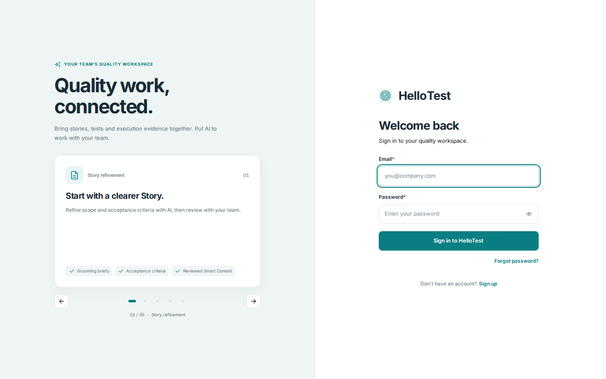 | 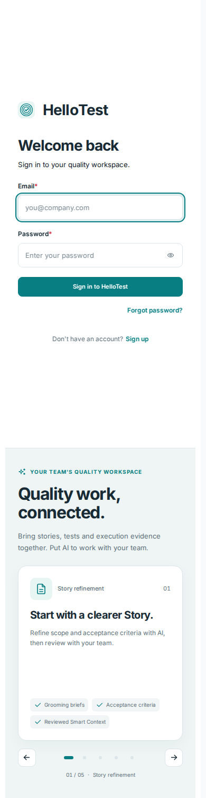 |
| 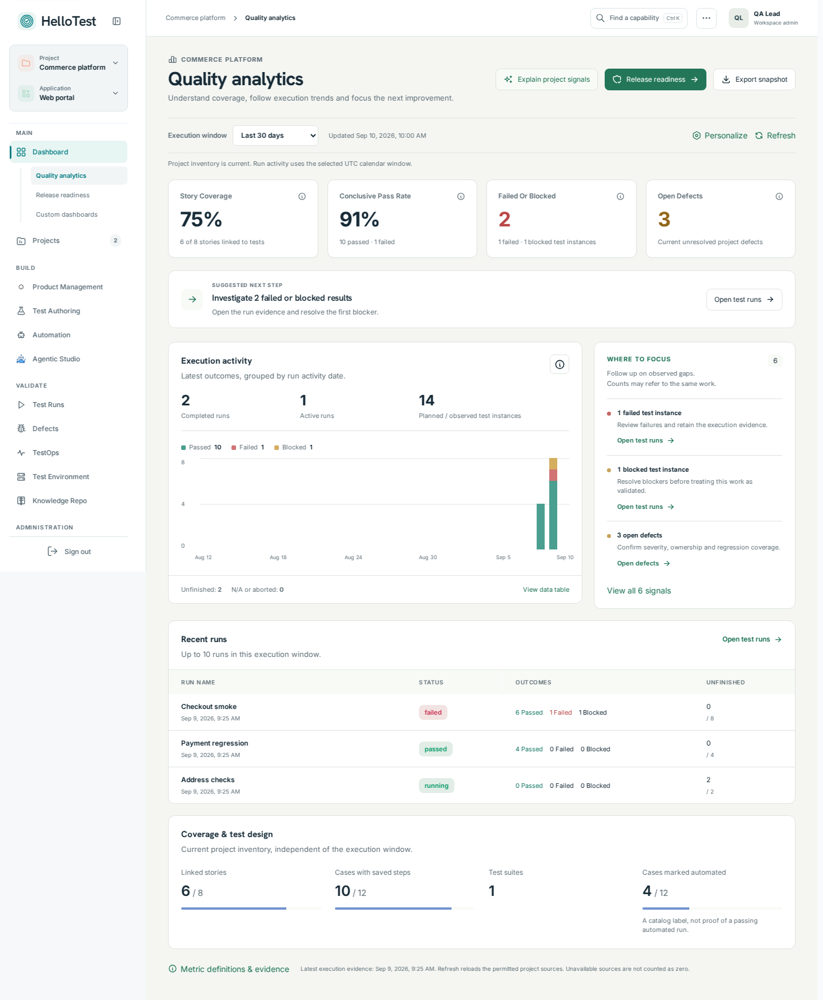 | 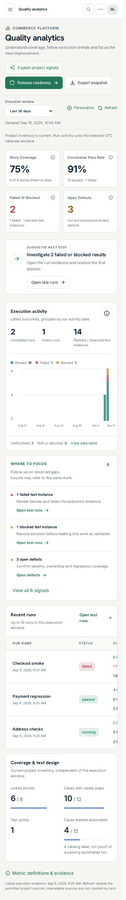 |
| 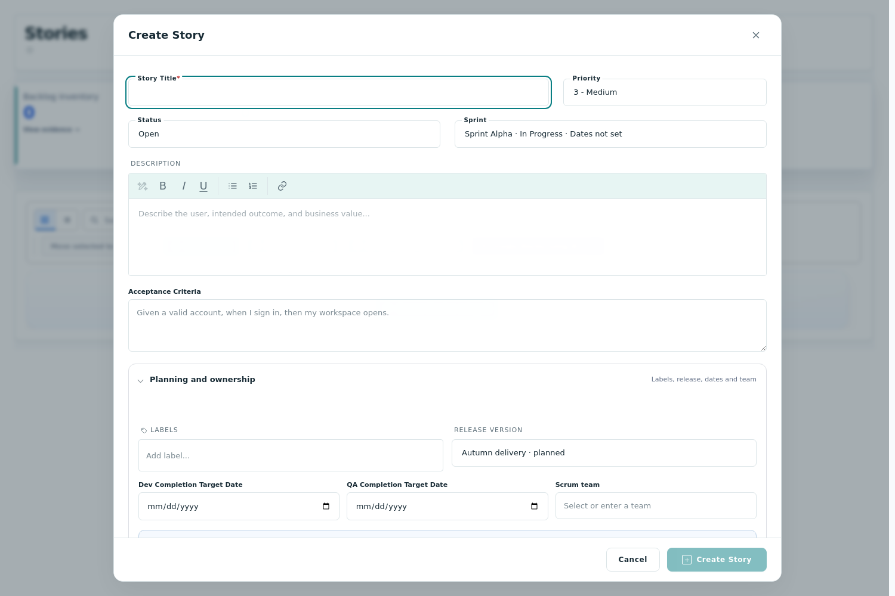 | 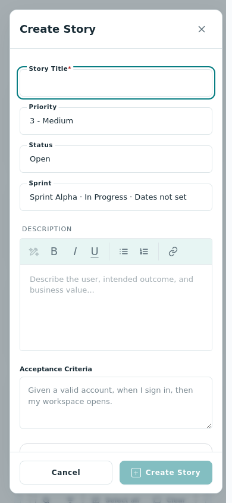 |
| 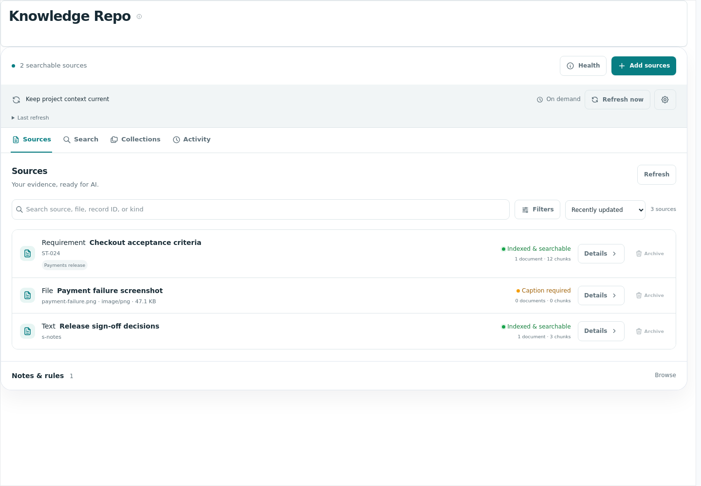 | 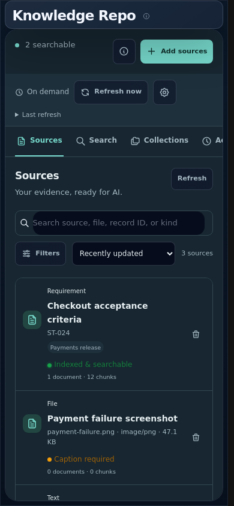 |
| 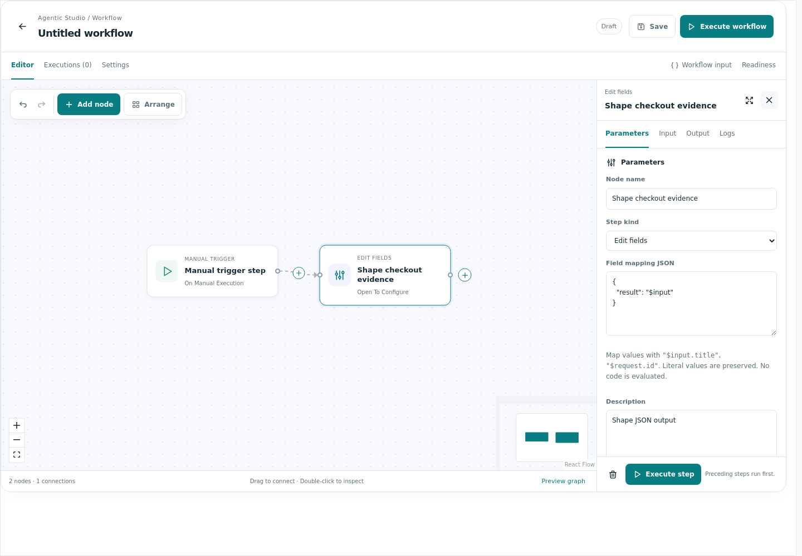 | 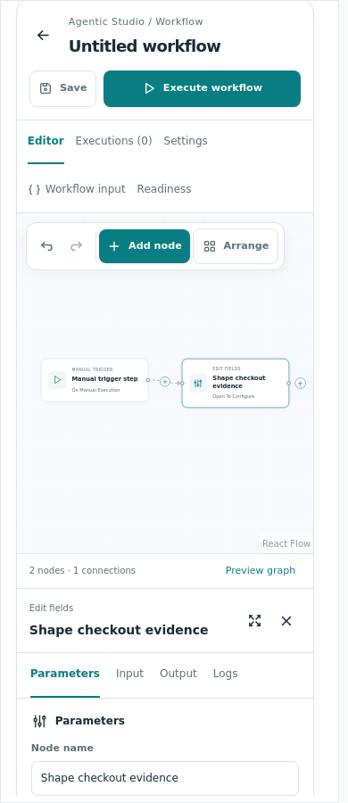 |
| 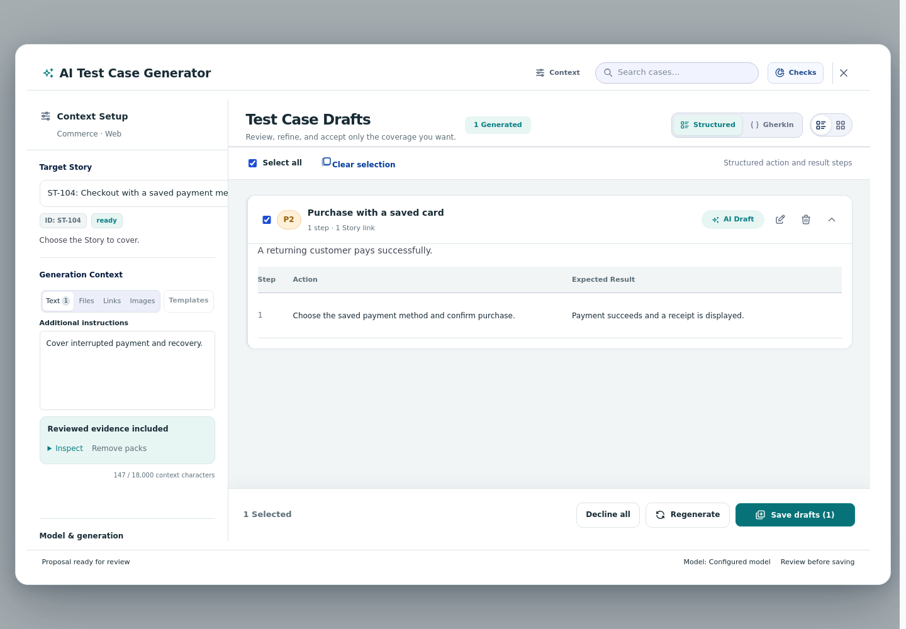 | 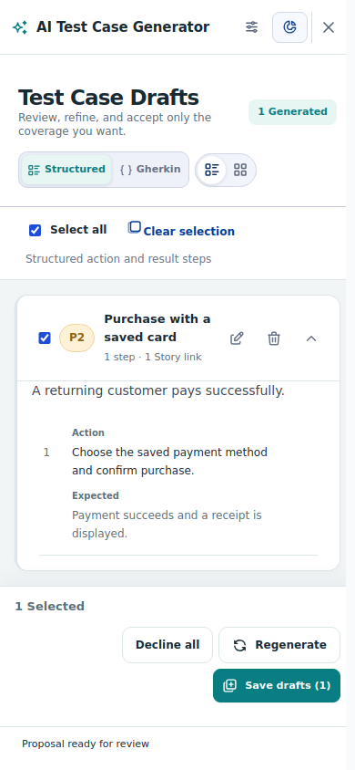 |
| 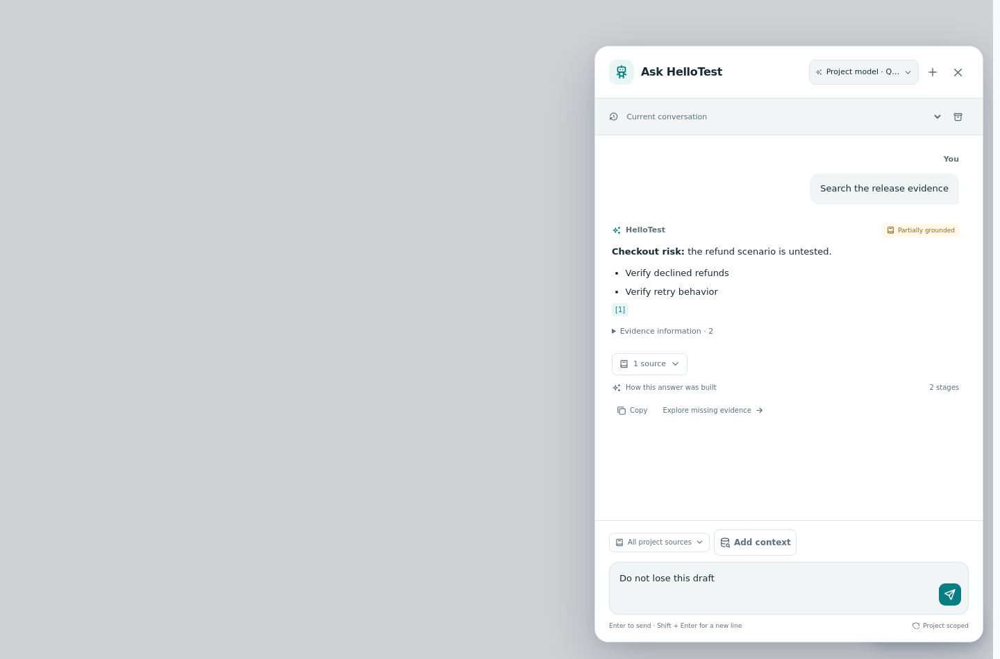 | 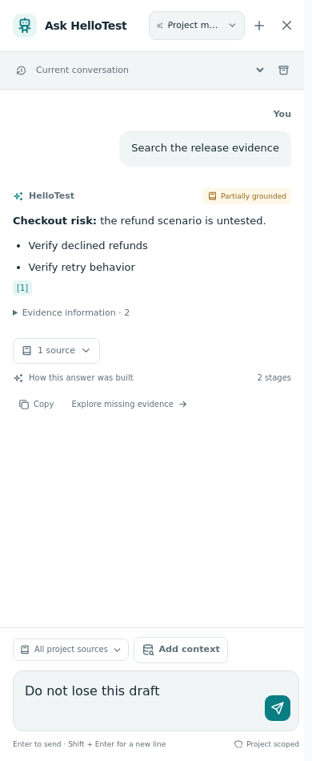 |
