# Agentic product release — 6 October 2026

This is the second improvement pass, built on the complete QAIra improved source. It retains the HelloTest product identity and original services. The earlier release guide remains in `docs/redesign-2026-10` for historical comparison.

## Start and configure

```sh
./hellotest.sh up --build --stack local
./hellotest.sh status --stack local
```

Workspace: http://localhost:8080. Administration: http://localhost:8081. Rebuild the frontend, platform/capability API and Test Engine together. Quality runs use the existing PostgreSQL observability tables; this pass adds no schema migration. Source development requires Node.js 22.18+, `npm run setup`, and matching Playwright Chromium.

Open **AI Agents → Browser quality** after selecting a project/application. Configure its active Test Engine integration and shared secret. The local Docker stack routes quality calls to a dedicated single worker with durable evidence storage; ordinary workers remain independently scalable. See [Quality Agents](../product/quality-agents.md) and [engine deployment](../architecture/quality-agent-engine.md) for exact allowlists, storage, limits and API contracts. Private QA hosts and additional resource origins need explicit administrator configuration. Without an available engine the workspace reports setup requirements.

Optional model planning uses the project LLM and `ai.agentic.quality_plan` preference. It can propose only typed actions grounded in explicit selectors or authorized Object Repository locators. Review or edit the proposal before running. No model is required for the deterministic agent presets or manually authored journeys.

## Implemented changes

| Area | Delivered behavior |
| --- | --- |
| Default agents | Web journey, passive security posture, navigation performance, axe accessibility and visual regression execute on Chromium and return observed evidence. |
| Quality lab | Intent canvas; editable typed plan; explicit review; recorded execution trace; selectable metrics; findings; authenticated screenshots; keyboard-controlled baseline comparison; run history, cancellation and export. |
| Evidence to action | Review and edit a finding-derived Defect before saving. Approve a visual capture explicitly, retaining reviewer, scope, viewport, masks and SHA-256. |
| AI authoring | Centered task input, useful intent starters, evidence chips, context peek, focused artifact outline/editor and a persistent action dock. Existing Story, Case and Defect APIs and partial acceptance remain connected. |
| Forms and menus | Right-side writing sheets; title-first authoring; searchable property menus; optional context; focused ownership/classification controls; accessible menu ownership and focus return; responsive saved-action docks. |
| Automation | Capture → Generate → Review → Run. Require explicit selection and a persisted executable plan. Show saved build evidence and changes. Validate syntax before dispatch; recover the same saved execution and retry only failed/unattempted items. |
| Assistant | Centered reading canvas, searchable conversation history, draft-safe followups, permission-aware agent handoff, copyable code artifacts and exports containing the validated displayed answer and authorized sources. |
| Runtime | Durable platform queue with leases, idempotent dispatch, protected cancellation, bounded browser queue, verified DNS/egress, evidence integrity and persistent storage with worker affinity. |

The existing fourteen repository/specialist agents and workflow editor remain available alongside the five execution agents. A planning model does not invent DOM observations. Agent progress is recorded execution state, and model authoring waits for valid artifacts rather than presenting simulated reasoning or fabricated token progress.

## Execution boundaries

- Security checks are passive browser response-policy observations, not penetration testing or a dependency audit.
- Performance results are one navigation and configured budgets, not a load test or production percentile benchmark.
- Accessibility executes pinned axe-core rules. Automated checks require manual review and cannot certify accessibility conformance.
- Visual regression compares a fixed viewport and matching scope against a human-approved baseline. The first capture requires review. Dynamic content can change pixels and must be investigated or explicitly masked.
- Web journeys run in a fresh browser with reviewed non-secret inputs. They do not provision accounts or reuse stored credentials. Sensitive selectors and actual password fields are rejected.
- Ordinary engine artifacts expire under the configured retention period (seven days by default); reviewed baseline sources are protected and the approved PNG is also stored durably in the application database.

Chat stages and validated answer segments retain the previous streaming contract. Raw provider tokens are not exposed before grounding and authorization; structured authoring returns validated complete artifacts. Browser cancellation blocks late UI/state updates but cannot guarantee a remote model provider stopped charging.

## Validation

[verification.json](verification.json) records final checks and practical limits. [changes.json](changes.json) records modifications relative to V1 and the original archive. Screenshots use real application components with isolated representative API fixtures. Engine tests separately run real local Chromium targets across all five agents, including actual axe rules and deterministic pixel comparison.

No production database, live model credentials or external application target was supplied. Database lease/baseline transactions are covered by recording adapters and existing guarded integration suites; live PostgreSQL deployment, provider answer quality, external targets and native devices still need configured integration validation. Compose configuration and worker-routing invariants are checked; containers were not launched in this environment. No unmeasured startup or throughput claim is made.

## Visual review

| Workspace | Desktop | Mobile / dark |
| --- | --- | --- |
| Quality agents | 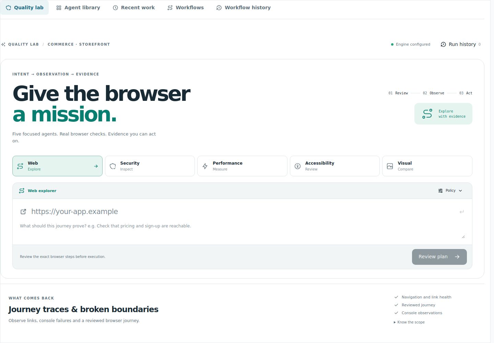 | 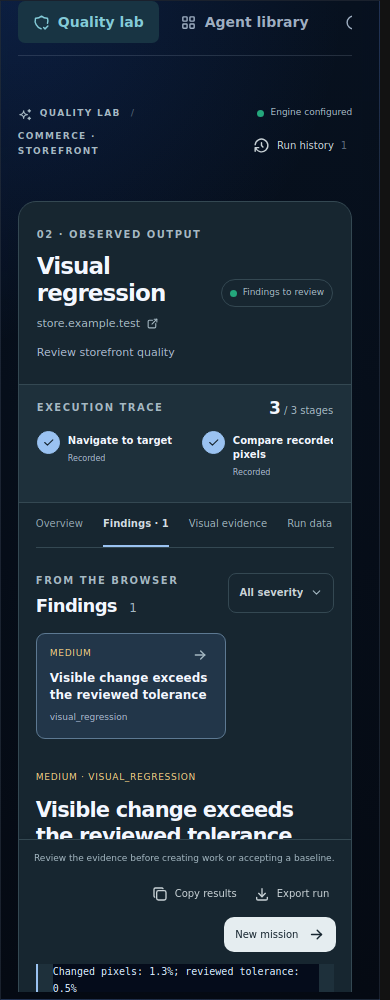 |
| Observed evidence | 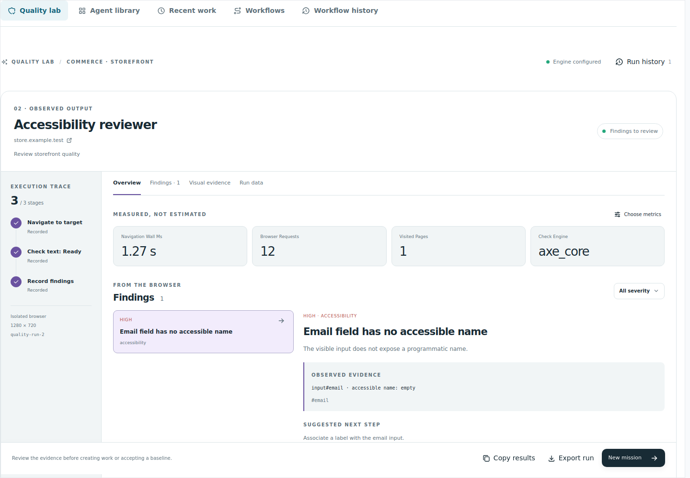 | 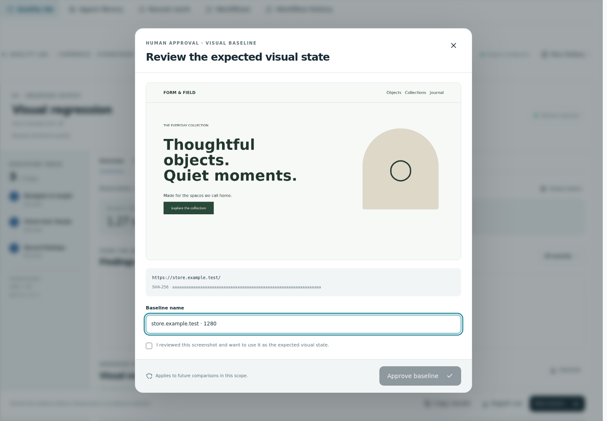 |
| AI authoring | 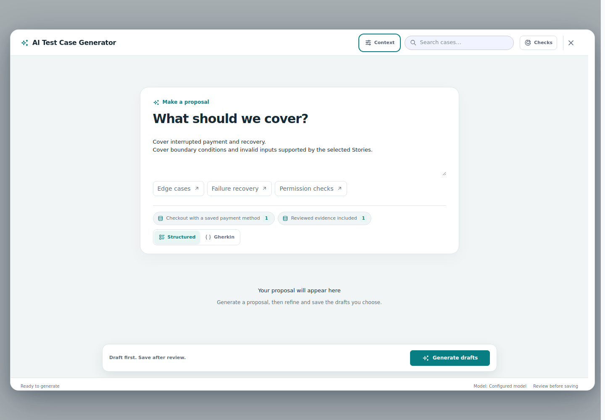 | 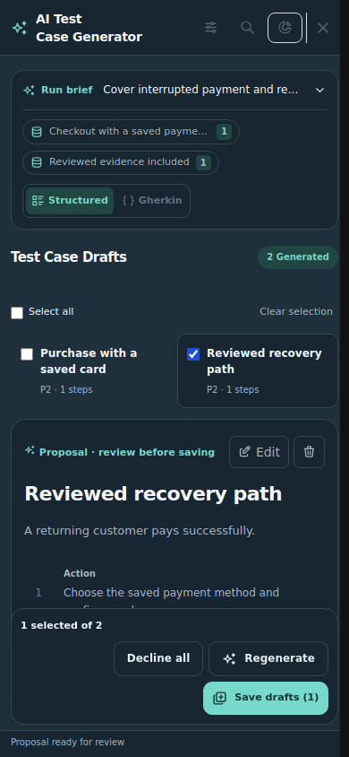 |
| Forms | 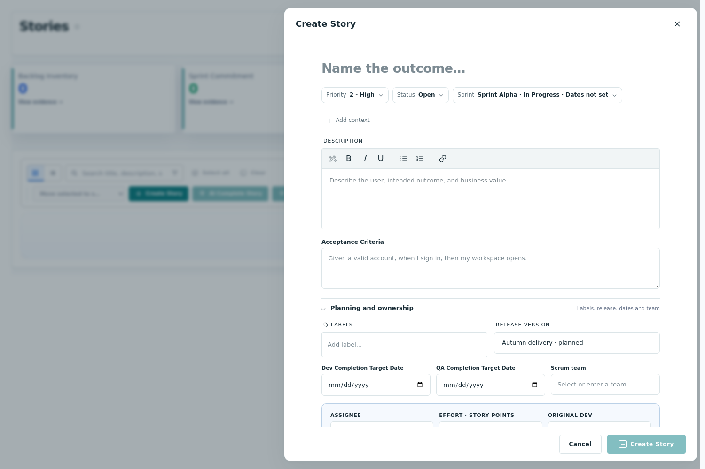 | 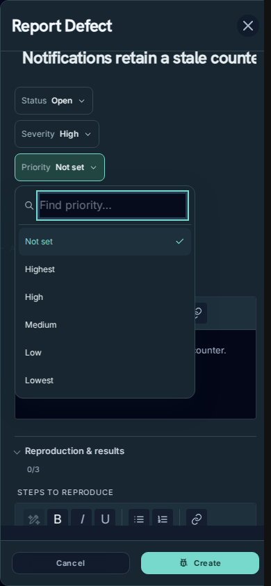 |
| Automation | 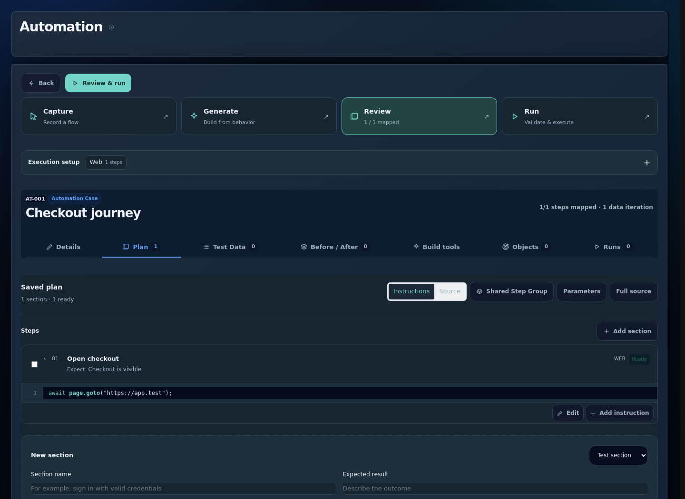 | 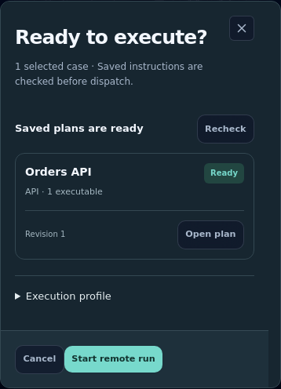 |
| Assistant | 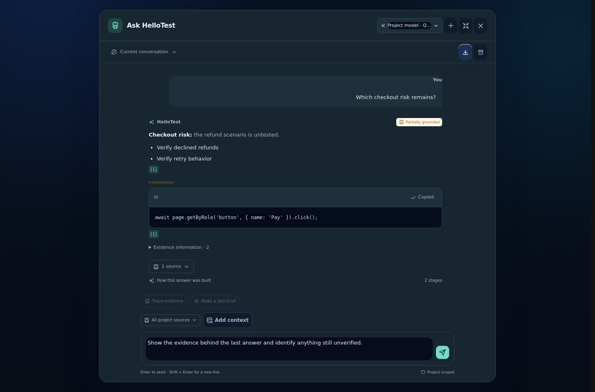 | 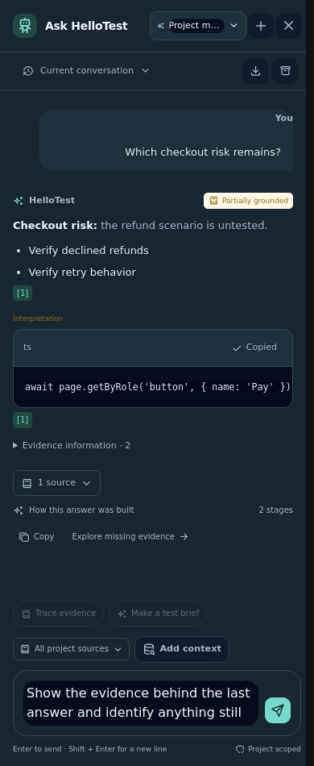 |
