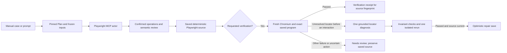

# Automation Engineer: browser research and implementation decision

Initial research was recorded on **17 October 2026**. The source-level comparison
and local strategy work were updated on **20 October 2026** below. Earlier dated
verification records retain their original scope. This document publishes the
research in the repository; it does not represent an external publication or an
independently measured performance benchmark.

## Decision

Keep Automation Engineer in the automation case's **Build tools** and extend the
existing manual-case/prompt → Plan → browser-grounded sections → saved source
workflow. Retain HelloTest's permission-checked Playwright MCP session and the
host compiler of confirmed browser operations. Improve the model-facing browser
capability selection through progressive disclosure: present the tools needed
for the current page and goal, keep every selected tool's actual discovered
schema, and disclose any deferred tool's schema before allowing its dispatch.

This is an application-specific inference from the primary sources below. It is
not an integration of Microsoft's test-agent definitions, the Playwright CLI, or
the Python browser-use SDK. Their design patterns are useful without introducing
a second browser lifecycle, arbitrary shell execution, or another model runtime.

## Primary-source findings

| Source reviewed | Finding | Consequence for this application |
| --- | --- | --- |
| [Microsoft Playwright MCP README](https://github.com/microsoft/playwright-mcp#playwright-mcp-vs-playwright-cli) | Microsoft distinguishes token-conscious CLI/skills usage for coding agents from MCP loops that need persistent browser state and iterative inspection. | Keep MCP for the in-product browser actor. Reduce repeated model context rather than migrating transport merely to claim efficiency. |
| [Microsoft Playwright CLI README](https://github.com/microsoft/playwright-cli#playwright-cli-vs-playwright-mcp) | CLI avoids forcing complete page data into context. It supports saved snapshots, scoped snapshots and finding relevant nodes. | Separate stored evidence from the model's current observation. Treat selective disclosure as a first-class interface, not a reason to discard evidence. No upstream cost percentage is transferred to this implementation. |
| [Playwright CLI skill](https://github.com/microsoft/playwright-cli/blob/main/skills/playwright-cli/SKILL.md) | The skill uses current snapshot references, scopes large snapshots, and links specialized references for test generation, tracing and other tasks. | Use compact current targets and disclose specialized capabilities only when needed. Preserve supported fallback discovery so uncommon goals remain possible. Reading this source for research does not install or execute the skill. |
| [Playwright test agents](https://playwright.dev/docs/test-agents) | The planner explores and writes scenarios; the generator performs the scenario and verifies selectors/assertions; the healer inspects a failing run and proposes bounded repairs. Plans contain steps, outcomes and data. | Preserve planning for a prompt with no sections, generation from manual sections, and repair from actual failure context. A successful interaction is generation evidence; a separate execution establishes the saved test's result. |
| [Playwright generator instructions](https://github.com/microsoft/playwright/blob/main/packages/playwright/src/agents/playwright-test-generator.agent.md) | The generator is instructed to perform planned steps with browser tools and generate tests from its recorded interactions. | Compile confirmed typed operations into section source instead of asking the model to reconstruct the same action sequence as code. |
| [Playwright best practices](https://playwright.dev/docs/best-practices) | Tests should assert visible behavior, use resilient locators, retry assertions and remain isolated. | Preserve native accessible names and unique locator validation. Keep private data as scoped references and replay saved source in a fresh isolated fixture during verification. |
| [Playwright actionability](https://playwright.dev/docs/actionability) | Playwright actions wait for required actionability checks; assertions retry their specified conditions. | Prefer bounded conditions and actual assertions to fixed delays. Do not treat locator existence alone as the expected business result. |
| [Browser Use agent parameters](https://docs.browser-use.com/open-source/customize/agent/all-parameters) | Browser Use exposes deterministic initial actions, bounded action batches, history limits, optional vision and cost accounting. Its current `skills` parameter marks hosted skill creation as retired. | Keep deterministic browser bootstrap, stop dependent batches when the page changes, bound history, and retain screenshots as optional evidence. Research the agent patterns; do not advertise a newly created Browser Use hosted skill. |
| [Browser Use prompting guide](https://docs.browser-use.com/open-source/customize/agent/prompting-guide) | Explicit actions and custom-tool requirements improve task clarity. | Present the active manual action, expected result, scoped data and missing dependencies explicitly. Clarify how a brief becomes a plan before generation. |

These links are the live documentation/source reviewed on the recorded date.
They may evolve. The earlier [automation research](automation.md) records pinned
upstream revisions for the existing compiler/browser implementation; those
historical verification claims are not rerun or inherited by this follow-up.

## Existing implementation inspected

The feature is already substantial. The following are existing behaviors, not
new claims about this follow-up:

- [Automation workflow](../architecture/automation-workflow.md) describes Build
  tools, immutable build context, permissions, progressive saves and the
  separate TestEngine execution result.
- [`automationActorPrompt.js`](../../services/automation/backend/lib/automationActorPrompt.js)
  projects authorized task data without saved source or cached executable
  locators. Linked manual actions and expected results remain available.
- [`automationBrowserModelTargets.js`](../../services/automation/backend/lib/automationBrowserModelTargets.js)
  maps current observed targets to private locator bindings; stale/unknown
  references fail rather than silently selecting another element.
- [`automationBrowserContext.js`](../../services/automation/backend/lib/automationBrowserContext.js)
  supplies one current snapshot, bounded receipt history, current failure and
  completion requirements. Older snapshots and screenshot bytes are not
  repeatedly sent to the actor.
- [`automationBrowserAgent.js`](../../services/automation/backend/lib/automationBrowserAgent.js)
  dispatches discovered typed tools, rejects unsupported arguments, refreshes
  after transitions, stops unknown-outcome replay, and logs prompt component
  sizes before managed instruction expansion.
- [`automationBrowserRecording.js`](../../services/automation/backend/lib/automationBrowserRecording.js)
  and [`automationRecordedProgram.js`](../../services/automation/backend/lib/automationRecordedProgram.js)
  preserve private operation provenance and compile confirmed actions and
  assertions into source. Model-reported success cannot replace those receipts.
- [`automationMcp.ts`](../../testengine/backend/src/lib/automationMcp.ts)
  exposes actual bounded tools and enforces browser/session policy. Read-only
  discovery omits interaction tools when interaction is disabled.

The concrete remaining overhead observed in the browser loop is serialization
of the **entire discovered tool catalog on every model turn**, even when current
controls require only navigation, observation, click, fill and an expected-result
check. The assertion schema and specialized tools still need exact contracts;
shortening those contracts into informal parameter guesses would trade away
correctness. Progressive selection can reduce catalog input while preserving
full contracts for selected tools.

## Proposed implementation contract

1. **Preserve the existing entry points.** A linked manual case retains its
   ordered actions, expectations, groups and parameters. A prompt with no
   sections first produces an ordered Plan, then uses the same section loop.
   Describe these two starting points clearly in the Automation Engineer UI.
2. **Select from the real catalog.** Always retain navigation/observation,
   expected-result checks and the common interaction tools required for ordinary
   forms. Add specialized tools from current observed controls, explicit goal
   intent and the latest failure. Selection must not grant a tool absent from
   discovery or override interaction permissions.
3. **Preserve exact selected schemas.** Pass the original discovered
   `inputSchema`, including required arguments, allowed modes, conditional
   branches and additional-property restrictions. Do not infer a replacement
   schema from a tool name or previous version.
4. **Disclose deferred capabilities.** Publish bounded names/omission metadata.
   When a model requests a supported deferred tool, return its real schema and
   pause that dependent batch before any deferred mutation. Allow a subsequent
   informed request within the same existing budget. A previously disclosed
   tool should remain available for that section's recovery.
5. **Keep authority host-side.** All dispatched tools still pass actual schema,
   data, current-target, interaction, origin and browser-budget checks. Evidence
   stays stored even when its model-facing projection is small. Saving still
   depends on the confirmed ledger, post-action expected-result checks and
   existing Plan persistence.
6. **Measure honestly.** Extend existing prompt-size activity with selected and
   available tool counts, disclosed/deferred names and catalog characters.
   Character counts are deterministic input-size evidence, not model tokens.
   Provider-reported input/output usage is authoritative for actual token
   savings. Preserve its absence when no real provider was invoked.

## Token-efficiency tradeoffs

| Choice | Benefit | Boundary |
| --- | --- | --- |
| Keep one current target projection | Prevents repeated DOM and locator alternatives | Missing/partial page evidence must remain explicit and support another scoped observation. |
| Select tool capabilities progressively | Removes unrelated schemas from ordinary turns | Incorrect selection can add a discovery turn; preserve exact-schema expansion and retain revealed tools. |
| Keep full selected schemas | Avoids malformed assertion/tool arguments and repairs | A large selected schema still consumes input; fidelity takes priority over an arbitrary size target. |
| Batch unchanged form actions | Fewer model round trips | A page/control transition or failed check pauses dependent requests. |
| Compile confirmed operations | Avoids a second model code-writing pass and action/source drift | Only supported recorded operations compile; unsupported behavior must remain explicit. |
| Bound receipts; retain complete artifacts outside prompt | Context grows with current decisions rather than every screenshot/DOM | Preserve the active failure, successful prefix, missing data and source provenance. |

No claim of optimal tokens, a percentage saving, universal application support,
or a completed customer run follows from these design choices. A real-provider
comparison must use the same case, data, target version, model and outcome;
report prompt/output tokens, browser/model calls, elapsed time and whether the
saved source passes unchanged. Include failed attempts in the denominator.

## Acceptance evidence required after implementation

- Focused backend checks demonstrate selection from actual observed controls,
  schema fidelity, deferred-tool disclosure before dispatch, discovery limits,
  read-only permissions and preservation of ordinary actor completion.
- An isolated real Chromium fixture demonstrates typed browser operations,
  compilation and unchanged source replay. Fixture/model stubs must be labelled;
  they establish host behavior rather than provider intelligence or token cost.
- UI checks show Automation Engineer under Build tools, clear linked-manual and
  prompt-first guidance, and honest readiness/review language.
- Record executed commands and results in the task completion record. Do not
  relabel older research results as newly executed acceptance evidence.

Missing credentials/data, inaccessible pages, product defects, anti-bot gates,
unsupported popup/cross-origin flows and exhausted budgets remain actionable
dependencies or failures. Build completion means saved automation ready for
review; only actual TestEngine execution establishes pass/fail.

## Implemented follow-up and verification

The follow-up implements capability selection and schema disclosure in the
existing interactive browser loop. Complete selected schemas and authorization
remain unchanged. An explicit schema request, or a batch referencing a deferred
tool, performs no browser action in that response. The next turn includes the
discovered schemas. The last actionable turn gets the full catalog to avoid a
disclosure delay at the turn limit; completion-only turns receive no tools.

Build tools now identifies **Automation Engineer** and explains manual-case and
prompt input. Verification found and fixed an empty-plan input deadlock: build
readiness had disabled the prompt field itself. Submission readiness now blocks
the button, keyboard shortcut and native form submission while leaving the
instructions editable. An empty plan still requires a brief or case description;
linked manual cases provide context and do not bypass that existing requirement.

Executed against this checkout on 17 October 2026:

| Check | Result and scope |
| --- | --- |
| `node --test services/automation/test/backend/automationBrowser*.test.js services/automation/test/backend/automationActorPrompt.test.js services/automation/test/backend/automationRecordedProgram.test.js services/automation/test/backend/automationFlowPlanning.test.js services/automation/test/backend/automationBuildCompletion.test.js services/platform/backend/test/aiConfiguration.test.js` | **182 passed**. Includes capability selection, actual-schema fidelity, deferred-batch pausing, invalid/unauthorized discovery, budget boundaries, target references, actor compilation, planning and configuration. Browser/model responses in these unit checks are controlled fixtures. |
| `PLAYWRIGHT_EXECUTABLE_PATH='<installed Chrome executable>' node --test testengine/backend/test/browser/automationEngineerCapabilities.test.mjs` | **1 passed** with real local HTTP MCP initialization/discovery/calls, Chromium, observed refs, fresh control discovery, recorded compilation and unchanged source replay in a second browser. Only the model is scripted; no provider request or production Plan/database write is exercised. |
| `VITE_TEST_URL=http://127.0.0.1:5197 node --test services/automation/test/browser/automationAgentSetup.test.mjs` | **1 passed**, covering Engineer/repair scope, mobile layout, empty prompt-only and linked-manual cases, editable instructions, readiness guards and the queued request. Real React/Chromium with controlled API fixtures. |
| `VITE_TEST_URL=http://127.0.0.1:5197 node --test services/automation/test/browser/automationEngineerSavedPlan.test.mjs` | **1 passed** after the submission change, covering saved partial plans and refresh with controlled API fixtures. |
| `npm --prefix testengine/backend run build` | Passed. |
| `npm --workspace @hellotest/automation run build`, `npm --workspace @hellotest/agentic run build`, `npm --workspace @hellotest/ai run build` | All passed. |
| `npm exec -- tsc -b tsconfig.json --pretty false` from `services/platform/frontend` | Passed. |
| `node scripts/checks/check-service-boundaries.mjs`, `node scripts/checks/check-docs.mjs` | Both passed. |

Broader legacy source-contract checks inspected during the UI work retain stale
expectations outside this change (including the export-preview property and
older model-call labels); this verification does not claim a green full repository
suite. No live model token comparison or production deployment was performed.

## Assertion-recovery and step-workspace follow-up

The reported 17 October failure was correlated with retained activity, model
responses and browser snapshots. The signup form displayed a password-required
alert after the email-only section submitted. The manual section expected a
verification-sent result at that point. The model checked that imagined message
against the signup heading and alternated two phrasings across five failed
assertions. Subsequent captured page snapshots differed only in observation IDs
and timestamps. This was an unmet prerequisite/flow expectation, compounded by
recovery that keyed retries by the exact expected string and did not foreground
the failed predicate. Increasing browser budgets or weakening assertions would
not correct it.

The implementation now:

- Counts failures by current target/mode and host-observed state, including
  changes to the expected text. Two failures permit one correction opportunity;
  another rejected probe stops with `AUTOMATION_BROWSER_CHECK_STALLED` instead of
  continuing model/browser retries. Real state changes, corrected targets and
  confirmed actions retain their normal checking behavior.
- Gives the actor privacy-projected context about its own failed expectation,
  current observed alerts and the pinned manual goal. It distinguishes an
  observable outcome from literal rendered copy and forbids invented business
  messages, unrelated-heading checks and implicit reordering of manual steps.
- Accepts a bounded `section_issue` with the active step ID and current observed
  evidence references. This stops the section for review; it does not establish
  a product defect, save incomplete source or perform accompanying actions.
- Refreshes evidence after transition-capable actions before dependent locator
  reads/assertions, retaining native URL/title checks. Checkbox state and exact
  bounded option values remain available in the model's current targets.
- Moves step-specific interaction mode, action/check outcomes and page title into
  **Browser activity** beside **Build Error**. The capture area stays clear of
  repeated summaries and the requested explanatory text; selecting another step
  cannot attribute the latest case's action history to that step.

The saved manual case was not rewritten, no external signup was repeated, and
historical build evidence was retained. Fixing the agent does not make a
verification-sent expectation valid before the application's required signup
inputs are supplied.

Follow-up verification uses controlled model/API responses where noted:

- **12/12 UI browser checks passed** with serial execution of
  `automationEngineerWorkspace.test.mjs`, `automationEngineerSavedPlan.test.mjs`
  and `automationAgentProgressHistory.test.mjs`. These exercise real React and
  Chromium, including selected-step activity, shared-section isolation, history,
  blocked/stalled errors, partial saves, mobile layout and data permissions.
- **2/2 real MCP/Chromium fixtures passed** in
  `testengine/backend/test/browser/automationEngineerCapabilities.test.mjs`.
  One compiles and replays confirmed source unchanged. The incident fixture
  submits only once, performs two real failed assertions, then reports the
  observed password prerequisite without saving an unmet outcome. The model is
  scripted; no external signup or live provider request is exercised.
- The Automation capability production build, platform frontend TypeScript and
  documentation-link checks passed. Additional activity monitoring, progression,
  build-context and validation checks passed **36/36**. Backend recovery and
  model-contract checks passed **208/208**, including grounded-target retry
  limits, expected-text churn, unrelated carousel changes, conservative
  incomplete-evidence handling, private predicate context and blocked-section
  validation. The service-boundary check passed after fixture cleanup.

Tests run from the checkout; no running Docker images were rebuilt or restarted
as part of this follow-up.

## General conversion-pipeline hardening

The broader implementation audit found a different class of defect: confirmed
execution and syntactically valid source did not by themselves establish that an
assertion covered the manual expected result. An unrelated heading could satisfy
the completion gate. The interactive builder now uses a bounded semantic review
before publishing or saving the current section, with the exact section and all
its active linked manual obligations pinned by host code. The review sees compact
confirmed operations from private provenance, their observed targets, current
page evidence and failed checks. Model-authored receipts or source cannot replace
this evidence. Strict verdict validation checks complete obligation identities,
operation kinds and action/assertion ordering. It supports intermediate checks
within grouped manual work while asking the reviewer to reject later invalidation
of required final outcomes.

This is a second assessment by the configured model, not deterministic proof of
natural-language equivalence or an independent passed test. Ambiguous requirements,
invalid/unavailable reviews and unsupported outcomes stop the unfinished section
without saving it. At most two distinct candidates can be reviewed; unchanged
rejected evidence is cached and stops, rather than replaying actions. Reviews
share the bounded model/deadline allowance with the actor. Compact evidence and
host compilation limit repeated context/code generation, but the added review has
a real model cost; no claim of a measured net token reduction is made.

The same audit hardens lifecycle and privacy contracts:

- Validate manual coverage before section writes and reject mappings that claim
  new behavior through unrelated earlier sections. Preserve detached accepted
  source when later responses mutate their own objects.
- Reject exact manual mappings that contradict the saved Plan order before
  browser work. Preserve all active manual IDs for sections with several linked
  obligations.
- Repair coverage and final metadata with retained instructions and no browser
  actions. Give final schema repair a separate bounded allowance from the last
  section's development attempts.
- Discard executable locator candidates whose bytes would change under privacy
  redaction, while retaining safe observed alternatives. Mark redacted native
  option values as excerpts instead of exact selectable values.
- Supply managed browser/phase instructions for every accepted builder profile.
  Defer final-case output schemas until assembly while retaining strict native
  contracts for actor, review, planning and metadata responses. Persist distinct
  outcome-review and metadata trace scopes so their responses are not presented
  as generated section code.

The cross-domain fixture uses an expense approval workflow: a real heading
assertion succeeds but semantic review rejects it; three outcome checks then
establish approval, its audit row and an unchanged balance. The approval mutation
is performed once during development. The generated native source replays in a
fresh browser and performs one independent approval. Review/model responses are
scripted to verify application enforcement; this is not a live-provider accuracy
evaluation or production database save.

Verification after this broader hardening, on the same checkout/date:

| Check | Result |
| --- | --- |
| Browser-agent, semantic review, goal obligations, completion, error attribution, planning, managed configuration and trace-capture regression set | **275 passed**. Controlled model responses; tests exercise strict review contracts, grouped obligations, unchanged-candidate stopping, source bypass prevention, lifecycle and phase/schema handling. |
| Supporting action reconciliation, activity, context/data, preflight, source grounding/validation, compiler tools and preview regression set | **102 passed**. |
| Serial `automationMcpEvidence.test.mjs`, `automationEngineerCapabilities.test.mjs`, `automationEngineerSemanticReview.test.mjs` and `automationSnapshotGrounding.test.mjs` | **16 passed**: ten MCP evidence checks and six browser-level checks. Explicit installed Google Chrome was used for real browser fixtures; generation/review providers are scripted. Includes native-source replay, the reported prerequisite failure and expense approval. |
| `services/trace/test/browser/engineerModelPayload.test.mjs` | **1 passed**, expanded real React/Chromium coverage of phase labels, request/response selection, access, copy and mobile layout. |
| TestEngine backend build, Automation capability build and platform frontend TypeScript build | Passed. |
| Service-boundary, documentation-link and changed-file whitespace checks | Passed. |

The earlier workspace regressions remain recorded above. This follow-up does not
claim a green full-repository suite, live-provider accuracy benchmark, measured
token savings or deployment. Running Docker images were not rebuilt/restarted.

## Architecture implementation: manual specification to runnable Playwright

The next architecture review keeps one permission-aware orchestrator and one
browser lifecycle. Its stages are: preserve the ordered specification, select
current context, perform typed grounded operations, review the requested outcomes,
compile confirmed operations, save a version-bound result, emit a portable test,
then execute through an explicit runner. This uses the planning/generation/repair
separation described by [Playwright's agents](https://playwright.dev/docs/test-agents)
without adding a new model conversation for every deterministic stage. Microsoft's
[MCP guidance](https://github.com/microsoft/playwright-mcp#playwright-mcp-vs-playwright-cli)
supports retaining persistent interactive browser state while reducing repeated
schema/page context. These are implementation decisions inferred from the sources,
not imported upstream agent runtimes.

Four concrete architecture gaps were implemented:

1. **One runnable export contract.** The backend artifact previously concatenated
   section bodies under a `.spec.js` name. It now shares the standalone emitter
   with the UI and emits `.spec.ts` with Playwright Test fixtures/imports, fixed
   public data, private runtime overrides, repository bindings and actual API
   sections. The emitter is in `services/automation/shared/playwrightArtifact.mjs`;
   frontend data preparation and backend authorized snapshots remain separate.
   Native assertion arguments now resolve scoped parameters through that same
   runtime, including negated, soft and polling assertions.
2. **Version-bound evidence.** Section previews contain a host-created SHA-256
   manifest of source/API behavior and exact section/covered manual specification.
   Compiler origin and outcome-review status come from host events. Fresh scoped
   reads distinguish current source from historical generation after edits;
   missing legacy evidence stays unknown. Hashes do not duplicate private text,
   and persisted JSON cannot recreate protected browser operation authority.
3. **Context selected for the current work.** Complete current obligations remain
   intact. Other manual steps have an ordered identity/excerpt index. Full manual
   records, documents, projected parameter values, resource details and paginated
   recorder captures are available from the immutable authorized snapshot through
   at most three bounded task-context requests on existing actor turns. Disclosure
   pauses accompanying mutations and cannot expand permissions. A 100-step fixture
   reduces initial task UTF-8 input by more than 88% with active source text
   unchanged. This is input-size evidence, not measured model token savings.
4. **Portable target bindings.** A validated explicit test-ID contract can be
   preferred to a changing accessible name. No selector is invented, broadened or
   substituted at runtime. A real fixture generated against “Submit order 41”
   replays against “Submit order 42” without selecting a similar adjacent control.
   [Playwright's locator guidance](https://playwright.dev/docs/best-practices#use-locators)
   supports resilient user-facing attributes and explicit locator contracts.

The review also found a subtle interpretation hazard: resolving already-projected
source text a second time can reinterpret a literal containing `@r.name`. The
implementation separates pure privacy projection from one-time resolution of an
original complete parameter argument. Active requirements, page evidence and
literal text keep their exact meaning; bracketed parameter names retain executable
scoped references.

The end-to-end fixture in
`services/automation/test/browser/automationBackendArtifact.test.mjs` uses the
actual actor-context manager, real HTTP MCP/browser operations, protected recording,
outcome review, backend artifact emitter, TypeScript declarations and a fresh
Playwright Test CLI process. It checks browser and API behavior, repository aliases,
private input overrides and native expected-value semantics. Development and
explicit fresh-test submissions are counted separately. Model decisions are
controlled fixtures; production Plan persistence, live PostgreSQL applicability
queries and live-provider accuracy are not established by this test.

Architecture-round verification on this checkout:

| Check | Result |
| --- | --- |
| Primary backend contracts, context selection, actor/review/compiler, completion, manifests, preview activity, portable artifact, configuration and trace tests | **325 passed**. |
| Supporting reconciliation, activity/context/data, preflight, source validation/grounding and program-tool tests | **96 passed**, with no overlap in test files with the primary set. |
| Export-source and generation-applicability frontend unit checks | **11 passed**. |
| Serial MCP evidence/capability/review/stable-locator/snapshot checks with installed Google Chrome | **17 passed**, including ten evidence contract checks and seven browser-level checks. |
| Backend-issued artifact to fresh Playwright Test CLI | **1 passed**, exercising the complete fixture flow described above. |
| Existing UI export to fresh Playwright CLI suites after shared emitter extraction | **2 passed** on final serial execution. |
| Engineer workspace and historical-generation UI checks | **2 passed** with real React/Chromium and controlled API responses. |
| Automation capability production build, platform frontend TypeScript, runtime exports, package contents, service boundaries, documentation links and changed-file whitespace | Passed. Backend Docker copy rules include the shared emitter. |

No paid provider benchmark, production database execution, container image rebuild
or deployment was performed. A successful fixture validates the exercised path;
free-prose interpretation remains model assisted. Generation applicability binds
source and specification, not the correctness of later runtime data/environment
changes. Real saved-case execution remains the final verification step.

## Browser-stack comparison and first-section incident

The additional products requested by the user were reviewed on **17 October
2026**. These are different layers of a browser agent, so switching packages
alone does not establish better manual-requirement coverage or correct test data.

| Candidate | Useful capability | Tradeoff for Automation Engineer | Decision |
| --- | --- | --- | --- |
| [Playwright MCP](https://github.com/microsoft/playwright-mcp) | Persistent browser state and typed browser inspection/actions. | Repeating large schemas and snapshots costs context. Browser interaction still needs a separate definition of the requested outcome. | Retain the existing TestEngine-owned session, exact discovered contracts, scoped evidence and protected action compiler. |
| [Playwright CLI and skills](https://github.com/microsoft/playwright-cli) | Coding-agent workflow with snapshot files, scoped reads, locator inspection, recording and code generation. | A CLI is another interface to Playwright; it does not independently solve expected-result interpretation. A shell subprocess inside the product would add lifecycle and authorization work. | Use its selective-reading principles and a fresh Playwright Test CLI for exported-test validation. No global CLI installation or second in-product browser was added. |
| [playwright-slim](https://github.com/mcpslim/playwright-slim) | Groups tool definitions to reduce schema overhead. | Its published comparison concerns schemas and estimated client overhead, not complete task accuracy/cost. Results are forwarded unchanged. The reviewed static recipe has argument-contract problems; the inspected release also lacks its expected Mac/Linux binaries. | Preserve progressive discovery using the actual server schemas. Do not install this bridge as the production adapter. |
| [Browser Use MCP](https://docs.browser-use.com/open-source/customize/integrations/mcp-server) | High-level exploration agent, browser control and an MCP entry point. | Adding its autonomous agent as another actor would complicate operation provenance, model budgets and manual-outcome review. Cloud browser services have separate session/cost lifecycles. | Keep one actor and one browser. A managed remote browser could later be an explicit provider behind the existing host contract; that provider is not implemented here. |
| [Chrome DevTools MCP](https://github.com/ChromeDevTools/chrome-devtools-mcp) | Browser, console, network and performance diagnostics through Chrome tooling. | A useful diagnostic surface, with additional tools/context; it does not replace portable Playwright Test generation or expected-result coverage. It is maintained by Chrome DevTools, rather than the MCP protocol team. | Consider a scoped diagnostic adapter to the same browser when a concrete failure needs it. No second driver/session was introduced. |
| [Ego Lite](https://github.com/citrolabs/ego-lite) | Desktop browser and agent harness for assisted exploration with logged-in state. | The reviewed repository separates its open harness from its closed browser app. Desktop session convenience does not establish isolated Linux/CI portability or universal MFA bypass. | Useful for optional assisted discovery; retain the current reproducible TestEngine browser as the core. |

### Details that affect the decision

The slim README compares `@playwright/mcp@0.0.54`: schema tokenization changes
2,922 to 638 tokens; its larger 73.8% estimate adds a client-specific per-tool
overhead. HelloTest serializes a selected catalog in its own model context, so
that overhead is not transferable. The reviewed
[recipe](https://github.com/mcpslim/playwright-slim/blob/main/recipes/playwright.json)
requires fields from unrelated interaction/control actions together and exposes
navigation mappings that its common action enum cannot express. In the inspected
`playwright-slim@0.0.54-slim.1.10`
[package](https://registry.npmjs.org/playwright-slim/-/playwright-slim-0.0.54-slim.1.10.tgz),
the launcher selects platform-specific binaries but only Windows binaries are
included. These are observations of that revision/release, not predictions about
future releases. No native bridge binary was executed.

Browser Use's main open-source agent is Python. Its official
[TypeScript agent](https://github.com/browser-use/browser-use-pi),
[JavaScript browser harness](https://github.com/browser-use/browser-harness-js)
and [cloud SDK](https://github.com/browser-use/sdk) are distinct offerings.
[Supported CAPTCHA handling](https://docs.browser-use.com/cloud/browser/captcha-handling)
and [stealth](https://docs.browser-use.com/cloud/browser/stealth) describe cloud
capabilities, not a guarantee that a local agent can pass every challenge.
[Authentication reuse](https://docs.browser-use.com/open-source/customize/browser/authentication)
can avoid a fresh login while valid; [2FA guidance](https://docs.browser-use.com/cloud/guides/2fa)
still accounts for authentication challenges. Reusing a session is not a general
MFA bypass. A future cloud adapter would need explicit session shutdown; closing
a CDP connection alone does not stop a managed cloud session, as documented in
the [Playwright connection guide](https://docs.browser-use.com/cloud/browser/playwright-puppeteer-selenium).

DevTools can attach to an existing Chrome using the documented
[connection options](https://github.com/ChromeDevTools/chrome-devtools-mcp/blob/main/docs/advanced-usage.md).
Ego Lite's desktop/profile flow is described in its
[quick start](https://lite.ego.app/document/en/docs/quick-start).
Neither vendor's headline performance claims were reproduced as a HelloTest
end-to-end benchmark. The generic MCP directory is discovery material, not
evidence of a particular implementation's runtime guarantees.

### Latest first-section failure

The retained 17 October trace was checked against the running API source and
actual screenshot. This was a current-code failure, separate from the earlier
email/password prerequisite incident above. The section asked to navigate to
the signup view and verify that it was displayed. Navigation, the view-switch
click and a unique visible-control assertion all succeeded. The actual form
showed a registration heading, Full name, Email and Password inputs, and its
submit control. The SPA kept the same `/auth` URL and a stale Sign In document
title. The outcome reviewer incorrectly interpreted that metadata as evidence
that the view had not opened. Repeating the same successful assertion consumed
the second review without correcting the evidence interpretation.

The fix is domain-neutral: the reviewer receives bounded rendered before/after
targets separately from URL/title context, with explicit completeness/freshness
flags. Sampled targets never establish page-wide absence; confirmed negative
predicates remain separate evidence. A transition is an observed change, not an automatic business-success
verdict. Explicit URL/title requirements remain enforceable. A missing baseline
does not mean no transition occurred, and a marketing-carousel change does not
prove a form or business outcome. Protected confirmed operations and mapped
expected-result assertions remain mandatory.

The actor now receives the reviewer's bounded, privacy-projected specific
rationale as an untrusted assessment to check against its original goal and
browser evidence. Public activity retains static messages. Repeating an identical
successful predicate under the same action, failure and page history reuses a
rejection and stops; changed evidence or a genuinely different check can still
use the remaining bounded review. Accepted evidence is never broadened by this
cache. The executable ledger and compiled source retain every real operation.

Stock instruction defaults are upgraded by exact previous-default matching for
published and draft configurations. Reviewed custom instruction blocks remain
unchanged. Configuration migration metadata is internal and is not exposed as
an editable instruction block.

Outcome review now uses its configured managed instruction once at system level,
selected only by the host's automation phase. It does not inherit the broader
code-generation role, task, prompt or final-case schema. Common configured
guardrails and native application instructions remain in effect. User/page JSON
cannot select this phase. The policy includes domain-neutral positive and
negative SPA examples and preserves explicit URL/title requirements. Actor
guidance prefers distinctive destination headings/fields over a navigation toggle
or submit button as the sole screen-identity check.

An error from an actual typed browser action also invalidates earlier expected-
result evidence, because the application may have changed before reporting the
error. A later successful check can establish the resulting state without
replaying that action. Read-only failures and host-denied, unattempted requests do
not imply a mutation. Acceptance caching includes actual failure history.

The fresh model/browser check exposed a further generic problem: after opening
the correct form, the actor guessed a `/signup` route. A smoke-only guard blocked
that request. Product code now also enforces navigation grounding: entry and
current/confirmed URLs, exact current authored destinations and current validated
link destinations can support a navigation; inferred routes cannot. This is an
additional grounding constraint and does not replace the existing browser/origin
policy. A denied, unattempted request must preserve the current snapshot and stay
outside actual-action receipts and browser-call consumption.

URL parameter grants are recovered from the original current section and exact
pinned manual identities before text projection. A public inserted value that
contains an `@token` cannot authorize reading another parameter. Other manual
steps, saved code and unrelated captures cannot introduce a current navigation
grant. Configured values remain under the existing scoped resolver/privacy
contract.

The actor phase also has an explicit host-only flag. Its five managed action,
goal and evidence blocks are sent once at system level, while the pinned task,
current browser state and exact tool schemas remain data. Ordinary source
generation, flow planning and final metadata keep their own contracts. Native
button types now survive compact target projection: an observed navigation
button can be distinguished from submit/reset controls without inferring a type
for custom or unspecified controls. This addressed a real-model attempt to submit
the blank form during a display-only step.

### Verification of this browser-stack follow-up

All results below were obtained on 17 October 2026. Tests with scripted model
responses establish host enforcement/replay behavior, not provider intelligence.

| Check | Result and practical limit |
| --- | --- |
| Browser/actor/navigation/evidence/compiler/obligation/completion/data and managed-configuration contract set | **326 passed**, including thirteen URL-grounding cases, no-action rejection with snapshot preservation, exact parameter provenance, native button-type disclosure, private feedback, duplicate review stopping and failed-action invalidation. Controlled model responses. |
| Real Chrome/MCP same-URL/title SPA fixtures | **2 passed** after metadata relocation: changed registration form accepted, unchanged wrong form with unrelated carousel change rejected. Standalone export type-check and fresh replay are included. Model responses are scripted. |
| Expense-approval Chrome/MCP fixture | **1 passed** with a compound outcome and unrelated-assertion rejection. Scripted review/model responses. |
| Retained-evidence provider calibration | **9 actual requests**, effective `gpt-4o-2024-08-06`: five positive packets were falsely rejected; four negatives were rejected. **32,758 tokens**. Includes prompt-only and reconstructed partial-transition variants. A valid JSON verdict was not treated as a valid assessment; these failures are not hidden by the successful fresh check. |
| Earlier guarded fresh-browser checks | Both reached a compiled first-section result, but exposed an inferred route and an unnecessary submit proposal. Those runs used an outer guard, so they were insufficient as autonomous-behavior acceptance. Their usage was **23,644** and **25,755** total tokens. |
| Final fresh public-target actor + reviewer | **Passed** with the configured model, actual Chrome/MCP and unchanged section plus linked manual goal. **3 actor calls + 2 reviews, 24,122 total tokens** (23,420 input, 702 output; 3,840 input tokens cached). One observed signup-view click; no inferred route, form input, submit click, action replay or outer-guard denial. The first review rejected button-only coverage; the actor added the distinctive heading assertion and the second review accepted. |
| Final actual generated artifact | The shared emitter produced a standalone `.spec.ts` from the exact four confirmed operations. TypeScript reported zero diagnostics. The bytes were replayed unchanged through Playwright Test in a new Chrome context: **1 expected, 0 unexpected, 0 flaky**. No model call was used for replay. |

The live first-section check did not save a production Plan, submit an account
or execute later case sections. The later email-only verification expectation
still conflicts with the application's required signup inputs; it was not
rewritten or falsely passed. A separate full saved-case execution remains
necessary after its data/flow is corrected.

The successful samples demonstrate grounded recovery and executable output,
not statistically reliable accuracy or measured net token savings. In particular,
the final sample used more tokens than the initial guarded sample. Token controls
reduce unnecessary context and repeated work, but a provider benchmark needs
multiple complete matched cases and must include failed attempts. Semantic
review remains model-assisted and can still produce false negatives.

The local API runtime image was refreshed from the previously verified local
image with the current platform/automation backend trees and feature catalog;
unchanged dependencies and UI artifacts were reused. Its runtime-export check
passed **185 exports**. Only the API service was recreated, after generation,
batch and execution queues each showed zero active jobs/leases. The API is healthy
and `/health/ready` returns **200**. All **12** selected runtime source hashes
match the checkout, and a provider-free effective-configuration check selects the
new host actor phase and current guidance. No external environment was deployed,
and no saved case, historical activity or reviewed custom configuration was edited.

## AT_35: entered input value and scoped test data

The subsequent case `4b6d5f63-a5ff-40a4-9dd9-078315451c95` failed on 17 October
2026 at 16:33 IST. This was a different failure: its first section completed,
passed review and was saved. Section 2 asked to enter a full `@name` without
errors. The fill succeeded, but the actor checked the input's visible inner text
against its entered value twice. Native input text was empty. The discovered
`value` assertion was already available and the target's `tag:input/type:text`
was present. API and web-worker source hashes matched checkout. The unchanged-
target retry limiter correctly stopped the bad predicate; increasing its budget
would not fix the selected property.

The build snapshot also contained no bound `r.name`, `r.email`, `r.password` or
`r.code`. The actor invented a literal name. Global static preflight deliberately
checked test/suite inputs while allowing future runtime captures; it did not
protect an unresolved runtime-style reference in the active section.

The generic corrections are:

- Identify native text-entry assertion subjects in compact targets, and reject
  nonempty inner-text checks on those exact validated targets before MCP. Return
  the actual discovered value-mode contract and require a new explicit request.
  Keep original parameter references, completed fills, snapshot identity and
  browser budget. Preserve explicit DOM/default-text assertions and other input
  kinds; a value check does not automatically establish a separate no-error
  clause.
- Check every original active-goal reference against authorized frozen bindings
  before its actor starts. Missing current data becomes a named dependency;
  unrelated future runtime references do not block earlier sections. Configured
  empty and already-bound runtime values remain valid. No sample values or
  user-case defaults are inserted.
- Join the stalled progress, case wrapper and final outcome as one typed scoped
  terminal occurrence while preserving the two actual failed checks and distinct
  attempts/causes. A successful native assertion uses `assertion_outcome:satisfied`
  rather than requiring mutation-style `action_outcome:completed`.
- Correct historical failed/satisfied display contradictions only when an exact
  case/step/action UUID has a matching completed assertion event. Retained
  metadata, historical errors and saved source are not rewritten.

The exact case was inspected again with PostgreSQL default transaction read-only
mode enabled. Its active original/pinned goal resolves to `r.name`, with zero
available bindings and no selected environment/configuration/data set. The new
preflight returns `AUTOMATION_DEPENDENCY_MISSING` before this section's model or
browser work. Saved section 1's 209-character source hash is identical before and
after inspection. The visible Email-required alert belongs to the still-empty
email field; it does not establish a Full-name error.

Verification includes a real local Chrome/MCP fixture that fills one configured
name, blocks the wrong text predicate without a browser assertion, then performs
native value and separate field-status assertions. Protected source compiles with
the original reference and `toHaveValue`; the shared standalone export type-checks
and replays unchanged in a new Playwright Test process. One fill occurs in
development and one in the independent replay, with zero submissions. Scripted
model responses in this fixture establish host behavior. A real React/Chrome
regression also renders exactly three issues and the earlier saved check as
satisfied, including the historical metadata contradiction without modifying it.

A bounded provider smoke using the production task-context factory and the case's
configured `gpt-4o-2024-08-06` made three requests (two actor, one reviewer;
11,189 provider-reported tokens). It selected native `value` immediately and
preserved `@r.name` in both recorded input and assertion. It nevertheless omitted
the separate field-validation assertion, and its reviewer accepted the
incomplete program despite receiving the new coverage policy in the trusted
system message. The strict fixture failed at that coverage check; this is not a
full-goal or standalone replay pass. An earlier two-request smoke exposed public
values without the production context factory and is not representative of
production binding behavior. No additional provider requests were made to retry
these outcomes.

The resulting host coverage boundary rejects the captured value-only ledger
before a provider review or source save, without refilling the control. It also
checks per-obligation mappings when a mixed ledger is reviewed. Its conservative
English clause classifier reads original authorized source, masking quoted
literals and parameter-reference lexemes; parameter projection cannot create
new requirements. It rejects known insufficient proof and does not establish
the meaning of arbitrary prose. Independent checks still need semantic review.

The failed live-model decisions were replayed through real local Chrome/MCP
without additional provider requests and could not save. Separately, controlled
corrected operations checked both the configured input value and the observed
field status. Their protected source type-checked and passed a new Playwright
Test process with `r.name` rebound to a different synthetic value. The observed
input changed with that binding; there were two fills (development and explicit
replay) and zero submissions. This controlled recovery is not a claim that the
live provider autonomously completed every requirement.

The page in the incident exposes no field-specific Name-accepted message. The
MCP assertion catalog therefore also gained `valid`/`invalid` for a unique native
input, textarea or select with `willValidate:true`. A fixed, read-only property
reader polls `validity.valid`; controls barred from validation and noncontrols
return an unsupported-subject error rather than passing by default. It never
calls event-dispatching validation methods or returns input values/messages.
This check covers native constraints and custom validity on that control; it
does not establish server acceptance or absence of all application errors. The
contract follows [HTML native constraint validation](https://html.spec.whatwg.org/multipage/form-control-infrastructure.html#dom-cva-validity)
and [Playwright locator evaluation](https://playwright.dev/docs/api/class-locator#locator-evaluate).

The protected compiler emits the same reader, and the program deriver recognizes
only its exact fixed AST. Schema/reader/compiler tests and real Chrome/MCP tests
cover required/email/custom-invalid fields, textarea/select, barred controls,
noncontrols, ambiguous/missing locators and modified callback rejection. The
source passes normalization, derivation, exact linear coverage, strict standalone
TypeScript and a fresh Playwright CLI replay with changed parameter data. Across
development and replay there are two intended fills, zero validation events and
zero submissions. The native capability's 33 focused tests pass; no new provider
requests were needed.

The local API, frontend and web worker were rebuilt and restarted after checking
that all three job queues had no active jobs or live leases. All three services
are healthy. The deployed automation backend/catalog's 69 files and the worker's
MCP module match checkout; the served entry script, stylesheet and Automation
page chunk match the frontend build. The case route and API readiness return
200. Read-only inspection still reports missing `r.name` before this section's
model/browser work, with effective stock policies active and no case writes.
Saved section 1's source remains byte-for-byte unchanged. Broader checks passed:
351 backend tests and 108 TestEngine tests; one optional video-transcoding test
was skipped. Browser/UI, native assertions and standalone-export fixtures passed
separately. This case has not been claimed as a complete passing test run.

## Linked input review and build/run parity

The latest data audit traced creation, parameter review, the actor, MCP dispatch,
accepted-source persistence, run snapshots and standalone export. It found legacy
`@name` references missing inherited `t.name`, explicit manual blanks disappearing
from inherited defaults, reviewed values losing to selected defaults during replay,
and linked manual data sets being available during generation but absent in later
runs. These were binding and lifecycle gaps; swapping browser libraries would not
correct them.

The implementation retains live manual defaults and offers a parameter review
before building whenever authored inputs are missing or empty. Users can edit
public inherited inputs, provide an unset private input, or continue with empty
strings for one case. **Review data & build** also opens the review for configured
public data. Configured nonempty private bindings and generators stay protected.
The backend applies the same empty-input policy to clients that skip this UI.
Unknown model-invented references remain errors. Empty data never weakens a
positive expected result or proves an unavailable external dependency.

An opaque HMAC receipt ties review to the actual authorized specification and
input resources. Resource/source drift is checked before browser work and locked
at save. Reviewed edits and defaulted empty values are persisted atomically with
accepted instructions. Name-only override metadata preserves their priority over
selected defaults in generation, runs and exports; explicit run inputs, captures
and shared-step protection retain their existing rules. Deleting an own value
clears its priority marker. No inherited environment secrets are copied wholesale.
Private input names retain separate bounded provenance, including inherited
manual names, so removing an originating data source cannot turn an authored
private override into a public preview or standalone default. Aliases of known
private values receive the same filtering.

Legacy aliases are chosen before adding empty defaults and recorded as exact
scoped references. Own data-set mappings take precedence over primary linked
manual mappings through one shared scope-checked query. An invalid own mapping
fails visibly; it cannot silently fall through. Existing run snapshots retain
frozen case data when run options are changed.

For prompt efficiency, exact active manual and section clauses are now emitted
once in `required_obligations`, with identity references in the execution contract.
The host checks exact source identity and text before using this compact contract
and falls back to the complete contract on mismatch. The deterministic integration
fixture fell from **37,145 to 15,863 UTF-8 bytes (57.3%)** across the task and
execution contract, retaining every clause. This measures input bytes, not
provider tokens or latency. A 48,000-byte pinned-goal limit rejects oversized input
before actor/model/browser work rather than truncating requirements. Existing
progressive tool discovery, bounded context retrieval, action receipts and retry
budgets remain in place. No new provider requests were used to benchmark this
change.

A real local Chrome/MCP fixture used inherited, empty and reviewed synthetic data
across three sequential sections. The same protected program passed normalization,
derivation, coverage validation, strict TypeScript and an unchanged fresh
Playwright CLI replay. A separate legacy-source check exercises portable alias
resolution. React/Chrome tests cover creation inheritance, review, cancellation,
blank input and export. Permission, stale-receipt, atomic-save, source-lock,
frozen-run and precedence tests run independently. These fixtures do not claim
that the user's full application case passed or that a model autonomously solved
all manual tasks.

Final validation passed 646 backend, 279 frontend and 110 TestEngine tests;
eight optional checks were skipped. Separate real Chrome/MCP and unchanged
standalone Playwright replays passed. Main/admin TypeScript and UI builds,
capability builds, 187 runtime exports, service boundaries and documentation
links passed. The local API's 214 checked source files, each execution worker's
38 JavaScript files, and served application/capability assets match the checkout.
The case route, direct readiness and frontend API proxy return 200. Read-only
comparison confirms all eight saved case steps retain their source and expected
results. Its parameter plan identifies four unset inputs for review. This is not
a complete execution receipt for that case.

## Integrated verification and bounded repair — 17 October 2026

The next stage is now implemented behind an explicit **After generating** choice
in Build tools and the specialist build action. Playwright MCP remains the
required browser-control interface. No CLI browser adapter or Browser Use runtime
is installed. The application uses the upstream planner/generator/healer pattern;
it does not claim to execute Microsoft's agent definitions.

The default is **Save instructions only**. A requested verification performs the
application's actions again and requires `automation.run.local` and `run.create`
in addition to build access. A new browser does not reset an application's data.
The first version therefore reruns an automatic locator repair only when the
failed operation was not attempted and no preceding interaction completed.
There is no UI checkbox that can certify an application fixture reset.

The verifier accepts complete, closed linear web programs: at most 50 sections,
250 operations and one minute per run. It compares the saved source's full AST
with the deterministic renderer before execution. Missing bindings, unsupported
source, skipped/optional sections and reusable execution groups block isolated
verification instead of passing a subset. Frozen input strings, including empty
values, are reused; generator templates are not evaluated again. This is a
Chromium source verification receipt; full configured, multi-browser case runs
continue through the ordinary Test Engine execution workflow.

A diagnosis may propose only an observed unique locator for the failed operation.
The host preserves every tool, operation order, input and assertion, and replaces
that locator consistently within its section. A candidate runs before a save.
An unsuccessful candidate leaves the original Plan intact. Source, ordering,
requirements, linked manual cases, test data and access are checked again across
await boundaries; the final repair uses the existing locked optimistic save.
Unknown interaction acknowledgements, assertion mismatches and failures after an
interaction stop automatic repair. They cannot weaken the expected result.

Passing runs require no model request. An eligible failure allows one diagnosis
request with a 600-token response cap, the failed requirement/operation and one
current projected snapshot. The host disables provider retries for that request.
Private frozen inputs travel only to the authenticated engine; model context is
projected and public activity stores typed status, counts and identifiers.
Engine trace files have owner-only permissions. HTTP execution has no automatic
retry; an immutable engine attempt ID and lease cache duplicate requests for
15 minutes in that worker. This is an in-memory receipt cache, not durable
cross-worker exactly-once execution. A lost response stays unverified.

The activity includes a separate verification summary and a **Verification** tab
for the selected step. A passing receipt identifies its saved source fingerprint;
subsequent Plan changes require another run. Generation and authoring browser
captures remain distinct from this execution result. The final `.spec.ts`
artifact uses the source retained after verification/repair.

Validation uses closed-contract unit tests and real pinned Chromium fixtures for
fixed/empty inputs, grounded locator repair, failed outcomes after submission and
duplicate dispatch. These fixtures do not establish that a user's complete
application case passed. The diagram's token ratio remains an upstream claim,
not a measured QAira benchmark.

The final follow-up validation completed on **18 October 2026**: 714 automation/AI
backend checks and 138 automation frontend checks passed; six optional backend
checks were skipped. The separate engine suite passed 113 checks with one skip.
Four real Chromium verification scenarios, the verification UI checks and four
Postgres persistence/concurrency checks passed. The Postgres checks were rerun
after a transient database recovery. Main/admin TypeScript and builds, three
capability builds, 188 runtime exports and service boundaries passed. Local
runtime comparison matched 221 API source files, 40 JavaScript files per updated
worker, and all checked application/capability bundles. A deployed verifier
performed one read-only Chromium assertion successfully, with no interactions
or case writes. All eight saved user-case steps and its parameter review were
unchanged. This remains distinct from running that complete application case.

### Live signup investigation — 18 October 2026

The actual AT_37 build initially failed while opening its saved remote target,
which returned HTTP 502. The user selected local HelloTest instead. The saved
Start URL now uses `http://localhost:8080/auth`; the manual requirements and
reviewed data remain intact. Local container inspection uses an administrator
configured exact-origin route to the frontend service, while browser URLs and
generated source retain the portable localhost URL. Other loopback ports remain
denied. Navigation failures now retain a safe HTTP status and actionable guidance
without copying response bodies, private URLs or provider errors into activity.

The first live local build saved navigation, name entry and email entry. Password
validation then exposed an application accessibility defect: its input referenced
a hint ID derived from the input, but `FormField` rendered the hint ID from the
decorative password wrapper. Password and reset-password wrappers now use the
existing composite-control contract. Verification-code hint/error associations
were corrected as well. The selected-field validation predicate was preserved;
missing or ambiguous associations must not be treated as successful validation.

The actor now receives the reviewer's existing field-validation proof requirement
before its first action, derived from the original scoped manual obligations.
Compact snapshots retain bounded field/error relationships through opaque target
references; missing relationships mean incomplete snapshot evidence, not a proven
DOM defect. Rich-text closing tags no longer become invented navigation routes.
After a rejected semantic review, genuinely changed assertion evidence can reopen
completion for a fresh review; repeated or copied evidence cannot. None of these
changes increases model or browser retry budgets.

A second live retry identified a separate persistence-boundary failure: a saved
input-value assertion used the materialized name literal, while the new recorded
assertion used the equivalent reviewed parameter. Raw AST comparison rejected
that representation change after semantic acceptance, and repeated completion
acknowledgements recompiled the same rejected source until the model budget ran
out. Input-value preservation now compares exact host-frozen bindings while
retaining matcher, polarity and parameter identity. An unchanged rejected recorded
program stops before another review or validation attempt, with typed Plan
validation diagnostics; a genuinely changed program still requires review.

The configured test mailbox is Yopmail. A direct browser check encountered human
verification. A saved/static code is not evidence of receiving a fresh signup
message. That external prerequisite requires usable authorized inbox access;
neither SMTP acceptance nor an internal authentication record can satisfy it.
Browser authoring currently lacks multi-origin inbox/frame capture, so completing
that workflow also requires a supported inbox adapter or a complete replayable
browser capture contract. Full-runtime tab/capture helpers alone do not establish
authoring, privacy, compiler and isolated-verifier support.

### Invalid-credential sign-in investigation — 18 October 2026

The requested negative-login regression uses the actual Automation Engineer batch
service, reviewed case parameters and Playwright MCP against local HelloTest.
It starts at `/auth`, follows the observed redirect to `/login`, enters synthetic
invalid credentials, and requires the authored `Invalid credentials` error while
retaining the login form and URL. Signup, mailbox access and SMTP are not involved.

Live evidence exposed a distinction between an alert's message and its whole
container: the container also includes Dismiss, and the message carries a changing
support reference. Exact paragraph text cannot establish whole-container equality,
and an unrequested runtime reference is not a stable oracle. Snapshots now retain
bounded alert-only visible `innerText` separately from `textContent`; hidden
descendants and truncation cannot establish a visible mismatch. Narrow feedback
requires the original quoted requirement and complete current visible evidence.
It never changes an operator or expected value: the actor explicitly corrects its
check, and independent outcome review still covers every authored clause.

Observed link destinations now respect the DOM base URL, completeness, configured
origin and privacy policy. Credential query/fragment URLs and raw ARIA `/url`
metadata are withheld, while safe observed destinations can ground navigation.
Input literals become reusable references only through unique active authored
bindings. Value assertions additionally require their explicit expected-result
binding and the same field's protected confirmed fill. Fixed business oracles
remain fixed. A complete repeated snapshot permits one unchanged refresh, then
correction feedback; repeating the blocked read stops before another MCP or model
call. Scoped inspection and native assertions/waits remain available.

A retry found two accidentally duplicated adjacent URL checks in old generated
source. Preservation now coalesces only adjacent identical assertions proven
read-only by the closed parser, comparing their entire AST including subject and
callback. Different checks and intervening work retain their requirements. A
separate compiler/verifier defect rejected the compiler's own URL, title and
visible-text polls. Those exact shapes now lower only when recompilation matches
the complete assertion AST. Arbitrary callbacks, changed visibility gates,
normalization, polarity or matchers cannot acquire execution authority this way.
No browser or model budgets were increased.

The live case **AT_38** (`42949b2d-1daa-48df-9b15-75eca775f6e5`) subsequently
saved all four sections through the actual agent and passed isolated verification
on its first run: **16 completed operations, 12 assertions, 2,178 ms**, with no
repair. Build transaction `57969683-1cb1-4e05-892f-67e16f675ea1` had zero browser
action failures and zero semantic rejections. Its source uses both configured
input references, contains neither credential literal nor changing support
reference, and explicitly checks the login URL and controls after rejection.
The retained `.spec.ts` artifact passed a TypeScript syntax check. The isolated
receipt verifies saved section source; it is not a separate CLI execution of the
exported wrapper.

Provider-reported usage for this successful build was **11 requests / 63,301
tokens**, compared with **16 requests / 97,005 tokens** for the earlier build that
could not enter isolated verification. These are observations of two local
attempts, not a controlled cost benchmark or an MCP-versus-CLI comparison.

The final review also covered scoped parameter keys with spaces, dots, escaped
brackets, backslashes and quotes. Compiler round trips preserve their exact
normalized scope/key and frozen value; completed-action reconciliation recognizes
equivalent reference spellings while retaining literal input bytes and protected
receipt provenance. The matrix covers 360 assertion fixtures with different values
for the same name in each scope.

Final validation passed **766 automation backend tests** (six optional skips),
**117 engine tests** (one skip), the focused real Chromium alert/navigation
fixtures, seven email/authentication checks, TypeScript builds, 188 runtime
exports and service boundaries. The local deployment matched 225 API source files,
40 JavaScript files per browser worker and all 19 checked UI assets. API/proxy
readiness and the case route returned HTTP 200. A final read-only preparation
with the deployed decoder confirmed that all four saved sections still match
the passing receipt's source fingerprint and resolve the same two input bindings.

### Phase contracts and small-model review — 18 October 2026

The architecture follows the official [Playwright test-agent pattern](https://playwright.dev/docs/test-agents)
with host-enforced boundaries between planning, generation and repair. Each phase
asks a different question. The planner proposes ordered manual sections or requests
read-only inspection; it never receives the final source-generation protocol. All
planning corrections share six model calls, four browser reads and one deadline.
Navigation, snapshots and screenshots provide discovery; execution assertions
belong to generation. Current planning snapshots use scoped opaque target references
instead of replaying raw DOM and observation history.

The generator chooses the next supported action/check, requests context/tool
schemas, acknowledges completed work, or reports an observed section issue. Its
current decision contract is independent of the model's ability to copy IDs and
formatting: missing mechanical phase/identity fields can be filled only for an
unambiguous typed proposal. Completion is never inferred. Explicit conflicting IDs,
invalid booleans and repeated malformed responses stop before browser dispatch.
Confirmed operations, independent outcome review and deterministic compilation
retain authority over saved source. This follows the separation between model
tool proposals and application execution described in the official
[function-calling guide](https://developers.openai.com/api/docs/guides/function-calling).

The isolated verifier requires a complete receipt with matching driver, operation
and assertion counts. A repair diagnosis receives copies of the failure ledger;
it cannot mutate receipts or change data and expected outcomes. Only a proven
failed lookup before any interaction, explicitly marked replay-safe, permits one
locator diagnosis. Authentication failures, unknown execution outcomes and partial
passes do not qualify.

Authoring continues through Playwright MCP. The additional **Playwright Test CLI**
lane invokes the existing pinned runner (1.59.1) with a host-generated private
wrapper, fixed arguments, no shell, no retries and one worker. It executes the same
closed operation interpreter and frozen inputs as the native verifier. The host
binds its private receipt to the request digest, nonce and lease, checks the exit
status, handles cancellation and removes temporary files. This is a runner lane;
Microsoft's separate browser-authoring CLI/skills transport is not integrated.
The [Playwright CLI guidance](https://github.com/microsoft/playwright-cli) informs
selective evidence and compact context, rather than establishing a QAira token
savings ratio.

The default actor and outcome-review guidance is approximately half its previous
character length; planner guidance is 738 rather than 1,261 characters. Recognized
stock instructions migrate on read, while custom published/draft instructions
remain byte-for-byte unchanged. This measures instruction characters, not provider
tokens or total task cost. Full manual obligations, quoted oracles, scoped inputs,
validation predicates and replay protections remain in the contracts.

An actual configured `openai/gpt-oss-20b` integration produced the four-section
invalid-sign-in Plan for case AT_41. Its first generator request then encountered
the provider's 8,000-token/minute limit. The previous scheduler deferred this short
reset for an hour. Provider-rejected HTTP 429 requests now retain the current
browser and retry at most twice for explicit waits of at most 60 seconds, under
the original model deadline and cancellation signal. Quota exhaustion, oversized
requests and invalid credentials have separate nonretryable codes. A later
capacity failure cannot automatically restart a case after a confirmed interaction.
The model selection remains explicit; there is no silent larger-model fallback.

Live generation then exposed the small model borrowing later email/password and
submission actions during the navigation section. A narrow host policy now
recognizes only original, unambiguous absolute-URL navigation actions; unknown,
compound and translated instructions retain the ordinary actor/reviewer path.
For recognized navigation-only sections, interactive tools are absent from the
current catalog and cannot be revealed through schema discovery. An attempted
interaction rejects the whole batch before any tool runs; repeating it stops the
section. The broader brief remains context and constraints, rather than authority
to perform future steps. The decision examples now explicitly permit completing
with the final action/check batch, avoiding a formatting-only acknowledgement call.

Further real provider evidence showed HTTP 413 with requested size 8,832 against
the 8,000 limit. The generic context fallback had truncated structured automation
instructions before retrying. All closed automation phases now disable that
fallback: complete obligations, current targets, receipts and tool schemas cannot
be replaced by a head/tail excerpt. HTTP 413 has a separate nonretryable model
error and safe guidance, rather than being labeled as a browser failure.

Additional prompt compaction is lossless for observed target flags: explicit
snapshot defaults encode repeated booleans only when every target has a known
boolean; differing values remain explicit and missing fields remain unknown.
The internal registry and retained evidence are unchanged. A 1,029-character
assertion description replaces the 2,176-character version only when the entire
discovered tool matches a reviewed version hash, including schema, prose and
annotations. Other contracts retain their complete descriptions. The original
input schema still validates every proposed request. Character savings are
measured separately from provider-reported tokens.

The active section is repeated as a bounded, host-selected scope hint in the
actor's request instructions and decision contract. It uses the privacy-projected
action and expected result, not page content or model-selected IDs. Large goals
retain their full canonical packet without a truncated hint. Review, planning and
repair receive their own phase contracts rather than this actor hint.

The existing agent-generated AT_38 source also passed the deployed **Playwright
Test CLI** lane: verification `10badfac-6a41-4e24-9bfe-24da36d9c180`, all **16
operations / 12 assertions**, one attempt, no repair, **29,036 ms**. Its source
fingerprint matched before and after the run, with the same two scoped inputs.
This independently verifies CLI execution of the saved closed program; it does
not establish the 20B model's end-to-end generation accuracy.

Current validation: **962 host tests passed**, six optional skips; **121 engine
tests passed**, one skip; **143 automation frontend tests passed**. Service
boundaries and 189 runtime exports passed. The deployed build matched 231 API
source files, 41 JavaScript files per worker and all 19 checked UI assets;
API/proxy readiness returned HTTP 200.

The fresh prompt-only case AT_46 confirmed that public and private inputs stay
symbolic in the saved manual flow. It also exposed a planner/generator handoff
defect: planning's genuine bootstrap navigation had no section owner, so the
generator's ledger omitted it. A host-only adoption operation now assigns original
completed planning navigation to the first browser section. It requires the
private operation record and preserves object identity, action ID and request;
copied, persisted, failed and already-assigned records cannot qualify. The source
therefore includes its real navigation without another browser call.

Outcome review now receives an explicit native response contract with all current
obligation IDs and permitted operation indexes. Malformed output permits one
format correction within the existing review/model/deadline limits, using the same
evidence and no browser actions. A rejected assessment cannot turn into acceptance
through formatting. Valid rejections retain their cache/stall behavior; provider
failures preserve typed diagnostics instead of becoming browser coverage errors.

The field-error guard also closes a proof-strength bypass: adding native `valid`
to a value check cannot satisfy an original no-field-errors clause. Native-only
validity requirements continue to accept that predicate. Declared error state needs
`field_valid` or distinct relevant error/status evidence assessed by review. Model
acceptance cannot override this guard. Successful previous-section assertions are
summarized as historical counts while all host receipts remain available. Stock
task-context guidance shrank from 1,774 to 997 characters. Provider redispatch also
rechecks case/data access and cancellation within the original deadline.

AT_47 exposed two additional small-model failures. Public input references were
occasionally replaced with their literal value despite correct prompting; the
planner now receives a required-reference contract validated by the original
frozen parameter resolver before Plan persistence. Every original scoped binding
must remain present, including empty/private inputs. Missing bindings use the
existing bounded format-correction budget; no mapping is guessed from literals.

The same run guessed a password textbox role that did not exist. Compact actors
now must choose exact current validated target candidates or opaque references
for positive element assertions and interactions. Host feedback rejects a guess
before any MCP call; an unchanged repeated proposal stops after its correction
opportunity. Scoped discovery, page assertions and hidden/count checks preserve
their existing semantics. The host registers fresh boundary snapshots immediately,
so legitimate same-batch checks remain available without another model turn.
Corrected successful work retires obsolete target feedback.

The healer audit also demonstrated an oracle-subject gap: a failed assertion
locator could be replaced by an unrelated visible target. Automatic repair now
requires a failed interactive lookup and cannot rewrite any assertion operation,
including assertions that share the old action locator. Navigation and frozen
data also remain identical. The original expected-result checks must pass the
isolated rerun before an action repair can commit.

The repair model receives the same bounded opaque-target view as the actor, with
a maximum 16,000-character snapshot projection and explicit omission markers.
Only actually displayed refs can resolve through the private capture registry.
Privacy filtering precedes this projection; the original verification receipt
remains the final locator-uniqueness authority. With no usable target evidence,
the host blocks repair without spending a model request.

The final affected-flow validation also passed **14 real Chromium regressions**:
six for data binding, semantic review and verification recovery, plus five for
isolated verification and preservation of original repair oracles, and three for
ordered retained assertions and equivalent captured locators in actual MCP authoring.

A controlled **live 20B healer-contract diagnostic** used the configured
`openai/gpt-oss-20b` integration and the production managed repair phase, without
changing its 600-token output allowance. It returned a valid bounded locator
proposal while preserving the original independent assertion: **766 input + 189
output = 955 provider-reported tokens**, including 152 reasoning tokens, ending
with `stop`. This used a synthetic fixed failure packet and made no browser,
application, source or case changes; the separate Chromium fixtures establish
repair execution behavior. It is not a live application-healing benchmark.

AT_48 then completed navigation, email and password with no browser failures or
semantic rejections. After its single sign-in submission, the model emitted an
invalid mixed tool array. Format-correction context grew from 6,875 to a rejected
8,081 input tokens against an 8,000-token provider capacity. The measured
2,205-character increase included 1,274 characters of generic browser recovery,
246 characters of newly advertised hover schema and duplicate diagnostic fields.
Compact actor format correction now omits the unrelated browser-recovery block;
format feedback no longer activates hover merely by being a failure. Native
field issues, current targets/receipts, complete goal and decision contracts, and
selected tool schemas remain present. Hover remains discoverable explicitly.
The regression bounds correction overhead without truncating task evidence or
trying to reinterpret the malformed action array.

The subsequent AT_48 rebuild exposed a separate retained-oracle handoff gap:
the model omitted the saved exact-URL assertion. Outcome review accepted the
visible controls, but the existing source-preservation gate correctly rejected
the omission. The actor had not been told that the saved oracle remained required.
A host-issued retained-assertion contract now lowers only complete canonical
closed programs, without executing source or materializing data. At completion
the host can run missing final assertions after the original action sequence is
confirmed, then recompile, review and seal the actual receipts. It never executes
old actions to repair generation.

Only the final assertion suffix is eligible for this automatic check. Earlier
assertions must already match their original action checkpoints and order; missing
or reordered checkpoints require review. Distinct parameter scopes and exact
subjects/predicates remain distinct. Unavailable legacy/control-flow/wait programs
do not receive guessed checks. Every native check shares existing tool/model
allowances, deadline, access and cancellation checks. A failed original check
stops without another mutation or source save; stale earlier successes cannot
discharge final checks after newer failed evidence.

Retained terminal checks preserve their original observable order as well: once
a saved final check is missing, the host queues that check and the remaining
original suffix, including any later check already observed out of order. It
reserves the entire suffix budget before dispatch. Both real Chromium tests pass:
positive coverage is actor-visible → retained URL → retained-visible, followed by
one review/save; a wrong saved URL fails before another check, review or save.

The next AT_48 run saved navigation with the retained exact-URL check and
confirmed the email field's value and error state. It then stopped during
outcome review on the configured provider's 8,000-token-per-minute limit, without
a browser failure or semantic rejection. The provider supplied different wait
precision in its integer header and fractional response-body estimate. Capacity
handling now honors the longest valid minimum across those hints and exhausted
resource resets, with up to 1,000 ms of safety within the existing 60-second wait
cap. Unexhausted daily resets do not delay a token retry. The original model and
case deadlines, cancellation, access rechecks and three-dispatch limit remain in
force. Reported wait duration includes the padding and retains the provider's
minimum separately; a limit rejection never authorizes browser replay.

A further rebuild audit found that differently ordered actor checks can add
redundant terminal checks before the host's original ordered suffix. Execution
remains bounded, but the additional source and checks waste budget. Compact actors
now receive a privacy-projected ordered hint list capped at 2,000 bytes. Literal
expectations are omitted, scoped bindings stay symbolic, and saved selectors are
requirements rather than current target authority. Hints never discharge an
assertion. A two-rebuild regression preserves the same source and native-check
count when the actor follows that order. The host fallback still preserves every
actual receipt; there is no nonadjacent assertion deduplication that could erase
distinct asynchronous checkpoints. Without a privacy projector no hints are
exposed, and original verification remains available.

The final live 20B retry (`0d1f7e94-e546-4340-bebe-6a1033b07be4`)
confirmed the navigation checks without a native browser failure or semantic
rejection. Its first outcome review received a daily provider quota rejection
(`LLM_QUOTA_EXCEEDED`) after an earlier minute-limit wait. No further requests
were made to this integration, no completed actions were replayed, and the three
previously saved sections remained unchanged. This attempt does **not** establish
end-to-end generation or CLI verification with the 20B model. The earlier AT_38
CLI receipt and isolated 20B healer-contract diagnostic remain separate evidence.

That retry also revealed a formatting gap in target grounding: a model's
compiler-style locator used quoted option keys and different whitespace from the
same current captured alias. A private canonical index now uses the existing
closed locator parser for literal `getBy...` calls only, and dispatch rewrites a
match to the original validated alias. Every name, role, exactness setting and
index remains significant; collisions across targets, changed snapshots, unknown
JavaScript and unobserved targets cannot qualify. CSS and `role=` strings retain
exact alias matching. Saved locator hints therefore do not acquire authority
merely by appearing in model context.

## Case data, missing prerequisites and artifact contracts — 19 October 2026

This follow-up retains Playwright MCP for authoring and the existing isolated
Playwright Test CLI verifier. It does not install a second browser-authoring CLI
or assume a particular model size will produce correct decisions.

The actor now receives a compact host-issued case journey: intent, preconditions,
current position, nearby obligations and preceding progress. Complete authorized
step text remains selectable by exact ID within the existing disclosure budget.
Saved non-browser source is explicitly distinguished from browser work confirmed
in this build. The journey is context, not permission to execute a future step.

For an omitted navigation/disclosure, the actor may propose one current observed
link, tab or explicitly non-submit disclosure. A separate review receives the
complete case intent and ordered requirements, with a 24 KB limit that fails
explicitly rather than truncating requirements. It must establish necessity for
the current action without new data, changed expectations or a later business
action. A private approval binds the exact native snapshot, step and target.
Original access, origin, tool, model and deadline budgets still govern dispatch;
no extra allowance is created. The ordinary path adds no review request. Final
semantic acceptance must account for every recorded interaction, including any
approved prerequisite. Unsupported or inaccurate flows stop without saving an
unfinished section or repeatedly submitting a form.

Case parameter discovery now parses supported source references and excludes
unrelated defaults and code/string/import artifacts. Manual edits, dataset choices,
intentional blanks and explicit override priority carry into automation. Generated
public values retain an inherited override only when that priority already existed;
unrelated generated values do not gain precedence over dataset values. The selected
suite also travels through parameter review and the build's pinned input context.
Multiple suite contexts require an explicit selection; batches retain it per case.
Suite access, membership and source changes are checked before use and saving.

Per-section object persistence uses the existing repository and protected workspace
artifacts. Before saving, a sealed manifest records only targets actually used by
confirmed compiled operations. After Plan commits, synchronization is idempotent
and permission checked. Pending metadata survives a recoverable storage/access
failure without replaying browser work. Exact source and saved prefix digests
protect route-specific bindings; changing earlier navigation invalidates them.
Query/hash values are not stored in object metadata. They contribute only to an
observed-route digest so identical selectors on distinct SPA screens stay separate.
An object binding is historical authoring evidence, not proof of a current test pass.

Polling has one execution implementation. Canonical recorded predicates render as
**Poll until condition**. Existing arbitrary polling callbacks render as
**Run custom code poll**, with source review; the actor gains no arbitrary-code tool.

Story, Test Case, Defect, triage and Smart Run now share bounded screenshot
validation and native output requirements. Selected screenshots reach the actual
vision request; size recovery cannot silently remove them. UI compression,
deduplication and configurable image budgets reduce repeated payload. Required
fields, metadata preservation and explicit missing-fact handling are documented in
the [AI capability](../../services/ai/README.md#artifact-and-screenshot-contracts).
Provider-reported usage remains the source for actual token measurements.

Acceptance uses backend contracts, real React/Chromium parameter and screenshot
flows, and native MCP tests. In the missing-prerequisite fixture, scripted model
responses select one observed missing link, then the unchanged compiled script
passes a fresh Playwright Test CLI run. An inaccurate-intent fixture stops before
click/save. These tests establish pipeline behavior and boundaries; they are not
a live-provider or arbitrary-application success benchmark. The earlier daily
quota limitation on the live 20B case is not relabeled as a completed run.

### AT_37 password validation follow-up

The 19 October capture establishes a specific subject failure: the password input
declares `aria-describedby="password-input-hint"`, while the remote page renders
`password-input-shell-hint`. The native input and supplied value were present.
The former `field_valid` predicate rejected every unresolved description reference,
so repeating the same check could never establish the required field outcome.

Missing descriptive ID references now follow
[ARIA ID-reference error processing](https://www.w3.org/TR/wai-aria-1.2/#idref_error_processing):
they do not make an otherwise supported field validation predicate unavailable.
Resolved description alerts, native constraint validity and `aria-invalid` remain
required. Explicit missing error references, duplicate associations and inspection
bounds stay guarded. No form is submitted to manufacture validation evidence.

The old generated reader is recognized only by its exact closed AST. Retained
requirement extraction can upgrade that recognized version to the current typed
predicate when rebuilding; arbitrary callbacks, different subjects and altered
matchers cannot acquire that authority. The independent verifier still checks
unchanged source by default. AT_37's actual saved password source was checked:
its value and field-validation assertions remain required after recompilation.

An unsupported subject now requires correction after its first native failure,
without another identical browser check. Changes to an associated error node
count as changed validation evidence even when the input's own attributes match.
The native snapshot includes bounded invalid/error-reference metadata for that
diagnosis. Real MCP, Chromium and standalone Playwright replay tests reproduce
the mismatched hint and preserve rejection of actual validation errors. Local
AuthPage browser checks separately confirm correct label, hint and error IDs.

Live native replay found a second, separate AT_37 issue: its saved password
locator still used `getByLabel("Password *")`, but that label was absent on the
remote page. After reviewing the current unique native password control against
the manual action, its three saved operations were corrected together: fill the
same scoped parameter, check the same value, and check the same validation state.
The repair used normal step persistence with permission, source and case-version
checks; manual text and test data were retained. A real MCP replay then passed
the first four sections: **14 operations and nine assertions**. It made no model
request and stopped before signup submission. This is prefix evidence, not a
completed signup/email-verification run.

For future builds, a narrow retained-subject check detects the same stale-input
pattern before filling. It applies only to a protected first saved input and its
paired value/validation checks with the same scoped binding. One read-only lookup
can establish that review is needed; an absent, ambiguous or unproven old subject
does not receive guessed identity. Conversely, validated current aliases of the
same native target can use the original saved spelling. This preserves the
retained checks and avoids changing their subject because the actor selected a
different currently observed alias. Original budgets, access and deadlines apply.

### Generated source, linked setup and focused repair follow-up

Ordinary value, visibility and text expectations continue to use Playwright's
retrying matchers. `expect.poll` is reserved for the recorded predicates whose
meaning combines native control validity and associated application error state,
or another property without an equivalent native matcher. Replacing those checks
with an entered-value comparison would remove the manual outcome. This follows
the [Playwright assertion guidance](https://playwright.dev/docs/test-assertions).

The deterministic compiler shares repeated lazy locator queries and fixed DOM
readers within a section. It does not remove authored assertion checkpoints or
replay side effects. Both the host and independent verifier recognize the exact
previous inline layout and the new compiler layout. Repository reuse also compares
equivalent closed locator syntax within the same application and observed route;
it does not guess equivalence between unrelated labels and selectors.

Portable exports omit unused web/API helper implementations when conservative
source analysis establishes that they are unnecessary. Function entrypoints with
injected or positional bindings, dynamic access and unknown imports retain the
complete compatibility runtime. Parameter interpolation, private-value omission,
repository resolution and native assertions retain their existing semantics.

Before/After references belong to the case and are frozen into each run's case
snapshot. A linked manual setup case resolves to its unique automation counterpart;
ambiguous choices, cycles, unsupported nested hooks and incomplete source scripts
require review. The full runner executes setup, main sections and cleanup using
the source case's own data context. A standalone export or isolated generation
verifier that has not loaded those linked sources must report that limitation
instead of establishing a partial passing result.

Focused repair accepts the same closed native Playwright programs as the engineer,
alongside supported legacy helpers. It retains actions, data bindings, navigation,
assertion predicates and order, and rebinds each subject consistently. The model
receives the failed section intact once, with the whole case intent and bounded
neighbor context; an oversized required packet cannot silently lose its code.
Runner validation still executes the complete case to establish prerequisite
state and verifies the repaired section and every following section. Same-section
and polling-only assertions can serve as protected outcomes; unrelated neighboring
cases are optional. Frozen setup/cleanup, freshness checks and known-negative
validation continue to apply before a reviewed repair is committed.

Normal-runner acceptance is checked separately from the isolated verifier and
standalone export. This exposed a promise-ownership bug: a concise callback in an
awaited `expect.poll` returns the DOM-read promise implicitly, but the normal
runner treated that read as detached work. Its ownership check now recognizes
that exact polling boundary and also requires the outer matcher promise to be
awaited, returned or retained and joined. Timer callbacks, unjoined polls and
unrelated callbacks cannot use that rule to acquire execution evidence.

## Source-level browser-agent comparison — 20 October 2026

This follow-up inspected actual agent loops, observation/identity code, recovery,
context management and skill files in pinned upstream checkouts. No upstream
runtime, dependency, skill installer, cloud browser or model was executed for
this research. Upstream instructions were read as reference material; they do
not replace HelloTest's user intent, access policy or typed execution contract.

| Pinned source and license | Concrete implementation inspected | Adopted pattern and boundary |
| --- | --- | --- |
| [Browser Use `aa093a843da5edbf323c0b4145c9b6a0db3ecde8`](https://github.com/browser-use/browser-use/tree/aa093a843da5edbf323c0b4145c9b6a0db3ecde8), MIT | [`agent/service.py`](https://github.com/browser-use/browser-use/blob/aa093a843da5edbf323c0b4145c9b6a0db3ecde8/browser_use/agent/service.py) retains partial batch results and stops after errors, completion or declared/runtime navigation. [`agent/views.py`](https://github.com/browser-use/browser-use/blob/aa093a843da5edbf323c0b4145c9b6a0db3ecde8/browser_use/agent/views.py) defines advisory loop detection and a smaller flash output schema. | Keep bounded batches, explicit current goals and host receipts. A soft loop nudge or model completion is insufficient for a test outcome; retain HelloTest's mutation replay guards and executable assertions. Flash-mode schema reduction does not establish accuracy for a small model. |
| [Nanobrowser `f1e912d7c9e859eec6638702be920c78a8eff0ea`](https://github.com/nanobrowser/nanobrowser/tree/f1e912d7c9e859eec6638702be920c78a8eff0ea), Apache-2.0 | [`core/interaction/resolve.ts`](https://github.com/nanobrowser/nanobrowser/blob/f1e912d7c9e859eec6638702be920c78a8eff0ea/src/browser-control/core/interaction/resolve.ts) revalidates the document, backend node, accessible subject and enclosing record content. [`agent/elision.ts`](https://github.com/nanobrowser/nanobrowser/blob/f1e912d7c9e859eec6638702be920c78a8eff0ea/src/agent/elision.ts) removes old page payloads while preserving receipts and user words; [`agent/completion.ts`](https://github.com/nanobrowser/nanobrowser/blob/f1e912d7c9e859eec6638702be920c78a8eff0ea/src/agent/completion.ts) tracks unseen mutation outcomes. | Recycled rows can keep an identical button name while changing the business record. Revalidate the observed subject before dispatch and preserve unknown-delivery state. Keep immutable evidence outside compact actor context. Current upstream uses one agent loop; older planner/navigator descriptions should not be treated as its present architecture. Its read-based completion debt remains weaker than HelloTest's required executable outcome coverage. |
| [Browser Harness `c6a941287424f32e2d20c7b7b892c8493f46808d`](https://github.com/browser-use/browser-harness/tree/c6a941287424f32e2d20c7b7b892c8493f46808d), MIT | [`daemon.py`](https://github.com/browser-use/browser-harness/blob/c6a941287424f32e2d20c7b7b892c8493f46808d/src/browser_harness/daemon.py) tracks exact stale-session replacement rather than sending work to a newly selected tab. [`helpers.py`](https://github.com/browser-use/browser-harness/blob/c6a941287424f32e2d20c7b7b892c8493f46808d/src/browser_harness/helpers.py) offers direct CDP interaction and opt-in matching-domain recipe discovery. | Use context-specific recovery and retrieve relevant strategy guidance only. Do not transplant arbitrary Python/CDP execution, global mutable Chrome attachment, synthetic form submission or site-specific selectors into the product actor. A domain recipe is planning context, not permission or evidence. |
| [Stagehand `7d25fcecc8a7a6002af35b3a52e465f43ddfbcd2`](https://github.com/browserbase/stagehand/tree/7d25fcecc8a7a6002af35b3a52e465f43ddfbcd2), MIT | [`actService.ts`](https://github.com/browserbase/stagehand/blob/7d25fcecc8a7a6002af35b3a52e465f43ddfbcd2/packages/extension/services/actService.ts) separates inference and deterministic action; bounded self-healing retains the method and resolved arguments. [`cacheService.ts`](https://github.com/browserbase/stagehand/blob/7d25fcecc8a7a6002af35b3a52e465f43ddfbcd2/packages/extension/services/cacheService.ts) records actual inference usage and cache hit/miss behavior. | Preserve action/data semantics during subject repair and measure actual provider usage. Do not replay a partially executed cached sequence through a full inference fallback. Current server-side cache shaping/project policy is owned by an external API, so the open repository alone is not a complete local cache implementation. |
| [Playwright MCP wrapper `ab6d67cbf8b619338f096980806fdbe29432cc4d`](https://github.com/microsoft/playwright-mcp/tree/ab6d67cbf8b619338f096980806fdbe29432cc4d), Apache-2.0; [actual monorepo `27219bd2cc94e1ebceec58f188760a6bf458c192`](https://github.com/microsoft/playwright/tree/27219bd2cc94e1ebceec58f188760a6bf458c192), Apache-2.0 | The wrapper's `src/README.md` points to the monorepo implementation. [`backend/find.ts`](https://github.com/microsoft/playwright/blob/27219bd2cc94e1ebceec58f188760a6bf458c192/packages/playwright-core/src/tools/backend/find.ts) returns matching accessibility nodes with surrounding/ancestor context. [`backend/tab.ts`](https://github.com/microsoft/playwright/blob/27219bd2cc94e1ebceec58f188760a6bf458c192/packages/playwright-core/src/tools/backend/tab.ts) resolves live refs and can skip unused accessibility traversal. | Prefer scoped discovery and retained artifacts over repeated full-page context. Preserve the actual versioned discovered tool schema; current upstream argument names must not be assumed compatible with the installed runtime. Action code emission still needs explicit test assertions. |

### What the upstream skills actually provide

- Browser Use has an [open-source reference skill](https://github.com/browser-use/browser-use/blob/aa093a843da5edbf323c0b4145c9b6a0db3ecde8/skills/open-source/SKILL.md)
  with topic-specific documents, a browser/CDP skill and a QA skill. The QA
  skill mandates its cloud browser and can create cloud resources or a localhost
  tunnel. Its default-model recommendation is vendor guidance. Neither behavior
  is adopted as HelloTest policy or evidence of comparative performance.
- Browser Harness's [root skill](https://github.com/browser-use/browser-harness/blob/c6a941287424f32e2d20c7b7b892c8493f46808d/SKILL.md)
  leaves domain recipes disabled by default and discovers matching recipe names
  when enabled. Some domain files recommend bypassing native UI event paths;
  their diagnosis can inform a strategy, while their executable recipe cannot
  authorize product actions.
- Stagehand has a [Browse CLI skill](https://github.com/browserbase/stagehand/blob/7d25fcecc8a7a6002af35b3a52e465f43ddfbcd2/packages/cli/skills/browse/SKILL.md)
  and an FX-specific facade skill. Their session, tool-name and installation
  assumptions differ from HelloTest's typed MCP session. They remain references.
- Nanobrowser has no `SKILL.md` at this revision. Its reusable material is source
  and tests, including its deterministic agent and browser-control boundaries.
- Microsoft's current [Playwright CLI skill](https://github.com/microsoft/playwright/blob/27219bd2cc94e1ebceec58f188760a6bf458c192/packages/playwright-core/src/tools/skills/playwright-cli/SKILL.md)
  links [test-generation guidance](https://github.com/microsoft/playwright/blob/27219bd2cc94e1ebceec58f188760a6bf458c192/packages/playwright-core/src/tools/skills/playwright-cli/references/test-generation.md)
  for plan/generate/heal. Installing such a skill does not integrate those phases
  with HelloTest's Plan, data, hooks, review or execution receipts.

### Bounded local strategies

[`automationBrowserSkills.js`](../../services/automation/backend/lib/automationBrowserSkills.js)
selects independently written local decision cards from structured host phase,
goal and current typed observations. It returns at most **two** cards in at most
**1,800 serialized JSON characters**, and none for completion-only turns. It does
not fetch remote recipes, execute code, copy page/parameter values into guidance,
change tool schemas or grant an action. Ordinary turns with no relevant condition
receive no static strategy bundle.

The priority is retained-contract repair, failed-outcome recovery, authored-order
review, ambiguous row subjects, then a native-select goal. Repeated names need
observed record context; a native-select strategy needs both that native control
and a selection action in the pinned goal. Page prose claiming to be an error,
policy, skill or saved contract does not select a strategy. A missing UI
prerequisite can only be proposed through the separately advertised host-reviewed
path. Every strategy preserves manual clauses, parameter references, confirmed
receipts and the verification boundary; repair also preserves methods and exact
assertion checkpoints.

The selector's focused tests exercise deterministic priority and bounds, private
value exclusion, native versus custom selects, intentional empty values, unknown
page instructions, stale inventory and preservation of the final read-only
phase. Those checks establish host selection behavior, not real-provider
intelligence, universal small-model support or measured token savings. A future
provider comparison must report complete unchanged-script success, mutation
replay, input/output/cached usage, model/browser calls and latency on the same
fixtures, including failed attempts.
