# Automation authoring and execution review

Reviewed 5 November 2026; current Engineer architecture and acceptance evidence
updated 9 November 2026 for direct upstream Playwright MCP integration. This extends the
[Automation Engineer review](automation-engineer-v1-review.md) across the complete
product flow. Current architecture, validation and upstream application outcomes
are described first. The historical verification section preserves evidence from
before the upstream replacement; those earlier checks do not establish a new
upstream Engineer Build or customer application Run.

## Product contract

An automation case needs one executable saved plan with readable instructions,
its authored actions and checks, scoped data references and stable locator semantics. The
manual case remains the authoring reference. Full Web recording replaces the
automation case's copied Web instructions atomically; selected-section recording
replaces only that section. Shared manual definitions and API/native sections are
preserved. A structurally ready plan still needs execution evidence to be called
verified.

```mermaid
flowchart LR
  M[Manual case and expectations] --> A[Automation case]
  R[Local or remote recording] --> V[Validate actions, assertions and bindings]
  B[Case or Workflow Engineer] --> U[Upstream Playwright MCP]
  U --> C[Native code and host source checks]
  C --> I[Separate display instruction mapping]
  I --> V
  A --> B
  V --> P[Atomically saved executable plan]
  P --> F[Frozen cases, rows, hooks and parameters]
  F --> L[Paired local scheduler]
  F --> Q[Atomic remote queue publication]
  L --> E[Native TestEngine execution]
  Q --> E
  E --> O[Redacted results and retained evidence]
```

## Gaps fixed

| Area | Failure previously possible | Implemented behavior |
| --- | --- | --- |
| Instruction compatibility | A saved `getByRole` expression inside a selector string failed local readiness or execution. | Closed AST compatibility normalization preserves supported role/label semantics, exact matching and index. Newly generated programs remain subject to strict validation. |
| Assertion coverage and Run admission | A runnable navigation/input section was blocked because its prose expectation had no inline assertion. | Run admission checks executable instructions, syntax and runtime for every active section. Saved actions and assertions execute as authored; AI Build keeps its separate stricter expected-result quality checks. Missing instructions still block dispatch. |
| Parameter editing | Scope changes or hardcoded-value replacements could corrupt source or leave Instructions/Gherkin inconsistent. | Scoped migrations update supported references together. Literal binding edits only recognized data arguments and leaves locator/program structure intact. New AI drafts default to Run parameters; explicit scopes are preserved. |
| Private data | Secret flags could be lost on inherited values; live recording exposed private values or URL data. | Privacy metadata survives inheritance/save. Recorder previews mask private inputs, aliases and sensitive query values; private navigation data requires explicit parameter binding before source is saved. |
| Recorder save | A committed save followed by a lost HTTP acknowledgement made retry fail, or overwrite later changes. | An atomic main-database import receipt binds source/target/user/session and input digest. Matching retry returns the original receipt; conflicting input is rejected. Selected-section imports lock and compare the saved baseline. |
| Record/playback durability | Optional repository learning could fail after a plan saved new unresolved symbolic references. | Existing durable repository objects retain references. New objects emit their observed native Playwright locator, so learning failure cannot invalidate replay. |
| Build lifecycle | Cancellation, deadline expiry or permission loss during an awaited model/browser call could still permit the next action or save. | Host checks run after awaits and at actual browser dispatch. Critical lifecycle errors propagate through progress callbacks; uncertain verification stops repair/replay. |
| Authentication | Different deployment secret aliases and generic MCP response parsing obscured 401s. | API/TestEngine share the canonical credential with legacy fallback; transport, model and target-application authentication retain separate diagnostics. |
| Serial suites | Parallel job preparation exposed a later case before every serial predecessor existed. | Prepare frozen envelopes first, then publish all jobs and workspace receipts in one observation-database transaction. |
| Suite data | Directly selected cases materialized shared generators separately; captured secrets reached later cases as a redaction marker. | Shared suite inputs materialize once. Exact completed case/row raw runtime captures supply subsequent cases; public result projections stay masked. Run captures cross suites, suite captures stay within their suite, and test captures stay within their case. |
| Worker authority | A running worker continued after cancellation/lease loss, or after an unaccepted step report. | Owner-bound heartbeat before each step and periodically during active work; abort pending API/native requests and close active browser sessions on authority loss. Report acknowledgement is awaited before another step or cleanup hook. Cancellation cannot be swallowed by a final optional section, and completion receipts must confirm the requested result. |
| Worker crash | An expired running lease could automatically replay side effects or resume without its browser state. | Expired running attempts become blocked with retained evidence and an unknown-outcome message. Never-started expired leases remain reclaimable. An explicit reviewed retry is required for an uncertain attempt. |
| Local suite entry | Legacy direct-local HTTP launches ignored suite scheduling/capture semantics. | Multi-case/multi-row direct-local requests fail before dispatch with `PAIRED_LOCAL_EXECUTION_REQUIRED`. Normal UI suites use the paired scheduler; genuine single-run legacy execution remains available. |
| Legacy queued API entry | An internal request could execute after parent cancellation/lease expiry, or execute an already reported action again. | Check running state, active lease and parent before dispatch; validate supplied owner ID and refuse replay of any saved step outcome. |
| Repository selection | Unselected properties or an implicit first match changed intended locator meaning. | Manual construction uses selected fields only. Captured candidates preserve actual count/index and exact target evidence; ambiguous candidates require an explicit choice. |

The recorder's durable schema is declared in
[`recordingImportSchema.js`](../../services/automation/backend/recordingImportSchema.js)
and wired into normal bootstrap and canonical instance setup. It is not created
lazily during a save request.

## Current Engineer architecture

Automation Case Automation Engineer and Workflow Engineer use the same upstream
Microsoft Playwright MCP browser path. TestEngine pins `@playwright/mcp` to
`0.0.84` and calls its public `createConnection` API. Native tool discovery,
argument schemas, snapshots, target references, browser actions, testing tools,
locator generation and generated Playwright snippets come from that package.
The Engineer build path no longer depends on the former custom DOM collector,
locator registry, assertion tools or browser action compiler. The existing
recording and legacy compatibility endpoints remain available for their existing
callers.

The integration is implemented in the
[TestEngine runtime](../../testengine/backend/src/lib/automationPlaywrightMcp.ts),
[shared Engineer loop](../../services/automation/backend/lib/automationUpstreamEngineer.js)
and [instruction mapper](../../services/automation/backend/lib/automationInstructionMapping.js).

The 9 November cleanup retired eight unused custom actor/input/object-sync
modules and removed the unreachable legacy browser-actor branch from the saved
case builder. The removed modules include `automationActorContext`,
`automationActorPrompt`, `automationGoalObligations` and
`automationUsedObjects.service`; their former responsibilities are supplied by
native upstream tools or the shared parameter and persistence boundaries.
Automation Case Build and workflow preview delegate to the same upstream host.
The workflow caller no longer supplies a redundant browser-driver choice. Its
explicit browser mode now supplies the shared preview host's supported action
policy. Offline source preview opens no MCP connection and uses the same
separate configured LLM display-mapping stage. The existing F18 Repair browser
path and recording/Run compatibility capabilities retain their own callers.

### Upstream comparison and intent-to-script changes

The comparison uses the official
[Playwright Test Agents documentation](https://playwright.dev/docs/test-agents),
the actual [generator instructions](https://raw.githubusercontent.com/microsoft/playwright/main/packages/playwright/src/agents/playwright-test-generator.agent.md),
the [planner instructions](https://raw.githubusercontent.com/microsoft/playwright/main/packages/playwright/src/agents/playwright-test-planner.agent.md)
and [MCP capabilities](https://playwright.dev/mcp/capabilities). Their common
pattern is a precise plan, actual browser interaction and verification, retained
performed-action evidence, then generated source. A later saved-test execution
is a separate result. The [upstream MCP project](https://github.com/microsoft/playwright-mcp)
describes MCP as useful for persistent exploratory agent loops; its CLI/skills
alternative is suited to coding agents with shell access and different context
costs. HelloTest's embedded Engineer continues to use native MCP directly.

| Observed gap | Implemented behavior |
| --- | --- |
| Intent-only planning had no observed application page. | Before the planning LLM call, two native entry calls navigate and snapshot the page using the owned browser. The bounded redacted evidence grounds the proposed sections; later pages remain explicitly unknown. No form actions occur during planning. |
| A model batch could continue using targets chosen before a transition. | Transition-capable actions stop the remaining batch. A new model turn receives the actual returned observation before selecting another target; native known-field fills and read batching remain available. |
| Some admitted native actions could not be represented in the single-page saved-source runtime. | Tab mutations and native dialog responses fail before dispatch with portable-capability feedback. Tab listing remains available. Original tool schemas and native results stay intact. |
| Source-response JSON formatting failure could terminate otherwise completed browser work. | Bounded source-only corrections reuse retained native evidence and cannot redispatch browser actions. Source validation and exact action authority remain enforced. |
| Workflow inspection was always read-only, even when the intended task required performing the flow. | New nodes explicitly save `automationBrowserMode:perform_steps`; `read_only` and `offline` remain selectable. The shared preview accepts the corresponding action flag, while offline plus interactive actions is invalid. |
| Retrying an interactive workflow after a lost case result/checkpoint could repeat application submissions. | The existing operation journal reserves a stable real-node/loop/Story/case identity and stores the privacy-projected complete artifact before the outer checkpoint. Completed receipts are reused; uncertain outcomes block replay. |
| A Case Build workspace lacked an image of the actual upstream session. | Optional UI-only images come from that owned native session. Inputs/editable regions and configured private text are masked; capture errors omit the image. Images are separate transport metadata and never enter the LLM prompt. |

Case Build presents its live page and progressive sections. A workflow Engineer
performs its configured generation in the background and returns the final
script proposal without requesting page-preview images. Browser visibility does
not grant action authority. Existing workflow definitions without a mode retain
their previous behavior: `inspectBrowser:false` maps to offline; other absent
modes map to read-only. Saved explicit modes survive editor hydration, export and
guidance reset. This is not an automatic authority upgrade for existing flows.

Interactive journal receipts permit at most 2 MiB for the whole Automation
Engineer artifact; ordinary tools retain the 128 KiB default. Private projection
occurs before the durable receipt. A nested LLM error reporting
`effect_dispatched:false` cannot release a case reservation after possible
earlier browser effects. Read-only/offline modes do not reserve interactive
effects. Both agent and node still return generated source as unverified until
a separate Run establishes saved-program execution.

This follow-up has **1,577 automation backend checks passed, 8 skipped and 0 failed**,
**66 workflow graph/mode/recovery/native-task and journal checks**, **22 journal/HTTP
checks**, and **6 real native MCP browser-preview/privacy checks** passing. Frontend
type checking and the Agentic UI build pass. The deployed MCP endpoint retains native
code and delivers masked JPEG previews separately from native results; images remain
outside model context. A cold optional capture can fall back to text evidence and the
next capture; capture failure never replays the completed action. The real-browser checks use local
fixtures and actual upstream MCP; model/case-mode tests use controlled provider
responses. They do not establish a new OrangeHRM Run for this revision. The
customer-application acceptance below predates these follow-up changes.

The deployed UI was verified in an unsaved workflow: a new Automation Engineer
selects **Perform the test steps**, all three modes are available, and restoring
task guidance retains the selected mode. No test workflow was saved or executed.
This check caught a local deployment mismatch: the new Agentic capability bundle
was present while the frontend still loaded its older bundled fallback. Local
Compose now forwards the existing service/capability UI configuration maps; the
local Agentic manifest points at the deployed API assets. The API, frontend and
Web worker are healthy. The downloaded paired-agent runtime is regenerated; the
user-owned running local agent was not restarted by this deployment.

Named HelloTest Engineer MCP tools remain domain wrappers around authorized,
durable build jobs. The host owns project permissions, configured model use,
build deadlines, parameter bindings, section persistence and outcome reporting.
It discovers the upstream catalog and passes an allowed subset of the original
schemas directly to the configured model. The runtime endpoint preserves native
tool results, including `### Ran Playwright code` blocks; the host extracts these
before producing redacted model context and diagnostics. Source repair never
replays a browser action to recover a model or transport acknowledgement.

Browser planning uses the configured provider's native function-tool protocol.
Tool calls must execute before a separate terminal completion can finish a
section. Model validation feedback stays separate from the last actual browser
observation. The host retains one current native page snapshot, keeps compact
action/error history, and requests an explicit upstream snapshot when the native
response contains only a remote snapshot-file link. Linked manual-step identities
and exact source/specification hashes connect progress, evidence and previews to
the correct manual row. Shared AI preflight/admission supports the upstream
2020-12 schemas without rewriting them; draft-7/2019-09 contracts remain supported.

The shared task-context projection carries case preconditions, only the current
section's linked manual goals, selected environment/configuration/data-set
metadata, linked Story acceptance criteria and authorized repository/knowledge
hints. Resource variables, raw data-set rows, other manual steps and saved
programs are excluded from that repeated context; scoped inputs use their own
parameter-binding channel. Actor completion history contains section status
rather than complete prior programs, and source synthesis receives at most the
last two completed source sections. The actor and source stages share the same
current task context. Domain guards recheck selected resource, repository,
manual-case, Story and browser-data permissions before model/tool dispatch and
saving; revocation stops both upstream Web and remaining API/native builds.

The Build workspace offers **Stop build** for the current queued or running
generator activity, subject to its existing access gates. The scoped cancel route
requires project membership plus `automation.build` and `automation.ai`. It
supports both actual durable owners: direct `automation_generator_jobs` and the
case Build producer's `batch_process_jobs` with operation `automation_build`.
The UI recognizes their exact action contracts, including
`batch_case_automation_build` with `metadata.agent_activity=true`; a generic
`local-llm` marker does not grant cancellation support. Historical and terminal
activities have no Stop action.

Stopping revokes durable worker authority and aborts the owned active guard;
late callbacks cannot save, complete or requeue the stopped job. Direct generator
jobs use their cancelled terminal status. Batch jobs retain their supported
completed status with `result.cancelled=true`; both activity records use
`metadata.cancelled=true` and the explicit stopped outcome. The UI displays
**Stopped**, including history and interrupted verification, rather than treating
that storage status as a successful build. Saved sections, previews and evidence
remain available. Already accepted remote side effects are not undone; an active
action can remain uncertain until reconciled.

The authenticated JSON MCP endpoint is
`/api/v1/automation/playwright-mcp`. Each build gets an owned browser/context,
inspection proxy, session ID and temporary output directory. Remote requests use
the existing TestEngine guard. Paired local builds retain the outbound job relay
and saved command receipts while using the same native endpoint internally.
Initialization identifies `playwright_mcp_upstream`, the upstream package and its
version; an older agent cannot silently substitute the former tool contract.

Executable source remains authoritative. The host binds native secret environment
references to the existing scoped parameter contract, rejects private literals,
validates bounded JavaScript with an AST capability check, and compares performed
action ASTs and their order with the native emitted code. Source synthesis may
add the authored expected-result assertions; it cannot replace observed actions
or use imports, arbitrary network calls, evaluation or new browser contexts.
These checks are application boundaries, not a sandbox for arbitrary JavaScript.
Public source binding retains uniquely identified values from the complete
frozen build dictionary, including values authored in earlier sections. Equal
values remain ambiguous unless the current authored references disambiguate them.
New native source uses ordinary JavaScript members such as
`params["r.orangehrm_url"] + "client/"` and template-literal expressions, rather
than quoted parameter tokens. Binding covers bounded data operands and template
fragments while retaining surrounding JavaScript structure, escaping, frame
locators and observed action authority. Selectors and static form-control labels
are not inferred as data. An exact authored sample owns its binding even if its
value resembles another parameter reference. Binding finishes before the source
is hashed, mapped to display instructions and saved; a mapping for the earlier
source hash is invalid.

The portable leading comment
`// @hellotest-parameter-bindings expressions-v1` identifies this data contract.
Only an actual leading line comment selects it; marker text inside a string,
block comment or later executable body does not. Native Run detects the original
source marker separately for each section and disables legacy parameter-string
interpolation. A value inserted through `params` therefore remains literal,
including token-looking text, email domains, URL queries and header values. The
same per-section mode applies inside isolated verification's existing closed
program contract. Playwright Test CLI
verification carries source and values unchanged in its private JSON request to
that shared executor. Standalone export selects the mode from each original
section before execution; legacy and API sections retain their existing contract.
Repository resolution, frame/origin checks and lifecycle guards remain active.
Unmarked legacy programs retain their existing string-reference interpolation,
including closed bracketed references at ambiguous token boundaries.

Marker-aware instruction editing preserves the mode comment and unchanged raw
argument source. Newly added parameterized native instructions use JavaScript
members and composition, so editing does not silently restore token-string
interpolation. Public/private data authority and source validation are unchanged.
Explicit Fill, Type or Enter instructions require a native write in that section
and the corresponding scoped write in saved source; a matching prefilled value
or assertion cannot substitute for the authored input action.

Actor and source guidance requires the full authored composite record identity,
including its configured name parts, and the authored assertions after the final
action. A broad template prefix or `.first()` cannot hide ambiguous matches.
The current onboarding brief directs the Engineer to use the observed
`#JobSearch_name` and `#searchBtn` controls and wait for the iframe's `#preloader`
to become hidden before checking the exact full record, type and status. These
are reviewed application instructions, not hardcoded browser-runtime behavior.

Private bindings are limited to the current authored section's references. The
model receives opaque authorized bindings and their configured, reviewed blank
or unavailable state; the host resolves values. An explicit empty reference list
grants no private binding access. Arguments and source are checked before and
after binding, while redaction retains the complete private-value inventory.

A separate configured LLM call maps the final source to readable HelloTest
instructions. Its contract accepts display labels and arguments only, with exact
step, operation and source hashes. It cannot return replacement source, change
locators or assertions, or grant execution authority. The saved mapping is
project/case scoped, retained with protected build artifacts, and projected only
when its source hash and operations still match the current source.
An invalid mapping gets one model-only retry with structural validation feedback.
If both mappings fail validation, the validated source is saved once with a
warning and the deterministic source parser supplies display instructions. The
invalid mapping is discarded; source, permission and lifecycle failures still
propagate.

Saved local and remote execution remains the existing native Run pipeline with
Playwright `1.59.1`, frozen data rows, hooks, suite ordering and scoped captures.
The upstream package has its own Playwright client dependency; it does not replace
the Run dependency. The owned browser launcher explicitly selects the already
installed Run Chromium executable. Both clients exercised that executable in
controlled fixtures. Build observation and successful authoring remain separate
from an actual saved-plan Run result.
Native `Locator.contentFrame()` chains are preserved by the shared source
compatibility and Run bindings alongside existing `frameLocator()` support.
Frame readiness waits for initial attachment, a visible owner and a loaded
same-origin document using one caller-configured budget. The matcher receives
the remaining allowance; the former eight-second clamp is removed. Loaded
foreign or opaque documents retain their explicit rejection.

Reruns preserve the source Run's canonical effective execution mode. The legacy
`execution_mode` column alone does not distinguish manual execution; mode
resolution also uses the trigger contract. Retained parameter templates are
materialized afresh for each rerun and the resulting values are frozen for its
steps.

The Run overview's failure inspector selects a current result within the same
execution, case and data iteration. It prefers a failing row over a newer passed
row, then media from a failed or blocked owned step before the highest numeric
step order. JSON key order and file names no longer determine the choice.
**Open case** follows that same row; media from another case, Run, iteration or
obsolete step cannot replace it. Regression checks cover this selection, and an
actual UI check confirmed that the corrected failure inspector displays Step 14
evidence.

Implemented efficiency changes remove model alignment/naming calls from ordinary
Web recording saves, share repository reads across rows of the same case, skip
live authoring reads for frozen cases, and bound dispatch preparation concurrency.
Worker authorization shares one in-flight request and uses a five-second periodic
check in addition to step boundaries. Cancellation during an active action is
therefore bounded by control latency; a remote side effect already accepted by
the application cannot be undone by closing the browser or HTTP connection.
These controls remain part of the domain and execution services. No measured
model-token or end-user latency improvement is claimed for the upstream change.

## Deliberate capability boundaries

- The host exposes native browser/testing tools under its action policy. Unsafe
  code/evaluation, filesystem output arguments, network rewriting and additional
  isolated contexts are excluded from model dispatch. Upstream MCP itself is not
  the security boundary; authorization, the owned context and inspection proxy
  remain required.
- The default navigation authority is the reviewed entry origin. The runtime
  also accepts administrator-configured exact
  `AUTOMATION_NAVIGATION_ALLOWED_ORIGINS`; the Engineer host can impose a narrower
  entry-origin policy. The inspection proxy independently checks destinations,
  DNS addresses and configured private-host/origin routes. Chromium document
  interception checks every redirect hop without prefetching or replaying an
  application request, and preserves usable HTTP 401/403 response bodies.
- Native new tabs await navigation protection. A popup's initial navigation can
  precede its page/frame protection and is then aborted. The popup can remain a
  visible native tab for protected subsequent navigation; the initial action is
  never replayed automatically. Complete popup/SSO application acceptance remains
  a separate requirement.
- Native upstream observations, locators and frame behavior now govern Engineer
  discovery. A native observation or fixture does not imply arbitrary iframe or
  multi-page application coverage. Existing framed saved Run programs keep their
  native source and execution contract.
- Before Test and After Test hooks are executable. Once-per-suite/run hooks are
  rejected explicitly until coordinated scheduling implements their lifecycle.
- Parallel cases cannot consume a future sibling's captures. Use a serial policy
  for dependent cases; freeze stable input data for independent parallel cases.
- Newly captured self-contained locators do not automatically track later
  repository edits. Bind them to a durable repository object explicitly when
  that behavior is needed.
- Legacy workers can omit owner IDs on report/completion for compatibility.
  Updated workers include them and use heartbeat. Deploy the API and engine as a
  coordinated version and refresh paired-agent downloads. Native service/browser
  shutdown is best effort for operations already accepted upstream.

## Upstream integration validation and installation

The following checks verify the replacement integration. They are controlled
fixtures and domain regression evidence, not a completed application Build/Run
acceptance result.

| Check | Observed result |
| --- | --- |
| 9 November complete automation backend regression | 1,551 passed, 8 skipped, 0 failed |
| 9 November native workflow delegation/lineage/recovery regression | 29 passed |
| 9 November documentation link validation | Passed across 88 Markdown files |
| TestEngine TypeScript build and scoped diff whitespace check | Passed |
| Source parameter binding/boundary and shared web orchestration slices | 21 passed; model/tool behavior is mocked in these tests, so this is host contract coverage |
| Separate instruction mapper | 5 passed, including unchanged source, exact hashes/operation order, stale-source rejection and scoped retained-artifact projection |
| Instruction preview, source-read authorization and workspace preview slices | 6, 4 and 12 passed respectively; stale or unavailable mapping falls back to the source parser |
| Frontend TypeScript | Passed |
| MCP contract and feature-inventory validation | Passed: 206 controller schemas and zero inventory failures |
| New upstream runtime tests | 5 passed: real official negotiation/schemas; engine authentication and private destination rejection; capacity/idle ownership; deadline/late launch cleanup without replay; actual native Chromium actions/codegen/assertions/secrets/navigation containment |
| Actual upstream Chromium fixture | Native snapshot targets, type, click, testing assertions and locator generation emitted original Playwright snippets; native secret names emitted symbolic environment accesses and masked snapshots; usable 401 document preserved; direct, chained, new-tab and popup foreign navigation produced zero foreign document requests |
| Regenerated downloaded-runtime import/status fixture | 1 passed using only installer-declared dependencies; confirmed upstream provider/version metadata |
| Paired execution/relay and TestEngine credential/CORS slices | 16 passed, including retained receipt delivery without action replay and existing native local Run/verification |
| Platform installer/repository-inspection slice | 14 passed, including exact dependency pins, generated setup syntax, scoped setup access and occupied-port preflight |
| Native `contentFrame()` runtime slice | 11 passed with the shared same-origin policy |
| Public source-binding focused suite | 124 passed, including symbolic bindings used by later sections |
| Explicit authored-input audit focused suite | 266 passed; matching defaults cannot replace required input writes, and accepted/uncertain writes are not replayed |
| Initial frame readiness and timeout-budget regressions | 16 passed, plus 1 regenerated-installer dependency check |
| Rerun effective-mode focused suite | 50 passed |
| Earlier mixed-template/token-string boundary and upstream source/mapping focused suite | 113 passed; retains regression evidence for binding before source hashing/saving, adjacent scoped tokens, literal suffixes, escaping, private scope and full-record/final-action guidance |
| Build Stop backend focused suite | 69 passed, including both durable owners, project/operation scope, lease revocation, retained stopped activity and prevention of late save/completion/requeue |
| Build Stop frontend/activity/evidence focused suite | 44 passed, including actual batch-producer metadata construction, pending disable, permission/terminal/history gates and retained saved previews/evidence |
| Failure inspector and existing lifecycle/data-row focused suite | 17 passed; shuffled Step 9 passed / Step 14 failed media selects Step 14, with Run/case/iteration ownership preserved; actual UI display of Step 14 evidence also verified |
| Native-expression binder composed with actual compiled Run bindings/context | 8 passed: changed Run values, URL concatenation, mixed templates, escaped names, private bindings and literal token-looking values without added actions or legacy regressions |
| Native-expression literal-owner, exact-marker and mapping/save slice | 17 passed across expression binding/runtime/template checks; a sample that resembles another token retains its own parameter identity, wrong-key authority is rejected, and the final marked source supplies the mapping hash |
| Shared wrapper, saved Web Run and isolated/CLI verification focused suite | 15 passed; original section markers select the mode, inserted values stay literal, and closed-ledger/origin validation remains enforced |
| Paired API claim and direct-local admission/dispatch focused suite | 21 passed; marked source/hooks require runtime support before envelope release or action dispatch, while unmarked backend compatibility remains |
| Marker-aware editing, standalone export and frontend paired admission focused suite | 69 passed, with generated standalone TypeScript compilation and full frontend typecheck also passing |
| Actual paired claim/header/callback fixture | 1 passed with the advertised expression capability and retained execution receipt |
| Post-expression-mode frame checks | 2 passed using actual isolated Chromium `contentFrame()` and nested frame/origin policies |

These focused suites overlap; their counts are not a combined regression total.

The installer bundle was regenerated with 39 runtime modules, including the
expression-aware shared Run and verification code. Agent status/health advertises
`parameter_expressions_v1`. The paired UI rejects an unsupported agent with update
guidance before starting a Run. Independently, the authenticated API claim checks
marked frozen steps and hooks against the agent's protocol capability before
releasing its envelopes or claiming the dispatch. Direct local execution checks
the selected runner's health capability before creating action transactions or
dispatching the marked program. This prevents a client bypassing the UI from
silently sending new marked source to an older interpolating runtime. Existing
unmarked backend dispatch remains compatible.

The downloaded-runtime fixture explicitly verified the advertised capability.
The bundle manifest pins
both upstream MCP `0.0.84` and Run Playwright `1.59.1`; Chromium installation still
uses the Run package. Docker checks the independent pins and the installed
Chromium path. Runtime configuration and those pins require a coordinated
API/TestEngine update and refreshed paired-agent installation. Generating the
bundle does not update an already running agent. The user's existing agent on
port `4311` was not restarted or replaced during this integration work.

## Earlier upstream application acceptance

These actual OrangeHRM results belong to the earlier 9 November deployed
revision. They preserve acceptance evidence for that source and data snapshot;
they do not claim a customer-application Build or Run for the later
intent-to-script changes described above.

Fresh 9 November login Build `8fdce246-b659-486e-935a-a51f125273aa`
completed **5/5 saved sections** for `AT_66` using the cleaned upstream path.
All five current sections match their retained source/preview receipts, exact
source hashes, portable expression markers and validated display mappings.
The Build retained **24 successful GPT-5 calls: 14 native browser-actor calls,
5 source calls and 5 separate display-mapping calls**. These are current-job
authoring receipts, not a saved-plan execution result.

Earlier serial remote Run `9a5a6521-dc7c-4fd1-bc47-ec339f88cf4f`
completed and locked at **11:36 India time on 9 November 2026**, with its frozen
snapshot preserved: **2 cases passed, 0 failed, 0 blocked; 19/19 steps passed**.
Final receipts record Login **5/5 in 41 seconds** and employee onboarding
**14/14 in 3 minutes 34 seconds**, for a cumulative case duration of
**4 minutes 15 seconds**. The earlier live duration omitted final receipt time.
The onboarding inspector
shows 14 step results, 14 Web traces and 14 automation traces; final Step 14
passed its exact event check. Both TestEngine jobs completed and cleared their
leases. A read-only audit matched **19/19 frozen, job and current saved-source
hashes**, confirmed fresh generator materialization once per case, and found no
private input literal in source or retained runtime text. This terminal Run
provides saved-plan execution acceptance for that two-case suite snapshot.

The earlier native-expression login build
`31c9642e-357d-43eb-8a96-30ea9500f71b` completed **5/5 saved sections** for `AT_66`.
All five current-job save receipts matched their retained preview and current
source exactly, with the portable marker and matching display-mapping source
hash. The audit found no legacy scoped binding strings or secret environment
accesses. Saved-plan Run
`1ccf5766-6336-4059-bd48-70cf1872fe28` then completed **PASSED, 5/5 steps**, in
**47 seconds**. The actual Run confirmed the private password binding and composed
URL behavior. This is execution of the newly saved marked source, separate from
the Build's browser observations.

Native-expression employee-onboarding Build
`ca461b6d-f1b4-4082-9f23-65bce681f2ba` saved **12/14 sections**, then failed source
validation for section 13. Its three native navigation actions completed, but
the proposed assertion used `toMatchAriaSnapshot`, which requires Playwright
Test's `testInfo` and cannot execute in the native step runner. A real isolated
upstream-tool check also found that its list-verification action emitted a
main-body snapshot for a target actually observed inside an iframe. Supported
frame-scoped native locator assertions are the required conversion; accepting
the snapshot matcher would only defer the failure to Run.

The same case's earlier completed build retains section 14's actual native
actions and a matching linked-manual-specification hash. Source-only recovery
from that evidence is deployed locally with explicit unverified review, old
public-sample normalization, current source/specification checks and no browser
action replay. It reuses the ordinary source and instruction-mapping model
stages and opens the existing Source editor as an unsaved draft. Protected model
request content requires administrator and existing project/content permissions.
Source bytes, source-version manifests and whole-context stale guards retain
separate hash domains. Actual UI verification caught a client hash-domain
mismatch before any source was saved; the corrected cross-layer fixtures use the
real manifest implementation. The final source/capture/query focused set passed
**47/47**, the proposal/preview/cancellation frontend set passed **27/27**, and
the full frontend typecheck passed.

Live source review rejected indexed table-wide status assertions, partial
metadata names and filter fields passed incorrectly to `getByRole`. The
source-only feedback now requires exact record names and scoped metadata,
preserving all native mutations. The combined source, readiness, binding,
capture and proposal regression set passed **205/205** after the final
option-owner check; its focused follow-up passed **33/33**. Seven real-browser
checks cover the installed and upstream Playwright versions: identical aliased
iframe prefixes work, differing prefixes fail natively, misplaced `getByRole`
filter options are silently ignored, and an actual `.filter({hasText})` chain
with exact identity/type/status checks selects the correct row despite decoys.
No blanket restriction on valid same-frame aliases was deployed.

Source-only requests now allow up to 90 seconds per model call within one
cancellable 180-second allowance, below the existing 210-second proxy deadline.
The earlier 30-second per-call allowance produced a real 504; cancellation and
the shared total deadline are covered by focused tests.

A read-only current-case audit matched all first twelve saved sections to their
own current-build preview, source hash and validated instruction mapping. All
twelve retain the expression marker, with no legacy data strings, unresolved
data tokens or secret-environment accesses. The eight effective parameters
retain the raw firstname generator and password privacy flag. Sections 13 and 14
were generated from protected native evidence and saved through the normal
Automation Studio editor. Both saved sources and validated instruction mappings
match their actual source-only proposals exactly. Section 13 preserves three
native navigation mutations from `ca461b6d-f1b4-4082-9f23-65bce681f2ba`; section
14 preserves five native mutations from
`3515371b-bce6-42c7-a036-53b68451bb0c`, with old samples rebound to current
parameter expressions and exact row-scoped metadata checks. Recovery made zero
browser actions. The original failed Build remains historical; current saved
cases have **19/19 structurally executable sections**.

Earlier serial remote Run `1e0834b2-be74-4054-a461-7ef0bf10de0b`,
**OrangeHRM · 2026.11.2 · Native MCP final acceptance**, was created through the
suite UI against sprint `2026.11.2` and the saved sources. Login passed **5/5**;
onboarding subsequently failed lease renewal after Step 2, before any Save
action. All 19 frozen snapshot and job
sources match the saved-source hashes, and both jobs freeze their parameter
values. The onboarding Run materialized one firstname distinct from the build
sample and shares it across all 14 steps. Password privacy flags are retained,
with no password plaintext in frozen source or retained runtime text.
This failed attempt does not establish suite acceptance. The queue callback
post-commit fix is now deployed: HTTP acknowledgement follows committed receipt
storage and connection release, while optional telemetry delivery cannot hold
the queue row lock and block heartbeat renewal. Its focused regression set
passed **25 tests**. Current acceptance is tracked by the separate Run above.

The earlier 6 November 2026 login build
`f303ca9d-972a-4d7b-baa6-65c71a0f751b` completed all five saved source sections for
`AT_66` (`5bcfabed-3b7e-41b1-b56d-233ad089f79c`) using the upstream Engineer.
Its individual remote Run `d591d2cc-5e6a-4626-b9ec-1e904b68b0c1` passed all five
steps, with a recorded case duration of **30.858 seconds**. These are separate
actual Build and saved-source Run outcomes.

Employee onboarding `AT_67` (`77f1a1a0-418f-4487-a970-b02f8a9c3243`) completed
all **14/14 saved sections** in upstream build
`3515371b-bce6-42c7-a036-53b68451bb0c`.

After the build ended, two saved-source corrections were made through the normal
product UI. Section 8 used **Bind parameters**, selecting the first- and last-name
parameters, followed by **Save section**. Section 6 used **Add instruction** to
add a Fill for `#joinedDate` with `@r.employee_joined_date`, moved before its
existing value assertion, followed by **Save automation**. Fresh Source views
confirmed symbolic name references and symbolic date fill/assertion, with no
retained build-time name sample. These are post-build product edits, recorded
separately from the native Build's browser-action receipts.

The API, frontend and web worker were deployed healthy with the shared
`contentFrame()` support, public binding inference and explicit input-write gate.
Serial remote suite Run `c6885632-164c-46a2-9670-b42014a7eeb6` was then created for
sprint `2026.11.2` and suite `TS-713`
(`93c77cdf-8646-4f71-a69c-4224aef831fa`), with `AT_66` followed by `AT_67`.
Login passed all five steps. Onboarding passed its first twelve steps, then
section 13 failed its first `contentFrame()` assertion with
`AUTOMATION_FRAME_SCOPE_INVALID` after **1.478 seconds**, while the target viewport
was white/loading. Its queued assertion and navigation allowances were both
45 seconds, and its action allowance was 15 seconds.

The next rerun, `550f758b-6a6d-46f2-98c4-42c85eb872a6`, inherited a manual trigger.
Starting it entered manual mode and published zero native jobs. It was aborted
through the UI. The rerun service now preserves the source Run's effective mode;
this was a dispatch-mode defect rather than a worker claim failure.

The frame readiness/budget fix and rerun-mode fix were deployed healthy. A fresh
rerun of the original remote suite,
`a0497185-29f7-4d26-850c-e5a016fb94e8`, was started through the UI. The UI confirmed
two automated cases queued to TestEngine. Onboarding passed sections **1–13**,
then failed section **14** while the filter results were loading and the broad
template-prefix record target was ambiguous. This remains a failed Run, not a
full-suite pass.

That failure also exposed a Run overview defect: **Failure inspector** chose
Step 9's passed screenshot even though Step 14's failure media existed under
**Open case → Evidence 14**. The corrected selector uses failed/blocked status and
numeric step order within the owning case/iteration, and opens that same row.
Its tests and frontend builds passed. A subsequent actual UI check confirmed
**Display 14** and the correct Step 14 failure evidence in the inspector.

A fresh upstream onboarding build,
`e47cce91-5cd8-49ad-8883-4c6e3e3161a4`, saved seven sections but remained
incomplete. Its worker was stopped in a controlled manner before the active Save;
the worker was subsequently restored healthy. This is not a completed native
Build or a passing Run. Mixed-template binding, closed scoped-token boundaries,
explicit date-write handling and full-record/final-action guidance were then
included in the current deployed source.

Actual **Stop build** acceptance passed for the future scheduled job
`62303b3f-9132-40a4-bde2-7f33d064ebfd`, scheduled for **7 November 2026 at 10:00**
local time. The UI showed **“Build stopped. Saved sections and evidence retained.”**,
the top status became **Stopped**, and the latest history item became **Stopped**.
The job had not started browser actions. Its actual durable owner was a queued
`batch_process_jobs` automation build, with no `automation_generator_jobs` row;
this acceptance therefore exercises the case Build path rather than only the
separate generator-job contract.

After the schedule was cleared, intermediate onboarding Build
`a30f9e6a-0d7d-4711-8f6b-6abd12b647ef` was stopped through the product UI after
seven saved sections. Intermediate Login Build
`101df6ad-031a-4312-b0df-dfdc2f2ee845` was also stopped through the UI with zero
saved sections. These stopped outcomes retain their saved work and
history; neither establishes complete onboarding or suite acceptance. The current
native-expression Build and the remaining suite acceptance are identified above.

Both linked AI-generated manual cases, `TC_798` and `TC_799`, were accepted into
the Test Case Library. Their separate formal review statuses remain pending.

## Historical verification and rollout

The remaining sections preserve the earlier custom Engineer's regression and
application evidence, including its defects and fixes. Their counts, saved case
identities, deployed behavior and pending acceptance states belong to those
checkpoints. They must not be presented as validation of the replacement upstream
Engineer. New upstream application Build/Run outcomes should be recorded
separately with their actual saved identities and observations.

Coverage includes actual PostgreSQL transactions for concurrent recorder retries,
rollback, later-edit preservation, suite visibility, row identity, private capture
transfer and expired attempts. Chromium checks exercise recorded-source replay,
repository-learning failure, strict saved locator compatibility and Engineer flow
boundaries. Queue tests exercise cancellation between mutations, interruption of
a real pending HTTP action, report rejection and completion without repeated
teardown. Frontend fixtures exercise parameter bindings and the recording studio.
Full regression results and known baseline failures are reported with delivery;
fixture/browser checks are not customer application acceptance evidence.

Historical combined checks:

| Check | Result |
| --- | --- |
| Automation backend, AI configuration and instruction audit regressions | 1,318 passed, 8 skipped |
| TestEngine, including bundled-runtime parity | 183 passed, 1 skipped |
| Disposable PostgreSQL suite / recorder integration | 6 suite and 8 recorder checks passed |
| Actual Chromium Engineer scope / existing Engineer and verification checks | 6 scope and 8 Engineer/verification checks passed |
| MCP tests / architecture tests | 119 / 37 passed |
| Frontend TypeScript; architecture, service boundary, docs and MCP metadata validation | Passed |
| Complete frontend suite | 975 passed; the same 10 failures independently reproduced on unchanged baseline commit `1ffe068bd4adb04967642ab5a87657f4f18b0219` |

The frontend baseline failures are in the automation surface/demand-loading source
contracts, dataset validation's missing `acorn.ts` fixture, portfolio/page-header
contracts, browser-route ownership and destination-history contract. They remain
visible and are not counted as passing coverage. No new frontend failure appeared
in this change set.

Before rollout, run the normal main-database schema/bootstrap update, deploy the
API/TestEngine/frontend together, and distribute the regenerated inspection-agent
bundle. Restart or refresh already running local agents to load that bundle.
The subsequent, user-authorized localhost acceptance exercise deployed the API,
frontend and TestEngine together and created sprint `2026.11.1`, story `Req_829`,
AI-generated manual case `TC_797`, automation case `AT_65`, and suite `TS-712`.
Its scope is the supplied OrangeHRM login form and empty-credential validation;
successful sign-in requires separate application credentials.

The exercise exposed a usable HTTP 401 login document, missing executable
editability/input-type predicates, provider request-size limits, and stale build
status presentation. Authentication handling now admits only a narrowly
identified usable login form while retaining the HTTP warning. Native predicates
and subject-specific proof validation preserve the authored field properties.
Actor prompts keep complete current requirements and Story constraints while
deferring auxiliary context and tool schemas; confirmed actions remain receipts
and cannot be replayed to recover from a model failure. Customized instruction
blocks are preserved when published default instructions migrate.

Navigation now waits for DOM content and bounded functional readiness rather
than the full resource-load event. Same-origin, HTTP status, usable-form,
visible-busy, settling and application-request checks remain in force; readiness
reports the actual document state. Chromium regressions hold an optional image
and an application stream open while proving both 200 and narrowly admitted 401
forms become ready. Navigation failures after dispatch retain an unknown outcome
and a sanitized, URL-free protected diagnostic; they do not trigger replay.

An explicit provider JSON-generation rejection in an actor request permits one
model-only retry within the original deadline, retaining the browser and
rechecking access. Authentication, quota, request-size, other invalid requests,
and transport uncertainty do not enter this recovery. A copied decision menu
is rejected before any tools run and produces explicit format feedback for the
next actor turn. Flat decisions and supported legacy source payloads retain
their existing behavior.

The live acceptance run `b8b4beb0-409b-4fb2-aed6-697bcce3010c` completed on
2026-11-05 with **5/5 steps and 22/22 native Playwright lines passed** in 28.889
seconds. It contains one suite (`TS-712`) and one automation case (`AT_65`), with
the exact frozen `r.name` value preserved through the execution envelope. Five
step evidence sets include screenshots, web traces and automation traces.
This is actual remote TestEngine execution, separate from Engineer review.

The Engineer generated four sections. Its final section could not finish after
the configured Groq model exhausted its daily quota and the alternative OpenAI
integration returned `expired_secret_key`. The final section was completed in
the application editor from observed selectors and exact empty-login outcomes,
preserving the authored expectations and parameter reference. The Engineer
activity remains incomplete; a passing suite run does not imply that the
blocked AI build completed. Renew the provider credential or restore capacity
before testing a fully automatic Engineer rebuild.

The acceptance report also exposed a cache-dependent false missing-story signal.
Readiness now shares the authoritative saved run story count used by the impact
card, retaining explicit zero and the existing fallback when metrics are absent.
The score policy is unchanged; a passing execution alone does not imply complete
release evidence.

## Historical 6 November 2026 acceptance follow-up

The next authorized localhost exercise created sprint `2026.11.2` and two
OrangeHRM stories, using screenshots captured from the actual application as AI
generation inputs. One generated manual case was accepted for each story.
Login retained two original screenshots and their model-input derivatives;
employee onboarding retained four originals and their derivatives. These are
accepted application records, separate from the isolated regression fixtures.

| Acceptance record | Saved identity | Status at this checkpoint |
| --- | --- | --- |
| Sprint | `2026.11.2` | Created; both stories linked |
| Login story and manual case | `Req_830`, `TC_798` | Created and AI case accepted with image context |
| Login automation | `AT_66` (`5bcfabed-3b7e-41b1-b56d-233ad089f79c`) | Engineer completed all five saved sections with generated source |
| Employee onboarding story and manual case | `Req_831`, `TC_799` | Created and AI case accepted with image context |
| Employee onboarding automation | `AT_67` (`77f1a1a0-418f-4487-a970-b02f8a9c3243`) | Saved sources for sections 1–5 passed native verification; sections 6–13 and complete Engineer acceptance remain pending |
| Suite | `TS-713` (`93c77cdf-8646-4f71-a69c-4224aef831fa`) | Saved with AT_66 followed by AT_67; two cases and eighteen steps |
| Suite execution for these two cases | Run acceptance pending | No new suite execution result exists at this checkpoint |

The five-section login Engineer completion is an actual build outcome, unlike
the partially completed Engineer activity described for the previous sprint.
It is still authoring evidence: neither this login build nor the stopped
onboarding build establishes a new TestEngine run pass. The earlier `TS-712`
execution belongs to sprint `2026.11.1` and must not be reused as acceptance of
these new cases.

The onboarding retry `d819ea23-63fd-4e26-85c7-5a3f4070426d` stopped after its
Step 3 actor allowance was exhausted, without a Step 3 click. It inherited the
prior section's element-scoped Log Out evidence rather than discovering the
current navigation target. The last retained host feedback was
`AUTOMATION_BROWSER_LOCATOR_NOT_OBSERVED`; the final public outcome was the
generic `AUTOMATION_BROWSER_EXECUTION_INCOMPLETE`. The earlier snapshot errors
were not retained, so their historical native codes must not be reconstructed as
missing or ambiguous. Section-boundary discovery and failed-read diagnostics
have since been corrected; this failed attempt is not a completed onboarding
build or run.

A later retry still stopped during Step 3 discovery. A read-only native diagnosis
in the actual application found that the root snapshot retained 59 element rows
and used 65,282 of its 65,536-byte allowance, yet omitted the visible
`#addEmployeeButton` anchor. The anchor had no `href` or explicit role, contained
the text `add`, appeared at scanned node 1,827 within the 2,000-node scan limit,
and had a unique ID with a valid grounded locator. Its omission was a candidate
priority/byte-bound issue, not evidence that the application control was absent.
The runtime correction keeps such non-navigation anchors with controls ahead of
navigation links before applying the existing byte bound.
The scan, size, origin and observed-target authority limits are not being raised.
The diagnosis did not create an employee.

A further discovery correction spends the same 2,000-element inspection
allowance on evidence candidates before inert layout nodes. A dialog appended
after thousands of structural nodes can therefore expose its actual form
controls. The ordered control/result/content/identified candidate cursor
deduplicates nodes, keeps an explicitly selected root in scope, and retains
existing per-category, byte and native grounding limits. This changes discovery
order, not click authority or the supported frame/origin boundary.

An apparent telephone-parameter reference corruption was separately confirmed
to affect trace presentation only. The live provider request and returned
references remained intact; this finding does not justify weakening the PII
policy.

The exercise drove the following implementation changes and checks:

- **Authoring and parameter retention.** Draft count now agrees with its allowed
  range and has an accessible label. Build creation exposes the existing model
  selector and forwards the explicit integration and agent context. Structured
  AI draft review shows parameter names, scopes and public values while masking
  private values. Story image intake advertises its actual four-image limit;
  case-step intake retains its six-image limit, with explicit overflow rejection.
  The story deep link survives pending project/detail hydration and uses scoped
  detail failures, rather than missing catalog membership, as authority.
- **Build data and saved references.** Materialized generator samples stay in a
  protected build snapshot; authored templates remain available for fresh Run
  materialization. Regression coverage exercises consistent values within one
  build/run and different samples across independent materializations. A live
  read-only check confirmed that `AT_66` Step 2 retains
  `@r.orangehrm_username` in its saved action, exactly matches its linked manual
  action/expected result, and uses the same scoped parameter in both source fill
  and value assertion. The resolved editor title is a display preview.
- **Native frames and bounded observation.** Same-origin frame discovery,
  compiler lowering, assertions and independent playback carry explicit owner
  paths and document identities. Stable framed snapshots now read that scope
  directly. Only a native `BROWSER_FRAME_STALE` read marked `not_attempted` and
  `retry_safe` permits one root inventory refresh and one retry of the exact
  advertised path. All failed and recovery reads consume the existing allowance;
  another stale result stops recovery. Actual Chromium coverage retains three
  framed mutations, a row-count check and three further assertions within the
  unchanged twelve-call budget, without action replay.
- **Section context and durable read failures.** A new section no longer treats
  a prior section's successful element-scoped snapshot as its full document
  context. One bounded document-body read retains the observed frame path and
  existing call allowance; unavailable context stops before new actions. Native
  reads distinguish `BROWSER_SNAPSHOT_SCOPE_NOT_FOUND`,
  `BROWSER_SNAPSHOT_SCOPE_AMBIGUOUS` and `BROWSER_SNAPSHOT_SCOPE_STALE`, with a
  bounded numeric match count where applicable. Actor context and durable
  activity diagnostics preserve these actual classifications, read phase and
  safe frame/readiness facts. Failed reads never become current page evidence
  or expected-result proof. Protected diagnostic artifacts exclude raw native
  messages, selectors, URLs, DOM content and values. Cause-specific Build Errors
  survive event pagination, while recoverable read failures leave the section
  in progress and completed actions remain recorded.
- **Coverage after editor formatting.** A narrowly bounded comparison recognizes
  supported editor tags and entities while retaining the complete case-sensitive
  action, every expectation clause, scoped parameter tokens and step type.
  Exact specification matching remains preferred; ambiguous format-equivalent
  matches are rejected. The thirteen real section/manual mappings are recognized
  without replacing their identities. Once a section has been accepted, missing
  coverage metadata is requested in a separate bounded phase with no required
  browser section; it cannot reopen saved browser actions. All manual coverage
  is still required before final build completion. This mapping check does not
  mean that the remaining nine sections already have verified source.
- **Readiness, clocks and native acknowledgements.** Structural readiness ignores
  changing clock/counter text while preserving document loading, controls, busy
  indicators and request checks. A resolved native action returns its completed
  receipt without awaiting a title or post-action readiness. Follow-up reads own
  that settling work. Timers, remaining-time checks and post-await checks share
  hard-deadline expiry; late startup/read completion cannot dispatch a mutation
  or reopen a quarantined session. A native action with an uncertain outcome
  remains unknown and is not replayed. Optional screenshot capture keeps its
  five-second native limit and does not repeat functional readiness polling.
- **Wire identity and action authority.** Native page `target_id`, observation
  IDs and framed document identity survive the typed wire contract. Stable
  batches use these receipts and observed control identity; a changed page or
  frame requires fresh grounding. Original source actions determine navigation,
  presence, input and explicit compound action families. Quoted labels, URLs and
  parameter names cannot grant additional verbs. Input bindings check the
  current observed subject before dispatch. After the final explicit authored
  Login/Save/Search/Next operation has a protected completed receipt, the host
  enters a verification phase and rejects further mutations, including later
  requests in the same batch. A narrowly reviewed disclosure prerequisite does
  not authorize a second submission or invented data.

### Privacy incident and reversible containment

A failed onboarding activity,
`2a5a7191-9f02-4ec2-a9da-509257389dcd`, misrouted a private password reference
into a plain Employee Name control after login. No employee Save was observed.
Five protected JPEG artifacts were retained during that activity; two were
captured after the misrouted fill. Their pixels were not visually inspected and
local OCR did not complete, so possible pixel exposure is not a confirmed visual
finding. All eight actual provider-dispatch requests reported zero image inputs
and contained no image blocks. These screenshots were protected activity
artifacts, not model image inputs. In-memory literal scans found no private value
in the audited text artifacts, activity events or captured model requests and
responses; post-action DOM evidence contained a privacy mask.

The two suspect images,
`6b897d36-1d4e-4141-96de-3060f7384447` and
`e759f43c-688a-473a-9394-39b6927e37a5`, were quarantined through the deployed
application service after current actor, project membership, permissions and
exact artifact ownership were checked. Original content hashes remained
unchanged, unrelated flags were preserved, and one audit event recorded the
operation. Quarantine is reversible; the original images and audit were neither
deleted nor rewritten. Authenticated live checks returned four 403 responses for
the two images across the protected screenshot and generic download paths, and
two 200 responses for an unaffected image across the same paths.

Future native screenshots mask all input/select/textarea, editable and ARIA text
controls using static locators in the main document and same-origin frames.
Foreign frame DOM is not inspected; owner frame boxes are conservatively masked
when needed. Only `privacyMasked: true` is added to capture metadata; no secret
list or control value is passed to a DOM evaluator for masking. Actual Chromium
pixel checks prove opaque masks in both documents, preserve surrounding content,
and confirm that capture does not change input values. The origin gate, optional
capture behavior and hard native deadline remain in force.

### Save-footer clearance and frontend deployment

The live `TC_799` editor exposed a separate pointer-access defect: the grounded
assistant trigger intercepted the bottom-right Save test case button at
1440×1000. Keyboard activation saved the edit, while the pointer trial confirmed
the overlap. The focused case-detail CSS now gives the compact assistant a
dedicated slot beside the footer and reserves matching space for Save/Cancel,
following the existing case-run footer pattern. Isolated production-component
checks at 1440×1000, 1024×768, 390×844 and 320×640 found no action/assistant hit-box
overlap, and native pointer checks could open and close the assistant at every
size. These fixtures made no SaaS requests or case-record mutations.

The active frontend serves this CSS from its bundled
`/assets/TestCasesPage-…css`, rather than the testing capability manifest.
An API capability-asset overlay alone therefore left the old pointer behavior
in place. The main frontend build (`npm --prefix services/platform/frontend run build`),
static frontend image overlay and frontend recreation completed. A native
pointer trial against the deployed `TC_799` Save button passed at 1440×1000;
the assistant occupied its separate reserved slot. The trial did not submit
another case edit.

### Saved-plan completion and assertion ordering

An already generated section now hands off from the actor after its exact saved
action sequence has protected native completed receipts. The host runs the
original retained assertions, semantic review and source validation without
requiring another actor acknowledgement. The action prefix is held in issued
receipt state; model JSON, an equal action count or an out-of-order/mismatched
input cannot authorize the handoff. Earlier assertion checkpoints remain
required. A rejected review or invalid candidate cannot be automatically saved.
The existing actor, browser-call and wall-clock allowances remain unchanged.

For root-page handoffs, retained native goal assertions run before broad page
discovery; a fresh root snapshot and semantic review still follow before Save.
Framed checks retain inventory refresh and document validation. Actual Chromium
fixtures exercise slow top-page discovery and the existing iframe handoff. A
live retry confirmed that the Dashboard URL assertion was dispatched immediately
after Login, then exposed a separate native MCP admission defect: its global
readiness gate consumed the assertion deadline before the URL predicate ran.
Native MCP now admits URL, nonempty title and positive visibility assertions
through their own bounded native polling, retaining navigation/HTTP admission,
fixed origin, session lifetime and frame owner/document validation before and
after checking. Empty title, absence/count, value/state predicates and every
mutation retain global readiness. The twenty-five-second tool and eight-second
assertion limits are unchanged. The updated native bundle, API and browser worker
are deployed locally. Five new real-browser checks and thirteen existing
readiness/frame checks passed, including an actual streaming loading document,
bounded mismatch failure, strict negative/mutation gates, stale frame rejection
and admitted-401 to busy-200 status reset. The live retry
`e667b10a-ec65-4574-bb13-b928e6c806b2` passed and saved Steps 2–5. Step 2's
original URL predicate waited 6.47 seconds and passed before broad discovery.
The new Step 5 source keeps both name fills and value assertions symbolic; the
manual generator remains unchanged.

The retry stopped in Step 6 after attempting a native fill on the custom
Location dropdown's read-only input. Joined Date fill and its value assertion
had already passed. The Location click completed, then the attempted fill spent
its native interaction allowance and returned an unknown outcome. No Step 6
source or employee Save was recorded. Native read-only fill admission and model
target metadata have been corrected before another build. Snapshot metadata now
carries the actual native input/textarea `readonly` property into the compact
model target. Immediately before fill dispatch, the protected native subject is
checked again; confirmed read-only inputs return `BROWSER_FILL_READONLY` with
`not_attempted` rather than entering a doomed interaction. Read-only dropdowns
remain clickable. Hidden or temporarily disabled editable controls keep native
auto-waiting, and a failure after actual dispatch remains unknown. This stopped
attempt is not suite execution evidence.

A separate post-predicate guard checks cancellation/page closure, the existing
assertion deadline and the current allowed origin before and after final awaited
scope validation. A successful native read cannot publish a satisfied receipt
after session loss or an intervening foreign navigation. Seventeen focused
checks include an actual native title-read/about:blank race; mutation admission
and the existing time limits are unchanged.

The next retry stopped at the saved Dashboard URL oracle after its eight-second
assertion allowance, before any visibility predicate or employee action. Current
credential references matched the successful builds. A single root-executed
diagnostic on the same deployed worker submitted Login once and reached the exact
Dashboard goal in 8,053 ms of client-observed time; it then closed the session.
This confirms a valid account and a redirect at the assertion boundary, without
claiming a recovered DOM state for the earlier failed activity. The diagnostic
made no model calls, case/source writes or employee actions; its temporary private
configuration was removed from host and container after completion.

Source review found that Build and independent verification defaulted to eight
seconds, while ordinary local/queued playback already defaulted to ten seconds.
A shared ten-second assertion default is implemented across those native paths.
The regenerated paired runtime includes thirty-seven native modules. Explicit
eight-second compiled property predicates retain
their existing contracts, and the twenty-five-second tool, section and model
allowances are unchanged. This policy correction still requires an actual
completed Engineer build and suite execution for acceptance.

Five real parity checks passed: an 8.4-second URL arrival succeeds through MCP,
isolated verification and ordinary saved `createWebRunSession` playback. Wrong
goals, cancellation and explicit shorter deadlines still fail. Every tested
path performs Login once, including configured playback failure with repair
attempts available; mutation recovery remains disabled. The shared-policy
runtime is deployed locally and the onboarding build is running again.

A subsequent ten-second URL failure still lacked failure-time page state. Local
reconstruction confirmed the correct symbolic references, native credential
subjects and effective values, with no reviewed overrides, masks, self-reference,
empty defaults or suite shadowing. This is resolver/dispatch-path evidence;
historical wire secrets were intentionally not retained. No further timeout
increase was made.

Failed native URL checks now optionally collect five scalar diagnostic facts:
same-origin status, document loading state, native-qualified visible sign-in
form, visible alert count and document busy state. Collection is bounded to
500 ms within the original tool deadline, uses the existing native form
qualification, and cannot change the assertion failure. Closed/foreign/cancelled,
late or unavailable reads omit the packet. The protected host projection
whitelists only those typed fields; it stores no addresses, selectors, values or
page text and explicitly marks the result as neither current page evidence nor
expected-result proof. Native privacy/omission/readiness regressions and fifteen
focused host diagnostics/activity checks passed.

### Parameterized custom selections

The Location failure exposed a discovery boundary: its menu is a sibling of
`#location`, while an input-only snapshot cannot see its choices. Native capture
of `.custom-dropdown-main-container:has(#location)` exposed twenty-nine options
and uniquely grounded the configured Location. The template widget uses visible
role-less spans, a readonly trigger linked to a sibling menu by `data-activates`,
and a hidden native select containing internal IDs. An unsaved wizard inspection
confirmed the visible label and internal ID without saving an employee.

Host-issued selection binding preserves public authored choice references through
recording, reconciliation and retained-plan checks. It requires a unique current
complete option name and an original selection obligation. Native dispatch uses
the observed literal target; the recorded program retains the whole-name
reference. Exact semantic option names and exact labels within a linked native
menu have closed supported forms. Proxy capture preserves the actual span role
and requires a unique visible trigger, menu, select owner and matching enabled
native label. Its scoped candidate must also pass native count/same-node
grounding and privacy projection. The collector now discovers those linked spans.

Real framed checks cover edited public values, literal token-looking data and
quotes through independent verification, ordinary saved Run and Playwright CLI,
with unchanged source and one selection per operation. Private/ambiguous/partial
names, forged bindings, changed frame documents, global text, dynamic CSS and
widened chains are rejected. Step 6's saved manual and automation expectations
now explicitly require their date and Location references. Its source and later
sections remain for the actual Engineer to generate; fixtures do not complete
the application build.

### Optional synchronization and queue liveness

A later retry accepted and compiled Step 1, staged its used-object manifest and
committed its unchanged Plan source, then stopped advancing while awaiting
optional object synchronization. Bounded V8 sampling showed mostly idle work;
both database pools had idle clients and no waiters, and PostgreSQL had no open
blocking transaction. The original pending promise was not attributed to a
specific database or CPU cause. The old worker later reclaimed its expired
lease and automatically retried Login, stopping at the URL assertion without an
employee Save. That replay occurred before the recovery correction deployed.

Optional sync and resume now have a five-second child deadline. Their durable
pending manifests survive timeout while the saved section can progress. An
opt-in database-operation scope prevents late SQL and commit, evicts cancelled
checked-out clients, permits cleanup rollback/release and latches cancellation
in inherited transaction contexts. Normal completed-transaction fallback stays
unchanged. Original permission, ownership, cancellation and case deadlines still
stop the build. Canonical option locators are also carried into staged object
targets, preserving their sealed-source correspondence.

Lease renewal has a ten-second watchdog and runs independently of optional
business transaction scopes. Same-owner watchdog failure settles the activity
through a bounded compare-and-set operation. Expired running automation builds
fail with retained-instruction diagnostics rather than requeueing browser work;
ordinary export recovery retains its prior behavior. Recovery is atomic with its
workspace event, and cannot overwrite a replacement owner's job. The deployed
API settled the old activity without starting a new build. A subsequent explicit
UI build saved Step 1 and advanced through Login normally.

### Validation at this checkpoint

| Check | Result |
| --- | --- |
| Automation, AI, database guard and batch regressions | 1,776 passed, 8 skipped |
| Broader platform regressions | 332 passed |
| Native TestEngine | 204 passed, 1 skipped |
| Architecture tests | 37 passed |
| Service boundary audit | Passed; 12 packages and 2,490 declared cross-package imports, no failures |
| MCP architecture/metadata checks | Passed |
| Complete frontend suite | 991 passed; the same 10 known baseline failures remain |
| Focused quarantine, ownership, permissions and both HTTP readers | 10 passed |
| Focused native screenshot, receipt and deadline checks | 8 passed, including Chromium pixel verification |
| Focused failed-read durability and existing diagnostic UI projection | 67 passed |
| Native assertion admission and post-predicate lifecycle checks | 17 passed |
| Native read-only fill admission, dropdown and transient input checks | 4 passed |
| Native delayed-arrival parity across Build, verification and saved playback | 5 passed |
| Option-binding host, recording, reconciliation and retained-plan checks | 103 passed |
| Native public-selection verification, framed Run and real CLI parity | 8 passed |
| Native linked-select discovery, grounding and negative cases | 3 passed |
| Optional sync, source-save receipts and used-object staging checks | 28 passed |
| Database cancellation guard and existing durability checks | 22 passed |
| Lease watchdog, owner-safe failure and expired build recovery checks | 26 passed |
| Unchanged native document/scoped read guard and Actor flow | 21 passed |
| Focused parameter edit Save pointer/keyboard regression | 1 passed |
| Configured timeout host forwarding, negotiation and paired regressions | 46 passed |
| Configured timeout native policy and strict request checks | 4 passed |
| Real configured SPA wait and native/CLI short-budget checks | 4 passed |

The section-boundary, typed failed-read and native discovery corrections have
been implemented and checked, together with the coverage-formatting correction.
Five saved onboarding sources have passed native verification; sections 6–14
remain pending. The main frontend CSS deployment and its live pointer check
passed. Complete
onboarding Engineer acceptance and a new native suite run remain pending. Append
their saved identities and observed outcomes when available.

### Atomic plan edits and draft persistence

The manual and automation plans now each contain fourteen steps. Joined Date
entry and Location selection have separate actions and explicit parameterized
value expectations, keeping the remaining onboarding coverage intact. Existing
native-verified automation sources for steps 1–5 were retained. The next actual
Engineer build uses the revised saved plan; this edit is not execution evidence.

The automation section editor now merges each draft update against the latest
per-step state. Previously, batched action, expected-result and blur events could
restore an older field value from a render closure. Fourteen focused persistence
checks passed, including the batched edit sequence. The platform frontend build
and capability bundle passed, and both served frontends were redeployed.

The same live edit also exposed a separate first-click failure: blurring a
parameterized field could remove its mapping preview and move Save between
pointer press and release. The Save button now preserves focus on primary mouse
press and performs its single mutation on the normal click. A real isolated
AutomationPage fixture reproduced zero writes before the fix; afterward it
proved zero writes on press, a stable target, one write on release with the
latest fields and unchanged source, and working keyboard activation.

Repeated scoped snapshots now receive the existing unchanged-read feedback and
bounded stop behavior. The guard compares the exact scope, frame/document and
native content, including stable truncation flags. Different scopes replace
the native subject ledger and require fresh grounding. Changed state, native
actions/checks/waits and failures reset the allowance. Twenty-one focused checks
passed, including the Location snapshot's `fields_truncated: true` shape and an
actual Actor flow. Suppressing a repeated read grants no action or assertion
proof.

### Configured assertion budgets and the trial application's SPA transition

A diagnostic using the deployed native MCP actions performed one Login and
observed the same page without further browser actions. The authentication POST
returned HTTP 200 and completed its body in about 5.2 seconds. Dashboard committed
about 29.9 seconds after the completed Login, without another document request.
This establishes a slow SPA transition for that attempt; it does not establish a
credential error or a slow response body. Earlier ten-second URL checks stopped
before that transition, and the fixed twenty-five-second MCP tool limit could
not accommodate it either.

Build now freezes the selected TestEngine assertion setting into MCP session
initialization and verification requests. Native checks, isolated verification,
CLI verification and ordinary Run use the same bounded policy. The default stays
ten seconds, explicit eight-second saved property predicates retain their
authored limit, and original cancellation/caller/case deadlines remain decisive.
A configured forty-five-second assertion receives a fifty-second native tool
allowance and fifty-five-second host transport allowance. Mutation tools retain
their existing limits. The native runtime echoes the accepted policy; a
nondefault policy cannot start browser work against an older runtime that does
not acknowledge it. Paired execution inherits the selected policy as well.

An actual thirty-two-second fixture SPA transition passed through native MCP and
the host transport with one Login. Configured short pass/fail checks also passed
through native verification and the real pinned Playwright CLI (four checks
total). HelloTest's integration UI now stores assertion/navigation waits of
45,000 ms and an action wait of 15,000 ms for the selected TestEngine. These are
bounded settings for the observed trial application, not an assertion that any
application must eventually succeed. The real onboarding Build and suite Run
remain the final acceptance checks.

### Retained-plan rejection and empty-target recovery

The corrected timeout passed a real eleven-second Login URL check. A later
section exposed an older incomplete implementation: its one saved navigation
could not satisfy the current two-navigation instruction. After the completed
saved prefix was rejected by semantic review, the actor repeatedly requested a
mutation that the existing read-only fence correctly prohibited. That state now
stops immediately with an explicit current-section rebuild requirement. Read-only
proof correction can still complete; source, completed receipts and mutation
fences are preserved. The incomplete Step 3 implementation was cleared through
HelloTest's section menu, retaining its instructions and expected result.

The next attempt exposed a genuine native accessibility-only partial snapshot:
DOM capture was unavailable, leaving zero grounded targets. The host now allows
one counted read-only refresh per completed action/frame before another actor
turn. Only actual host-observed native receipt identities qualify. A second
partial result stops with a readability error before another actor or action;
copied, forged or altered receipts grant no recovery or target authority.
Twenty-five focused host checks and two real MCP browser checks passed, including
the successful grounded refresh and zero-action/zero-save failure path. Native
production code and the existing action/deadline limits are unchanged.

### Reasoning-model actor output

The configured GPT-5 integration passed HelloTest's authentication/generation
probe, but its first fresh Step 3 decision returned HTTP 200 with
`finish_reason: length`: all 2,048 completion tokens were reasoning tokens and
visible content was empty. No Step 3 browser action occurred. The provider's
[token-counting contract](https://developers.openai.com/api/docs/guides/token-counting)
includes reasoning and formatting within the completion limit, and its
[reasoning guidance](https://developers.openai.com/api/docs/guides/reasoning)
identifies low effort as suitable for efficient tool use. The
[GPT-5 model contract](https://developers.openai.com/api/docs/models/gpt-5)
supports low reasoning effort. Browser actor requests for the official original
GPT-5 model family now use low effort and a 4,096-token total completion budget.
The same value reaches managed capacity reservation and final request preparation;
smaller configured caps remain authoritative. Other providers, model variants
and semantic review retain their previous policy. Forty-six focused request,
provider, builder and real managed-policy checks passed. A truncated output never
authorizes a browser action or automatic action replay.

The activity UI also distinguishes a current build submission from its previous
failed transaction. A scoped "Submitting build" state remains visible while the
request is pending, suppressing stale failure/retry content until the matching
receipt arrives. Explicit history remains available, errors retain their existing
feedback path, and polling/permissions are unchanged. Thirty-three focused
frontend checks passed.

### Native duplicate labels and parameter retention

The next real build saved the corrected two-navigation section, recovered an
unattempted stale Last Name target without replaying First Name, and reached the
new atomic Date step. Its symbolic fill and native value assertions passed, but
the host named-input guard rejected them before paid semantic review. The target
is a text input whose complete native accessible name is
`Joined Date* Joined Date*`; the authored subject is `Joined Date`.

Native-name matching now permits one to three exact repetitions of that authored
phrase, with optional required-field stars. It does not rewrite accessible names
or selectors, broaden placeholder matching, infer synonyms or accept substrings.
Same-control aliases, frame/document, exact symbolic reference, action order and
review mappings remain mandatory. Fifty-three focused coverage, binding, Actor
and semantic-flow checks passed, including the actual duplicated-label shape and
strict negative cases. The next actual build must still save Date and the
remaining sections before suite execution.

The next real build saved Date and Location. Both Location selection and its
value oracle retain `@r.employee_location`, and Date retains its original symbol
in both operations. Step 8 completed all three checkbox checks, Next, Personal
Details title and both name-value checks, but review exhausted 4,096 reasoning
tokens with no visible verdict. The same official-model policy now applies low
reasoning effort to the trusted `section_semantic_review` callback, retaining its
4,096 total limit and every mandatory coverage/verdict check. Other non-actor
phases and providers stay unchanged. Fifty focused provider, callback and real
managed-cap checks passed; explicit smaller limits still win, and truncation
never causes browser replay or acceptance without a verdict.

A later retained-Date replay revealed a second independent metadata problem.
The paid reviewer accepted the confirmed fill and value assertion, but its
post-mapping host guard lost the retained assertion's target metadata: it used
raw string membership for a compact role locator while the native candidate had
equivalent quoted/pretty option syntax. Proof lookup and private coverage-alias
hashes now reuse the existing closed-AST locator identity helper. Raw selectors,
native names and executable source are not changed. Eighty-two focused checks
passed, including the actual retained-Date Agent save and strict rejection of
different exactness, names, indices, meaningful CSS literal spaces, ambiguous
targets and wrong frame/document scope.
