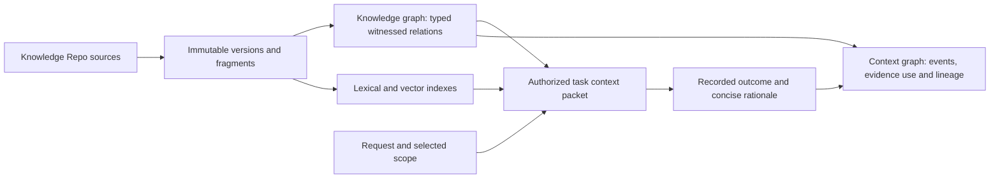

# Knowledge and context graphs: research and implementation direction

Reviewed 2026-11-01 against the HelloTest checkout and primary references.

## Model

A graph supplies nodes and relationships. A knowledge graph adds domain meaning,
identities and an ontology. A context graph connects knowledge relevant to a task
with retained interactions and recorded decisions. These are useful product
distinctions, not mutually exclusive data structures. Knowledge graphs can already
contain events and time; IBM describes context graphs as knowledge graphs for
structured inference context. [IBM context graph](https://www.ibm.com/think/topics/context-graph),
[IBM knowledge graph](https://www.ibm.com/think/topics/knowledge-graph).

Neo4j's agent-memory architecture connects knowledge, conversation history and
decision traces. For HelloTest this supports a shared identity model with distinct
views. It does not require replacing storage or granting old decisions authority
over new actions. [Neo4j agent memory](https://neo4j.com/blog/agentic-ai/context-graph-ai-agent-memory/).

## Existing implementation

The graph is already a source-level semantic knowledge graph: PostgreSQL nodes,
typed relationships, immutable evidence witnesses and projection state. Each node
maps to a canonical Knowledge source. Nine source kinds include Stories, Test
Cases, Runs, Defects and ingested documents. Eight relation types include `TESTS`,
`EXECUTED_IN`, `HAS_DEFECT`, `DEPENDS_ON`, `RELATED_TO`, `DERIVED_FROM`, `USES`
and `PART_OF`.

Publication projects native links with document/chunk/version witnesses. Traversal
filters visibility before fanout, checks current native records and reauthorizes
evidence after walking the graph. Aliases do not merge records, and unreviewed
extraction candidates cannot become active facts. The original **Context Graph**
label does not by itself imply persistent task/decision memory.

The shared context engine combines live evidence, lexical/vector retrieval and
bounded graph paths into `ContextPacket` objects. Chatbot messages retain packets
under their private session/turn identity. A standalone context-engine return is
not persistent memory. This offers a sound foundation for a cross-feature task
ledger.

| Existing contract | Implementation implication |
| --- | --- |
| Source → immutable document → chunk | Preserve exact evidence identity; do not create duplicate identity for the same source. |
| Structural links and candidate states | Separate native facts, supported semantic links and hypotheses. |
| Current active traversal | An as-of control requires a real version-bound historical query. |
| Private retained assistant packet | A task graph can show the actual retained evidence for that turn. |
| Fresh read/history authorization | Graph memory inherits the same source and principal restrictions. |
| Bounded node/edge/evidence budgets | Counts represent the loaded permitted subgraph, with omissions disclosed. |

Entry points:
[graphSchema.js](../../services/knowledge/backend/graphSchema.js),
[knowledgeGraph.service.js](../../services/knowledge/backend/services/knowledgeGraph.service.js),
[knowledgeGraphProjection.service.js](../../services/knowledge/backend/services/knowledgeGraphProjection.service.js),
[knowledgeContextEngine.service.js](../../services/knowledge/backend/services/knowledgeContextEngine.service.js)
and [KnowledgeGraphPanel.tsx](../../services/knowledge/frontend/components/KnowledgeGraphPanel.tsx).

## Layering

This is an architectural relationship, not evidence that every source, policy or
agent event has been instrumented. Knowledge mode explores what relationships
mean. Context mode inspects which retained evidence and recorded events supported
a specific task, what happened and when. Both anchor to the same domain identities.

## Decision and temporal evidence

Task records should retain the verified principal/project, task or turn identity,
packet identity, selected evidence/version IDs, actual tool outcomes, policy results
actually emitted and concise rationale explicitly supplied in a retained outcome.
Neo4j Labs shows how observed discussion/action records connect to source
documents. A resolved comment or model narrative alone does not prove approval
or execution. [Neo4j Labs decision traces](https://github.com/neo4j-labs/create-context-graph/blob/main/docs/docs/explanation/how-decision-traces-work.md).

Use concise recorded outcome explanations, citations and activity receipts; do
not capture hidden chain of thought. Failed/unavailable stages retain that outcome.
Missing events must not be filled with plausible history.

Evidence, activity and actors are distinct concepts. A task consumes a particular
source version. Revision/invalidation describes lifecycle; a traversal path alone
does not establish causality. [W3C PROV-DM](https://www.w3.org/TR/prov-dm/).

Distinguish occurrence time, recording time and assertion validity. A new
observation may describe an old document, and a current document may become
effective in the future. Time filtering must state which clock it uses.
[W3C Time Ontology](https://www.w3.org/TR/owl-time/).

## Retrieval and visualization

Retain PostgreSQL's evidence ledger and existing lexical/vector infrastructure.
GraphRAG adds witnessed traversal. A different graph engine would not alone
improve contextual accuracy.

Both modes need focused selection, search, expansion, typed directed edges, a
legend and a readable inspector. Knowledge mode exposes provenance, witnesses,
versions and review state. Context mode exposes task/event time, evidence use and
recorded outcomes. Current, historical, stale, unknown and partial labels must
come from actual response metadata. Candidate suggestions remain separate from
facts; confidence must identify its actual method rather than invent percentages.

Provide keyboard selection and an accessible text/list view. Filtering must not
visually assert an edge whose endpoints are missing. Loaded-subgraph counts must
not claim exhaustive coverage. No returned path means no permitted path was
found within this query's bounds.

## Verification

Test exact witnesses, archive/version changes, principal/project isolation,
revoked sources, private middle nodes, unreviewed candidates, duplicate event
identities and stale historical evidence. Trace capture follows persisted events,
not client-selected identity or log wording. Partial or failed capture stays explicit.

Use disposable PostgreSQL integration for real graph queries. Browser fixtures
should verify mode selection, focus/expansion, edge meaning, source/event inspection,
empty/error/partial states and desktop/mobile legibility. Distinguish real service
checks from model/API fixtures; these do not establish provider reasoning accuracy
or exhaustive production coverage.
